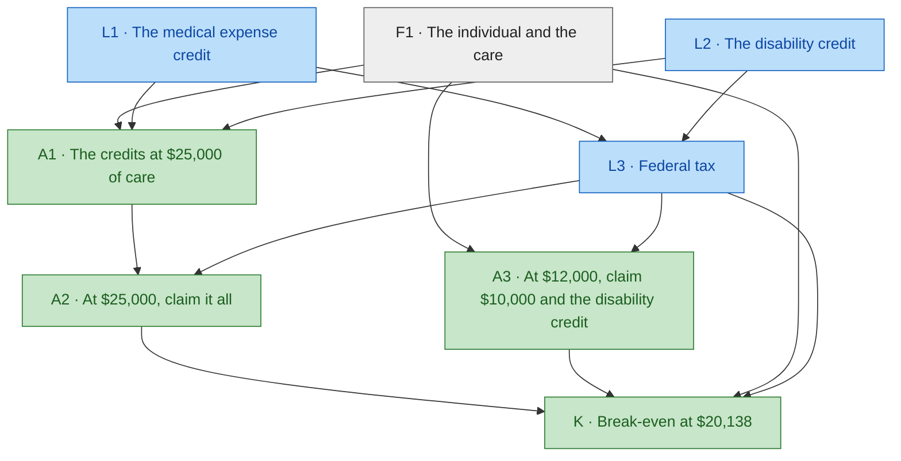
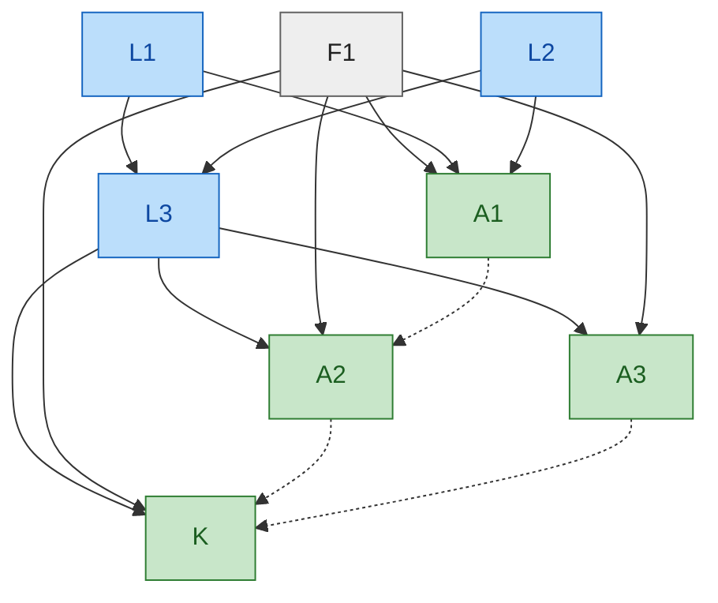

# Memo: attendant care, as a medical expense or with the disability credit

> Generated from the Lean sources by `scripts/blueprint.sh`. Do not edit by hand.

**Issue.** An individual eligible for the disability credit earns $60,000 in 2025 and pays for full-time attendant care. Should they claim all of it as a medical expense, losing the disability credit, or $10,000 of it with the disability credit?

**Conclusion.** It depends on the cost, and the break-even is $20,138: $10,000 plus the $10,138 disability amount (K). At $25,000 of care, claiming it all saves $680.68 (A2); at $12,000, claiming $10,000 with the disability credit saves $1,139.32 (A3). Both options take the same 3% of income off the medical expenses, so the break-even does not depend on income while the credits can be used. Provincial tax is not computed.

This is a constructed example, not advice.

**Status of the 8 statements:** 4 proven, 3 encoded, 1 fact.

## Dependency graph



Green: proven in Lean. Blue: encoded (definitions). Grey: facts. Orange: judgment calls. Dashed red: not yet formalized. An arrow points from a statement to the statements that use it.

### What the Lean proofs use

The same statements, with the dependencies Lean finds in the proofs themselves (solid) and those stated only in the memo's reasoning (dotted). Every dependency a proof has is also stated in the memo: `Blueprint.check` refuses a memo that hides one.



## The law

### L1. The medical expense credit

**Status:** encoded · **Citation:** ITA 118.2(1), (2)(b), (b.1)

14% of medical expenses over the lesser of $2,834 and 3% of income. Full-time attendant care is a medical expense under (b); up to $10,000 of attendant care can be claimed under (b.1) instead.

**Lean:** [`Canteen.ITA.MedicalExpenses.credit`](../../Canteen/ITA/S118_2/MedicalExpenses.lean#L83), [`Canteen.ITA.IndividualYear.medicalCredit`](../../Canteen/ITA/S3/IndividualYear.lean#L260)

### L2. The disability credit

**Status:** encoded · **Citation:** ITA 118.3(1)

14% of $10,138, unless attendant care for the individual is claimed as a medical expense other than under 118.2(2)(b.1).

**Lean:** [`Canteen.ITA.Disability.eligible`](../../Canteen/ITA/S118_3/Disability.lean#L59), [`Canteen.ITA.Disability.credit`](../../Canteen/ITA/S118_3/Disability.lean#L83), [`Canteen.ITA.IndividualYear.disabilityCredit`](../../Canteen/ITA/S3/IndividualYear.lean#L277)

### L3. Federal tax

**Status:** encoded · **Citation:** ITA 117(2); 118(1) · **Uses:** L1, L2

Tax at the 117(2) rates, less the personal, medical and disability credits.

**Lean:** [`Canteen.ITA.IndividualYear.federalTax`](../../Canteen/ITA/S3/IndividualYear.lean#L311)

## Facts

### F1. The individual and the care

**Status:** fact

A certified, severe and prolonged impairment; $60,000 of income in 2025; full-time attendant care.

**Lean:** [`Canteen.Transactions.AttendantCare.impairment`](../../Canteen/Transactions/AttendantCare.lean#L21), [`Canteen.Transactions.AttendantCare.attendant`](../../Canteen/Transactions/AttendantCare.lean#L23), [`Canteen.Transactions.AttendantCare.optionA`](../../Canteen/Transactions/AttendantCare.lean#L25), [`Canteen.Transactions.AttendantCare.optionB`](../../Canteen/Transactions/AttendantCare.lean#L30)

## Analysis

### A1. The credits at $25,000 of care

**Status:** proven · **Citation:** ITA 118.2(1); 118.3(1) · **Uses:** F1, L1, L2

All of it: a $3,248 medical credit and no disability credit. $10,000 of it: a $1,148 medical credit and a $1,419.32 disability credit.

**Lean:** [`Canteen.Transactions.AttendantCare.credits_25000`](../../Canteen/Transactions/AttendantCare.lean#L37)

**Rests on:** facts F1.

### A2. At $25,000, claim it all

**Status:** proven · **Citation:** ITA 118.2(2)(b) · **Uses:** A1, L3

$680.68 less federal tax.

**Lean:** [`Canteen.Transactions.AttendantCare.a_better_at_25000`](../../Canteen/Transactions/AttendantCare.lean#L43)

**Rests on:** facts F1.

### A3. At $12,000, claim $10,000 and the disability credit

**Status:** proven · **Citation:** ITA 118.2(2)(b.1) · **Uses:** F1, L3

$1,139.32 less federal tax.

**Lean:** [`Canteen.Transactions.AttendantCare.b_better_at_12000`](../../Canteen/Transactions/AttendantCare.lean#L46)

**Rests on:** facts F1.

## Conclusion

### K. Break-even at $20,138

**Status:** proven · **Uses:** A2, A3, F1, L3

At $20,138 of care the two are equal; above it, claim it all; below it, claim $10,000 and the disability credit.

**Lean:** [`Canteen.Transactions.AttendantCare.break_even`](../../Canteen/Transactions/AttendantCare.lean#L49), [`Canteen.Transactions.AttendantCare.either_side`](../../Canteen/Transactions/AttendantCare.lean#L54)

**Rests on:** facts F1.

## Appendix: the argument as Lean renders it

### The disability credit

```
1. The individual has a severe and prolonged impairment that markedly restricts a basic activity of daily living. [ITA 118.3(1)(a), (a.1)]
2. A medical practitioner has certified it in prescribed form. [ITA 118.3(1)(a.2), (a.3)]
3. The certificate has been filed with the Minister. [ITA 118.3(1)(b)]
4. No attendant or nursing home care for the individual is claimed as a medical expense. [ITA 118.3(1)(c)]
5. Therefore subsection 118.3(1) applies. [ITA 118.3(1)]
6. The amount is $10,138.00; the credit is 14% of it: $1,419.32. [ITA 118.3(1)]
Relies on no judgment calls.
```

### Option A, at $25,000

```
1. Employment and business income $60,000.00; dividends included $0.00 (with the gross-up); recapture $0.00; income attributed $0.00. [ITA 3(a); 82(1); 13(1); 74.1]
2. Taxable capital gains, net: $0.00. [ITA 3(b)]
3. Losses: business $0.00, terminal $0.00, attributed $0.00; interest deducted $0.00. [ITA 3(d); 20(16); 74.1; 20(1)(c)]
4. Income for the year: $60,000.00. [ITA 3]
5. Less the net capital loss deduction $0.00, the capital gains deduction $0.00, and other deductions $0.00: taxable income $60,000.00. [ITA 2(2); 111(1)(b); 110.6(2), (2.1)]
6. Tax under 117(2) on taxable income, $8,570.62, less the dividend tax credit of $0.00, the personal credit of $2,258.06, the age and pension credits of $0.00, the employment, CPP and EI credits of $0.00, the adoption, accessibility, home buyers' and volunteer credits of $0.00, the tuition credits of $0.00, the donation credit of $0.00, the medical expense credit of $3,248.00, the disability credit of $0.00 and other credits of $0.00: $3,064.56. [ITA 117(2); 120.4(2); 121; 118 to 118.07; 118.1; 118.2; 118.3; 118.5; 118.61; 118.7; 118.9]
Relies on no judgment calls.
```

### Option B, at $25,000

```
1. Employment and business income $60,000.00; dividends included $0.00 (with the gross-up); recapture $0.00; income attributed $0.00. [ITA 3(a); 82(1); 13(1); 74.1]
2. Taxable capital gains, net: $0.00. [ITA 3(b)]
3. Losses: business $0.00, terminal $0.00, attributed $0.00; interest deducted $0.00. [ITA 3(d); 20(16); 74.1; 20(1)(c)]
4. Income for the year: $60,000.00. [ITA 3]
5. Less the net capital loss deduction $0.00, the capital gains deduction $0.00, and other deductions $0.00: taxable income $60,000.00. [ITA 2(2); 111(1)(b); 110.6(2), (2.1)]
6. Tax under 117(2) on taxable income, $8,570.62, less the dividend tax credit of $0.00, the personal credit of $2,258.06, the age and pension credits of $0.00, the employment, CPP and EI credits of $0.00, the adoption, accessibility, home buyers' and volunteer credits of $0.00, the tuition credits of $0.00, the donation credit of $0.00, the medical expense credit of $1,148.00, the disability credit of $1,419.32 and other credits of $0.00: $3,745.24. [ITA 117(2); 120.4(2); 121; 118 to 118.07; 118.1; 118.2; 118.3; 118.5; 118.61; 118.7; 118.9]
Relies on no judgment calls.
```

