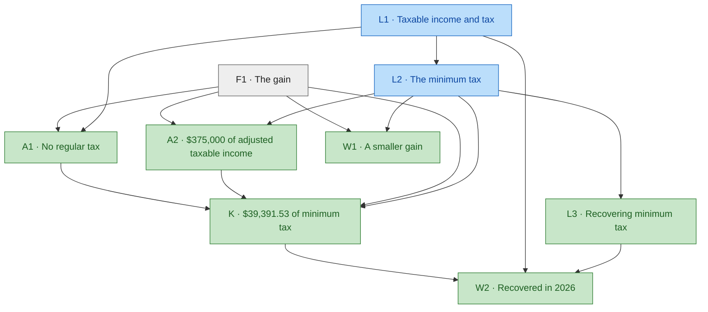
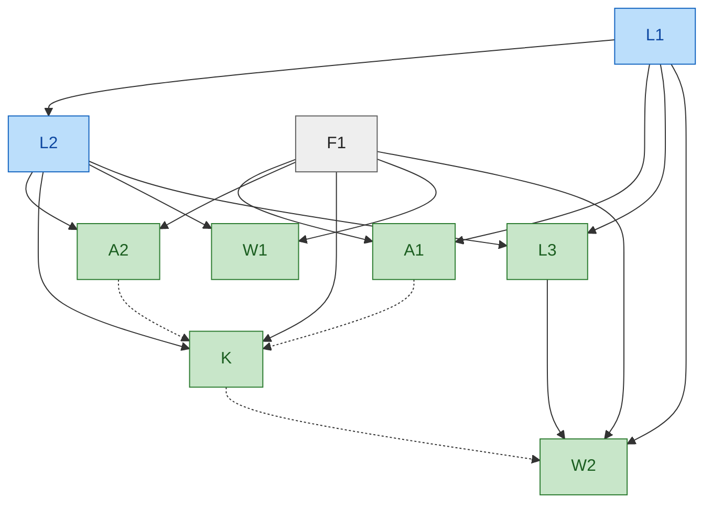

# Memo: the minimum tax on crystallizing the capital gains exemption

> Generated from the Lean sources by `scripts/blueprint.sh`. Do not edit by hand.

**Issue.** An individual with no other income in 2025 realizes a $1,250,000 gain on qualified small business corporation shares and shelters all of it with the capital gains deduction. Is any federal tax payable?

**Conclusion.** No regular tax (A1), but $39,391.53 of minimum tax (K): for the minimum tax the gain counts in full and only 7/5 of the deduction comes off, leaving $375,000 of adjusted taxable income (A2). A gain of $600,000 stays within the exemption; $620,000 does not (W1). The minimum tax is not lost: with a $250,000 salary in 2026, all of it is recovered against that year's regular tax (W2). Provincial tax is not computed.

This is a constructed example, not advice.

**Status of the 9 statements:** 6 proven, 2 encoded, 1 fact.

## Dependency graph



Green: proven in Lean. Blue: encoded (definitions). Grey: facts. Orange: judgment calls. Dashed red: not yet formalized. An arrow points from a statement to the statements that use it.

### What the Lean proofs use

The same statements, with the dependencies Lean finds in the proofs themselves (solid) and those stated only in the memo's reasoning (dotted). Every dependency a proof has is also stated in the memo: `Blueprint.check` refuses a memo that hides one.



## The law

### L1. Taxable income and tax

**Status:** encoded · **Citation:** ITA 2(2); 3; 38; 110.6(2.1); 117(2); 118(1)

Half the gain is a taxable capital gain, which the capital gains deduction shelters; tax at the 117(2) rates, less the personal credit.

**Lean:** [`Canteen.ITA.IndividualYear.taxableIncome`](../../Canteen/ITA/S3/IndividualYear.lean#L240), [`Canteen.ITA.IndividualYear.federalTax`](../../Canteen/ITA/S3/IndividualYear.lean#L311)

### L2. The minimum tax

**Status:** encoded · **Citation:** ITA 127.5; 127.51; 127.52(1); 127.531 · **Uses:** L1

Tax payable is at least 20.5% of adjusted taxable income over $177,882, less the basic minimum tax credit (half the personal credit). Adjusted taxable income counts capital gains in full and allows 7/5 of the capital gains deduction.

**Lean:** [`Canteen.ITA.MinimumTax.adjustedTaxableIncome`](../../Canteen/ITA/S127_5/MinimumTax.lean#L61), [`Canteen.ITA.MinimumTax.minimumAmount`](../../Canteen/ITA/S127_5/MinimumTax.lean#L73), [`Canteen.ITA.MinimumTax.taxPayable`](../../Canteen/ITA/S127_5/MinimumTax.lean#L77)

## Facts

### F1. The gain

**Status:** fact

Qualified small business corporation shares with a $100 cost, sold in 2025 at a gain; the deduction claimed for all of it; no other income.

**Lean:** [`Canteen.Transactions.CrystallizationMinimumTax.shares`](../../Canteen/Transactions/CrystallizationMinimumTax.lean#L22), [`Canteen.Transactions.CrystallizationMinimumTax.year`](../../Canteen/Transactions/CrystallizationMinimumTax.lean#L25)

## Analysis

### A1. No regular tax

**Status:** proven · **Citation:** ITA 110.6(2.1) · **Uses:** F1, L1

The $625,000 taxable gain is fully deducted: taxable income is nil.

**Lean:** [`Canteen.Transactions.CrystallizationMinimumTax.no_regular_tax`](../../Canteen/Transactions/CrystallizationMinimumTax.lean#L32)

**Rests on:** facts F1.

### A2. $375,000 of adjusted taxable income

**Status:** proven · **Citation:** ITA 127.52(1)(d), (h)(ii) · **Uses:** F1, L2

The $1,250,000 gain in full, less 7/5 of the $625,000 deduction.

**Lean:** [`Canteen.Transactions.CrystallizationMinimumTax.adjusted`](../../Canteen/Transactions/CrystallizationMinimumTax.lean#L37)

**Rests on:** facts F1.

## Conclusion

### K. $39,391.53 of minimum tax

**Status:** proven · **Uses:** A1, A2, F1, L2

20.5% of the $197,118 over the exemption is $40,409.19; less half the $2,035.32 personal credit.

**Lean:** [`Canteen.Transactions.CrystallizationMinimumTax.minimum_tax`](../../Canteen/Transactions/CrystallizationMinimumTax.lean#L40)

**Rests on:** facts F1.

## What if

### W1. A smaller gain

**Status:** proven · **Citation:** ITA 127.51 · **Uses:** F1, L2

A $600,000 gain gives $180,000 of adjusted taxable income, within what the exemption and credit cover: no tax. A $620,000 gain gives $646.53.

**Lean:** [`Canteen.Transactions.CrystallizationMinimumTax.smaller_gain`](../../Canteen/Transactions/CrystallizationMinimumTax.lean#L43), [`Canteen.Transactions.CrystallizationMinimumTax.slightly_larger`](../../Canteen/Transactions/CrystallizationMinimumTax.lean#L48)

**Rests on:** facts F1.

### L3. Recovering minimum tax

**Status:** proven · **Citation:** ITA 120.2(1), (3) · **Uses:** L2

Minimum tax over regular tax is carried forward seven years, and deducted from a later year's tax to the extent that year's regular tax exceeds its minimum amount. Proven: never below the minimum amount.

**Lean:** [`Canteen.ITA.MinimumTax.additional`](../../Canteen/ITA/S127_5/MinimumTax.lean#L80), [`Canteen.ITA.MinimumTax.recovery`](../../Canteen/ITA/S127_5/MinimumTax.lean#L93), [`Canteen.ITA.MinimumTax.taxAfterRecovery`](../../Canteen/ITA/S127_5/MinimumTax.lean#L97), [`Canteen.ITA.MinimumTax.recovery_floor`](../../Canteen/ITA/S127_5/MinimumTax.lean#L132)

### W2. Recovered in 2026

**Status:** proven · **Citation:** ITA 120.2(1) · **Uses:** K, L1, L3

With a $250,000 salary, 2026 regular tax of $54,714.26 (at 2026 amounts) exceeds its minimum amount by more than $39,391.53, so all of it is deducted. With $200,000, $37,386.26 is, and $2,005.27 waits.

**Lean:** [`Canteen.Transactions.CrystallizationMinimumTax.nextYear`](../../Canteen/Transactions/CrystallizationMinimumTax.lean#L53), [`Canteen.Transactions.CrystallizationMinimumTax.carried`](../../Canteen/Transactions/CrystallizationMinimumTax.lean#L57), [`Canteen.Transactions.CrystallizationMinimumTax.carried_forward`](../../Canteen/Transactions/CrystallizationMinimumTax.lean#L59), [`Canteen.Transactions.CrystallizationMinimumTax.recovered`](../../Canteen/Transactions/CrystallizationMinimumTax.lean#L62), [`Canteen.Transactions.CrystallizationMinimumTax.partly_recovered`](../../Canteen/Transactions/CrystallizationMinimumTax.lean#L68)

**Rests on:** facts F1.

## Appendix: the argument as Lean renders it

### The minimum tax, on $1,250,000

```
1. Adjusted taxable income, with capital gains at 1/1 (3/10 on gifts of listed securities), dividends without the gross-up and 7/5 of the capital gains deduction: $375,000.00. [ITA 127.52(1)(d), (d.1), (f), (h), (i)]
2. 20.5% of the amount over $177,882.00, less the basic minimum tax credit of $1,017.66: a minimum amount of $39,391.53. [ITA 127.51; 127.531]
3. Tax under Division E is $0.00; tax payable is $39,391.53. [ITA 127.5]
Relies on no judgment calls.
```

### The year

```
1. Employment and business income $0.00; dividends included $0.00 (with the gross-up); recapture $0.00; income attributed $0.00. [ITA 3(a); 82(1); 13(1); 74.1]
2. Taxable capital gains, net: $625,000.00. [ITA 3(b)]
3. Losses: business $0.00, terminal $0.00, attributed $0.00; interest deducted $0.00. [ITA 3(d); 20(16); 74.1; 20(1)(c)]
4. Income for the year: $625,000.00. [ITA 3]
5. Less the net capital loss deduction $0.00, the capital gains deduction $625,000.00, and other deductions $0.00: taxable income $0.00. [ITA 2(2); 111(1)(b); 110.6(2), (2.1)]
6. Tax under 117(2) on taxable income, $0.00, less the dividend tax credit of $0.00, the personal credit of $2,035.32, the age and pension credits of $0.00, the employment, CPP and EI credits of $0.00, the adoption, accessibility, home buyers' and volunteer credits of $0.00, the tuition credits of $0.00, the donation credit of $0.00, the medical expense credit of $0.00, the disability credit of $0.00 and other credits of $0.00: $0.00. [ITA 117(2); 120.4(2); 121; 118 to 118.07; 118.1; 118.2; 118.3; 118.5; 118.61; 118.7; 118.9]
Relies on no judgment calls.
```

