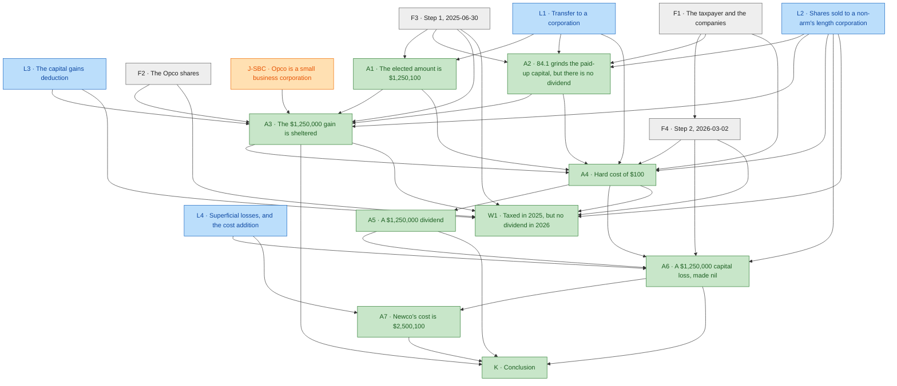
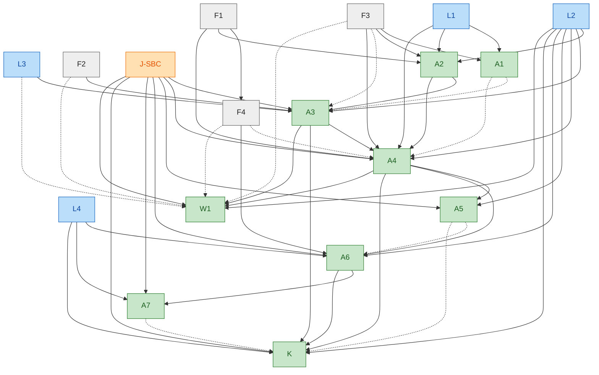
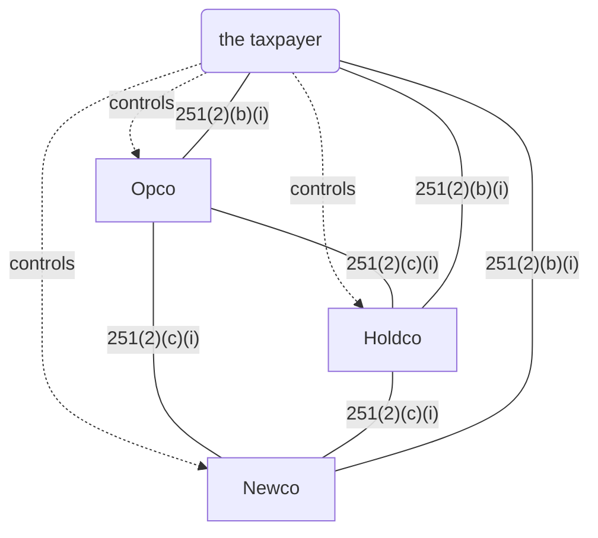
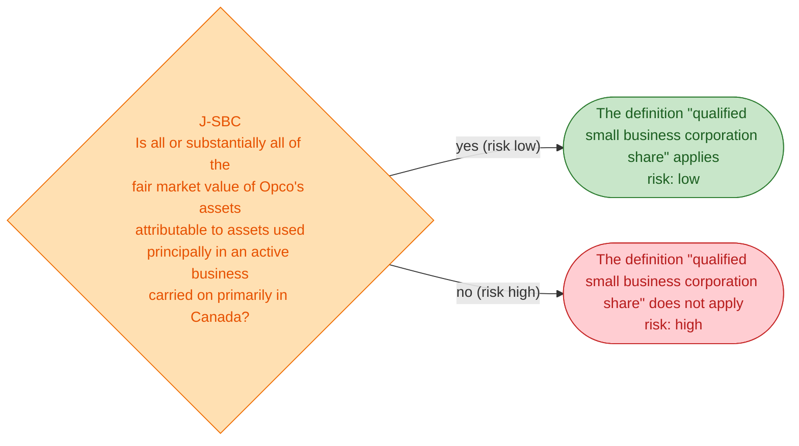

# Memo: crystallizing the capital gains exemption, then stripping the cost

> Generated from the Lean sources by `scripts/blueprint.sh`. Do not edit by hand.

**Issue.** The taxpayer transferred Opco shares worth $2,000,000 (cost $100) to Holdco under 85(1), electing $1,250,100 to use the capital gains deduction. Eight months later the taxpayer sold the Holdco preferred shares, now costing $1,250,100, to Newco for a $1,250,100 note. Is the note a tax-free return of the crystallized cost?

**Conclusion.** No. The 2025 gain of $1,250,000 is sheltered by the capital gains deduction, on the low-risk position that Opco is a small business corporation (A3). But on the 2026 sale, section 84.1 takes the sheltered gain off the cost (84.1(2)(a.1)(ii)), so $1,250,000 of the note is a deemed dividend (A5). The dividend is not proceeds, so the sale shows a $1,250,000 capital loss; Newco is affiliated with the taxpayer, so it is a superficial loss, nil, and moves to Newco's cost (A6, A7).

**If Opco is not a small business corporation**, the 2025 gain is fully taxed, but the note then comes out without a dividend (W1).

This is a constructed example, not advice on a real transaction.

**Status of the 18 statements:** 9 proven, 4 encoded, 4 fact, 1 judgment call.

## Dependency graph



Green: proven in Lean. Blue: encoded (definitions). Grey: facts. Orange: judgment calls. Dashed red: not yet formalized. An arrow points from a statement to the statements that use it.

### What the Lean proofs use

The same statements, with the dependencies Lean finds in the proofs themselves (solid) and those stated only in the memo's reasoning (dotted). Every dependency a proof has is also stated in the memo: `Blueprint.check` refuses a memo that hides one.



### Who is related to whom



### Decision tree: J-SBC



## The law

### L1. Transfer to a corporation

**Status:** encoded · **Citation:** ITA 85(1)

The elected amount is the transferor's proceeds and the corporation's cost; the preferred shares take the elected amount less any boot as their cost.

**Lean:** [`Canteen.ITA.TransferToCorporation.rollover`](../../Canteen/ITA/S85/TransferToCorporation.lean#L132), [`Canteen.ITA.TransferToCorporation.electedAmount`](../../Canteen/ITA/S85/TransferToCorporation.lean#L176), [`Canteen.ITA.TransferToCorporation.preferredCost`](../../Canteen/ITA/S85/TransferToCorporation.lean#L188)

### L2. Shares sold to a non-arm's length corporation

**Status:** encoded · **Citation:** ITA 84.1

Paid-up capital is ground down, and what comes out above the greater of paid-up capital and hard cost is a dividend, not proceeds.

**Lean:** [`Canteen.ITA.SurplusStripping.applies`](../../Canteen/ITA/S84_1/SurplusStripping.lean#L102), [`Canteen.ITA.SurplusStripping.dividend`](../../Canteen/ITA/S84_1/SurplusStripping.lean#L142), [`Canteen.ITA.SurplusStripping.proceeds`](../../Canteen/ITA/S84_1/SurplusStripping.lean#L145), [`Canteen.ITA.SurplusStripping.paidUpCapital`](../../Canteen/ITA/S84_1/SurplusStripping.lean#L139)

### L3. The capital gains deduction

**Status:** encoded · **Citation:** ITA 110.6(1), (2.1)

Gains on qualified small business corporation shares may be deducted, up to the lifetime limit.

**Lean:** [`Canteen.ITA.CapitalGainsDeduction.qualifiedShare`](../../Canteen/ITA/S110_6/CapitalGainsDeduction.lean#L84), [`Canteen.ITA.CapitalGainsDeduction.deduction`](../../Canteen/ITA/S110_6/CapitalGainsDeduction.lean#L153)

### L4. Superficial losses, and the cost addition

**Status:** encoded · **Citation:** ITA 54; 40(2)(g)(i); 53(1)(f)

A loss on shares an affiliated person holds at the end of the period is nil, and is added to that person's cost.

**Lean:** [`Canteen.ITA.Paragraph40_2_g.paragraph`](../../Canteen/ITA/S40/Paragraph40_2_g.lean#L32), [`Canteen.ITA.Paragraph40_2_g.deniedLoss`](../../Canteen/ITA/S40/Paragraph40_2_g.lean#L41), [`Canteen.ITA.CostAddition.adjustedCostBase`](../../Canteen/ITA/S53/CostAddition.lean#L53)

## Facts

### F1. The taxpayer and the companies

**Status:** fact

The taxpayer controls Opco, Holdco and Newco.

**Lean:** [`Canteen.Transactions.Crystallization.world`](../../Canteen/Transactions/Crystallization.lean#L38)

### F2. The Opco shares

**Status:** fact

Paid-up capital and cost $100, worth $2,000,000, held by the taxpayer alone for over two years; 85% and 90% of Opco's assets' value in active business assets over the two years.

**Lean:** [`Canteen.Transactions.Crystallization.opcoShares`](../../Canteen/Transactions/Crystallization.lean#L51)

### F3. Step 1, 2025-06-30

**Status:** fact

The Opco shares are transferred to Holdco for preferred shares worth $2,000,000 with $1,250,100 of stated capital, jointly electing $1,250,100.

**Lean:** [`Canteen.Transactions.Crystallization.transfer`](../../Canteen/Transactions/Crystallization.lean#L61), [`Canteen.Transactions.Crystallization.holdcoPreferred`](../../Canteen/Transactions/Crystallization.lean#L58)

### F4. Step 2, 2026-03-02

**Status:** fact · **Uses:** F1

The taxpayer sells the Holdco preferred shares to Newco for a $1,250,100 note; Newco keeps them.

**Lean:** [`Canteen.Transactions.Crystallization.newcoPurchase`](../../Canteen/Transactions/Crystallization.lean#L100)

**Rests on:** facts F1.

## Judgment call

### J-SBC. Opco is a small business corporation

**Status:** judgment call

All or substantially all of the value of Opco's assets is in assets used principally in an active business carried on primarily in Canada. Risk: low.

**Lean:** [`Canteen.Transactions.Crystallization.calls`](../../Canteen/Transactions/Crystallization.lean#L45), [`Canteen.Transactions.Crystallization.position`](../../Canteen/Transactions/Crystallization.lean#L49)

## Analysis

### A1. The elected amount is $1,250,100

**Status:** proven · **Citation:** ITA 85(1)(a), (g) · **Uses:** F3, L1

85(1) applies; the elected amount is between the floor and fair market value, so it stands, and the preferred shares cost $1,250,100.

**Lean:** [`Canteen.Transactions.Crystallization.step1_elected`](../../Canteen/Transactions/Crystallization.lean#L120)

**Rests on:** facts F3.

### A2. 84.1 grinds the paid-up capital, but there is no dividend

**Status:** proven · **Citation:** ITA 84.1(1) · **Uses:** F1, F3, L1, L2

The taxpayer and Holdco are related, so 84.1 applies. With no boot, there is no dividend; the preferred shares' paid-up capital is ground from $1,250,100 to $100.

**Lean:** [`Canteen.Transactions.Crystallization.step1`](../../Canteen/Transactions/Crystallization.lean#L66), [`Canteen.Transactions.Crystallization.step1_paid_up_capital`](../../Canteen/Transactions/Crystallization.lean#L125)

**Rests on:** facts F1, F3.

### A3. The $1,250,000 gain is sheltered

**Status:** proven · **Citation:** ITA 110.6(2.1) · **Uses:** F2, F3, J-SBC, L2, L3, A1, A2

The Opco shares are qualified small business corporation shares, so the $625,000 taxable capital gain is deducted in full.

**Lean:** [`Canteen.Transactions.Crystallization.disposition1`](../../Canteen/Transactions/Crystallization.lean#L71), [`Canteen.Transactions.Crystallization.deduction`](../../Canteen/Transactions/Crystallization.lean#L74), [`Canteen.Transactions.Crystallization.shelteredGain`](../../Canteen/Transactions/Crystallization.lean#L80), [`Canteen.Transactions.Crystallization.opco_qualified`](../../Canteen/Transactions/Crystallization.lean#L114), [`Canteen.Transactions.Crystallization.step1_gain`](../../Canteen/Transactions/Crystallization.lean#L131), [`Canteen.Transactions.Crystallization.step1_sheltered`](../../Canteen/Transactions/Crystallization.lean#L134)

**Rests on:** judgment calls J-SBC; facts F2, F3, F1.

### A4. Hard cost of $100

**Status:** proven · **Citation:** ITA 84.1(2)(a.1)(ii) · **Uses:** A1, A2, A3, F1, F4, L1, L2

The preferred shares were acquired from Holdco, not at arm's length, in substitution for the Opco shares, so their $1,250,100 cost is reduced by the $1,250,000 gain sheltered on the Opco shares.

**Lean:** [`Canteen.Transactions.Crystallization.step2`](../../Canteen/Transactions/Crystallization.lean#L84), [`Canteen.Transactions.Crystallization.step2_dividend`](../../Canteen/Transactions/Crystallization.lean#L139)

**Rests on:** judgment calls J-SBC; facts F3, F1, F2, F4.

### A5. A $1,250,000 dividend

**Status:** proven · **Citation:** ITA 84.1(1)(b) · **Uses:** A4

The note exceeds the greater of the $100 paid-up capital and the $100 hard cost by $1,250,000, a deemed dividend.

**Lean:** [`Canteen.Transactions.Crystallization.step2_dividend`](../../Canteen/Transactions/Crystallization.lean#L139)

**Rests on:** judgment calls J-SBC; facts F3, F1, F2, F4.

### A6. A $1,250,000 capital loss, made nil

**Status:** proven · **Citation:** ITA 54 "proceeds of disposition" (k); 40(2)(g)(i) · **Uses:** A4, A5, F4, L2, L4

The dividend is not proceeds, so the taxpayer's proceeds are $100 against a $1,250,100 cost. Newco, which the taxpayer controls, is affiliated with the taxpayer and holds the very shares, so the loss is a superficial loss, nil.

**Lean:** [`Canteen.Transactions.Crystallization.sale2`](../../Canteen/Transactions/Crystallization.lean#L95), [`Canteen.Transactions.Crystallization.slFacts`](../../Canteen/Transactions/Crystallization.lean#L105), [`Canteen.Transactions.Crystallization.step2_loss`](../../Canteen/Transactions/Crystallization.lean#L145), [`Canteen.Transactions.Crystallization.step2_loss_nil`](../../Canteen/Transactions/Crystallization.lean#L149)

**Rests on:** judgment calls J-SBC; facts F3, F1, F2, F4.

### A7. Newco's cost is $2,500,100

**Status:** proven · **Citation:** ITA 53(1)(f) · **Uses:** A6, L4

The denied $1,250,000 is added to Newco's $1,250,100 cost of the preferred shares.

**Lean:** [`Canteen.Transactions.Crystallization.newcoCostFacts`](../../Canteen/Transactions/Crystallization.lean#L108), [`Canteen.Transactions.Crystallization.newco_cost`](../../Canteen/Transactions/Crystallization.lean#L155)

**Rests on:** judgment calls J-SBC; facts F3, F1, F2, F4.

## Conclusion

### K. Conclusion

**Status:** proven · **Uses:** A3, A5, A6, A7

The crystallization works: the 2025 gain is sheltered. The strip does not: $1,250,000 of the note is a dividend in 2026, and the matching capital loss is denied and moves to Newco's cost.

**Lean:** [`Canteen.Transactions.Crystallization.step1_sheltered`](../../Canteen/Transactions/Crystallization.lean#L134), [`Canteen.Transactions.Crystallization.step2_dividend`](../../Canteen/Transactions/Crystallization.lean#L139), [`Canteen.Transactions.Crystallization.step2_loss_nil`](../../Canteen/Transactions/Crystallization.lean#L149)

**Rests on:** judgment calls J-SBC; facts F2, F3, F1, F4.

## If Opco is not a small business corporation

### W1. Taxed in 2025, but no dividend in 2026

**Status:** proven · **Citation:** ITA 110.6(2.1); 84.1(2)(a.1) · **Uses:** A3, A4, F2, F3, F4, L2, L3

The shares would not qualify, so nothing is deducted and the gain is taxed. Nothing then comes off the cost under 84.1(2)(a.1)(ii), and the note is within it: no dividend.

**Lean:** [`Canteen.Transactions.Crystallization.not_sbc_no_deduction`](../../Canteen/Transactions/Crystallization.lean#L160), [`Canteen.Transactions.Crystallization.not_sbc_no_dividend`](../../Canteen/Transactions/Crystallization.lean#L163)

**Rests on:** judgment calls J-SBC; facts F2, F3, F1, F4.

## Appendix: the argument as Lean renders it

### Subsection 85(1), step 1

```
1. The property is eligible property (85(1.1)). [ITA 85(1) eligible property]
2. It was disposed of to a taxable Canadian corporation. [ITA 85(1) taxable Canadian corporation]
3. The consideration includes shares of the capital stock of the corporation. [ITA 85(1) shares]
4. The taxpayer and the corporation jointly elected in prescribed form and in time (85(6)). [ITA 85(1) election]
5. Therefore subsection 85(1) applies. [ITA 85(1)]
6. The elected amount is the amount agreed on, $1,250,100.00. [ITA 85(1)(b), (c), (c.1), (e), (e.3)]
7. So the taxpayer's proceeds, and the corporation's cost, are $1,250,100.00. [ITA 85(1)(a)]
8. The taxpayer's cost of the Holdco preferred shares is $1,250,100.00. [ITA 85(1)(g)]
Relies on no judgment calls.
```

### Section 84.1, step 1

```
1. The taxpayer is resident in Canada and is not a corporation. [ITA 84.1(1) taxpayer]
2. The subject shares are capital property of the taxpayer, of a corporation resident in Canada. [ITA 84.1(1) subject shares]
3. The taxpayer does not deal at arm's length with the purchaser corporation (or is deemed not to by 84.1(2)(b) or (d)). [ITA 84.1(1) not at arm's length]
4. Immediately after, the subject corporation is connected with the purchaser corporation (186(4)). [ITA 84.1(1) connected]
5. Therefore subsection 84.1(1) applies. [ITA 84.1(1)]
6. The greater of the subject shares' paid-up capital ($100.00) and their adjusted cost base as 84.1(2)(a.1) reduces it ($100.00) is $100.00. [ITA 84.1(1)(a) B, (b) E; 84.1(2)(a.1)]
7. The new shares' paid-up capital is reduced by $1,250,000.00, to $100.00. [ITA 84.1(1)(a)]
8. A dividend of $0.00 is deemed paid to the taxpayer. [ITA 84.1(1)(b)]
9. The taxpayer's proceeds of disposition are $1,250,100.00. [ITA 54 "proceeds of disposition" (k)]
Relies on no judgment calls.
```

### The capital gains deduction for 2025, on the position taken

```
1. At the determination time it is a share of a small business corporation owned by the individual, the individual's spouse or common-law partner, or a related partnership. [ITA 110.6(1) "qualified small business corporation share" (a)]
2. Throughout the 24 months before, no one but the individual or a related person or partnership owned it. [ITA 110.6(1) "qualified small business corporation share" (b)]
3. Throughout the part of the 24 months it was so owned, the corporation was a Canadian-controlled private corporation more than 50% of whose assets' value was in active business assets or qualifying connected shares and debt. [ITA 110.6(1) "qualified small business corporation share" (c)]
4. Any share it was substituted for met paragraphs (b) and (c) up to the substitution. [ITA 110.6(1) "qualified small business corporation share" (e)]
5. Therefore the definition "qualified small business corporation share" applies. [ITA 110.6(1) "qualified small business corporation share"]
Relies on these judgment calls:
- J-SBC: Is all or substantially all of the fair market value of Opco's assets attributable to assets used principally in an active business carried on primarily in Canada? Assumed: yes. Risk: low.
Overall risk: low.
```

### Section 84.1, step 2

```
1. The taxpayer is resident in Canada and is not a corporation. [ITA 84.1(1) taxpayer]
2. The subject shares are capital property of the taxpayer, of a corporation resident in Canada. [ITA 84.1(1) subject shares]
3. The taxpayer does not deal at arm's length with the purchaser corporation (or is deemed not to by 84.1(2)(b) or (d)). [ITA 84.1(1) not at arm's length]
4. Immediately after, the subject corporation is connected with the purchaser corporation (186(4)). [ITA 84.1(1) connected]
5. Therefore subsection 84.1(1) applies. [ITA 84.1(1)]
6. The greater of the subject shares' paid-up capital ($100.00) and their adjusted cost base as 84.1(2)(a.1) reduces it ($100.00) is $100.00. [ITA 84.1(1)(a) B, (b) E; 84.1(2)(a.1)]
7. The new shares' paid-up capital is reduced by $0.00, to $0.00. [ITA 84.1(1)(a)]
8. A dividend of $1,250,000.00 is deemed paid to the taxpayer: the $1,250,100.00 of other consideration exceeds $100.00. [ITA 84.1(1)(b)]
9. The taxpayer's proceeds of disposition are $100.00. [ITA 54 "proceeds of disposition" (k)]
Relies on no judgment calls.
```

### Paragraph 40(2)(g), step 2

```
1. The taxpayer disposed of the Holdco preferred shares on 2026-03-02 for proceeds of $100.00. The adjusted cost base plus outlays and expenses was $1,250,100.00, so the taxpayer's loss from the disposition is $1,250,000.00. [ITA 40(1)(b)]
2. On 2026-03-02, within the period from 2026-01-31 to 2026-04-01, Newco, a person affiliated with the taxpayer, acquired the Holdco preferred shares. That property is the particular property. [ITA 54 "superficial loss" (a)]
3. At the end of that period, on 2026-04-01, the taxpayer or a person affiliated with the taxpayer owned or had a right to acquire that property. [ITA 54 "superficial loss" (b)]
4. The disposition is not one described in paragraphs (c) to (h), so the taxpayer's loss of $1,250,000.00 is a superficial loss. [ITA 54 "superficial loss"]
5. Therefore one of subparagraphs 40(2)(g)(i) to (iv) applies. [ITA 40(2)(g)]
6. The property is not excluded property being considered in computing a foreign affiliate's surplus or deficit. [ITA 40(2)(g) opening words]
7. Therefore paragraph 40(2)(g) applies. [ITA 40(2)(g)]
Relies on no judgment calls.
```

