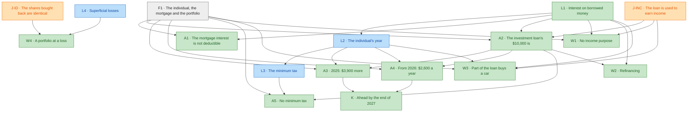
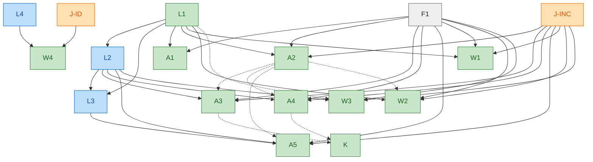
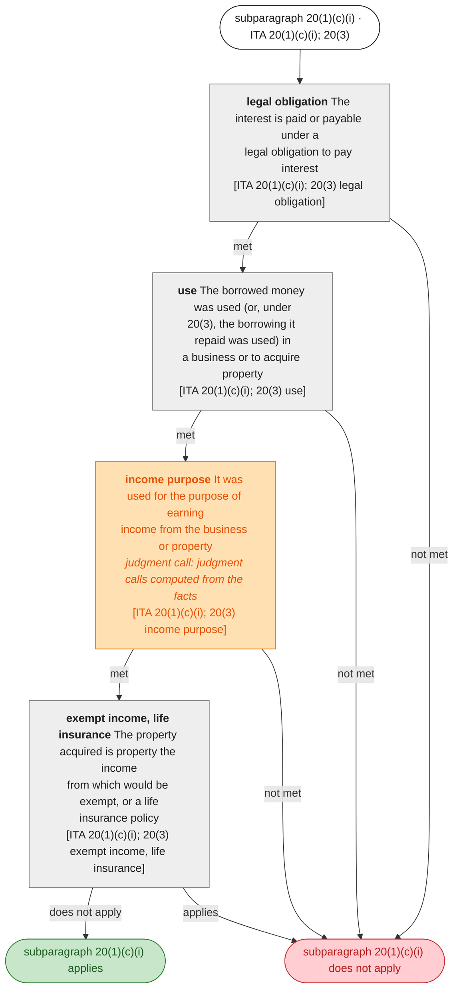

# Memo: a debt swap, making mortgage interest deductible

> Generated from the Lean sources by `scripts/blueprint.sh`. Do not edit by hand.

**Issue.** An individual with a $150,000 salary has a $200,000 mortgage at 5% and a $200,000 share portfolio that cost $150,000. If they sell the portfolio, pay off the mortgage and borrow to buy the portfolio back, is the interest deductible, and is it worth it?

**Conclusion.** Yes, on the position that the new loan is used to earn income from the shares (J-INC): its $10,000 of interest is deductible, where the mortgage's was not (A1, A2). The sale realizes a $50,000 gain, so 2025 costs $3,900 more (A3); from 2026 the swap saves $2,600 a year (A4), and is ahead by the end of 2027 (K). The minimum tax does not apply (A5). Refinancing the loan later keeps the interest deductible (W2); if part of it buys a car, only the part that buys shares counts (W3). Had the portfolio stood at a loss, buying it back at once would make the loss superficial, added to the new cost (W4). Provincial tax is not computed.

This is a constructed example, not advice.

**Status of the 17 statements:** 11 proven, 3 encoded, 1 fact, 2 judgment call.

## Dependency graph



Green: proven in Lean. Blue: encoded (definitions). Grey: facts. Orange: judgment calls. Dashed red: not yet formalized. An arrow points from a statement to the statements that use it.

### What the Lean proofs use

The same statements, with the dependencies Lean finds in the proofs themselves (solid) and those stated only in the memo's reasoning (dotted). Every dependency a proof has is also stated in the memo: `Blueprint.check` refuses a memo that hides one.



### Flowchart: subparagraph 20(1)(c)(i)



## The law

### L1. Interest on borrowed money

**Status:** proven · **Citation:** ITA 20(1)(c)(i); 20(3)

Interest under a legal obligation on money borrowed and used for the purpose of earning income from a business or property is deductible (not for exempt income or life insurance); money borrowed to repay a borrowing takes its use. Proven: never more than the interest, and nil for a personal use.

**Lean:** [`Canteen.ITA.InterestDeductibility.deductible`](../../Canteen/ITA/S20/InterestDeductibility.lean#L61), [`Canteen.ITA.InterestDeductibility.deduction`](../../Canteen/ITA/S20/InterestDeductibility.lean#L84), [`Canteen.ITA.InterestDeductibility.deduction_le`](../../Canteen/ITA/S20/InterestDeductibility.lean#L102), [`Canteen.ITA.InterestDeductibility.personal_nil`](../../Canteen/ITA/S20/InterestDeductibility.lean#L122), [`Canteen.ITA.InterestDeductibility.refinancing_inherits`](../../Canteen/ITA/S20/InterestDeductibility.lean#L114)

### L2. The individual's year

**Status:** encoded · **Citation:** ITA 3; 38; 82(1); 117(2); 118(1); 121 · **Uses:** L1

Income with the gain and dividends, less the interest; tax less the personal and dividend credits.

**Lean:** [`Canteen.ITA.IndividualYear.interestDeduction`](../../Canteen/ITA/S3/IndividualYear.lean#L169), [`Canteen.ITA.IndividualYear.federalTax`](../../Canteen/ITA/S3/IndividualYear.lean#L311)

### L3. The minimum tax

**Status:** encoded · **Citation:** ITA 127.5; 127.52(1)(j)(ii) · **Uses:** L2

For the minimum tax, only half the interest on money borrowed to earn property income is deducted.

**Lean:** [`Canteen.ITA.MinimumTax.adjustedTaxableIncome`](../../Canteen/ITA/S127_5/MinimumTax.lean#L61), [`Canteen.ITA.MinimumTax.taxPayable`](../../Canteen/ITA/S127_5/MinimumTax.lean#L77)

## Facts

### F1. The individual, the mortgage and the portfolio

**Status:** fact

A $150,000 salary; a $200,000 home mortgage at 5%; a $200,000 portfolio costing $150,000 that pays $6,000 of eligible dividends; sold, the mortgage repaid, $200,000 borrowed at 5% and the portfolio bought back.

**Lean:** [`Canteen.Transactions.DebtSwap.dividends`](../../Canteen/Transactions/DebtSwap.lean#L34), [`Canteen.Transactions.DebtSwap.mortgage`](../../Canteen/Transactions/DebtSwap.lean#L36), [`Canteen.Transactions.DebtSwap.loan`](../../Canteen/Transactions/DebtSwap.lean#L39), [`Canteen.Transactions.DebtSwap.sale`](../../Canteen/Transactions/DebtSwap.lean#L43), [`Canteen.Transactions.DebtSwap.year`](../../Canteen/Transactions/DebtSwap.lean#L45)

### J-INC. The loan is used to earn income

**Status:** judgment call

The borrowed money is used directly to buy dividend-paying shares, with a reasonable expectation of income. Risk: low.

**Lean:** [`Canteen.Transactions.DebtSwap.calls`](../../Canteen/Transactions/DebtSwap.lean#L28), [`Canteen.Transactions.DebtSwap.position`](../../Canteen/Transactions/DebtSwap.lean#L32)

## Analysis

### A1. The mortgage interest is not deductible

**Status:** proven · **Citation:** ITA 20(1)(c)(i) · **Uses:** F1, L1

The mortgage money bought a home.

**Lean:** [`Canteen.Transactions.DebtSwap.mortgage_not_deductible`](../../Canteen/Transactions/DebtSwap.lean#L51)

**Rests on:** facts F1.

### A2. The investment loan's $10,000 is

**Status:** proven · **Citation:** ITA 20(1)(c)(i) · **Uses:** F1, J-INC, L1

Its money bought the shares, for the purpose of earning dividends.

**Lean:** [`Canteen.Transactions.DebtSwap.loan_deductible`](../../Canteen/Transactions/DebtSwap.lean#L54), [`Canteen.Transactions.DebtSwap.relies_on_purpose`](../../Canteen/Transactions/DebtSwap.lean#L57)

**Rests on:** judgment calls J-INC; facts F1.

### A3. 2025: $3,900 more

**Status:** proven · **Citation:** ITA 38(a); 117(2) · **Uses:** A2, F1, L2

The $25,000 taxable gain costs $6,500; the deduction saves $2,600.

**Lean:** [`Canteen.Transactions.DebtSwap.without_swap`](../../Canteen/Transactions/DebtSwap.lean#L60), [`Canteen.Transactions.DebtSwap.swap_year`](../../Canteen/Transactions/DebtSwap.lean#L63)

**Rests on:** judgment calls J-INC; facts F1.

### A4. From 2026: $2,600 a year

**Status:** proven · **Citation:** ITA 117(2) · **Uses:** A2, F1, L2

The $10,000 deduction at the 26% rate.

**Lean:** [`Canteen.Transactions.DebtSwap.yearly_saving`](../../Canteen/Transactions/DebtSwap.lean#L68)

**Rests on:** judgment calls J-INC; facts F1.

### A5. No minimum tax

**Status:** proven · **Citation:** ITA 127.5 · **Uses:** A2, F1, L3

Adjusted taxable income is $151,000, below the $177,882 exemption.

**Lean:** [`Canteen.Transactions.DebtSwap.no_minimum_tax`](../../Canteen/Transactions/DebtSwap.lean#L75)

**Rests on:** judgment calls J-INC; facts F1.

## Conclusion

### K. Ahead by the end of 2027

**Status:** proven · **Uses:** A3, A4

−$3,900 in 2025, then $2,600 a year: $1,300 ahead after three years, and $2,600 a year after that.

**Lean:** [`Canteen.Transactions.DebtSwap.payback`](../../Canteen/Transactions/DebtSwap.lean#L72)

**Rests on:** judgment calls J-INC; facts F1.

## What if

### W1. No income purpose

**Status:** proven · **Citation:** ITA 20(1)(c)(i) · **Uses:** F1, J-INC, L1

If the loan was not used to earn income, nothing is deductible, and the swap only costs the tax on the gain.

**Lean:** [`Canteen.Transactions.DebtSwap.if_no_purpose`](../../Canteen/Transactions/DebtSwap.lean#L82)

**Rests on:** judgment calls J-INC; facts F1.

### W2. Refinancing

**Status:** proven · **Citation:** ITA 20(3) · **Uses:** A2, L1

A new loan that repays the investment loan is taken to be used as that loan was: still deductible.

**Lean:** [`Canteen.Transactions.DebtSwap.refinanced`](../../Canteen/Transactions/DebtSwap.lean#L85)

**Rests on:** judgment calls J-INC; facts F1.

### W3. Part of the loan buys a car

**Status:** proven · **Citation:** ITA 20(1)(c)(i) · **Uses:** F1, J-INC, L1, L2

With only $150,000 traced to the shares, 75% of the interest is deductible: $1,950 a year saved.

**Lean:** [`Canteen.Transactions.DebtSwap.partly_traced`](../../Canteen/Transactions/DebtSwap.lean#L89)

**Rests on:** judgment calls J-INC; facts F1.

### L4. Superficial losses

**Status:** encoded · **Citation:** ITA 54 "superficial loss"; 40(2)(g)(i); 53(1)(f)

A loss is nil where the taxpayer acquires identical property within 30 days and holds it at the end; the loss is added to the cost of that property.

**Lean:** [`Canteen.ITA.LossDenial.rule`](../../Canteen/ITA/S40/LossDenial.lean#L78), [`Canteen.ITA.LossDenial.deniedLoss`](../../Canteen/ITA/S40/LossDenial.lean#L93), [`Canteen.ITA.CostAddition.adjustedCostBase`](../../Canteen/ITA/S53/CostAddition.lean#L53)

### J-ID. The shares bought back are identical

**Status:** judgment call

The same shares of the same companies, bought back the same day. Risk: low.

**Lean:** [`Canteen.Transactions.DebtSwap.lossCalls`](../../Canteen/Transactions/DebtSwap.lean#L97), [`Canteen.Transactions.DebtSwap.lossPosition`](../../Canteen/Transactions/DebtSwap.lean#L113)

### W4. A portfolio at a loss

**Status:** proven · **Citation:** ITA 40(2)(g)(i); 53(1)(f) · **Uses:** J-ID, L4

A $250,000 portfolio sold for $200,000 and bought back the same day: the $50,000 loss is superficial, and the new shares cost $250,000 again. The swap neither uses nor loses the loss.

**Lean:** [`Canteen.Transactions.DebtSwap.lossSale`](../../Canteen/Transactions/DebtSwap.lean#L101), [`Canteen.Transactions.DebtSwap.buyBack`](../../Canteen/Transactions/DebtSwap.lean#L105), [`Canteen.Transactions.DebtSwap.lossFacts`](../../Canteen/Transactions/DebtSwap.lean#L110), [`Canteen.Transactions.DebtSwap.buyBackCost`](../../Canteen/Transactions/DebtSwap.lean#L115), [`Canteen.Transactions.DebtSwap.loss_superficial`](../../Canteen/Transactions/DebtSwap.lean#L120)

**Rests on:** judgment calls J-ID.

## Appendix: the argument as Lean renders it

### The investment loan

```
1. The interest is paid or payable under a legal obligation to pay interest. [ITA 20(1)(c)(i); 20(3) legal obligation]
2. The borrowed money was used (or, under 20(3), the borrowing it repaid was used) in a business or to acquire property. [ITA 20(1)(c)(i); 20(3) use]
3. It was used for the purpose of earning income from the business or property. [ITA 20(1)(c)(i); 20(3) income purpose]
4. The property acquired is not property with exempt income or a life insurance policy. [ITA 20(1)(c)(i); 20(3) exempt income, life insurance]
5. Therefore subparagraph 20(1)(c)(i) applies. [ITA 20(1)(c)(i); 20(3)]
6. Interest of $10,000.00 on the investment loan is deductible. [ITA 20(1)(c)]
Relies on these judgment calls:
- J-INC: Is the $200,000 borrowed in 2025 used for the purpose of earning income from the shares it buys back? Assumed: yes. Risk: low.
Overall risk: low.
```

### The mortgage

```
1. The borrowed money was used for a personal purpose, not in a business or to acquire property. [ITA 20(1)(c)(i); 20(3) use]
2. Therefore subparagraph 20(1)(c)(i) does not apply. [ITA 20(1)(c)(i); 20(3)]
Relies on no judgment calls.
```

### 2026, with the swap

```
1. Employment and business income $150,000.00; dividends included $8,280.00 (with the gross-up); recapture $0.00; income attributed $0.00. [ITA 3(a); 82(1); 13(1); 74.1]
2. Taxable capital gains, net: $0.00. [ITA 3(b)]
3. Losses: business $0.00, terminal $0.00, attributed $0.00; interest deducted $10,000.00. [ITA 3(d); 20(16); 74.1; 20(1)(c)]
4. Income for the year: $148,280.00. [ITA 3]
5. Less the net capital loss deduction $0.00, the capital gains deduction $0.00, and other deductions $0.00: taxable income $148,280.00. [ITA 2(2); 111(1)(b); 110.6(2), (2.1)]
6. Tax under 117(2) on taxable income, $28,311.33, less the dividend tax credit of $1,243.63, the personal credit of $2,303.28, the age and pension credits of $0.00, the employment, CPP and EI credits of $0.00, the adoption, accessibility, home buyers' and volunteer credits of $0.00, the tuition credits of $0.00, the donation credit of $0.00, the medical expense credit of $0.00, the disability credit of $0.00 and other credits of $0.00: $24,764.42. [ITA 117(2); 120.4(2); 121; 118 to 118.07; 118.1; 118.2; 118.3; 118.5; 118.61; 118.7; 118.9]
Relies on no judgment calls.
```

