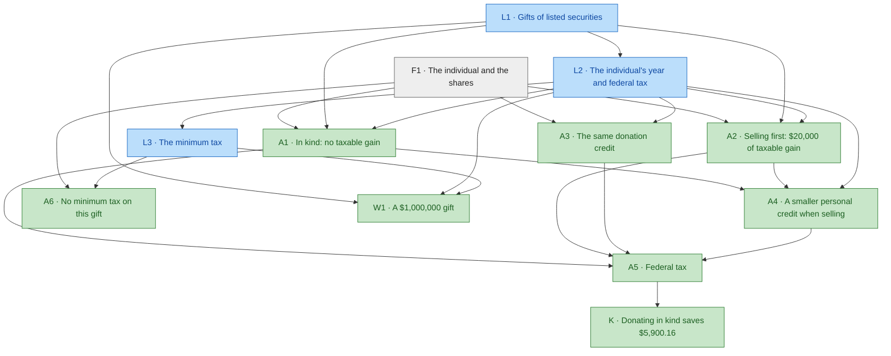
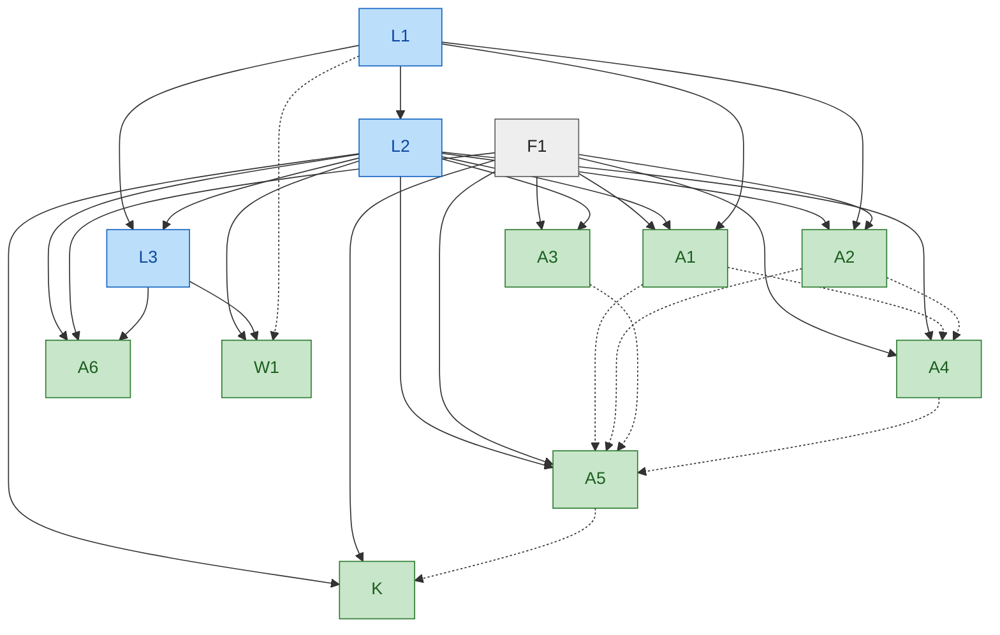

# Memo: donating shares in kind, or selling them and donating the cash

> Generated from the Lean sources by `scripts/blueprint.sh`. Do not edit by hand.

**Issue.** An individual with a $200,000 salary wants to give a charity $50,000, and owns public-company shares worth $50,000 that cost $10,000. Should they donate the shares, or sell them and donate the cash?

**Conclusion.** Donate the shares. The gain on shares given to a qualified donee is taxed at nil (A1), while selling first adds $20,000 of taxable capital gain (A2). The donation credit is $14,470 either way (A3), but the higher income also trims the basic personal amount (A4). Federal tax is $26,163.69 in kind against $32,063.85 (A5): a saving of $5,900.16 (K). The minimum tax does not apply (A6); for a $1,000,000 gift it would, either way, and donating in kind would still save $34,243.00 (W1). Provincial tax is not computed.

This is a constructed example, not advice on a real transaction.

**Status of the 12 statements:** 8 proven, 3 encoded, 1 fact.

## Dependency graph



Green: proven in Lean. Blue: encoded (definitions). Grey: facts. Orange: judgment calls. Dashed red: not yet formalized. An arrow points from a statement to the statements that use it.

### What the Lean proofs use

The same statements, with the dependencies Lean finds in the proofs themselves (solid) and those stated only in the memo's reasoning (dotted). Every dependency a proof has is also stated in the memo: `Blueprint.check` refuses a memo that hides one.



## The law

### L1. Gifts of listed securities

**Status:** encoded · **Citation:** ITA 38(a.1)(i)

The taxable capital gain on a gift of a listed security to a qualified donee is nil.

**Lean:** [`Canteen.ITA.CapitalGains.Disposition.taxableCapitalGain`](../../Canteen/ITA/S38/CapitalGains.lean#L122)

### L2. The individual's year and federal tax

**Status:** encoded · **Citation:** ITA 3; 117(2); 118(1); 118.1(3) · **Uses:** L1

Income, taxable income, tax at the 117(2) rates, less the personal and donation credits.

**Lean:** [`Canteen.ITA.IndividualYear.income`](../../Canteen/ITA/S3/IndividualYear.lean#L114), [`Canteen.ITA.IndividualYear.federalTax`](../../Canteen/ITA/S3/IndividualYear.lean#L155), [`Canteen.ITA.IndividualYear.personalCredit`](../../Canteen/ITA/S3/IndividualYear.lean#L138), [`Canteen.ITA.IndividualYear.donationCredit`](../../Canteen/ITA/S3/IndividualYear.lean#L146)

## Facts

### F1. The individual and the shares

**Status:** fact

A $200,000 salary in 2025; public-company shares costing $10,000, worth $50,000; a $50,000 gift.

**Lean:** [`Canteen.Transactions.DonatingShares.shares`](../../Canteen/Transactions/DonatingShares.lean#L24), [`Canteen.Transactions.DonatingShares.year`](../../Canteen/Transactions/DonatingShares.lean#L27), [`Canteen.Transactions.DonatingShares.inKind`](../../Canteen/Transactions/DonatingShares.lean#L31), [`Canteen.Transactions.DonatingShares.cash`](../../Canteen/Transactions/DonatingShares.lean#L32)

## Analysis

### A1. In kind: no taxable gain

**Status:** proven · **Citation:** ITA 38(a.1)(i) · **Uses:** F1, L1, L2

The $40,000 gain is taxed at nil; income is the $200,000 salary.

**Lean:** [`Canteen.Transactions.DonatingShares.in_kind_no_gain`](../../Canteen/Transactions/DonatingShares.lean#L36)

**Rests on:** facts F1.

### A2. Selling first: $20,000 of taxable gain

**Status:** proven · **Citation:** ITA 38(a); 3(b) · **Uses:** F1, L1, L2

Half the $40,000 gain is taxable: income is $220,000.

**Lean:** [`Canteen.Transactions.DonatingShares.cash_gain`](../../Canteen/Transactions/DonatingShares.lean#L40)

**Rests on:** facts F1.

### A3. The same donation credit

**Status:** proven · **Citation:** ITA 118.1(3) · **Uses:** F1, L2

$50,000 of gifts is within the limit either way: 14% of $200 and 29% of $49,800, $14,470.

**Lean:** [`Canteen.Transactions.DonatingShares.same_donation_credit`](../../Canteen/Transactions/DonatingShares.lean#L43)

**Rests on:** facts F1.

### A4. A smaller personal credit when selling

**Status:** proven · **Citation:** ITA 118(1.1) · **Uses:** A1, A2, L2

At $220,000 more of the enhanced basic personal amount is phased out: $1,889.06 against $1,989.22.

**Lean:** [`Canteen.Transactions.DonatingShares.personal_credits`](../../Canteen/Transactions/DonatingShares.lean#L47)

**Rests on:** facts F1.

### A5. Federal tax

**Status:** proven · **Citation:** ITA 117(2) · **Uses:** A1, A2, A3, A4

$26,163.69 in kind; $32,063.85 selling first.

**Lean:** [`Canteen.Transactions.DonatingShares.federal_tax`](../../Canteen/Transactions/DonatingShares.lean#L51)

**Rests on:** facts F1.

## Conclusion

### K. Donating in kind saves $5,900.16

**Status:** proven · **Uses:** A5

The difference in federal tax is $5,900.16, all from the gain that selling first makes taxable.

**Lean:** [`Canteen.Transactions.DonatingShares.saving`](../../Canteen/Transactions/DonatingShares.lean#L55)

**Rests on:** facts F1.

## What if

### L3. The minimum tax

**Status:** encoded · **Citation:** ITA 127.5; 127.51; 127.52(1)(d), (d.1); 127.531 · **Uses:** L2

At least 20.5% of adjusted taxable income over $177,882, less half the personal credit and 4/5 of the donation credit; for it, capital gains count in full and gains on gifts of listed securities at 3/10.

**Lean:** [`Canteen.ITA.MinimumTax.adjustedTaxableIncome`](../../Canteen/ITA/S127_5/MinimumTax.lean#L58), [`Canteen.ITA.MinimumTax.minimumAmount`](../../Canteen/ITA/S127_5/MinimumTax.lean#L69), [`Canteen.ITA.MinimumTax.taxPayable`](../../Canteen/ITA/S127_5/MinimumTax.lean#L73)

### A6. No minimum tax on this gift

**Status:** proven · **Citation:** ITA 127.5 · **Uses:** F1, L3

The minimum amount is nil in kind and $213.66 selling first, below regular tax either way.

**Lean:** [`Canteen.Transactions.DonatingShares.no_minimum_tax`](../../Canteen/Transactions/DonatingShares.lean#L58)

**Rests on:** facts F1.

### W1. A $1,000,000 gift

**Status:** proven · **Citation:** ITA 127.52(1)(d.1) · **Uses:** L1, L2, L3

Shares worth $1,000,000 that cost $200,000: in kind, no regular tax but $17,963.58 of minimum tax; selling first, $52,206.58 of minimum tax. In kind saves $34,243.00. Unclaimed gifts carry forward five years.

**Lean:** [`Canteen.Transactions.DonatingShares.bigShares`](../../Canteen/Transactions/DonatingShares.lean#L66), [`Canteen.Transactions.DonatingShares.bigYear`](../../Canteen/Transactions/DonatingShares.lean#L69), [`Canteen.Transactions.DonatingShares.big_in_kind`](../../Canteen/Transactions/DonatingShares.lean#L73), [`Canteen.Transactions.DonatingShares.big_cash`](../../Canteen/Transactions/DonatingShares.lean#L78), [`Canteen.Transactions.DonatingShares.big_saving`](../../Canteen/Transactions/DonatingShares.lean#L83)

## Appendix: the argument as Lean renders it

### The year, donating in kind

```
1. Employment and business income $200,000.00; dividends included $0.00 (with the gross-up); recapture $0.00; income attributed $0.00. [ITA 3(a); 82(1); 13(1); 74.1]
2. Taxable capital gains, net: $0.00. [ITA 3(b)]
3. Losses: business $0.00, terminal $0.00, attributed $0.00; interest deducted $0.00. [ITA 3(d); 20(16); 74.1; 20(1)(c)]
4. Income for the year: $200,000.00. [ITA 3]
5. Less the net capital loss deduction $0.00, the capital gains deduction $0.00, and other deductions $0.00: taxable income $200,000.00. [ITA 2(2); 111(1)(b); 110.6(2), (2.1)]
6. Tax under 117(2) on taxable income, $42,622.91, less the dividend tax credit of $0.00, the personal credit of $1,989.22, the donation credit of $14,470.00, the medical expense credit of $0.00, the disability credit of $0.00 and other credits of $0.00: $26,163.69. [ITA 117(2); 120.4(2); 121; 118; 118.1; 118.2; 118.3]
Relies on no judgment calls.
```

### The year, selling first

```
1. Employment and business income $200,000.00; dividends included $0.00 (with the gross-up); recapture $0.00; income attributed $0.00. [ITA 3(a); 82(1); 13(1); 74.1]
2. Taxable capital gains, net: $20,000.00. [ITA 3(b)]
3. Losses: business $0.00, terminal $0.00, attributed $0.00; interest deducted $0.00. [ITA 3(d); 20(16); 74.1; 20(1)(c)]
4. Income for the year: $220,000.00. [ITA 3]
5. Less the net capital loss deduction $0.00, the capital gains deduction $0.00, and other deductions $0.00: taxable income $220,000.00. [ITA 2(2); 111(1)(b); 110.6(2), (2.1)]
6. Tax under 117(2) on taxable income, $48,422.91, less the dividend tax credit of $0.00, the personal credit of $1,889.06, the donation credit of $14,470.00, the medical expense credit of $0.00, the disability credit of $0.00 and other credits of $0.00: $32,063.85. [ITA 117(2); 120.4(2); 121; 118; 118.1; 118.2; 118.3]
Relies on no judgment calls.
```

