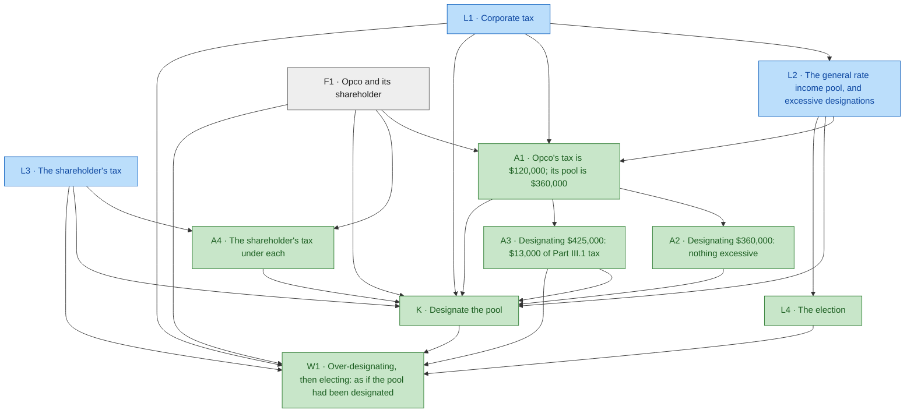
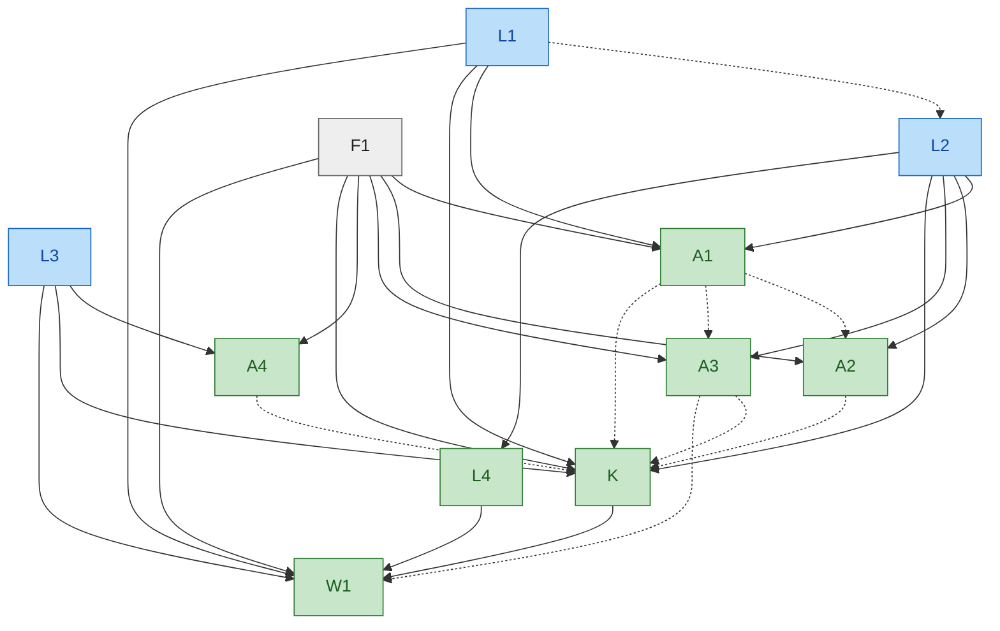

# Memo: how much of a dividend to designate eligible

> Generated from the Lean sources by `scripts/blueprint.sh`. Do not edit by hand.

**Issue.** Opco, a CCPC, earns $1,000,000 of active business income in 2025, half of it over its business limit, and pays the $880,000 left after tax to its shareholder. How much should it designate as eligible dividends?

**Conclusion.** Exactly its general rate income pool, $360,000 (A2): the total federal tax is then $325,430.45, $9,909.57 less than designating nothing (K). Designating the $425,000 it kept from income taxed at the general rate goes $65,000 over the pool: that saves the shareholder $1,789.22 but costs $13,000 of Part III.1 tax (A3, A4). Electing under 185.1(2) to treat the excess as a separate non-eligible dividend undoes it (W1). The minimum tax and provincial tax are not computed.

This is a constructed example, not advice.

**Status of the 11 statements:** 7 proven, 3 encoded, 1 fact.

## Dependency graph



Green: proven in Lean. Blue: encoded (definitions). Grey: facts. Orange: judgment calls. Dashed red: not yet formalized. An arrow points from a statement to the statements that use it.

### What the Lean proofs use

The same statements, with the dependencies Lean finds in the proofs themselves (solid) and those stated only in the memo's reasoning (dotted). Every dependency a proof has is also stated in the memo: `Blueprint.check` refuses a memo that hides one.



## The law

### L1. Corporate tax

**Status:** encoded · **Citation:** ITA 123–125

9% federally on active business income within the business limit, 15% on the rest.

**Lean:** [`Canteen.ITA.CorporateRates.tax`](../../Canteen/ITA/S123/CorporateRates.lean#L52)

### L2. The general rate income pool, and excessive designations

**Status:** encoded · **Citation:** ITA 89(1); 185.1(1) · **Uses:** L1

72% of income taxed at the general rate goes into the pool; eligible dividends beyond it are excessive and bear 20% Part III.1 tax.

**Lean:** [`Canteen.ITA.GeneralRateIncomePool.pool`](../../Canteen/ITA/S89/GeneralRateIncomePool.lean#L54), [`Canteen.ITA.GeneralRateIncomePool.excessive`](../../Canteen/ITA/S89/GeneralRateIncomePool.lean#L59), [`Canteen.ITA.GeneralRateIncomePool.partIII1`](../../Canteen/ITA/S89/GeneralRateIncomePool.lean#L63)

### L3. The shareholder's tax

**Status:** encoded · **Citation:** ITA 82(1); 117(2); 118; 121

Eligible dividends are grossed up by 38% and carry a credit of 6/11 of the gross-up; other dividends 15% and 9/13.

**Lean:** [`Canteen.ITA.IndividualYear.federalTax`](../../Canteen/ITA/S3/IndividualYear.lean#L155)

## Facts

### F1. Opco and its shareholder

**Status:** fact

$1,000,000 of active business income in 2025, a $500,000 business limit, no pool from earlier years; $880,000 paid to a shareholder with no other income.

**Lean:** [`Canteen.Transactions.EligibleDesignation.opcoRates`](../../Canteen/Transactions/EligibleDesignation.lean#L26), [`Canteen.Transactions.EligibleDesignation.opco`](../../Canteen/Transactions/EligibleDesignation.lean#L28), [`Canteen.Transactions.EligibleDesignation.paidOut`](../../Canteen/Transactions/EligibleDesignation.lean#L30), [`Canteen.Transactions.EligibleDesignation.shareholder`](../../Canteen/Transactions/EligibleDesignation.lean#L32)

## Analysis

### A1. Opco's tax is $120,000; its pool is $360,000

**Status:** proven · **Citation:** ITA 123–125; 89(1) · **Uses:** F1, L1, L2

$45,000 on the first $500,000 and $75,000 on the rest; 72% of the $500,000 taxed at the general rate.

**Lean:** [`Canteen.Transactions.EligibleDesignation.opco_tax`](../../Canteen/Transactions/EligibleDesignation.lean#L44)

**Rests on:** facts F1.

### A2. Designating $360,000: nothing excessive

**Status:** proven · **Citation:** ITA 89(1) · **Uses:** A1

The eligible dividends equal the pool.

**Lean:** [`Canteen.Transactions.EligibleDesignation.designate_pool`](../../Canteen/Transactions/EligibleDesignation.lean#L49)

**Rests on:** facts F1.

### A3. Designating $425,000: $13,000 of Part III.1 tax

**Status:** proven · **Citation:** ITA 185.1(1) · **Uses:** A1

$65,000 over the pool is excessive, taxed at 20%.

**Lean:** [`Canteen.Transactions.EligibleDesignation.over_designate`](../../Canteen/Transactions/EligibleDesignation.lean#L52)

**Rests on:** facts F1.

### A4. The shareholder's tax under each

**Status:** proven · **Citation:** ITA 117(2); 121 · **Uses:** F1, L3

$205,430.45 designating $360,000; $215,340.02 designating nothing; $203,641.23 designating $425,000.

**Lean:** [`Canteen.Transactions.EligibleDesignation.shareholder_tax`](../../Canteen/Transactions/EligibleDesignation.lean#L56)

**Rests on:** facts F1.

## Conclusion

### K. Designate the pool

**Status:** proven · **Uses:** F1, L1, L2, L3, A1, A2, A3, A4

$325,430.45 in all, against $335,340.02 designating nothing and $336,641.23 designating $425,000.

**Lean:** [`Canteen.Transactions.EligibleDesignation.total`](../../Canteen/Transactions/EligibleDesignation.lean#L38), [`Canteen.Transactions.EligibleDesignation.designate_the_pool`](../../Canteen/Transactions/EligibleDesignation.lean#L61)

**Rests on:** facts F1.

## What if

### L4. The election

**Status:** proven · **Citation:** ITA 185.1(2), (3) · **Uses:** L2

With the shareholders' concurrence, the corporation may treat up to the excessive designation as a separate non-eligible dividend; the eligible dividend is reduced by it. Proven: electing the whole excess leaves no Part III.1 tax and exactly the pool designated eligible.

**Lean:** [`Canteen.ITA.GeneralRateIncomePool.elected`](../../Canteen/ITA/S89/GeneralRateIncomePool.lean#L76), [`Canteen.ITA.GeneralRateIncomePool.eligibleAfter`](../../Canteen/ITA/S89/GeneralRateIncomePool.lean#L79), [`Canteen.ITA.GeneralRateIncomePool.partIII1After`](../../Canteen/ITA/S89/GeneralRateIncomePool.lean#L82), [`Canteen.ITA.GeneralRateIncomePool.full_election`](../../Canteen/ITA/S89/GeneralRateIncomePool.lean#L111)

### W1. Over-designating, then electing: as if the pool had been designated

**Status:** proven · **Citation:** ITA 185.1(2) · **Uses:** F1, L1, L3, L4, A3, K

Electing the $65,000 excess leaves $360,000 eligible and no Part III.1 tax: $325,430.45 in all.

**Lean:** [`Canteen.Transactions.EligibleDesignation.election`](../../Canteen/Transactions/EligibleDesignation.lean#L70), [`Canteen.Transactions.EligibleDesignation.totalElected`](../../Canteen/Transactions/EligibleDesignation.lean#L73), [`Canteen.Transactions.EligibleDesignation.election_undoes`](../../Canteen/Transactions/EligibleDesignation.lean#L78)

**Rests on:** facts F1.

## Appendix: the argument as Lean renders it

### Opco's pool

```
1. Adjusted taxable income is $500,000.00; 72% of it is added to the pool. [ITA 89(1) "adjusted taxable income", "general rate factor"]
2. The general rate income pool at year end is $360,000.00. [ITA 89(1) "general rate income pool"]
3. Eligible dividends of $360,000.00 are paid; the excessive designation is $0.00, and Part III.1 tax $0.00. [ITA 89(1) "excessive eligible dividend designation"; 185.1(1)]
Relies on no judgment calls.
```

### Opco, over-designating

```
1. Adjusted taxable income is $500,000.00; 72% of it is added to the pool. [ITA 89(1) "adjusted taxable income", "general rate factor"]
2. The general rate income pool at year end is $360,000.00. [ITA 89(1) "general rate income pool"]
3. Eligible dividends of $425,000.00 are paid; the excessive designation is $65,000.00, and Part III.1 tax $13,000.00. [ITA 89(1) "excessive eligible dividend designation"; 185.1(1)]
Relies on no judgment calls.
```

### The shareholder, designating the pool

```
1. Employment and business income $0.00; dividends included $1,094,800.00 (with the gross-up); recapture $0.00; income attributed $0.00. [ITA 3(a); 82(1); 13(1); 74.1]
2. Taxable capital gains, net: $0.00. [ITA 3(b)]
3. Losses: business $0.00, terminal $0.00, attributed $0.00; interest deducted $0.00. [ITA 3(d); 20(16); 74.1; 20(1)(c)]
4. Income for the year: $1,094,800.00. [ITA 3]
5. Less the net capital loss deduction $0.00, the capital gains deduction $0.00, and other deductions $0.00: taxable income $1,094,800.00. [ITA 2(2); 111(1)(b); 110.6(2), (2.1)]
6. Tax under 117(2) on taxable income, $335,770.35, less the dividend tax credit of $128,618.18, the personal credit of $1,721.72, the donation credit of $0.00, the medical expense credit of $0.00, the disability credit of $0.00 and other credits of $0.00: $205,430.45. [ITA 117(2); 120.4(2); 121; 118; 118.1; 118.2; 118.3]
Relies on no judgment calls.
```

