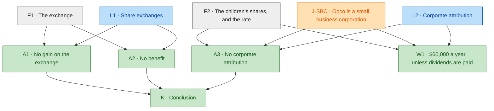
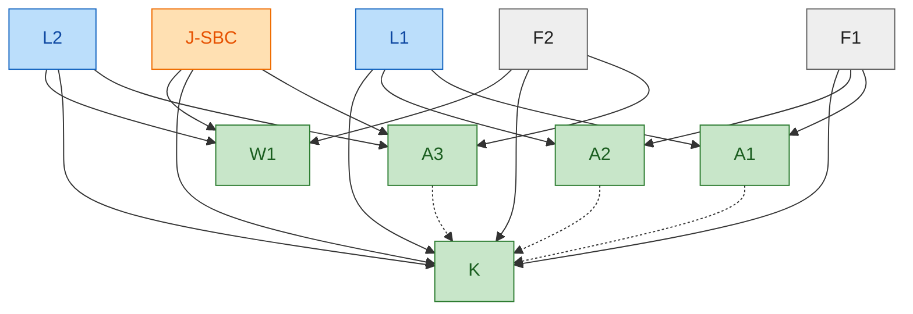
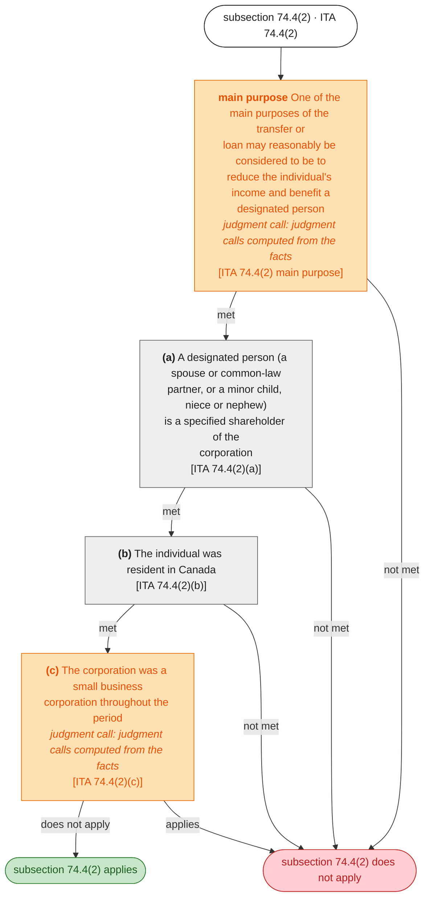
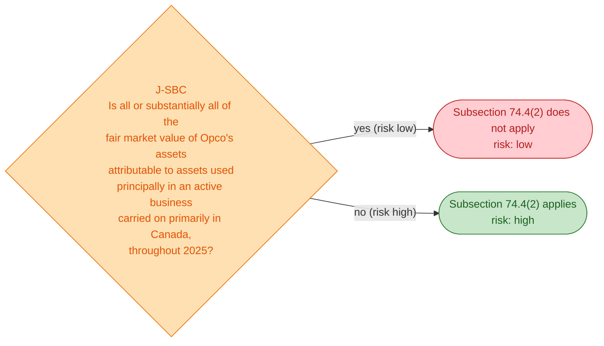

# Memo: an estate freeze in favour of minor children

> Generated from the Lean sources by `scripts/blueprint.sh`. Do not edit by hand.

**Issue.** A parent exchanges Opco common shares (cost $100, worth $2,000,000) for $2,000,000 of preferred shares, and the parent's minor children take new common shares. Is there tax now, or each year after?

**Conclusion.** No gain on the exchange: 86(1) carries the $100 cost over to the preferred shares, and with a price adjustment clause there is no benefit for 86(2) (A1, A2). Corporate attribution under 74.4(2) does not apply on the low-risk position that Opco is a small business corporation (A3). If it is not, the parent is deemed to receive $60,000 of interest a year, unless Opco pays at least $52,174 of dividends on the preferred shares (W1).

This is a constructed example, not advice on a real transaction.

**Status of the 10 statements:** 5 proven, 2 encoded, 2 fact, 1 judgment call.

## Dependency graph



Green: proven in Lean. Blue: encoded (definitions). Grey: facts. Orange: judgment calls. Dashed red: not yet formalized. An arrow points from a statement to the statements that use it.

### What the Lean proofs use

The same statements, with the dependencies Lean finds in the proofs themselves (solid) and those stated only in the memo's reasoning (dotted). Every dependency a proof has is also stated in the memo: `Blueprint.check` refuses a memo that hides one.



### Flowchart: subsection 74.4(2)



### Decision tree: J-SBC



## The law

### L1. Share exchanges

**Status:** encoded · **Citation:** ITA 86(1), (2)

In a reorganization of capital, old shares exchanged for new shares go at their cost; a benefit to a related person is taxed.

**Lean:** [`Canteen.ITA.ShareExchange.applies`](../../Canteen/ITA/S86/ShareExchange.lean#L73), [`Canteen.ITA.ShareExchange.proceeds`](../../Canteen/ITA/S86/ShareExchange.lean#L110), [`Canteen.ITA.ShareExchange.newCost`](../../Canteen/ITA/S86/ShareExchange.lean#L104), [`Canteen.ITA.ShareExchange.excess`](../../Canteen/ITA/S86/ShareExchange.lean#L93)

### L2. Corporate attribution

**Status:** encoded · **Citation:** ITA 74.4(2)

A transfer to a corporation to benefit a spouse or minor child is taxed as prescribed-rate interest, less dividends on the shares taken back, unless the corporation is a small business corporation.

**Lean:** [`Canteen.ITA.CorporateAttribution.applies`](../../Canteen/ITA/S74/CorporateAttribution.lean#L61), [`Canteen.ITA.CorporateAttribution.deemedInterest`](../../Canteen/ITA/S74/CorporateAttribution.lean#L85)

## Facts

### F1. The exchange

**Status:** fact

Opco common shares (cost and paid-up capital $100, worth $2,000,000) for preferred shares worth $2,000,000.

**Lean:** [`Canteen.Transactions.EstateFreeze.exchange`](../../Canteen/Transactions/EstateFreeze.lean#L34), [`Canteen.Transactions.EstateFreeze.prefs`](../../Canteen/Transactions/EstateFreeze.lean#L32)

### F2. The children's shares, and the rate

**Status:** fact

The minor children subscribe for new common shares; the prescribed rate is 3%.

**Lean:** [`Canteen.Transactions.EstateFreeze.attribution`](../../Canteen/Transactions/EstateFreeze.lean#L39)

## Judgment call

### J-SBC. Opco is a small business corporation

**Status:** judgment call

All or substantially all of Opco's assets' value is in an active business carried on in Canada. Risk: low.

**Lean:** [`Canteen.Transactions.EstateFreeze.calls`](../../Canteen/Transactions/EstateFreeze.lean#L26), [`Canteen.Transactions.EstateFreeze.position`](../../Canteen/Transactions/EstateFreeze.lean#L30)

## Analysis

### A1. No gain on the exchange

**Status:** proven · **Citation:** ITA 86(1) · **Uses:** F1, L1

The preferred shares take over the $100 cost and $100 of paid-up capital; the proceeds are $100.

**Lean:** [`Canteen.Transactions.EstateFreeze.freeze_no_gain`](../../Canteen/Transactions/EstateFreeze.lean#L47)

**Rests on:** facts F1.

### A2. No benefit

**Status:** proven · **Citation:** ITA 86(2) · **Uses:** F1, L1

The preferred shares are worth what the common shares were, so there is no excess to tax.

**Lean:** [`Canteen.Transactions.EstateFreeze.no_benefit`](../../Canteen/Transactions/EstateFreeze.lean#L52)

**Rests on:** facts F1.

### A3. No corporate attribution

**Status:** proven · **Citation:** ITA 74.4(2)(c) · **Uses:** F2, J-SBC, L2

Opco is a small business corporation, so 74.4(2) deems nothing; this rests on J-SBC.

**Lean:** [`Canteen.Transactions.EstateFreeze.no_attribution`](../../Canteen/Transactions/EstateFreeze.lean#L55), [`Canteen.Transactions.EstateFreeze.relies_on_sbc`](../../Canteen/Transactions/EstateFreeze.lean#L65)

**Rests on:** judgment calls J-SBC; facts F2.

## Conclusion

### K. Conclusion

**Status:** proven · **Uses:** A1, A2, A3

The freeze is tax-free now, and, while Opco stays a small business corporation, each year after.

**Lean:** [`Canteen.Transactions.EstateFreeze.freeze_no_gain`](../../Canteen/Transactions/EstateFreeze.lean#L47), [`Canteen.Transactions.EstateFreeze.no_attribution`](../../Canteen/Transactions/EstateFreeze.lean#L55)

**Rests on:** judgment calls J-SBC; facts F1, F2.

## If Opco is not a small business corporation

### W1. $60,000 a year, unless dividends are paid

**Status:** proven · **Citation:** ITA 74.4(2)(d), (f) · **Uses:** F2, J-SBC, L2

The parent would be deemed to receive $60,000 of interest a year, but not if Opco pays at least $52,174 of dividends on the preferred shares ($60,000.10 included with the gross-up).

**Lean:** [`Canteen.Transactions.EstateFreeze.attribution_if_not_sbc`](../../Canteen/Transactions/EstateFreeze.lean#L58), [`Canteen.Transactions.EstateFreeze.dividends_avoid_it`](../../Canteen/Transactions/EstateFreeze.lean#L61)

**Rests on:** judgment calls J-SBC; facts F2.

## Appendix: the argument as Lean renders it

### Subsection 86(1)

```
1. The shares were disposed of in the course of a reorganization of the capital of the corporation. [ITA 86(1) reorganization]
2. They were capital property, all the shares of their class the taxpayer owned. [ITA 86(1) old shares]
3. Property receivable for them includes other shares of the corporation. [ITA 86(1) new shares]
4. Subsection 85(1) or (2) does not apply. [ITA 86(3)]
5. Therefore subsection 86(1) applies. [ITA 86(1)]
6. The new shares cost the old shares' adjusted cost base of $100.00 less the boot of $0.00: $100.00. [ITA 86(1)(a), (b)]
7. So the proceeds for the old shares are $100.00. [ITA 86(1)(c)]
Relies on no judgment calls.
```

### Subsection 74.4(2), if Opco is not a small business corporation

```
1. One of the main purposes of the transfer or loan may reasonably be considered to be to reduce the individual's income and benefit a designated person. [ITA 74.4(2) main purpose]
2. A designated person (a spouse or common-law partner, or a minor child, niece or nephew) is a specified shareholder of the corporation. [ITA 74.4(2)(a)]
3. The individual was resident in Canada. [ITA 74.4(2)(b)]
4. The corporation was not a small business corporation. [ITA 74.4(2)(c)]
5. Therefore subsection 74.4(2) applies. [ITA 74.4(2)]
6. Interest at the prescribed rate on $2,000,000.00 for 12 months would be $60,000.00; less interest received of $0.00, dividends included of $0.00, and split income dividends of $0.00, the individual is deemed to receive $60,000.00 of interest. [ITA 74.4(2)(d)–(g)]
Relies on these judgment calls:
- J-SBC: Is all or substantially all of the fair market value of Opco's assets attributable to assets used principally in an active business carried on primarily in Canada, throughout 2025? Assumed: no. Risk: high.
Overall risk: high.
```

