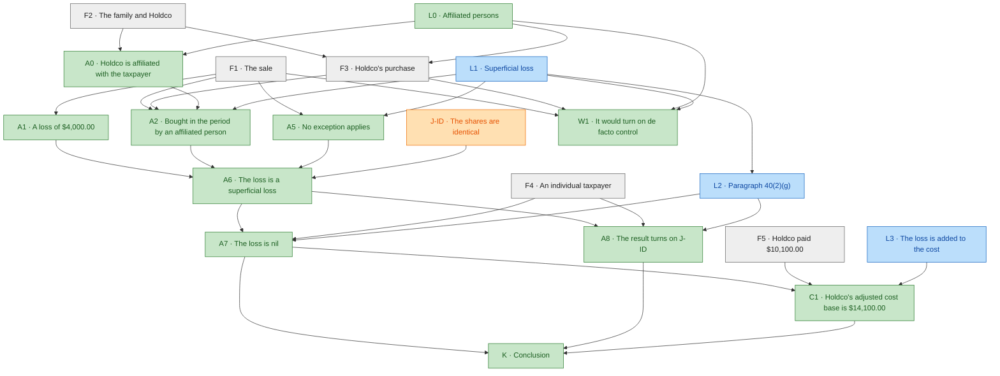
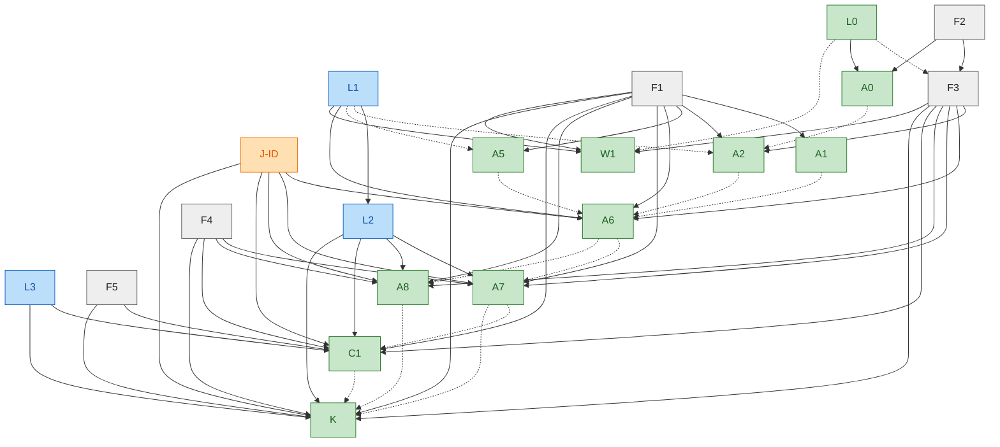
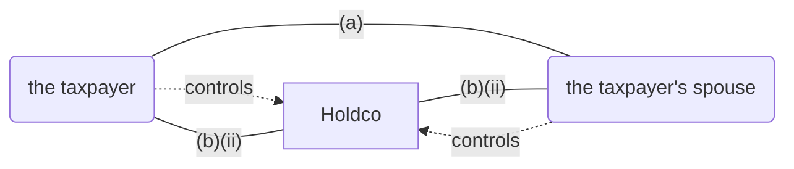
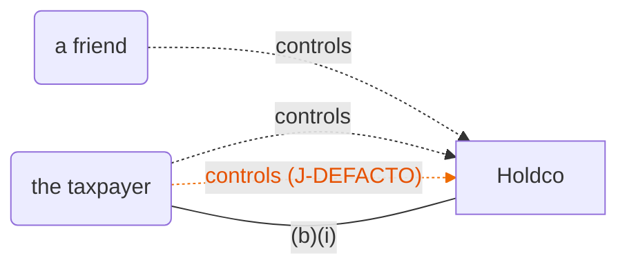
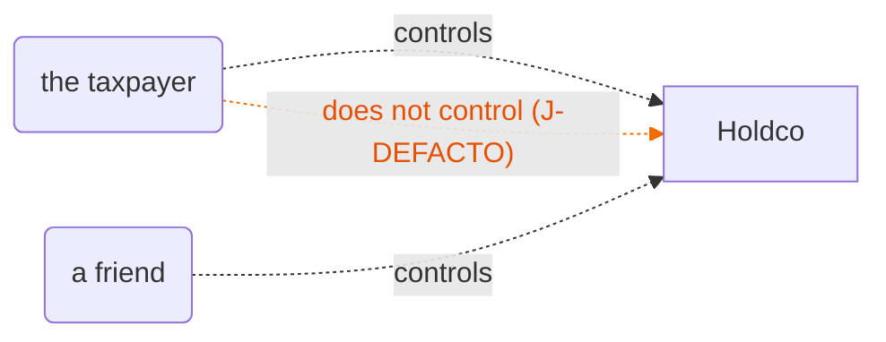
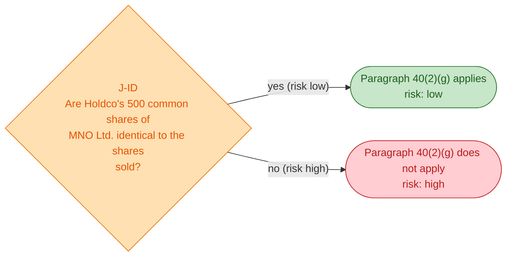
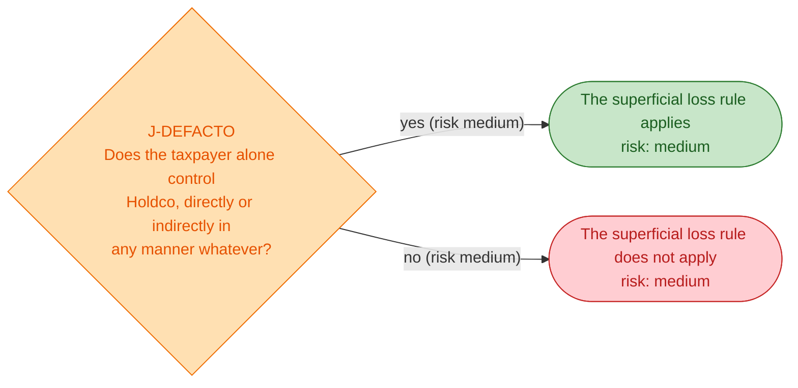

# Memo: shares sold at a loss and bought by a family holding company

> Generated from the Lean sources by `scripts/blueprint.sh`. Do not edit by hand.

**Issue.** The taxpayer sold 500 common shares of MNO Ltd. at a $4,000.00 loss on 2025-11-03. Holdco, which the taxpayer and the taxpayer's spouse own half and half, bought the same shares 17 days later. Can the taxpayer use the loss?

**Conclusion.** No, on the low-risk position that Holdco's shares are identical. The spouses are an affiliated group and together control Holdco, so Holdco is affiliated with the taxpayer (A0), on the facts alone. The loss is a superficial loss and paragraph 40(2)(g) makes it nil (A7). Paragraph 53(1)(f) adds it to Holdco's cost (C1).

**What if.** Had the taxpayer owned Holdco half and half with an unrelated friend, the two would not be an affiliated group, and the result would turn on whether the taxpayer controls Holdco de facto (W1).

This is a constructed example, not advice on a real transaction.

**Status of the 20 statements:** 11 proven, 3 encoded, 5 fact, 1 judgment call.

## Dependency graph



Green: proven in Lean. Blue: encoded (definitions). Grey: facts. Orange: judgment calls. Dashed red: not yet formalized. An arrow points from a statement to the statements that use it.

### What the Lean proofs use

The same statements, with the dependencies Lean finds in the proofs themselves (solid) and those stated only in the memo's reasoning (dotted). Every dependency a proof has is also stated in the memo: `Blueprint.check` refuses a memo that hides one.



### Who is affiliated with whom



### What if: owned with a friend, if the taxpayer controls Holdco de facto



### What if: and if not



### Timeline of the period

```mermaid
gantt
    title Superficial loss period for the disposition on 2025-11-03
    dateFormat YYYY-MM-DD
    axisFormat %b %d
    section Period (a)
    2025-10-04 to 2025-12-03 :active, period, 2025-10-04, 61d
    section Disposition
    2025-11-03 disposition of 500 common shares of MNO Ltd. (loss $4,000.00) :milestone, disp, 2025-11-03, 0d
    section Acquisitions
    2025-11-20 Holdco (affiliated) acquires 500 common shares of MNO Ltd. (in period, held at end) :milestone, crit, a0, 2025-11-20, 0d
    section End of period (b)
    2025-12-03 end of period :milestone, endp, 2025-12-03, 0d
```

### Decision tree: J-ID



### Decision tree for the what-if: J-DEFACTO



## The law

### L0. Affiliated persons

**Status:** proven · **Citation:** ITA 251.1(1)(a)–(g)

Spouses are affiliated (a); a corporation is affiliated with each member of an affiliated group of persons by which it is controlled (b)(ii); and so on, through paragraphs (c) to (g). Computed as the smallest relation closed under the paragraphs.

**Lean:** [`Canteen.ITA.AffiliatedPersons.rule`](../../Canteen/ITA/S251_1/AffiliatedPersons.lean#L545), [`Canteen.ITA.AffiliatedPersons.affiliated_symm`](../../Canteen/ITA/S251_1/AffiliatedPersons.lean#L559)

### L1. Superficial loss

**Status:** encoded · **Citation:** ITA 54 "superficial loss"

The definition, as in the provision's blueprint.

**Lean:** [`Canteen.ITA.SuperficialLoss.superficialLoss`](../../Canteen/ITA/S54/SuperficialLoss.lean#L255)

### L2. Paragraph 40(2)(g)

**Status:** encoded · **Citation:** ITA 40(2)(g) · **Uses:** L1

A loss within any of subparagraphs (i) to (iv) is nil, unless the carve-out applies.

**Lean:** [`Canteen.ITA.Paragraph40_2_g.paragraph`](../../Canteen/ITA/S40/Paragraph40_2_g.lean#L32), [`Canteen.ITA.Paragraph40_2_g.deniedLoss`](../../Canteen/ITA/S40/Paragraph40_2_g.lean#L41)

### L3. The loss is added to the cost

**Status:** encoded · **Citation:** ITA 53(1)(f)

The superficial loss, less any amount in subparagraph 53(1)(f)(ii), is added to the cost of the substituted property.

**Lean:** [`Canteen.ITA.CostAddition.addition`](../../Canteen/ITA/S53/CostAddition.lean#L49), [`Canteen.ITA.CostAddition.adjustedCostBase`](../../Canteen/ITA/S53/CostAddition.lean#L53)

## Facts

### F1. The sale

**Status:** fact

On 2025-11-03 the taxpayer sold 500 common shares of MNO Ltd. for $10,000.00; adjusted cost base $14,000.00.

**Lean:** [`Canteen.Transactions.HoldcoRepurchase.sale`](../../Canteen/Transactions/HoldcoRepurchase.lean#L42)

### F2. The family and Holdco

**Status:** fact

The taxpayer and the taxpayer's spouse are married, and each owns half of Holdco's voting shares, so together they control it.

**Lean:** [`Canteen.Transactions.HoldcoRepurchase.world`](../../Canteen/Transactions/HoldcoRepurchase.lean#L35)

### F3. Holdco's purchase

**Status:** fact · **Uses:** F2, L0

On 2025-11-20 Holdco bought 500 common shares of MNO Ltd., and still held them at the end of the period.

**Lean:** [`Canteen.Transactions.HoldcoRepurchase.holdcoPurchase`](../../Canteen/Transactions/HoldcoRepurchase.lean#L46)

**Rests on:** facts F2.

### F4. An individual taxpayer

**Status:** fact

The taxpayer is an individual, so the foreign affiliate carve-out is not engaged.

**Lean:** [`Canteen.Transactions.HoldcoRepurchase.surplusCarveOut`](../../Canteen/Transactions/HoldcoRepurchase.lean#L55)

### F5. Holdco paid $10,100.00

**Status:** fact

Holdco's shares cost $10,100.00.

**Lean:** [`Canteen.Transactions.HoldcoRepurchase.holdcoCost`](../../Canteen/Transactions/HoldcoRepurchase.lean#L66)

## Judgment call

### J-ID. The shares are identical

**Status:** judgment call

Holdco's shares are of the same class of the same corporation as the shares sold. Risk: low.

**Lean:** [`Canteen.Transactions.HoldcoRepurchase.calls`](../../Canteen/Transactions/HoldcoRepurchase.lean#L51), [`Canteen.Transactions.HoldcoRepurchase.position`](../../Canteen/Transactions/HoldcoRepurchase.lean#L64)

## Analysis

### A0. Holdco is affiliated with the taxpayer

**Status:** proven · **Citation:** ITA 251.1(1)(a), (b)(ii) · **Uses:** F2, L0

The spouses are affiliated with each other, so they are an affiliated group of persons; Holdco is controlled by that group, so it is affiliated with each of them. This rests on the facts alone.

**Lean:** [`Canteen.Transactions.HoldcoRepurchase.holdco_affiliated`](../../Canteen/Transactions/HoldcoRepurchase.lean#L78)

**Rests on:** facts F2.

### A1. A loss of $4,000.00

**Status:** proven · **Citation:** ITA 40(1)(b) · **Uses:** F1

The adjusted cost base ($14,000.00) exceeds the proceeds ($10,000.00) by $4,000.00.

**Lean:** [`Canteen.Transactions.HoldcoRepurchase.loss_amount`](../../Canteen/Transactions/HoldcoRepurchase.lean#L76)

**Rests on:** facts F1.

### A2. Bought in the period by an affiliated person

**Status:** proven · **Citation:** ITA 54 "superficial loss" (a) · **Uses:** F1, F3, A0, L1

The period runs from 2025-10-04 to 2025-12-03. Holdco's purchase on 2025-11-20 falls in it.

**Lean:** [`Canteen.Transactions.HoldcoRepurchase.purchase_in_period`](../../Canteen/Transactions/HoldcoRepurchase.lean#L84)

**Rests on:** facts F1, F3, F2.

### A5. No exception applies

**Status:** proven · **Citation:** ITA 54 "superficial loss" (c)–(h) · **Uses:** F1, L1

None of paragraphs (c) to (h) applies to the sale.

**Lean:** [`Canteen.Transactions.HoldcoRepurchase.no_exception`](../../Canteen/Transactions/HoldcoRepurchase.lean#L88)

**Rests on:** facts F1.

### A6. The loss is a superficial loss

**Status:** proven · **Citation:** ITA 54 "superficial loss" · **Uses:** A1, A2, A5, J-ID

There is a loss; Holdco's purchase meets (a), as the shares are identical, and (b); and no exception applies.

**Lean:** [`Canteen.Transactions.HoldcoRepurchase.superficial_on_position`](../../Canteen/Transactions/HoldcoRepurchase.lean#L90)

**Rests on:** judgment calls J-ID; facts F1, F3, F2.

### A7. The loss is nil

**Status:** proven · **Citation:** ITA 40(2)(g) · **Uses:** A6, F4, L2

The carve-out is not engaged, so paragraph 40(2)(g) makes the $4,000.00 loss nil.

**Lean:** [`Canteen.Transactions.HoldcoRepurchase.loss_nil_on_position`](../../Canteen/Transactions/HoldcoRepurchase.lean#L92)

**Rests on:** judgment calls J-ID; facts F1, F3, F2, F4.

### A8. The result turns on J-ID

**Status:** proven · **Uses:** A6, F4, L2

If Holdco's shares were not identical, the loss would stand.

**Lean:** [`Canteen.Transactions.HoldcoRepurchase.turns_on_identity`](../../Canteen/Transactions/HoldcoRepurchase.lean#L97)

**Rests on:** judgment calls J-ID; facts F1, F3, F2, F4.

## Consequence and conclusion

### C1. Holdco's adjusted cost base is $14,100.00

**Status:** proven · **Citation:** ITA 53(1)(f) · **Uses:** A7, F5, L3

Holdco's shares are substituted property of Holdco; the $4,000.00 is added to its $10,100.00 cost.

**Lean:** [`Canteen.Transactions.HoldcoRepurchase.holdco_adjusted_cost_base`](../../Canteen/Transactions/HoldcoRepurchase.lean#L101)

**Rests on:** judgment calls J-ID; facts F1, F3, F2, F4, F5.

### K. Conclusion

**Status:** proven · **Uses:** A7, A8, C1

The taxpayer cannot use the $4,000.00 loss: Holdco is affiliated with the taxpayer, so the loss is a superficial loss, nil under paragraph 40(2)(g). It is added to Holdco's adjusted cost base, which becomes $14,100.00.

**Lean:** [`Canteen.Transactions.HoldcoRepurchase.loss_nil_on_position`](../../Canteen/Transactions/HoldcoRepurchase.lean#L92), [`Canteen.Transactions.HoldcoRepurchase.holdco_adjusted_cost_base`](../../Canteen/Transactions/HoldcoRepurchase.lean#L101)

**Rests on:** judgment calls J-ID; facts F1, F3, F2, F4, F5.

## What if Holdco were owned with an unrelated friend

### W1. It would turn on de facto control

**Status:** proven · **Citation:** ITA 251.1(1)(b), (3) "controlled" · **Uses:** F1, F3, L0, L1

The taxpayer and a friend would control Holdco together, but they are not an affiliated group, so (b)(ii) would not apply. Holdco would be affiliated with the taxpayer, and the loss superficial, only if the taxpayer alone controlled Holdco "directly or indirectly in any manner whatever" (J-DEFACTO).

**Lean:** [`Canteen.Transactions.HoldcoRepurchase.friend_turns_on_defacto`](../../Canteen/Transactions/HoldcoRepurchase.lean#L124), [`Canteen.Transactions.HoldcoRepurchase.friend_relies_on_defacto`](../../Canteen/Transactions/HoldcoRepurchase.lean#L130)

**Rests on:** facts F1, F3, F2.

## Appendix: the argument as Lean renders it

### Why Holdco is affiliated with the taxpayer

```
1. The taxpayer and the taxpayer's spouse are an individual and a spouse or common-law partner of the individual. [ITA 251.1(1)(a)]
2. Holdco is a corporation controlled by the group made up of the taxpayer and the taxpayer's spouse, an affiliated group of persons, of which the taxpayer is a member. [ITA 251.1(1)(b)(ii)]
3. So the taxpayer and Holdco are affiliated persons. [ITA 251.1(1)]
Relies on no judgment calls.
```

### Paragraph 40(2)(g), on the position taken

```
1. The taxpayer disposed of 500 common shares of MNO Ltd. on 2025-11-03 for proceeds of $10,000.00. The adjusted cost base plus outlays and expenses was $14,000.00, so the taxpayer's loss from the disposition is $4,000.00. [ITA 40(1)(b)]
2. On 2025-11-20, within the period from 2025-10-04 to 2025-12-03, Holdco, a person affiliated with the taxpayer, acquired 500 common shares of MNO Ltd. That property is identical to the particular property (judgment call J-ID). [ITA 54 "superficial loss" (a)]
3. At the end of that period, on 2025-12-03, the taxpayer or a person affiliated with the taxpayer owned or had a right to acquire that property. [ITA 54 "superficial loss" (b)]
4. The disposition is not one described in paragraphs (c) to (h), so the taxpayer's loss of $4,000.00 is a superficial loss. [ITA 54 "superficial loss"]
5. Therefore one of subparagraphs 40(2)(g)(i) to (iv) applies. [ITA 40(2)(g)]
6. The property is not excluded property being considered in computing a foreign affiliate's surplus or deficit. [ITA 40(2)(g) opening words]
7. Therefore paragraph 40(2)(g) applies. [ITA 40(2)(g)]
Relies on these judgment calls:
- J-ID: Are Holdco's 500 common shares of MNO Ltd. identical to the shares sold? Assumed: yes. Risk: low.
Overall risk: low.
```

### Paragraph 53(1)(f), for Holdco's shares

```
1. The 500 common shares of MNO Ltd. owned by Holdco are substituted property of Holdco, within the meaning of paragraph (a) of the definition "superficial loss" in section 54. [ITA 53(1)(f)]
2. The loss that was a superficial loss because of the acquisition by Holdco is $4,000.00; the amount described in subparagraph (ii) is $0.00. [ITA 53(1)(f)(i), (ii)]
3. So $4,000.00 is added to the cost of the property: its adjusted cost base to Holdco is $10,100.00 + $4,000.00 = $14,100.00. [ITA 53(1)(f)]
```

