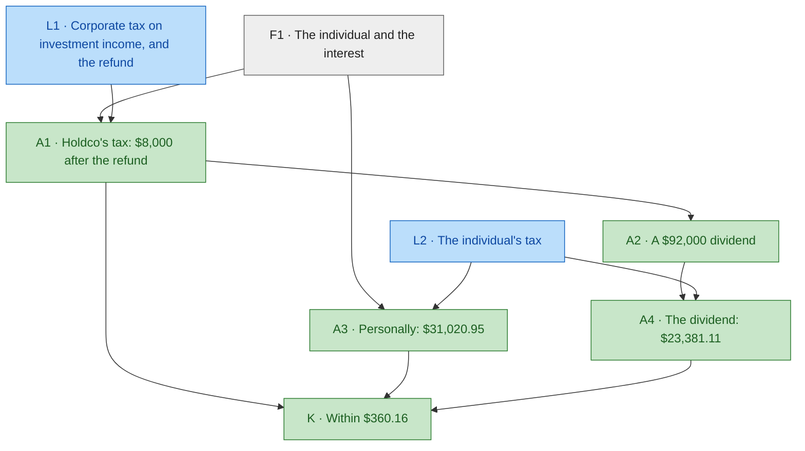
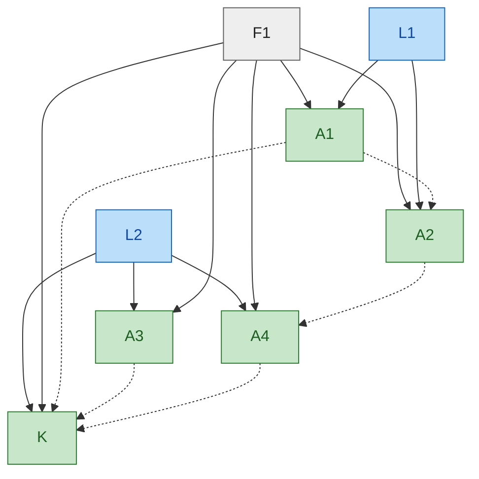

# Memo: investment income earned personally, or through a holding company

> Generated from the Lean sources by `scripts/blueprint.sh`. Do not edit by hand.

**Issue.** An individual with a $200,000 salary earns $100,000 of interest a year. Is the federal tax different if a holding company earns it and pays it out as dividends?

**Conclusion.** Barely. Personally, the interest adds $31,020.95 of federal tax (A3). Through Holdco, Holdco pays $38,666.66 but gets $30,666.66 back as a dividend refund when it pays out $92,000 (A1, A2), and the dividend adds $23,381.11 to the individual's tax (A4): $31,381.11 in all, $360.16 more (K). The refundable tax and the dividend gross-up and credit are designed to make the two routes nearly equal. Provincial tax is not computed.

This is a constructed example, not advice.

**Status of the 8 statements:** 5 proven, 2 encoded, 1 fact.

## Dependency graph



Green: proven in Lean. Blue: encoded (definitions). Grey: facts. Orange: judgment calls. Dashed red: not yet formalized. An arrow points from a statement to the statements that use it.

### What the Lean proofs use

The same statements, with the dependencies Lean finds in the proofs themselves (solid) and those stated only in the memo's reasoning (dotted). Every dependency a proof has is also stated in the memo: `Blueprint.check` refuses a memo that hides one.



## The law

### L1. Corporate tax on investment income, and the refund

**Status:** encoded · **Citation:** ITA 123–125; 123.3; 129

28% plus 10⅔% on a CCPC's investment income; 30⅔% of it is refunded at 38⅓% of dividends paid.

**Lean:** [`Canteen.ITA.RefundableTax.partITax`](../../Canteen/ITA/S129/RefundableTax.lean#L60), [`Canteen.ITA.RefundableTax.dividendRefund`](../../Canteen/ITA/S129/RefundableTax.lean#L90)

### L2. The individual's tax

**Status:** encoded · **Citation:** ITA 3; 82(1); 117(2); 118; 121

Income, with non-eligible dividends grossed up by 15%; tax at the 117(2) rates, less the personal and dividend tax credits.

**Lean:** [`Canteen.ITA.IndividualYear.federalTax`](../../Canteen/ITA/S3/IndividualYear.lean#L361)

## Facts

### F1. The individual and the interest

**Status:** fact

A $200,000 salary in 2025; $100,000 of interest, earned personally or by Holdco, a CCPC.

**Lean:** [`Canteen.Transactions.InvestmentIncomeIntegration.salary`](../../Canteen/Transactions/InvestmentIncomeIntegration.lean#L22), [`Canteen.Transactions.InvestmentIncomeIntegration.interest`](../../Canteen/Transactions/InvestmentIncomeIntegration.lean#L23), [`Canteen.Transactions.InvestmentIncomeIntegration.personal`](../../Canteen/Transactions/InvestmentIncomeIntegration.lean#L25), [`Canteen.Transactions.InvestmentIncomeIntegration.holdco`](../../Canteen/Transactions/InvestmentIncomeIntegration.lean#L29), [`Canteen.Transactions.InvestmentIncomeIntegration.dividend`](../../Canteen/Transactions/InvestmentIncomeIntegration.lean#L33), [`Canteen.Transactions.InvestmentIncomeIntegration.throughHoldco`](../../Canteen/Transactions/InvestmentIncomeIntegration.lean#L36), [`Canteen.Transactions.InvestmentIncomeIntegration.baseline`](../../Canteen/Transactions/InvestmentIncomeIntegration.lean#L41)

## Analysis

### A1. Holdco's tax: $8,000 after the refund

**Status:** proven · **Citation:** ITA 123.3; 129(1) · **Uses:** F1, L1

Part I tax of $38,666.66, less a $30,666.66 dividend refund.

**Lean:** [`Canteen.Transactions.InvestmentIncomeIntegration.holdco_tax`](../../Canteen/Transactions/InvestmentIncomeIntegration.lean#L46)

**Rests on:** facts F1.

### A2. A $92,000 dividend

**Status:** proven · **Citation:** ITA 129(1) · **Uses:** A1

The interest less the tax, plus the refund that the dividend earns.

**Lean:** [`Canteen.Transactions.InvestmentIncomeIntegration.dividend_is_whats_left`](../../Canteen/Transactions/InvestmentIncomeIntegration.lean#L52)

**Rests on:** facts F1.

### A3. Personally: $31,020.95

**Status:** proven · **Citation:** ITA 117(2) · **Uses:** F1, L2

The federal tax the interest adds to a $200,000 salary.

**Lean:** [`Canteen.Transactions.InvestmentIncomeIntegration.personal_tax`](../../Canteen/Transactions/InvestmentIncomeIntegration.lean#L56)

**Rests on:** facts F1.

### A4. The dividend: $23,381.11

**Status:** proven · **Citation:** ITA 82(1); 121 · **Uses:** A2, L2

$105,800 of income after the gross-up, less the dividend tax credit.

**Lean:** [`Canteen.Transactions.InvestmentIncomeIntegration.dividend_tax`](../../Canteen/Transactions/InvestmentIncomeIntegration.lean#L59)

**Rests on:** facts F1.

## Conclusion

### K. Within $360.16

**Status:** proven · **Uses:** A1, A3, A4

Through Holdco, $31,381.11 of federal tax in all, against $31,020.95 personally.

**Lean:** [`Canteen.Transactions.InvestmentIncomeIntegration.integration`](../../Canteen/Transactions/InvestmentIncomeIntegration.lean#L62)

**Rests on:** facts F1.

## Appendix: the argument as Lean renders it

### Holdco

```
1. Part I tax $28,000.00, plus the 10⅔% refundable tax on investment income $10,666.66. [ITA 123–125; 123.3]
2. Part IV tax on dividends received: $0.00, $0.00 of it on eligible dividends. [ITA 186(1)]
3. At year end the eligible refundable dividend tax on hand is $0.00, and the non-eligible $30,666.66. [ITA 129(4)]
4. The dividend refund is $30,666.66: $0.00 on eligible dividends, $30,666.66 on non-eligible dividends, and $0.00 of the eligible account used for non-eligible dividends. [ITA 129(1)]
Relies on no judgment calls.
```

### The individual, through Holdco

```
1. Employment and business income $200,000.00; dividends included $105,800.00 (with the gross-up); recapture $0.00; income attributed $0.00. [ITA 3(a); 82(1); 13(1); 74.1]
2. Taxable capital gains, net: $0.00. [ITA 3(b)]
3. Losses: business $0.00, terminal $0.00, attributed $0.00; interest deducted $0.00. [ITA 3(d); 20(16); 74.1; 20(1)(c)]
4. Income for the year: $305,800.00. [ITA 3]
5. Less the net capital loss deduction $0.00, the capital gains deduction $0.00, and other deductions $0.00: taxable income $305,800.00. [ITA 2(2); 111(1)(b); 110.6(2), (2.1)]
6. Tax under 117(2) on taxable income, $75,400.35, less the dividend tax credit of $9,553.84, the personal credit of $2,035.32, the age and pension credits of $0.00, the employment, CPP and EI credits of $0.00, the adoption, accessibility, home buyers' and volunteer credits of $0.00, the tuition credits of $0.00, the donation credit of $0.00, the medical expense credit of $0.00, the disability credit of $0.00 and other credits of $0.00: $63,811.19. [ITA 117(2); 120.4(2); 121; 118 to 118.07; 118.1; 118.2; 118.3; 118.5; 118.61; 118.7; 118.9]
Relies on no judgment calls.
```

### The individual, personally

```
1. Employment and business income $300,000.00; dividends included $0.00 (with the gross-up); recapture $0.00; income attributed $0.00. [ITA 3(a); 82(1); 13(1); 74.1]
2. Taxable capital gains, net: $0.00. [ITA 3(b)]
3. Losses: business $0.00, terminal $0.00, attributed $0.00; interest deducted $0.00. [ITA 3(d); 20(16); 74.1; 20(1)(c)]
4. Income for the year: $300,000.00. [ITA 3]
5. Less the net capital loss deduction $0.00, the capital gains deduction $0.00, and other deductions $0.00: taxable income $300,000.00. [ITA 2(2); 111(1)(b); 110.6(2), (2.1)]
6. Tax under 117(2) on taxable income, $73,486.35, less the dividend tax credit of $0.00, the personal credit of $2,035.32, the age and pension credits of $0.00, the employment, CPP and EI credits of $0.00, the adoption, accessibility, home buyers' and volunteer credits of $0.00, the tuition credits of $0.00, the donation credit of $0.00, the medical expense credit of $0.00, the disability credit of $0.00 and other credits of $0.00: $71,451.03. [ITA 117(2); 120.4(2); 121; 118 to 118.07; 118.1; 118.2; 118.3; 118.5; 118.61; 118.7; 118.9]
Relies on no judgment calls.
```

