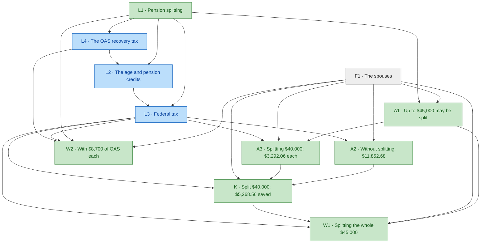
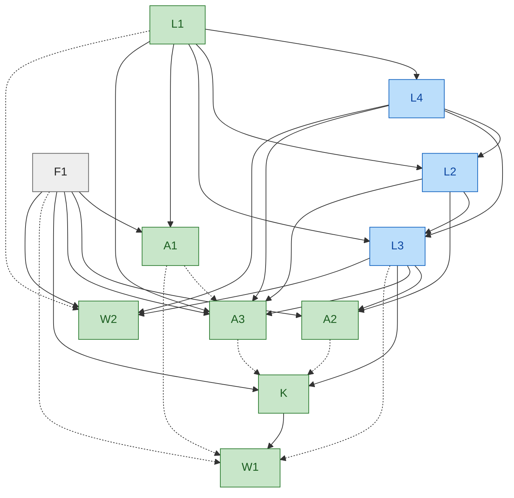

# Memo: splitting pension income between spouses

> Generated from the Lean sources by `scripts/blueprint.sh`. Do not edit by hand.

**Issue.** Spouses over 65: one receives a $90,000 pension plan annuity in 2025, the other $10,000 of RRIF payments. How much of the pension should they elect to split?

**Conclusion.** $40,000, which leaves each with $50,000 of income: their federal tax falls from $11,852.68 to $6,584.12, a saving of $5,268.56 (K). Besides the lower rates, the pensioner's age credit, mostly clawed back at $90,000, comes back (A2, A3). No split in $1,000 steps up to the $45,000 limit does better, and splitting the whole $45,000 costs $10.96 more (W1). With Old Age Security as well, splitting also avoids $786.90 of OAS recovery tax and saves $4,870.19 (W2). Provincial tax is not computed.

This is a constructed example, not advice.

**Status of the 11 statements:** 7 proven, 3 encoded, 1 fact.

## Dependency graph



Green: proven in Lean. Blue: encoded (definitions). Grey: facts. Orange: judgment calls. Dashed red: not yet formalized. An arrow points from a statement to the statements that use it.

### What the Lean proofs use

The same statements, with the dependencies Lean finds in the proofs themselves (solid) and those stated only in the memo's reasoning (dotted). Every dependency a proof has is also stated in the memo: `Blueprint.check` refuses a memo that hides one.



## The law

### L1. Pension splitting

**Status:** proven · **Citation:** ITA 60.03; 60(c); 56(1)(a.2)

Spouses may jointly elect to move up to half the pensioner's eligible pension income to the other: deducted by the pensioner, included by the transferee, and treated as the transferee's pension income for the pension credit. Proven: never more than half.

**Lean:** [`Canteen.ITA.PensionSplitting.splitLimit`](../../Canteen/ITA/S60_03/PensionSplitting.lean#L61), [`Canteen.ITA.PensionSplitting.split_le_half`](../../Canteen/ITA/S60_03/PensionSplitting.lean#L88), [`Canteen.ITA.IndividualYear.splitOutAllowed`](../../Canteen/ITA/S3/IndividualYear.lean#L185)

### L4. The OAS recovery tax

**Status:** encoded · **Citation:** ITA 180.2(2); 60(w) · **Uses:** L1

15% of adjusted income over $93,454 (2025), up to the OAS received; deducted in computing income.

**Lean:** [`Canteen.ITA.OasRecovery.tax`](../../Canteen/ITA/S180_2/OasRecovery.lean#L21), [`Canteen.ITA.IndividualYear.oasRecovery`](../../Canteen/ITA/S3/IndividualYear.lean#L256)

### L2. The age and pension credits

**Status:** encoded · **Citation:** ITA 118(2), (3), (7) · **Uses:** L1, L4

14% of $9,028 less 15% of income over $45,522, for those 65 or over; 14% of up to $2,000 of eligible pension income.

**Lean:** [`Canteen.ITA.PensionSplitting.ageCredit`](../../Canteen/ITA/S60_03/PensionSplitting.lean#L73), [`Canteen.ITA.PensionSplitting.pensionCredit`](../../Canteen/ITA/S60_03/PensionSplitting.lean#L76), [`Canteen.ITA.IndividualYear.ageAndPensionCredits`](../../Canteen/ITA/S3/IndividualYear.lean#L308)

### L3. Federal tax

**Status:** encoded · **Citation:** ITA 117(2); 118(1) · **Uses:** L1, L2

Tax at the 117(2) rates, less the personal, age and pension credits.

**Lean:** [`Canteen.ITA.IndividualYear.federalTax`](../../Canteen/ITA/S3/IndividualYear.lean#L350)

## Facts

### F1. The spouses

**Status:** fact

Both over 65 in 2025; a $90,000 pension plan annuity and $10,000 of RRIF payments; both claim the basic personal amount.

**Lean:** [`Canteen.Transactions.PensionSplit.pensioner`](../../Canteen/Transactions/PensionSplit.lean#L20), [`Canteen.Transactions.PensionSplit.transferee`](../../Canteen/Transactions/PensionSplit.lean#L24)

## Analysis

### A1. Up to $45,000 may be split

**Status:** proven · **Citation:** ITA 60.03(1) · **Uses:** F1, L1

Half the pensioner's $90,000 of eligible pension income.

**Lean:** [`Canteen.Transactions.PensionSplit.limit`](../../Canteen/Transactions/PensionSplit.lean#L32)

**Rests on:** facts F1.

### A2. Without splitting: $11,852.68

**Status:** proven · **Citation:** ITA 117(2); 118(2) · **Uses:** F1, L3

All of it the pensioner's, whose age credit is down to $329.88.

**Lean:** [`Canteen.Transactions.PensionSplit.no_split`](../../Canteen/Transactions/PensionSplit.lean#L35)

**Rests on:** facts F1.

### A3. Splitting $40,000: $3,292.06 each

**Status:** proven · **Citation:** ITA 60(c); 56(1)(a.2) · **Uses:** A1, F1, L3

$50,000 of income each; the pensioner's age credit back to $1,169.88, plus the $280 pension credit.

**Lean:** [`Canteen.Transactions.PensionSplit.split_40000`](../../Canteen/Transactions/PensionSplit.lean#L41)

**Rests on:** facts F1.

## Conclusion

### K. Split $40,000: $5,268.56 saved

**Status:** proven · **Uses:** A2, A3, F1, L3

$6,584.12 between them, against $11,852.68; no split in $1,000 steps up to the limit does better.

**Lean:** [`Canteen.Transactions.PensionSplit.total`](../../Canteen/Transactions/PensionSplit.lean#L28), [`Canteen.Transactions.PensionSplit.saving`](../../Canteen/Transactions/PensionSplit.lean#L48), [`Canteen.Transactions.PensionSplit.best`](../../Canteen/Transactions/PensionSplit.lean#L51)

**Rests on:** facts F1.

## What if

### W1. Splitting the whole $45,000

**Status:** proven · **Citation:** ITA 60.03(1) · **Uses:** A1, F1, K, L3

The transferee's income then exceeds the pensioner's: $10.96 more than at $40,000.

**Lean:** [`Canteen.Transactions.PensionSplit.overshoot`](../../Canteen/Transactions/PensionSplit.lean#L54)

**Rests on:** facts F1.

### W2. With $8,700 of OAS each

**Status:** proven · **Citation:** ITA 180.2(2) · **Uses:** F1, L1, L3, L4

Unsplit, $786.90 of the pensioner's OAS is recovered; split $40,000 and none is: $9,557.76 in all against $14,427.95, still the best split in $1,000 steps.

**Lean:** [`Canteen.Transactions.PensionSplit.oas`](../../Canteen/Transactions/PensionSplit.lean#L59), [`Canteen.Transactions.PensionSplit.pensionerOas`](../../Canteen/Transactions/PensionSplit.lean#L61), [`Canteen.Transactions.PensionSplit.transfereeOas`](../../Canteen/Transactions/PensionSplit.lean#L62), [`Canteen.Transactions.PensionSplit.totalOas`](../../Canteen/Transactions/PensionSplit.lean#L64), [`Canteen.Transactions.PensionSplit.with_oas`](../../Canteen/Transactions/PensionSplit.lean#L69), [`Canteen.Transactions.PensionSplit.best_with_oas`](../../Canteen/Transactions/PensionSplit.lean#L75)

**Rests on:** facts F1.

## Appendix: the argument as Lean renders it

### The pensioner, splitting $40,000

```
1. Employment and business income $0.00; dividends included $0.00 (with the gross-up); recapture $0.00; income attributed $0.00. [ITA 3(a); 82(1); 13(1); 74.1]
2. Taxable capital gains, net: $0.00. [ITA 3(b)]
3. Losses: business $0.00, terminal $0.00, attributed $0.00; interest deducted $0.00. [ITA 3(d); 20(16); 74.1; 20(1)(c)]
4. Income for the year: $50,000.00. [ITA 3]
5. Less the net capital loss deduction $0.00, the capital gains deduction $0.00, and other deductions $0.00: taxable income $50,000.00. [ITA 2(2); 111(1)(b); 110.6(2), (2.1)]
6. Tax under 117(2) on taxable income, $7,000.00, less the dividend tax credit of $0.00, the personal credit of $2,258.06, the age and pension credits of $1,449.88, the employment, CPP and EI credits of $0.00, the adoption, accessibility, home buyers' and volunteer credits of $0.00, the tuition credits of $0.00, the donation credit of $0.00, the medical expense credit of $0.00, the disability credit of $0.00 and other credits of $0.00: $3,292.06. [ITA 117(2); 120.4(2); 121; 118 to 118.07; 118.1; 118.2; 118.3; 118.5; 118.61; 118.7; 118.9]
Relies on no judgment calls.
```

### The transferee, receiving $40,000

```
1. Employment and business income $0.00; dividends included $0.00 (with the gross-up); recapture $0.00; income attributed $0.00. [ITA 3(a); 82(1); 13(1); 74.1]
2. Taxable capital gains, net: $0.00. [ITA 3(b)]
3. Losses: business $0.00, terminal $0.00, attributed $0.00; interest deducted $0.00. [ITA 3(d); 20(16); 74.1; 20(1)(c)]
4. Income for the year: $50,000.00. [ITA 3]
5. Less the net capital loss deduction $0.00, the capital gains deduction $0.00, and other deductions $0.00: taxable income $50,000.00. [ITA 2(2); 111(1)(b); 110.6(2), (2.1)]
6. Tax under 117(2) on taxable income, $7,000.00, less the dividend tax credit of $0.00, the personal credit of $2,258.06, the age and pension credits of $1,449.88, the employment, CPP and EI credits of $0.00, the adoption, accessibility, home buyers' and volunteer credits of $0.00, the tuition credits of $0.00, the donation credit of $0.00, the medical expense credit of $0.00, the disability credit of $0.00 and other credits of $0.00: $3,292.06. [ITA 117(2); 120.4(2); 121; 118 to 118.07; 118.1; 118.2; 118.3; 118.5; 118.61; 118.7; 118.9]
Relies on no judgment calls.
```

