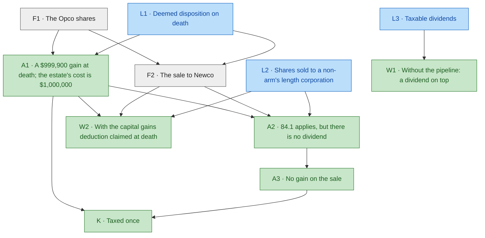
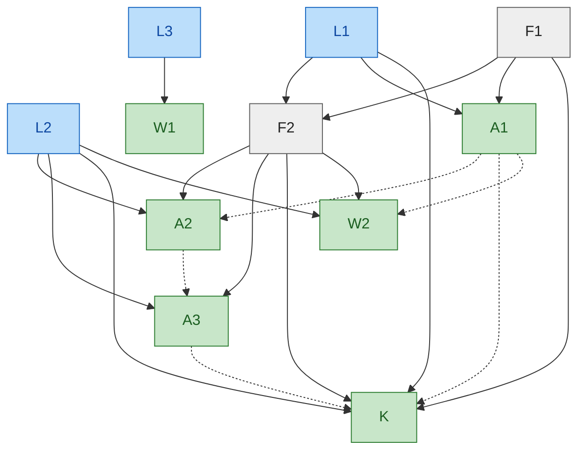
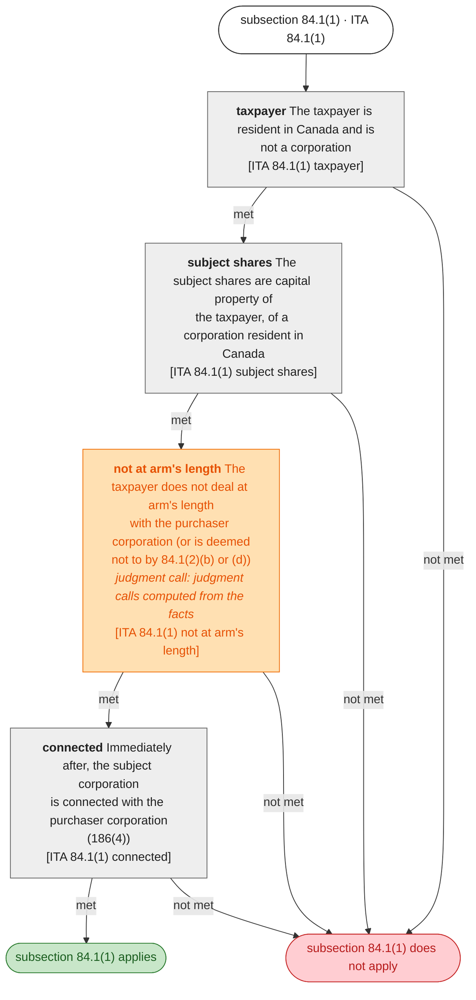

# Memo: a post-mortem pipeline

> Generated from the Lean sources by `scripts/blueprint.sh`. Do not edit by hand.

**Issue.** The deceased's Opco shares (cost $100, worth $1,000,000) pass to the estate. The gain is taxed at death. Can the estate take Opco's $1,000,000 out without it being taxed again as a dividend?

**Conclusion.** Yes, through a pipeline. 70(5) taxes the $999,900 gain at death and gives the estate a $1,000,000 cost (A1). When the estate sells the shares to its new corporation for a $1,000,000 note, 84.1 applies, but its hard cost is the full $1,000,000, so there is no dividend and no gain (A2, A3): the gain at death is taxed once (K). Without the pipeline, a dividend would add $1,150,000 of income (W1). Had the capital gains deduction been claimed at death, the sheltered part would come back as a dividend (W2).

The CRA's conditions for not applying 84(2) or 245(2) to the later repayment of the note are not encoded.

This is a constructed example, not advice on a real transaction.

**Status of the 11 statements:** 6 proven, 3 encoded, 2 fact.

## Dependency graph



Green: proven in Lean. Blue: encoded (definitions). Grey: facts. Orange: judgment calls. Dashed red: not yet formalized. An arrow points from a statement to the statements that use it.

### What the Lean proofs use

The same statements, with the dependencies Lean finds in the proofs themselves (solid) and those stated only in the memo's reasoning (dotted). Every dependency a proof has is also stated in the memo: `Blueprint.check` refuses a memo that hides one.



### Flowchart: subsection 84.1(1)



## The law

### L1. Deemed disposition on death

**Status:** encoded · **Citation:** ITA 70(5)

Capital property is deemed disposed of at fair market value immediately before death, and acquired at that cost by whoever receives it.

**Lean:** [`Canteen.ITA.Death.proceeds`](../../Canteen/ITA/S70/Death.lean#L88), [`Canteen.ITA.Death.recipientCost`](../../Canteen/ITA/S70/Death.lean#L93), [`Canteen.ITA.Death.disposition`](../../Canteen/ITA/S70/Death.lean#L96)

### L2. Shares sold to a non-arm's length corporation

**Status:** encoded · **Citation:** ITA 84.1; 84.1(2)(a.1)

Boot above the greater of paid-up capital and hard cost is a dividend; hard cost excludes earlier gains of non-arm's length individuals only to the extent the capital gains deduction sheltered them.

**Lean:** [`Canteen.ITA.SurplusStripping.applies`](../../Canteen/ITA/S84_1/SurplusStripping.lean#L102), [`Canteen.ITA.SurplusStripping.hardCost`](../../Canteen/ITA/S84_1/SurplusStripping.lean#L120), [`Canteen.ITA.SurplusStripping.dividend`](../../Canteen/ITA/S84_1/SurplusStripping.lean#L142)

### L3. Taxable dividends

**Status:** encoded · **Citation:** ITA 82(1)

A non-eligible dividend is included with a 15% gross-up.

**Lean:** [`Canteen.ITA.Dividends.inclusion`](../../Canteen/ITA/S82/Dividends.lean#L92)

## Facts

### F1. The Opco shares

**Status:** fact

Paid-up capital and cost $100, worth $1,000,000, passing to the estate; no capital gains deduction claimed.

**Lean:** [`Canteen.Transactions.PostMortemPipeline.opcoShares`](../../Canteen/Transactions/PostMortemPipeline.lean#L30), [`Canteen.Transactions.PostMortemPipeline.death`](../../Canteen/Transactions/PostMortemPipeline.lean#L33)

### F2. The sale to Newco

**Status:** fact · **Uses:** F1, L1

The estate sells the shares to Newco, which it controls, for a $1,000,000 note.

**Lean:** [`Canteen.Transactions.PostMortemPipeline.sale`](../../Canteen/Transactions/PostMortemPipeline.lean#L36)

**Rests on:** facts F1.

## Analysis

### A1. A $999,900 gain at death; the estate's cost is $1,000,000

**Status:** proven · **Citation:** ITA 70(5)(a), (b) · **Uses:** F1, L1

The shares are deemed disposed of at $1,000,000 and acquired by the estate at that cost.

**Lean:** [`Canteen.Transactions.PostMortemPipeline.gain_at_death`](../../Canteen/Transactions/PostMortemPipeline.lean#L46)

**Rests on:** facts F1.

### A2. 84.1 applies, but there is no dividend

**Status:** proven · **Citation:** ITA 84.1(1), (2)(a.1) · **Uses:** A1, F2, L2

The estate and Newco are not at arm's length and connected, so 84.1 applies. No capital gains deduction was claimed at death, so nothing comes off the estate's $1,000,000 cost; the $1,000,000 note does not exceed it.

**Lean:** [`Canteen.Transactions.PostMortemPipeline.pipeline_no_dividend`](../../Canteen/Transactions/PostMortemPipeline.lean#L51)

**Rests on:** facts F1, F2.

### A3. No gain on the sale

**Status:** proven · **Citation:** ITA 40(1)(a) · **Uses:** A2

Proceeds of $1,000,000 against a $1,000,000 cost.

**Lean:** [`Canteen.Transactions.PostMortemPipeline.pipeline_no_gain`](../../Canteen/Transactions/PostMortemPipeline.lean#L57)

**Rests on:** facts F1, F2.

## Conclusion

### K. Taxed once

**Status:** proven · **Uses:** A1, A3

The $999,900 gain at death is the only amount taxed; the estate takes the $1,000,000 out as repayment of the note.

**Lean:** [`Canteen.Transactions.PostMortemPipeline.taxed_once`](../../Canteen/Transactions/PostMortemPipeline.lean#L60)

**Rests on:** facts F1, F2.

## What if

### W1. Without the pipeline: a dividend on top

**Status:** proven · **Citation:** ITA 82(1) · **Uses:** L3

Paid out as a dividend, the $1,000,000 would add $1,150,000 of income, on top of the gain at death.

**Lean:** [`Canteen.Transactions.PostMortemPipeline.without_pipeline`](../../Canteen/Transactions/PostMortemPipeline.lean#L65)

### W2. With the capital gains deduction claimed at death

**Status:** proven · **Citation:** ITA 84.1(2)(a.1)(ii) · **Uses:** A1, F2, L2

Had $500,000 of the gain been sheltered, the estate's hard cost would be $500,000, and $500,000 of the note would be a dividend.

**Lean:** [`Canteen.Transactions.PostMortemPipeline.sheltered_part_is_dividend`](../../Canteen/Transactions/PostMortemPipeline.lean#L70)

**Rests on:** facts F1, F2.

## Appendix: the argument as Lean renders it

### Subsection 70(5), at death

```
1. The property did not pass to a resident spouse or common-law partner or a qualifying resident spousal trust. [ITA 70(6)(a), (b)]
2. Therefore subsection 70(6) does not apply. [ITA 70(6)]
3. So the shares of Opco is deemed disposed of immediately before death for its fair market value, $1,000,000.00, and acquired at that cost. [ITA 70(5)(a), (b)]
Relies on no judgment calls.
```

### Section 84.1, the sale to Newco

```
1. The taxpayer is resident in Canada and is not a corporation. [ITA 84.1(1) taxpayer]
2. The subject shares are capital property of the taxpayer, of a corporation resident in Canada. [ITA 84.1(1) subject shares]
3. The taxpayer does not deal at arm's length with the purchaser corporation (or is deemed not to by 84.1(2)(b) or (d)). [ITA 84.1(1) not at arm's length]
4. Immediately after, the subject corporation is connected with the purchaser corporation (186(4)). [ITA 84.1(1) connected]
5. Therefore subsection 84.1(1) applies. [ITA 84.1(1)]
6. The greater of the subject shares' paid-up capital ($100.00) and their adjusted cost base as 84.1(2)(a.1) reduces it ($1,000,000.00) is $1,000,000.00. [ITA 84.1(1)(a) B, (b) E; 84.1(2)(a.1)]
7. The new shares' paid-up capital is reduced by $0.00, to $0.00. [ITA 84.1(1)(a)]
8. A dividend of $0.00 is deemed paid to the taxpayer. [ITA 84.1(1)(b)]
9. The taxpayer's proceeds of disposition are $1,000,000.00. [ITA 54 "proceeds of disposition" (k)]
Relies on no judgment calls.
```

