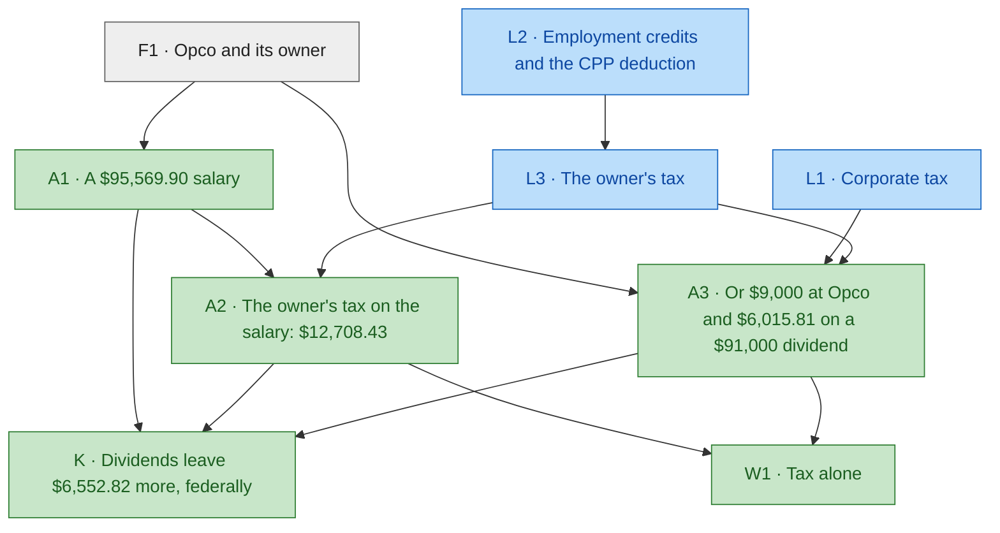
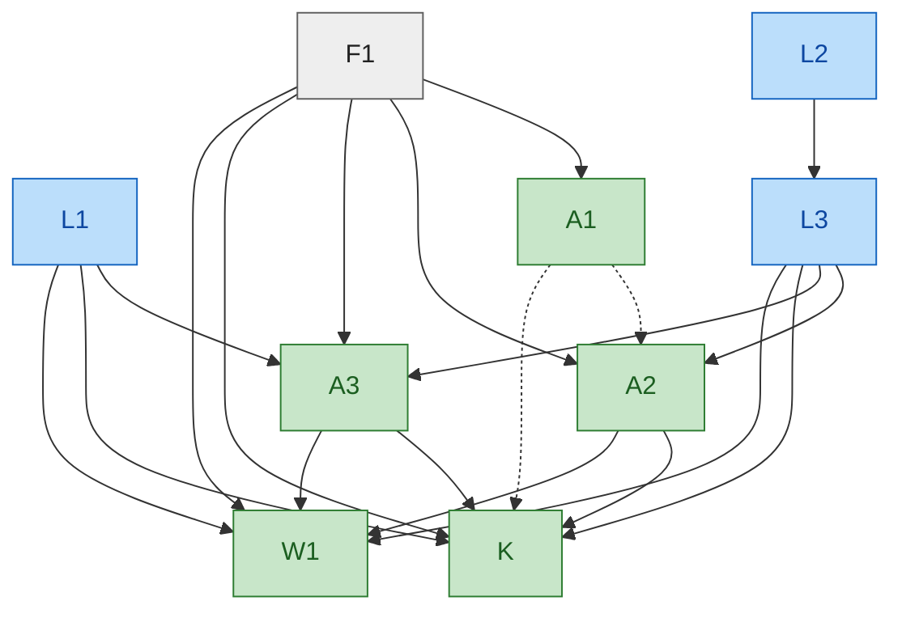

# Memo: paying the owner-manager a salary or dividends

> Generated from the Lean sources by `scripts/blueprint.sh`. Do not edit by hand.

**Issue.** Opco, a CCPC, has $100,000 of active business income in 2025, within its business limit, before paying its owner, who has no other income. Should it pay a salary or dividends?

**Conclusion.** Federally, dividends leave the owner $6,552.82 more: $84,984.19 against $78,431.37 (K). Most of the difference is Canada Pension Plan contributions, $8,860.20 between the owner and Opco (A1), which buy a pension not valued here; on tax alone the salary costs $2,307.38 less (W1). A salary also creates RRSP room. Provincial tax, which changes the balance, is not computed.

This is a constructed example, not advice.

**Status of the 9 statements:** 5 proven, 3 encoded, 1 fact.

## Dependency graph



Green: proven in Lean. Blue: encoded (definitions). Grey: facts. Orange: judgment calls. Dashed red: not yet formalized. An arrow points from a statement to the statements that use it.

### What the Lean proofs use

The same statements, with the dependencies Lean finds in the proofs themselves (solid) and those stated only in the memo's reasoning (dotted). Every dependency a proof has is also stated in the memo: `Blueprint.check` refuses a memo that hides one.



## The law

### L1. Corporate tax

**Status:** encoded · **Citation:** ITA 123–125

9% federally on active business income within the business limit; a salary and the employer's CPP are deductible, leaving no taxable income.

**Lean:** [`Canteen.ITA.CorporateRates.tax`](../../Canteen/ITA/S123/CorporateRates.lean#L52)

### L2. Employment credits and the CPP deduction

**Status:** encoded · **Citation:** ITA 118(10); 118.7; 60(e.1)

14% of up to $1,471 of employment income, and of base CPP contributions (and EI premiums); the enhanced CPP contributions are deducted from income.

**Lean:** [`Canteen.ITA.EmploymentCredits.employmentCredit`](../../Canteen/ITA/S118_7/EmploymentCredits.lean#L50), [`Canteen.ITA.EmploymentCredits.contributionCredit`](../../Canteen/ITA/S118_7/EmploymentCredits.lean#L53), [`Canteen.ITA.EmploymentCredits.enhancedDeduction`](../../Canteen/ITA/S118_7/EmploymentCredits.lean#L57)

### L3. The owner's tax

**Status:** encoded · **Citation:** ITA 3; 82(1); 117(2); 118(1); 121 · **Uses:** L2

Tax at the 117(2) rates on income (non-eligible dividends grossed up by 15%), less the personal, employment and dividend tax credits.

**Lean:** [`Canteen.ITA.IndividualYear.federalTax`](../../Canteen/ITA/S3/IndividualYear.lean#L311), [`Canteen.ITA.IndividualYear.employmentCredits`](../../Canteen/ITA/S3/IndividualYear.lean#L180), [`Canteen.ITA.IndividualYear.enhancedCpp`](../../Canteen/ITA/S3/IndividualYear.lean#L177)

## Facts

### F1. Opco and its owner

**Status:** fact

$100,000 of active business income; the owner has no other income and, holding over 40% of the votes, pays no EI premiums. CPP contributions under the Canada Pension Plan for 2025.

**Lean:** [`Canteen.Transactions.SalaryOrDividend.available`](../../Canteen/Transactions/SalaryOrDividend.lean#L29), [`Canteen.Transactions.SalaryOrDividend.cppBase`](../../Canteen/Transactions/SalaryOrDividend.lean#L31), [`Canteen.Transactions.SalaryOrDividend.cppEnhanced`](../../Canteen/Transactions/SalaryOrDividend.lean#L33), [`Canteen.Transactions.SalaryOrDividend.cpp`](../../Canteen/Transactions/SalaryOrDividend.lean#L36), [`Canteen.Transactions.SalaryOrDividend.salary`](../../Canteen/Transactions/SalaryOrDividend.lean#L38), [`Canteen.Transactions.SalaryOrDividend.opco`](../../Canteen/Transactions/SalaryOrDividend.lean#L46)

## Analysis

### A1. A $95,569.90 salary

**Status:** proven · **Citation:** CPP 8(1), (1.1), (1.2); ITA 9(1) · **Uses:** F1

With Opco's matching $4,430.10 of CPP, it uses up the $100,000; the owner contributes the same.

**Lean:** [`Canteen.Transactions.SalaryOrDividend.salary_uses_it_all`](../../Canteen/Transactions/SalaryOrDividend.lean#L54)

**Rests on:** facts F1.

### A2. The owner's tax on the salary: $12,708.43

**Status:** proven · **Citation:** ITA 117(2); 118(10); 118.7; 60(e.1) · **Uses:** A1, L3

After $675.79 of employment and CPP credits and the $1,074 deduction of enhanced contributions.

**Lean:** [`Canteen.Transactions.SalaryOrDividend.withSalary`](../../Canteen/Transactions/SalaryOrDividend.lean#L41), [`Canteen.Transactions.SalaryOrDividend.salary_tax`](../../Canteen/Transactions/SalaryOrDividend.lean#L58)

**Rests on:** facts F1.

### A3. Or $9,000 at Opco and $6,015.81 on a $91,000 dividend

**Status:** proven · **Citation:** ITA 125(1); 82(1); 121 · **Uses:** F1, L1, L3

Opco pays the small business rate and the rest out as a non-eligible dividend.

**Lean:** [`Canteen.Transactions.SalaryOrDividend.dividend`](../../Canteen/Transactions/SalaryOrDividend.lean#L48), [`Canteen.Transactions.SalaryOrDividend.withDividend`](../../Canteen/Transactions/SalaryOrDividend.lean#L49), [`Canteen.Transactions.SalaryOrDividend.dividend_tax`](../../Canteen/Transactions/SalaryOrDividend.lean#L64)

**Rests on:** facts F1.

## Conclusion

### K. Dividends leave $6,552.82 more, federally

**Status:** proven · **Uses:** A1, A2, A3

$84,984.19 against $78,431.37; neither pays minimum tax.

**Lean:** [`Canteen.Transactions.SalaryOrDividend.what_the_owner_keeps`](../../Canteen/Transactions/SalaryOrDividend.lean#L68), [`Canteen.Transactions.SalaryOrDividend.no_minimum_tax`](../../Canteen/Transactions/SalaryOrDividend.lean#L82)

**Rests on:** facts F1.

## What if

### W1. Tax alone

**Status:** proven · **Citation:** ITA 117(2); 121; 125(1) · **Uses:** A2, A3

Leaving CPP aside, the salary route's tax is $2,307.38 less: the dividend tax credit does not quite integrate at the small business rate.

**Lean:** [`Canteen.Transactions.SalaryOrDividend.tax_alone`](../../Canteen/Transactions/SalaryOrDividend.lean#L77)

**Rests on:** facts F1.

## Appendix: the argument as Lean renders it

### The owner, with the salary

```
1. Employment and business income $95,569.90; dividends included $0.00 (with the gross-up); recapture $0.00; income attributed $0.00. [ITA 3(a); 82(1); 13(1); 74.1]
2. Taxable capital gains, net: $0.00. [ITA 3(b)]
3. Losses: business $0.00, terminal $0.00, attributed $0.00; interest deducted $0.00. [ITA 3(d); 20(16); 74.1; 20(1)(c)]
4. Income for the year: $94,495.90. [ITA 3]
5. Less the net capital loss deduction $0.00, the capital gains deduction $0.00, and other deductions $0.00: taxable income $94,495.90. [ITA 2(2); 111(1)(b); 110.6(2), (2.1)]
6. Tax under 117(2) on taxable income, $15,642.28, less the dividend tax credit of $0.00, the personal credit of $2,258.06, the age and pension credits of $0.00, the employment, CPP and EI credits of $675.79, the adoption, accessibility, home buyers' and volunteer credits of $0.00, the tuition credits of $0.00, the donation credit of $0.00, the medical expense credit of $0.00, the disability credit of $0.00 and other credits of $0.00: $12,708.43. [ITA 117(2); 120.4(2); 121; 118 to 118.07; 118.1; 118.2; 118.3; 118.5; 118.61; 118.7; 118.9]
Relies on no judgment calls.
```

### The owner, with the dividend

```
1. Employment and business income $0.00; dividends included $104,650.00 (with the gross-up); recapture $0.00; income attributed $0.00. [ITA 3(a); 82(1); 13(1); 74.1]
2. Taxable capital gains, net: $0.00. [ITA 3(b)]
3. Losses: business $0.00, terminal $0.00, attributed $0.00; interest deducted $0.00. [ITA 3(d); 20(16); 74.1; 20(1)(c)]
4. Income for the year: $104,650.00. [ITA 3]
5. Less the net capital loss deduction $0.00, the capital gains deduction $0.00, and other deductions $0.00: taxable income $104,650.00. [ITA 2(2); 111(1)(b); 110.6(2), (2.1)]
6. Tax under 117(2) on taxable income, $17,723.87, less the dividend tax credit of $9,450.00, the personal credit of $2,258.06, the age and pension credits of $0.00, the employment, CPP and EI credits of $0.00, the adoption, accessibility, home buyers' and volunteer credits of $0.00, the tuition credits of $0.00, the donation credit of $0.00, the medical expense credit of $0.00, the disability credit of $0.00 and other credits of $0.00: $6,015.81. [ITA 117(2); 120.4(2); 121; 118 to 118.07; 118.1; 118.2; 118.3; 118.5; 118.61; 118.7; 118.9]
Relies on no judgment calls.
```

