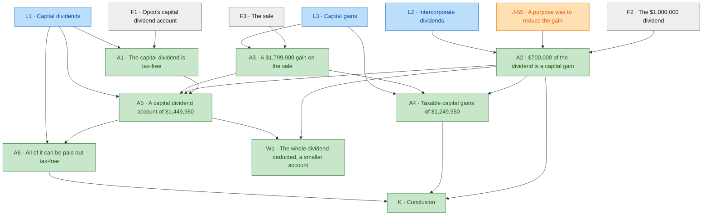
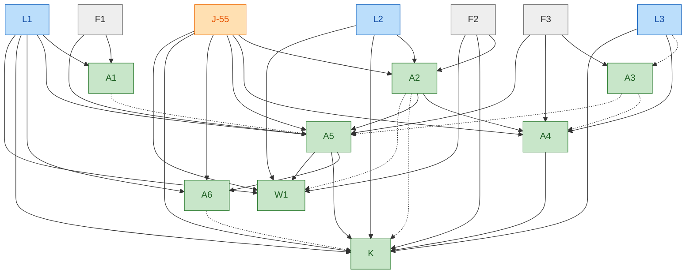
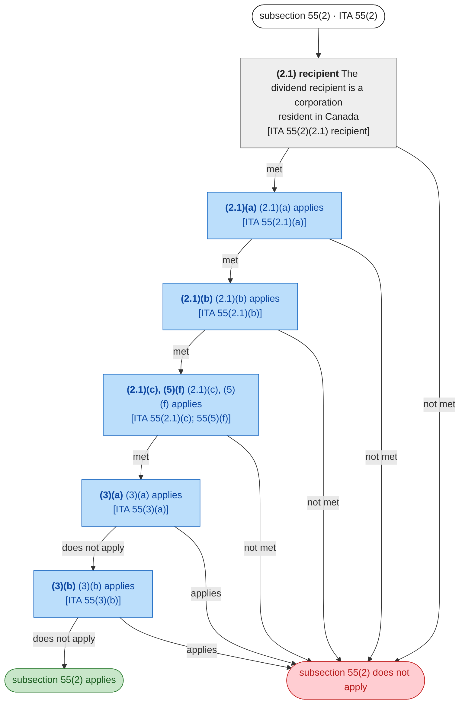
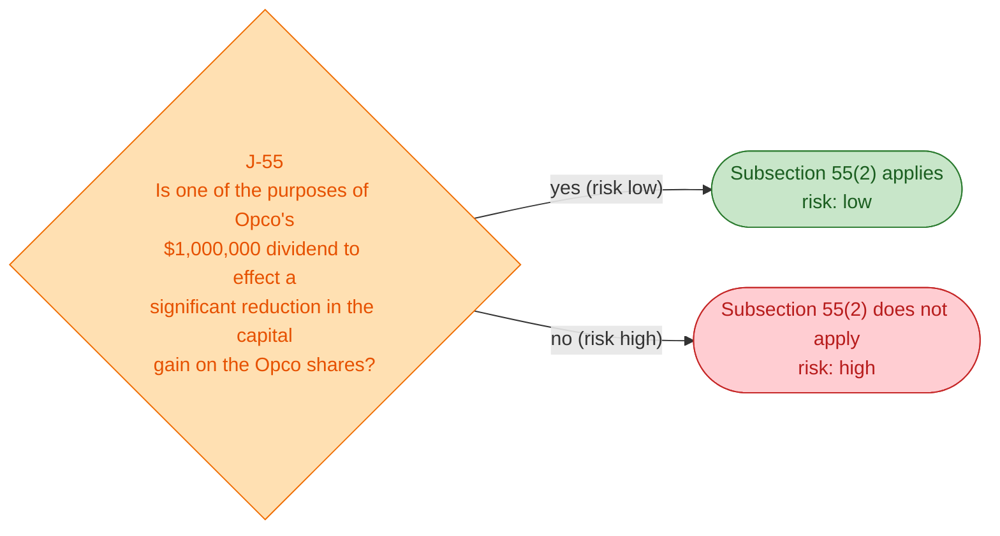

# Memo: selling Opco through Holdco, with dividends first

> Generated from the Lean sources by `scripts/blueprint.sh`. Do not edit by hand.

**Issue.** Before Holdco sold Opco to an unrelated buyer, Opco paid Holdco a $200,000 capital dividend and a $1,000,000 taxable dividend, though Opco had only $300,000 of safe income. What does Holdco include, and what can it pay its shareholder tax-free?

**Conclusion.** The capital dividend is tax-free (A1). On the position that reducing the gain was one of the dividend's purposes, 55(2) makes $700,000 of the taxable dividend a capital gain; Holdco deducts the other $300,000 (A2). With the $1,799,900 gain on the sale, Holdco's taxable capital gains are $1,249,950 (A4), and its capital dividend account is $1,449,950, all of which it can pay out tax-free (A5, A6).

**If reducing the gain were not a purpose**, the whole dividend would be deducted, and the account would be $350,000 smaller (W1). The result turns on J-55.

This is a constructed example, not advice on a real transaction.

**Status of the 15 statements:** 8 proven, 3 encoded, 3 fact, 1 judgment call.

## Dependency graph



Green: proven in Lean. Blue: encoded (definitions). Grey: facts. Orange: judgment calls. Dashed red: not yet formalized. An arrow points from a statement to the statements that use it.

### What the Lean proofs use

The same statements, with the dependencies Lean finds in the proofs themselves (solid) and those stated only in the memo's reasoning (dotted). Every dependency a proof has is also stated in the memo: `Blueprint.check` refuses a memo that hides one.



### Flowchart: subsection 55(2)



### Decision tree: J-55



## The law

### L1. Capital dividends

**Status:** encoded · **Citation:** ITA 83(2); 89(1) "capital dividend account"

A private corporation's elected dividend is a capital dividend to the extent of its account, which holds the untaxed half of its capital gains and capital dividends received; no shareholder includes it.

**Lean:** [`Canteen.ITA.CapitalDividendAccount.account`](../../Canteen/ITA/S89/CapitalDividendAccount.lean#L62), [`Canteen.ITA.CapitalDividendAccount.capitalDividend`](../../Canteen/ITA/S89/CapitalDividendAccount.lean#L66)

### L2. Intercorporate dividends

**Status:** encoded · **Citation:** ITA 112(1); 55(2), (2.1), (5)(f)

A corporation deducts taxable dividends from taxable Canadian corporations, but the part over safe income, paid with a purpose of reducing a capital gain, is a capital gain instead.

**Lean:** [`Canteen.ITA.IntercorporateDividends.subsection55_2`](../../Canteen/ITA/S55/IntercorporateDividends.lean#L113), [`Canteen.ITA.IntercorporateDividends.gain`](../../Canteen/ITA/S55/IntercorporateDividends.lean#L143), [`Canteen.ITA.IntercorporateDividends.deduction`](../../Canteen/ITA/S55/IntercorporateDividends.lean#L146)

### L3. Capital gains

**Status:** encoded · **Citation:** ITA 3(b); 38; 39(1); 40(1)

Half of a capital gain is a taxable capital gain.

**Lean:** [`Canteen.ITA.CapitalGains.Year.paragraph3b`](../../Canteen/ITA/S38/CapitalGains.lean#L190)

## Facts

### F1. Opco's capital dividend account

**Status:** fact

Opco has $200,000 in its capital dividend account (from life insurance proceeds).

**Lean:** [`Canteen.Transactions.SaleThroughHoldco.opcoAccount`](../../Canteen/Transactions/SaleThroughHoldco.lean#L34)

### F2. The $1,000,000 dividend

**Status:** fact

Opco pays Holdco a $1,000,000 taxable dividend; the safe income on the Opco shares is $300,000; the shares are then sold to an unrelated buyer.

**Lean:** [`Canteen.Transactions.SaleThroughHoldco.taxableDividend`](../../Canteen/Transactions/SaleThroughHoldco.lean#L37)

### F3. The sale

**Status:** fact

Holdco sells the Opco shares (cost $100) for $1,800,000.

**Lean:** [`Canteen.Transactions.SaleThroughHoldco.sale`](../../Canteen/Transactions/SaleThroughHoldco.lean#L42)

## Judgment call

### J-55. A purpose was to reduce the gain

**Status:** judgment call

One of the purposes of the $1,000,000 dividend, paid just before the sale, was to effect a significant reduction in the capital gain on the Opco shares. Risk: low.

**Lean:** [`Canteen.Transactions.SaleThroughHoldco.calls`](../../Canteen/Transactions/SaleThroughHoldco.lean#L28), [`Canteen.Transactions.SaleThroughHoldco.position`](../../Canteen/Transactions/SaleThroughHoldco.lean#L32)

## Analysis

### A1. The capital dividend is tax-free

**Status:** proven · **Citation:** ITA 83(2) · **Uses:** F1, L1

Opco elects; the whole $200,000 is within its account, so it is a capital dividend.

**Lean:** [`Canteen.Transactions.SaleThroughHoldco.capital_dividend`](../../Canteen/Transactions/SaleThroughHoldco.lean#L59)

**Rests on:** facts F1.

### A2. $700,000 of the dividend is a capital gain

**Status:** proven · **Citation:** ITA 55(2)(c); 112(1) · **Uses:** F2, J-55, L2

Holdco could deduct the dividend under 112(1); a purpose was to reduce the gain; it exceeds safe income by $700,000; and the sale to an unrelated buyer takes it out of 55(3)(a). So $700,000 is a capital gain, and Holdco deducts $300,000.

**Lean:** [`Canteen.Transactions.SaleThroughHoldco.dividend_recharacterized`](../../Canteen/Transactions/SaleThroughHoldco.lean#L62), [`Canteen.Transactions.SaleThroughHoldco.deemedGain`](../../Canteen/Transactions/SaleThroughHoldco.lean#L45)

**Rests on:** judgment calls J-55; facts F2.

### A3. A $1,799,900 gain on the sale

**Status:** proven · **Citation:** ITA 40(1)(a) · **Uses:** F3, L3

Proceeds of $1,800,000 less the $100 cost.

**Lean:** [`Canteen.Transactions.SaleThroughHoldco.sale_gain`](../../Canteen/Transactions/SaleThroughHoldco.lean#L69)

**Rests on:** facts F3.

### A4. Taxable capital gains of $1,249,950

**Status:** proven · **Citation:** ITA 3(b); 38(a) · **Uses:** A2, A3, L3

Half of the $2,499,900 of capital gains.

**Lean:** [`Canteen.Transactions.SaleThroughHoldco.holdcoYear`](../../Canteen/Transactions/SaleThroughHoldco.lean#L54), [`Canteen.Transactions.SaleThroughHoldco.holdco_taxable`](../../Canteen/Transactions/SaleThroughHoldco.lean#L72)

**Rests on:** judgment calls J-55; facts F2, F3.

### A5. A capital dividend account of $1,449,950

**Status:** proven · **Citation:** ITA 89(1) "capital dividend account" (a), (b) · **Uses:** A1, A2, A3, L1

The untaxed half of the two gains, $1,249,950, and the $200,000 capital dividend received.

**Lean:** [`Canteen.Transactions.SaleThroughHoldco.holdcoAccount`](../../Canteen/Transactions/SaleThroughHoldco.lean#L49), [`Canteen.Transactions.SaleThroughHoldco.holdco_account`](../../Canteen/Transactions/SaleThroughHoldco.lean#L75)

**Rests on:** judgment calls J-55; facts F1, F2, F3.

### A6. All of it can be paid out tax-free

**Status:** proven · **Citation:** ITA 83(2) · **Uses:** A5, L1

Holdco elects on a $1,449,950 dividend: all of it is a capital dividend, and nothing exceeds the account.

**Lean:** [`Canteen.Transactions.SaleThroughHoldco.holdco_capital_dividend`](../../Canteen/Transactions/SaleThroughHoldco.lean#L79)

**Rests on:** judgment calls J-55; facts F1, F2, F3.

## Conclusion

### K. Conclusion

**Status:** proven · **Uses:** A2, A4, A6

Holdco pays tax on $1,249,950 of taxable capital gains, deducts $300,000 of the dividend, and can pay its shareholder $1,449,950 tax-free as a capital dividend.

**Lean:** [`Canteen.Transactions.SaleThroughHoldco.dividend_recharacterized`](../../Canteen/Transactions/SaleThroughHoldco.lean#L62), [`Canteen.Transactions.SaleThroughHoldco.holdco_taxable`](../../Canteen/Transactions/SaleThroughHoldco.lean#L72), [`Canteen.Transactions.SaleThroughHoldco.holdco_capital_dividend`](../../Canteen/Transactions/SaleThroughHoldco.lean#L79)

**Rests on:** judgment calls J-55; facts F2, F3, F1.

## If reducing the gain were not a purpose

### W1. The whole dividend deducted, a smaller account

**Status:** proven · **Citation:** ITA 55(2.1)(b) · **Uses:** A2, A5

55(2) would not apply: Holdco would deduct the whole $1,000,000, and its capital dividend account would be $1,099,950. Either way, the explanation rests on J-55.

**Lean:** [`Canteen.Transactions.SaleThroughHoldco.without_55_2`](../../Canteen/Transactions/SaleThroughHoldco.lean#L84), [`Canteen.Transactions.SaleThroughHoldco.relies_on_purpose`](../../Canteen/Transactions/SaleThroughHoldco.lean#L90)

**Rests on:** judgment calls J-55; facts F2, F1, F3.

## Appendix: the argument as Lean renders it

### Subsection 55(2), on the position taken

```
1. The dividend recipient is a corporation resident in Canada. [ITA 55(2)(2.1) recipient]
2. The recipient is entitled to deduct the dividend under subsection 112(1). [ITA 55(2.1)(a)]
3. One of the purposes (or, for an 84(3) dividend, one of the results) of the dividend is a significant reduction in the capital gain on a share, or in a share's value or an increase in cost. [ITA 55(2.1)(b)]
4. The dividend exceeds the safe income that could reasonably be considered to contribute to the capital gain on the share; the excess is a separate dividend. [ITA 55(2.1)(c); 55(5)(f)]
5. The dividend is not on a redemption in a series free of the dispositions and increases in interest in 55(3)(a)(i) to (v). [ITA 55(3)(a)]
6. The dividend is not received on a butterfly reorganization. [ITA 55(3)(b)]
7. Therefore subsection 55(2) applies. [ITA 55(2)]
8. So $700,000.00, the excess over safe income of $300,000.00, is deemed not to be a dividend, but a gain from the disposition of a capital property. [ITA 55(2)(a), (c)]
9. The recipient deducts the remaining $300,000.00 under subsection 112(1). [ITA 112(1)]
Relies on these judgment calls:
- J-55: Is one of the purposes of Opco's $1,000,000 dividend to effect a significant reduction in the capital gain on the Opco shares? Assumed: yes. Risk: low.
Overall risk: low.
```

### Holdco's capital dividend account

```
1. The untaxed part of the corporation's capital gains, less the unallowed part of its capital losses, is $1,249,950.00. [ITA 89(1) "capital dividend account" (a)]
2. With capital dividends received, life insurance proceeds and other additions, less capital dividends paid, the capital dividend account is $1,449,950.00. [ITA 89(1) "capital dividend account"]
3. Of the $1,449,950.00 dividend elected on, $1,449,950.00 is a capital dividend. [ITA 83(2)(a)]
4. No part of it is included in computing any shareholder's income. [ITA 83(2)(b)]
Relies on no judgment calls.
```

