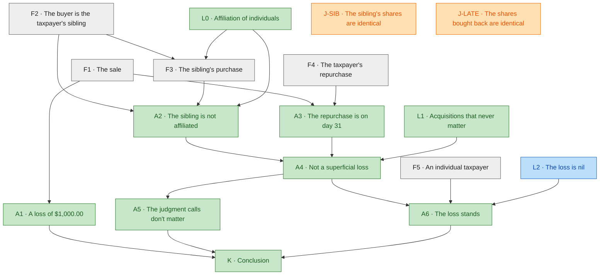
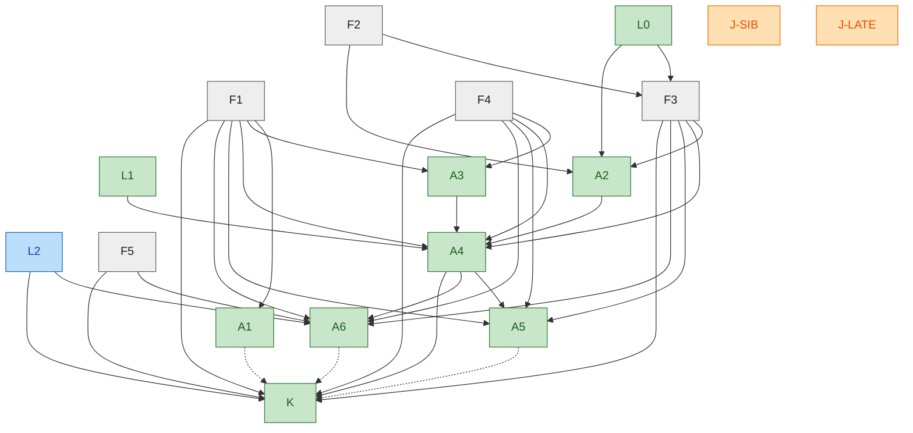
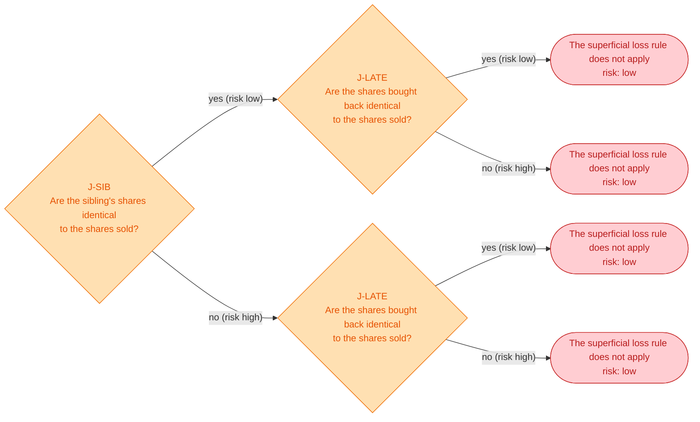

# Memo: a sibling buys in the period, and the taxpayer buys back on day 31

> Generated from the Lean sources by `scripts/blueprint.sh`. Do not edit by hand.

**Issue.** The taxpayer sold 50 common shares of DEF Inc. at a $1,000.00 loss on 2025-03-03. The taxpayer's sibling bought the same shares a week later, and the taxpayer bought them back on 2025-04-03. Can the taxpayer use the loss?

**Conclusion.** Yes. Siblings are not affiliated, and the repurchase is one day outside the period, so the loss is not a superficial loss (A4). This holds however the two identity judgment calls are answered: the conclusion rests on no judgment call at all (A5).

This is a constructed example, not advice on a real transaction.

**Status of the 17 statements:** 9 proven, 1 encoded, 5 fact, 2 judgment call.

## Dependency graph



Green: proven in Lean. Blue: encoded (definitions). Grey: facts. Orange: judgment calls. Dashed red: not yet formalized. An arrow points from a statement to the statements that use it.

### What the Lean proofs use

The same statements, with the dependencies Lean finds in the proofs themselves (solid) and those stated only in the memo's reasoning (dotted). Every dependency a proof has is also stated in the memo: `Blueprint.check` refuses a memo that hides one.



### Timeline of the period

```mermaid
gantt
    title Superficial loss period for the disposition on 2025-03-03
    dateFormat YYYY-MM-DD
    axisFormat %b %d
    section Period (a)
    2025-02-01 to 2025-04-02 :active, period, 2025-02-01, 61d
    section Disposition
    2025-03-03 disposition of 50 common shares of DEF Inc. (loss $1,000.00) :milestone, disp, 2025-03-03, 0d
    section Acquisitions
    2025-03-10 the taxpayer's sibling (not affiliated) acquires 50 common shares of DEF Inc. (in period, held at end) :milestone, a0, 2025-03-10, 0d
    2025-04-03 the taxpayer acquires 50 common shares of DEF Inc. (outside period, held at end) :milestone, a1, 2025-04-03, 0d
    section End of period (b)
    2025-04-02 end of period :milestone, endp, 2025-04-02, 0d
```

### Decision tree: both judgment calls



## The law

### L0. Affiliation of individuals

**Status:** proven · **Citation:** ITA 251.1(1)

Two individuals who are not spouses or common-law partners are affiliated only if one of paragraphs 251.1(1)(b) to (g) applies.

**Lean:** [`Canteen.ITA.Affiliation.affiliated`](../../Canteen/ITA/S251_1/Affiliation.lean#L47), [`Canteen.ITA.Affiliation.individuals_not_spouses`](../../Canteen/ITA/S251_1/Affiliation.lean#L60)

### L1. Acquisitions that never matter

**Status:** proven · **Citation:** ITA 54 "superficial loss"

An acquisition by a person not affiliated with the taxpayer, or outside the period, never affects whether a loss is superficial; and with no acquisitions left, there is no superficial loss. (Proven once, in the provision's blueprint.)

**Lean:** [`Canteen.ITA.SuperficialLoss.not_affiliated_irrelevant`](../../Canteen/Lemmas/SuperficialLoss.lean#L61), [`Canteen.ITA.SuperficialLoss.outside_period_irrelevant`](../../Canteen/Lemmas/SuperficialLoss.lean#L47), [`Canteen.ITA.SuperficialLoss.not_of_no_acquisitions`](../../Canteen/Lemmas/SuperficialLoss.lean#L42)

### L2. The loss is nil

**Status:** encoded · **Citation:** ITA 40(2)(g)(i)

A loss, to the extent that it is a superficial loss, is nil.

**Lean:** [`Canteen.ITA.LossDenial.rule`](../../Canteen/ITA/S40/LossDenial.lean#L78)

## Facts

### F1. The sale

**Status:** fact

On 2025-03-03 the taxpayer sold 50 common shares of DEF Inc. for $2,000.00. Their adjusted cost base was $3,000.00.

**Lean:** [`Canteen.Transactions.SiblingAndLateRepurchase.sale`](../../Canteen/Transactions/SiblingAndLateRepurchase.lean#L28)

### F2. The buyer is the taxpayer's sibling

**Status:** fact

The taxpayer and the buyer are individuals and siblings: not spouses or common-law partners, and no other paragraph of subsection 251.1(1) applies to them.

**Lean:** [`Canteen.Transactions.SiblingAndLateRepurchase.siblingRelation`](../../Canteen/Transactions/SiblingAndLateRepurchase.lean#L32)

### F3. The sibling's purchase

**Status:** fact · **Uses:** F2, L0

On 2025-03-10 the sibling bought 50 common shares of DEF Inc., and still held them at the end of the period.

**Lean:** [`Canteen.Transactions.SiblingAndLateRepurchase.siblingPurchase`](../../Canteen/Transactions/SiblingAndLateRepurchase.lean#L37)

**Rests on:** facts F2.

### F4. The taxpayer's repurchase

**Status:** fact

On 2025-04-03 the taxpayer bought 50 common shares of DEF Inc.

**Lean:** [`Canteen.Transactions.SiblingAndLateRepurchase.lateRepurchase`](../../Canteen/Transactions/SiblingAndLateRepurchase.lean#L42)

### F5. An individual taxpayer

**Status:** fact

The taxpayer is an individual, so the foreign affiliate carve-out in paragraph 40(2)(g) is not engaged.

**Lean:** [`Canteen.Transactions.SiblingAndLateRepurchase.surplusCarveOut`](../../Canteen/Transactions/SiblingAndLateRepurchase.lean#L55)

## Judgment calls (not needed)

Both judgment calls are listed for completeness. The conclusion does not rest on either: it is proven for every answer.

### J-SIB. The sibling's shares are identical

**Status:** judgment call

Whether the sibling's shares are identical to the shares sold.

### J-LATE. The shares bought back are identical

**Status:** judgment call

Whether the shares bought back are identical to the shares sold.

## Analysis

### A1. A loss of $1,000.00

**Status:** proven · **Citation:** ITA 40(1)(b) · **Uses:** F1

The adjusted cost base ($3,000.00) exceeds the proceeds ($2,000.00) by $1,000.00.

**Lean:** [`Canteen.Transactions.SiblingAndLateRepurchase.loss_amount`](../../Canteen/Transactions/SiblingAndLateRepurchase.lean#L63)

**Rests on:** facts F1.

### A2. The sibling is not affiliated

**Status:** proven · **Citation:** ITA 251.1(1) · **Uses:** F2, F3, L0

Siblings are not spouses or common-law partners, and no other paragraph applies, so the sibling is not affiliated with the taxpayer.

**Lean:** [`Canteen.Transactions.SiblingAndLateRepurchase.sibling_not_affiliated`](../../Canteen/Transactions/SiblingAndLateRepurchase.lean#L65), [`Canteen.Transactions.SiblingAndLateRepurchase.sibling_acquirer`](../../Canteen/Transactions/SiblingAndLateRepurchase.lean#L69)

**Rests on:** facts F2, F3.

### A3. The repurchase is on day 31

**Status:** proven · **Citation:** ITA 54 "superficial loss" (a) · **Uses:** F1, F4

The period runs from 2025-02-01 to 2025-04-02. The repurchase on 2025-04-03 is outside it.

**Lean:** [`Canteen.Transactions.SiblingAndLateRepurchase.repurchase_outside_period`](../../Canteen/Transactions/SiblingAndLateRepurchase.lean#L73)

**Rests on:** facts F1, F4.

### A4. Not a superficial loss

**Status:** proven · **Citation:** ITA 54 "superficial loss" · **Uses:** A2, A3, L1

The sibling's purchase and the repurchase both never matter, leaving no acquisition, so the loss is not a superficial loss, whether or not either purchase is of identical shares.

**Lean:** [`Canteen.Transactions.SiblingAndLateRepurchase.not_superficial`](../../Canteen/Transactions/SiblingAndLateRepurchase.lean#L77)

**Rests on:** facts F2, F3, F1, F4.

### A5. The judgment calls don't matter

**Status:** proven · **Uses:** A4

The result is the same on all four branches of J-SIB and J-LATE.

**Lean:** [`Canteen.Transactions.SiblingAndLateRepurchase.same_on_every_branch`](../../Canteen/Transactions/SiblingAndLateRepurchase.lean#L85)

**Rests on:** facts F2, F3, F1, F4.

### A6. The loss stands

**Status:** proven · **Citation:** ITA 40(2)(g)(i) · **Uses:** A4, F5, L2

Subparagraph 40(2)(g)(i) denies nothing: the $1,000.00 loss stands.

**Lean:** [`Canteen.Transactions.SiblingAndLateRepurchase.loss_stands`](../../Canteen/Transactions/SiblingAndLateRepurchase.lean#L89)

**Rests on:** facts F2, F3, F1, F4, F5.

### K. Conclusion

**Status:** proven · **Uses:** A1, A5, A6

The taxpayer can use the $1,000.00 loss. The conclusion rests on facts alone: no judgment call is needed.

**Lean:** [`Canteen.Transactions.SiblingAndLateRepurchase.loss_stands`](../../Canteen/Transactions/SiblingAndLateRepurchase.lean#L89)

**Rests on:** facts F1, F2, F3, F4, F5.

