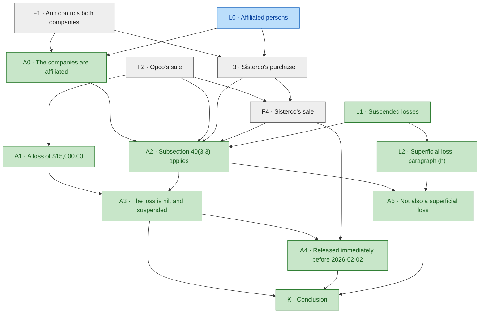
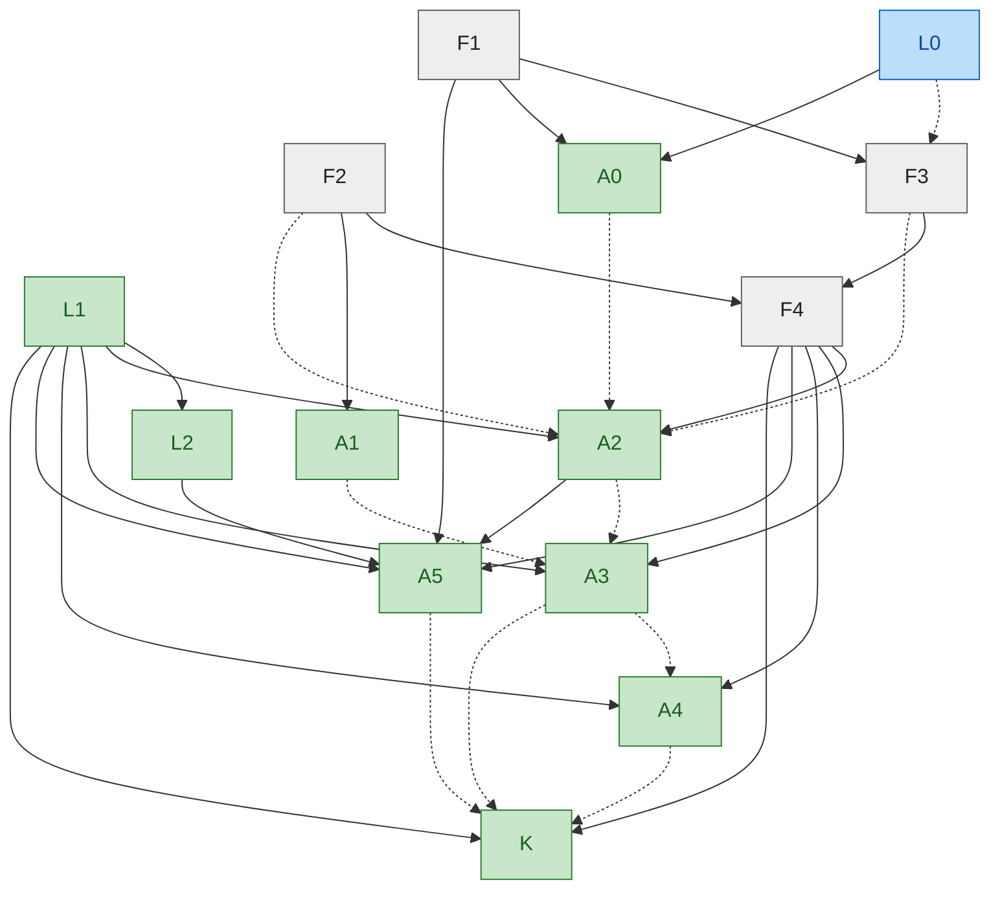
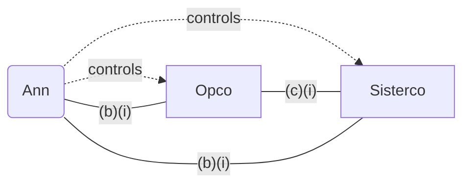
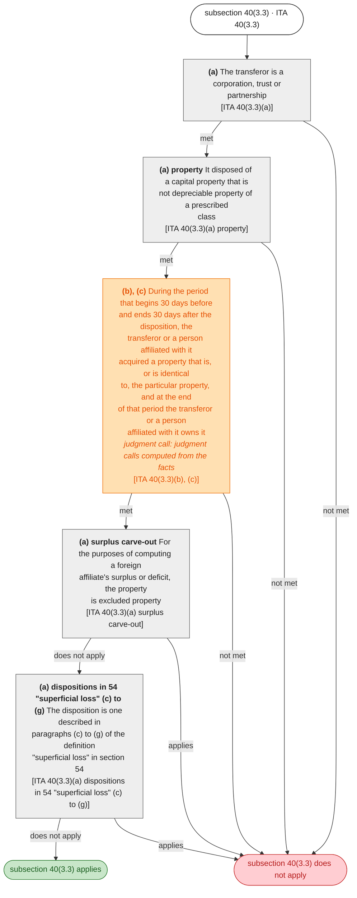

# Memo: a company's loss suspended when its sister company buys the shares

> Generated from the Lean sources by `scripts/blueprint.sh`. Do not edit by hand.

**Issue.** Opco sold 1,000 common shares of PQR Ltd. at a $15,000.00 loss on 2025-08-01. Sisterco, controlled like Opco by Ann, bought the same shares two weeks later and sold them on 2026-02-02. When can Opco use the loss?

**Conclusion.** Not on 2025-08-01: Opco and Sisterco are affiliated (A0), so subsection 40(3.3) applies and the loss is nil (A3). It is suspended, not lost: it is deemed to be Opco's loss immediately before 2026-02-02, when Sisterco's sale starts a 30-day period in which neither company owns the shares (A4). It is not also a superficial loss (A5). The conclusion rests on no judgment call.

This is a constructed example, not advice on a real transaction.

**Status of the 14 statements:** 9 proven, 1 encoded, 4 fact.

## Dependency graph



Green: proven in Lean. Blue: encoded (definitions). Grey: facts. Orange: judgment calls. Dashed red: not yet formalized. An arrow points from a statement to the statements that use it.

### What the Lean proofs use

The same statements, with the dependencies Lean finds in the proofs themselves (solid) and those stated only in the memo's reasoning (dotted). Every dependency a proof has is also stated in the memo: `Blueprint.check` refuses a memo that hides one.



### Who is affiliated with whom



### Timeline: the period, the suspension and the release

```mermaid
gantt
    title Suspended loss for the disposition on 2025-08-01
    dateFormat YYYY-MM-DD
    axisFormat %b %d
    section Period 40(3.3)(b)
    2025-07-02 to 2025-08-31 :active, period, 2025-07-02, 61d
    section Disposition
    2025-08-01 disposition of 1,000 common shares of PQR Ltd. :milestone, disp, 2025-08-01, 0d
    section Acquisitions
    2025-08-15 Sisterco (affiliated) acquires 1,000 common shares of PQR Ltd. :milestone, crit, a0, 2025-08-15, 0d
    section Suspended loss
    $15,000.00 suspended :active, susp, 2025-08-01, 185d
    2026-02-02 released, a 30-day period begins throughout which neither the transferor nor a person affiliated with it owns the substituted property :milestone, rel, 2026-02-02, 0d
```

### Subsection 40(3.3) as a flowchart



## The law

### L0. Affiliated persons

**Status:** encoded · **Citation:** ITA 251.1(1)

Two corporations are affiliated if each is controlled by a person and those persons are affiliated; a person is affiliated with itself (251.1(1)(c)(i), (4)(a)).

**Lean:** [`Canteen.ITA.AffiliatedPersons.rule`](../../Canteen/ITA/S251_1/AffiliatedPersons.lean#L606)

### L1. Suspended losses

**Status:** proven · **Citation:** ITA 40(3.3), (3.4)

When a corporation disposes of capital property and, within 30 days before or after, it or an affiliated person acquires identical property and owns it at the end of that period, the loss is nil, and deemed to arise immediately before the first of the times in 40(3.4)(b).

**Lean:** [`Canteen.ITA.SuspendedLoss.applies`](../../Canteen/ITA/S40/SuspendedLoss.lean#L151), [`Canteen.ITA.SuspendedLoss.rule`](../../Canteen/ITA/S40/SuspendedLoss.lean#L231), [`Canteen.ITA.SuspendedLoss.releaseDate`](../../Canteen/ITA/S40/SuspendedLoss.lean#L194), [`Canteen.ITA.SuspendedLoss.releaseDate_after`](../../Canteen/ITA/S40/SuspendedLoss.lean#L272)

### L2. Superficial loss, paragraph (h)

**Status:** proven · **Citation:** ITA 54 "superficial loss" (h) · **Uses:** L1

A disposition to which subsection 40(3.4) applies is not a superficial loss.

**Lean:** [`Canteen.ITA.SuspendedLoss.not_superficial_of_applies`](../../Canteen/ITA/S40/SuspendedLoss.lean#L304)

## Facts

### F1. Ann controls both companies

**Status:** fact

Ann controls Opco and Sisterco.

**Lean:** [`Canteen.Transactions.SisterCompanyRepurchase.world`](../../Canteen/Transactions/SisterCompanyRepurchase.lean#L25)

### F2. Opco's sale

**Status:** fact

On 2025-08-01 Opco sold 1,000 common shares of PQR Ltd., capital property, for $20,000.00; adjusted cost base $35,000.00. It was an ordinary sale: none of paragraphs (c) to (g) of the superficial loss definition applies.

**Lean:** [`Canteen.Transactions.SisterCompanyRepurchase.sale`](../../Canteen/Transactions/SisterCompanyRepurchase.lean#L30)

### F3. Sisterco's purchase

**Status:** fact · **Uses:** F1, L0

On 2025-08-15 Sisterco bought 1,000 common shares of PQR Ltd., and owned them at the end of the period.

**Lean:** [`Canteen.Transactions.SisterCompanyRepurchase.sisterPurchase`](../../Canteen/Transactions/SisterCompanyRepurchase.lean#L34)

**Rests on:** facts F1.

### F4. Sisterco's sale

**Status:** fact · **Uses:** F2, F3

On 2026-02-02 Sisterco sold the shares to an unrelated buyer; neither company owned any for 30 days after.

**Lean:** [`Canteen.Transactions.SisterCompanyRepurchase.facts`](../../Canteen/Transactions/SisterCompanyRepurchase.lean#L38), [`Canteen.Transactions.SisterCompanyRepurchase.factsBeforeRelease`](../../Canteen/Transactions/SisterCompanyRepurchase.lean#L44)

**Rests on:** facts F2, F3, F1.

## Analysis

### A0. The companies are affiliated

**Status:** proven · **Citation:** ITA 251.1(1)(c)(i) · **Uses:** F1, L0

Each company is controlled by Ann, and Ann is affiliated with herself, so the two are affiliated.

**Lean:** [`Canteen.Transactions.SisterCompanyRepurchase.companies_affiliated`](../../Canteen/Transactions/SisterCompanyRepurchase.lean#L49)

**Rests on:** facts F1.

### A1. A loss of $15,000.00

**Status:** proven · **Citation:** ITA 40(1)(b) · **Uses:** F2

The adjusted cost base ($35,000.00) exceeds the proceeds ($20,000.00) by $15,000.00.

**Lean:** [`Canteen.Transactions.SisterCompanyRepurchase.loss_amount`](../../Canteen/Transactions/SisterCompanyRepurchase.lean#L54)

**Rests on:** facts F2.

### A2. Subsection 40(3.3) applies

**Status:** proven · **Citation:** ITA 40(3.3) · **Uses:** A0, F2, F3, F4, L1

Opco is a corporation; it disposed of capital property; Sisterco, an affiliated person, bought the same shares within 30 days and owned them at the end of the period; and no exception applies.

**Lean:** [`Canteen.Transactions.SisterCompanyRepurchase.applies`](../../Canteen/Transactions/SisterCompanyRepurchase.lean#L56)

**Rests on:** facts F1, F2, F3, F4.

### A3. The loss is nil, and suspended

**Status:** proven · **Citation:** ITA 40(3.4)(a) · **Uses:** A1, A2

Opco's $15,000.00 loss from the sale is deemed to be nil.

**Lean:** [`Canteen.Transactions.SisterCompanyRepurchase.suspended`](../../Canteen/Transactions/SisterCompanyRepurchase.lean#L59)

**Rests on:** facts F2, F1, F3, F4.

### A4. Released immediately before 2026-02-02

**Status:** proven · **Citation:** ITA 40(3.4)(b)(i) · **Uses:** A3, F4

Sisterco's sale starts a 30-day period throughout which neither Opco nor Sisterco owns the shares. The loss is deemed to be Opco's loss immediately before then. Before that sale, nothing had released it.

**Lean:** [`Canteen.Transactions.SisterCompanyRepurchase.released`](../../Canteen/Transactions/SisterCompanyRepurchase.lean#L63), [`Canteen.Transactions.SisterCompanyRepurchase.not_yet_released`](../../Canteen/Transactions/SisterCompanyRepurchase.lean#L67)

**Rests on:** facts F2, F1, F3, F4.

### A5. Not also a superficial loss

**Status:** proven · **Citation:** ITA 54 "superficial loss" (h) · **Uses:** A2, L2

Because 40(3.4) applies, paragraph (h) of the superficial loss definition excludes the disposition.

**Lean:** [`Canteen.Transactions.SisterCompanyRepurchase.not_superficial`](../../Canteen/Transactions/SisterCompanyRepurchase.lean#L70)

**Rests on:** facts F1, F2, F3, F4.

### K. Conclusion

**Status:** proven · **Uses:** A3, A4, A5

Opco cannot use the $15,000.00 loss in 2025; it can use it immediately before 2026-02-02.

**Lean:** [`Canteen.Transactions.SisterCompanyRepurchase.suspended`](../../Canteen/Transactions/SisterCompanyRepurchase.lean#L59), [`Canteen.Transactions.SisterCompanyRepurchase.released`](../../Canteen/Transactions/SisterCompanyRepurchase.lean#L63)

**Rests on:** facts F2, F1, F3, F4.

## Appendix: the argument as Lean renders it

### Subsection 40(3.4)

```
1. The transferor is a corporation, trust or partnership. [ITA 40(3.3)(a)]
2. It disposed of a capital property that is not depreciable property of a prescribed class. [ITA 40(3.3)(a) property]
3. During the period that begins 30 days before and ends 30 days after the disposition, the transferor or a person affiliated with it acquired a property that is, or is identical to, the particular property, and at the end of that period the transferor or a person affiliated with it owns it. [ITA 40(3.3)(b), (c)]
4. The property is not excluded property being considered in computing a foreign affiliate's surplus or deficit. [ITA 40(3.3)(a) surplus carve-out]
5. The disposition is not one described in paragraphs (c) to (g) of the definition "superficial loss" in section 54. [ITA 40(3.3)(a) dispositions in 54 "superficial loss" (c) to (g)]
6. Therefore subsection 40(3.3) applies. [ITA 40(3.3)]
7. So the transferor's loss of $15,000.00 from the disposition is deemed to be nil. [ITA 40(3.4)(a)]
8. The $15,000.00 loss is deemed to be a loss of the transferor from a disposition of the property immediately before 2026-02-02, when a 30-day period begins throughout which neither the transferor nor a person affiliated with it owns the substituted property (40(3.4)(b)(i)). [ITA 40(3.4)(b)]
Relies on no judgment calls.
```

