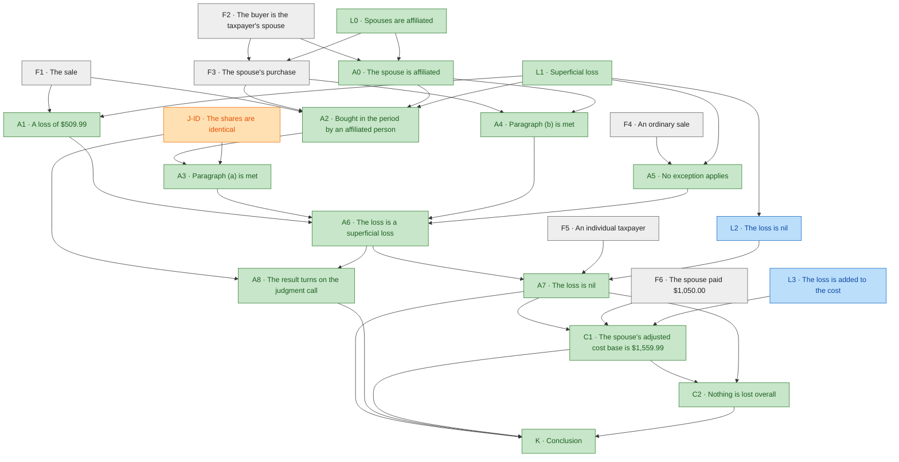
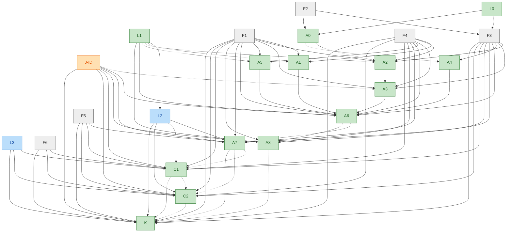
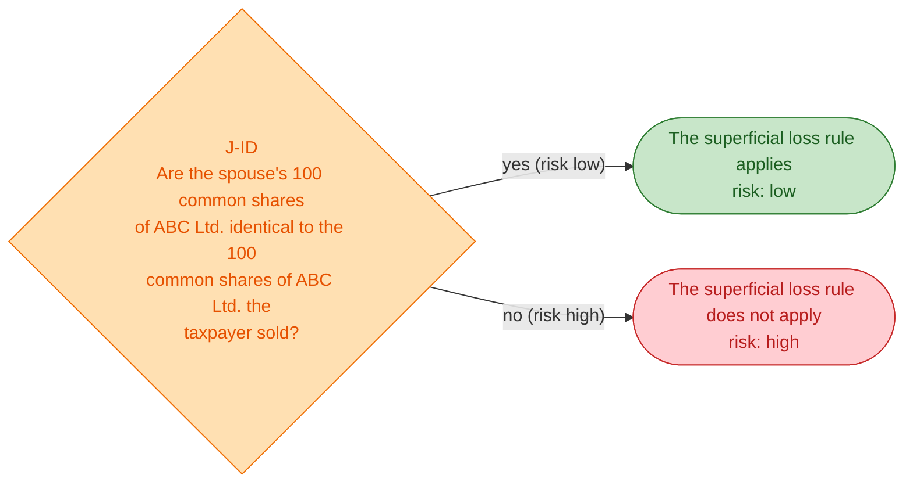
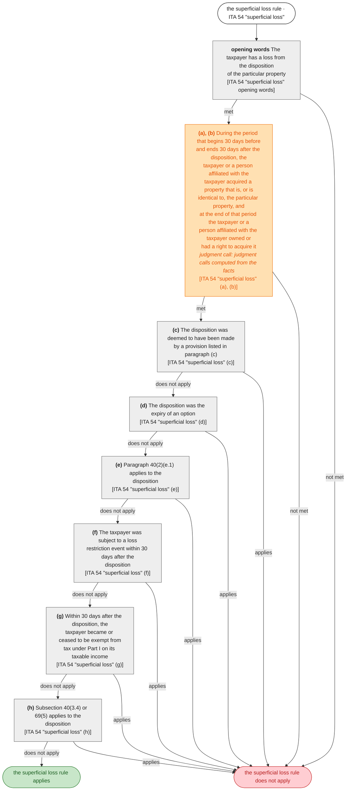

# Memo: shares sold at a loss and bought by the spouse

> Generated from the Lean sources by `scripts/blueprint.sh`. Do not edit by hand.

**Issue.** The taxpayer sold 100 common shares of ABC Ltd. at a loss on 2025-06-15, and the taxpayer's spouse bought 100 common shares of ABC Ltd. five days later. Can the taxpayer use the loss?

**Conclusion.** No, on the position that the spouse's shares are identical to the shares sold (low risk). The loss of $509.99 is a superficial loss, and subparagraph 40(2)(g)(i) makes it nil (A7). It is not lost: paragraph 53(1)(f) adds it to the spouse's cost, for an adjusted cost base of $1,559.99 (C1, C2). If the shares were not identical, the loss would stand (A8).

This is a constructed example, not advice on a real transaction.

**Status of the 23 statements:** 14 proven, 2 encoded, 6 fact, 1 judgment call.

## Dependency graph



Green: proven in Lean. Blue: encoded (definitions). Grey: facts. Orange: judgment calls. Dashed red: not yet formalized. An arrow points from a statement to the statements that use it.

### What the Lean proofs use

The same statements, with the dependencies Lean finds in the proofs themselves (solid) and those stated only in the memo's reasoning (dotted). Every dependency a proof has is also stated in the memo: `Blueprint.check` refuses a memo that hides one.



### Timeline of the period

```mermaid
gantt
    title Superficial loss period for the disposition on 2025-06-15
    dateFormat YYYY-MM-DD
    axisFormat %b %d
    section Period (a)
    2025-05-16 to 2025-07-15 :active, period, 2025-05-16, 61d
    section Disposition
    2025-06-15 disposition of 100 common shares of ABC Ltd. (loss $509.99) :milestone, disp, 2025-06-15, 0d
    section Acquisitions
    2025-06-20 the taxpayer's spouse (affiliated) acquires 100 common shares of ABC Ltd. (in period, held at end) :milestone, crit, a0, 2025-06-20, 0d
    section End of period (b)
    2025-07-15 end of period :milestone, endp, 2025-07-15, 0d
```

### Decision tree: the judgment call



### The definition as a flowchart



## The law

### L0. Spouses are affiliated

**Status:** proven · **Citation:** ITA 251.1(1)(a)

“an individual and a spouse or common-law partner of the individual” are affiliated persons.

**Lean:** [`Canteen.ITA.Affiliation.affiliated`](../../Canteen/ITA/S251_1/Affiliation.lean#L50), [`Canteen.ITA.Affiliation.spouses_affiliated`](../../Canteen/ITA/S251_1/Affiliation.lean#L58)

### L1. Superficial loss

**Status:** proven · **Citation:** ITA 54 "superficial loss"

A loss is a superficial loss if there is a loss, some property acquired by the taxpayer or an affiliated person in the period from 30 days before to 30 days after the disposition is, or is identical to, the property sold and is held at the end of the period, and no exception in (c) to (h) applies. See the provision's blueprint.

**Lean:** [`Canteen.ITA.SuperficialLoss.superficialLoss`](../../Canteen/ITA/S54/SuperficialLoss.lean#L255), [`Canteen.ITA.SuperficialLoss.superficialLoss_iff`](../../Canteen/Lemmas/SuperficialLoss.lean#L11)

### L2. The loss is nil

**Status:** encoded · **Citation:** ITA 40(2)(g)(i) · **Uses:** L1

A loss, to the extent that it is a superficial loss, is nil.

**Lean:** [`Canteen.ITA.LossDenial.rule`](../../Canteen/ITA/S40/LossDenial.lean#L78)

### L3. The loss is added to the cost

**Status:** encoded · **Citation:** ITA 53(1)(f)

The superficial loss, less any amount described in subparagraph 53(1)(f)(ii), is added to the cost of the substituted property in computing its adjusted cost base.

**Lean:** [`Canteen.ITA.CostAddition.addition`](../../Canteen/ITA/S53/CostAddition.lean#L49), [`Canteen.ITA.CostAddition.adjustedCostBase`](../../Canteen/ITA/S53/CostAddition.lean#L53)

## Facts

### F1. The sale

**Status:** fact

On 2025-06-15 the taxpayer sold 100 common shares of ABC Ltd. for $1,000.00. Their adjusted cost base was $1,500.00, and the taxpayer paid a $9.99 commission.

**Lean:** [`Canteen.Transactions.SpouseRepurchase.sale`](../../Canteen/Transactions/SpouseRepurchase.lean#L28)

### F2. The buyer is the taxpayer's spouse

**Status:** fact

The taxpayer is an individual, and the buyer is the taxpayer's spouse.

**Lean:** [`Canteen.Transactions.SpouseRepurchase.spouseRelation`](../../Canteen/Transactions/SpouseRepurchase.lean#L33)

### F3. The spouse's purchase

**Status:** fact · **Uses:** F2, L0

On 2025-06-20 the taxpayer's spouse bought 100 common shares of ABC Ltd., and still held them on 2025-07-15.

**Lean:** [`Canteen.Transactions.SpouseRepurchase.spousePurchase`](../../Canteen/Transactions/SpouseRepurchase.lean#L37)

**Rests on:** facts F2.

### F4. An ordinary sale

**Status:** fact

The sale was not a deemed disposition or the expiry of an option. Paragraph 40(2)(e.1) and subsections 40(3.4) and 69(5) do not apply, and the taxpayer had no loss restriction event or change in exempt status.

**Lean:** [`Canteen.Transactions.SpouseRepurchase.sale`](../../Canteen/Transactions/SpouseRepurchase.lean#L28)

### F5. An individual taxpayer

**Status:** fact

The taxpayer is an individual, so the foreign affiliate carve-out in paragraph 40(2)(g) is not engaged.

**Lean:** [`Canteen.Transactions.SpouseRepurchase.surplusCarveOut`](../../Canteen/Transactions/SpouseRepurchase.lean#L55)

### F6. The spouse paid $1,050.00

**Status:** fact

The spouse's shares cost $1,050.00.

**Lean:** [`Canteen.Transactions.SpouseRepurchase.spouseCost`](../../Canteen/Transactions/SpouseRepurchase.lean#L69)

## Judgment call

### J-ID. The shares are identical

**Status:** judgment call

The spouse's shares are identical to the shares sold: they are shares of the same class of the same corporation. Risk of this position: low. Risk of the opposite position: high.

**Lean:** [`Canteen.Transactions.SpouseRepurchase.calls`](../../Canteen/Transactions/SpouseRepurchase.lean#L44), [`Canteen.Transactions.SpouseRepurchase.position`](../../Canteen/Transactions/SpouseRepurchase.lean#L61)

## Analysis

### A0. The spouse is affiliated

**Status:** proven · **Citation:** ITA 251.1(1)(a) · **Uses:** F2, L0

The taxpayer is an individual and the buyer is the taxpayer's spouse, so they are affiliated persons.

**Lean:** [`Canteen.Transactions.SpouseRepurchase.spouse_affiliated`](../../Canteen/Transactions/SpouseRepurchase.lean#L80)

**Rests on:** facts F2.

### A1. A loss of $509.99

**Status:** proven · **Citation:** ITA 40(1)(b) · **Uses:** F1, L1

The adjusted cost base plus outlays and expenses ($1,509.99) exceeds the proceeds ($1,000.00) by $509.99.

**Lean:** [`Canteen.Transactions.SpouseRepurchase.loss_amount`](../../Canteen/Transactions/SpouseRepurchase.lean#L84)

**Rests on:** facts F1.

### A2. Bought in the period by an affiliated person

**Status:** proven · **Citation:** ITA 54 "superficial loss" (a) · **Uses:** F1, F3, A0, L1

The period runs from 30 days before to 30 days after the sale on 2025-06-15: from 2025-05-16 to 2025-07-15. The spouse's purchase on 2025-06-20 falls in it, and the spouse is affiliated with the taxpayer.

**Lean:** [`Canteen.Transactions.SpouseRepurchase.purchase_in_period`](../../Canteen/Transactions/SpouseRepurchase.lean#L87)

**Rests on:** facts F1, F3, F2.

### A3. Paragraph (a) is met

**Status:** proven · **Citation:** ITA 54 "superficial loss" (a) · **Uses:** A2, J-ID

The spouse's shares are identical to the shares sold, so the purchase meets paragraph (a).

**Lean:** [`Canteen.Transactions.SpouseRepurchase.purchase_meets_a`](../../Canteen/Transactions/SpouseRepurchase.lean#L93)

**Rests on:** judgment calls J-ID; facts F1, F3, F2.

### A4. Paragraph (b) is met

**Status:** proven · **Citation:** ITA 54 "superficial loss" (b) · **Uses:** F3, A0

The spouse still held the shares at the end of the period on 2025-07-15.

**Lean:** [`Canteen.Transactions.SpouseRepurchase.purchase_meets_b`](../../Canteen/Transactions/SpouseRepurchase.lean#L96)

**Rests on:** facts F3, F2.

### A5. No exception applies

**Status:** proven · **Citation:** ITA 54 "superficial loss" (c)–(h) · **Uses:** F4, L1

None of paragraphs (c) to (h) applies to the sale.

**Lean:** [`Canteen.Transactions.SpouseRepurchase.no_exception`](../../Canteen/Transactions/SpouseRepurchase.lean#L100)

**Rests on:** facts F4.

### A6. The loss is a superficial loss

**Status:** proven · **Citation:** ITA 54 "superficial loss" · **Uses:** A1, A3, A4, A5

There is a loss, the spouse's purchase meets (a) and (b), and no exception applies.

**Lean:** [`Canteen.Transactions.SpouseRepurchase.superficial_on_position`](../../Canteen/Transactions/SpouseRepurchase.lean#L103)

**Rests on:** judgment calls J-ID; facts F1, F3, F2, F4.

### A7. The loss is nil

**Status:** proven · **Citation:** ITA 40(2)(g)(i) · **Uses:** A6, F5, L2

The foreign affiliate carve-out is not engaged, so subparagraph 40(2)(g)(i) makes the $509.99 loss nil.

**Lean:** [`Canteen.Transactions.SpouseRepurchase.loss_nil_on_position`](../../Canteen/Transactions/SpouseRepurchase.lean#L108)

**Rests on:** judgment calls J-ID; facts F1, F3, F2, F4, F5.

### A8. The result turns on the judgment call

**Status:** proven · **Uses:** J-ID, A6

If the shares were not identical, the loss would not be a superficial loss. The conclusion depends on J-ID.

**Lean:** [`Canteen.Transactions.SpouseRepurchase.turns_on_identity`](../../Canteen/Transactions/SpouseRepurchase.lean#L116), [`Canteen.Transactions.SpouseRepurchase.not_superficial_on_alternative`](../../Canteen/Transactions/SpouseRepurchase.lean#L113)

**Rests on:** judgment calls J-ID; facts F1, F3, F2, F4.

## Consequence and conclusion

### C1. The spouse's adjusted cost base is $1,559.99

**Status:** proven · **Citation:** ITA 53(1)(f) · **Uses:** A7, F6, L3

The spouse's shares are substituted property of the spouse. Nothing is described in subparagraph 53(1)(f)(ii), so the whole $509.99 is added to the spouse's $1,050.00 cost: $1,559.99.

**Lean:** [`Canteen.Transactions.SpouseRepurchase.spouse_adjusted_cost_base`](../../Canteen/Transactions/SpouseRepurchase.lean#L121)

**Rests on:** judgment calls J-ID; facts F1, F3, F2, F4, F5, F6.

### C2. Nothing is lost overall

**Status:** proven · **Uses:** C1, A7

The amount added to the spouse's cost is exactly the loss denied to the taxpayer.

**Lean:** [`Canteen.Transactions.SpouseRepurchase.denied_loss_moves_to_spouse`](../../Canteen/Transactions/SpouseRepurchase.lean#L127)

**Rests on:** judgment calls J-ID; facts F1, F3, F2, F4, F5, F6.

### K. Conclusion

**Status:** proven · **Uses:** A7, A8, C1, C2

The taxpayer cannot use the $509.99 loss: it is nil under subparagraph 40(2)(g)(i), on the low-risk position that the spouse's shares are identical. The same amount is added to the spouse's adjusted cost base, which becomes $1,559.99, so it can be recognized when the spouse disposes of the shares.

**Lean:** [`Canteen.Transactions.SpouseRepurchase.loss_nil_on_position`](../../Canteen/Transactions/SpouseRepurchase.lean#L108), [`Canteen.Transactions.SpouseRepurchase.spouse_adjusted_cost_base`](../../Canteen/Transactions/SpouseRepurchase.lean#L121)

**Rests on:** judgment calls J-ID; facts F1, F3, F2, F4, F5, F6.

## Appendix: the argument as Lean renders it

### Subparagraph 40(2)(g)(i), on the position taken

```
1. The property is not excluded property being considered in computing a foreign affiliate's surplus or deficit, so the opening words of paragraph 40(2)(g) apply to it. [ITA 40(2)(g)]
2. The taxpayer disposed of 100 common shares of ABC Ltd. on 2025-06-15 for proceeds of $1,000.00. The adjusted cost base plus outlays and expenses was $1,509.99, so the taxpayer's loss from the disposition is $509.99. [ITA 40(1)(b)]
3. On 2025-06-20, within the period from 2025-05-16 to 2025-07-15, the taxpayer's spouse, a person affiliated with the taxpayer, acquired 100 common shares of ABC Ltd. That property is identical to the particular property (judgment call J-ID). [ITA 54 "superficial loss" (a)]
4. At the end of that period, on 2025-07-15, the taxpayer or a person affiliated with the taxpayer owned or had a right to acquire that property. [ITA 54 "superficial loss" (b)]
5. The disposition is not one described in paragraphs (c) to (h), so the taxpayer's loss of $509.99 is a superficial loss. [ITA 54 "superficial loss"]
6. Therefore, under subparagraph 40(2)(g)(i), the taxpayer's loss from the disposition is nil to the extent that it is a superficial loss. [ITA 40(2)(g)(i)]
Relies on these judgment calls:
- J-ID: Are the spouse's 100 common shares of ABC Ltd. identical to the 100 common shares of ABC Ltd. the taxpayer sold? Assumed: yes. Risk: low.
Overall risk: low.
```

### Paragraph 53(1)(f), for the spouse's shares

```
1. The 100 common shares of ABC Ltd. owned by the taxpayer's spouse are substituted property of the taxpayer's spouse, within the meaning of paragraph (a) of the definition "superficial loss" in section 54. [ITA 53(1)(f)]
2. The loss that was a superficial loss because of the acquisition by the taxpayer's spouse is $509.99; the amount described in subparagraph (ii) is $0.00. [ITA 53(1)(f)(i), (ii)]
3. So $509.99 is added to the cost of the property: its adjusted cost base to the taxpayer's spouse is $1,050.00 + $509.99 = $1,559.99. [ITA 53(1)(f)]
```

### Section 54, on both answers to J-ID

```
Branch 1 (J-ID = yes):
1. The taxpayer disposed of 100 common shares of ABC Ltd. on 2025-06-15 for proceeds of $1,000.00. The adjusted cost base plus outlays and expenses was $1,509.99, so the taxpayer's loss from the disposition is $509.99. [ITA 40(1)(b)]
2. On 2025-06-20, within the period from 2025-05-16 to 2025-07-15, the taxpayer's spouse, a person affiliated with the taxpayer, acquired 100 common shares of ABC Ltd. That property is identical to the particular property (judgment call J-ID). [ITA 54 "superficial loss" (a)]
3. At the end of that period, on 2025-07-15, the taxpayer or a person affiliated with the taxpayer owned or had a right to acquire that property. [ITA 54 "superficial loss" (b)]
4. The disposition is not one described in paragraphs (c) to (h), so the taxpayer's loss of $509.99 is a superficial loss. [ITA 54 "superficial loss"]
Conclusion: The superficial loss rule applies. Risk: low.

Branch 2 (J-ID = no):
1. The taxpayer disposed of 100 common shares of ABC Ltd. on 2025-06-15 for proceeds of $1,000.00. The adjusted cost base plus outlays and expenses was $1,509.99, so the taxpayer's loss from the disposition is $509.99. [ITA 40(1)(b)]
2. The property acquired on 2025-06-20 (100 common shares of ABC Ltd.) is not identical to the particular property (judgment call J-ID), so it does not meet paragraph (a). [ITA 54 "superficial loss" (a)]
3. No property meets both paragraphs (a) and (b), so the loss is not a superficial loss. [ITA 54 "superficial loss"]
Conclusion: The superficial loss rule does not apply. Risk: high.

Summary: The superficial loss rule applies on 1 of 2 branches, so the conclusion depends on the judgment calls.
```

### Section 3 for the taxpayer's year (with $60,000.00 of employment income), on the position taken

```
1. 100 common shares of ABC Ltd.: the loss is nil under paragraph 40(2)(g) or subsection 40(3.4): so there is no capital loss. [ITA 40(1); 39(1); 38]
2. Paragraph 3(a), income from sources other than taxable capital gains: $60,000.00. [ITA 3(a)]
3. Paragraph 3(b): taxable capital gains $0.00 and taxable net gain from listed personal property $0.00, less allowable capital losses $0.00 in excess of allowable business investment losses $0.00: $0.00. [ITA 3(b)]
4. Paragraph 3(c), less Subdivision E deductions of $0.00: $60,000.00. [ITA 3(c)]
5. Paragraph 3(d), less losses from sources of $0.00 and allowable business investment losses of $0.00: $60,000.00. [ITA 3(d)]
6. So the taxpayer's income for the year is $60,000.00. [ITA 3(e), (f)]
Relies on no judgment calls.
```

### Section 3 for the taxpayer's year, if the shares were not identical

```
1. 100 common shares of ABC Ltd.: a loss of $509.99: a capital loss, of which ½, $254.995, is an allowable capital loss. [ITA 40(1); 39(1); 38]
2. Paragraph 3(a), income from sources other than taxable capital gains: $60,000.00. [ITA 3(a)]
3. Paragraph 3(b): taxable capital gains $0.00 and taxable net gain from listed personal property $0.00, less allowable capital losses $254.995 in excess of allowable business investment losses $0.00: $0.00. [ITA 3(b)]
4. Paragraph 3(c), less Subdivision E deductions of $0.00: $60,000.00. [ITA 3(c)]
5. Paragraph 3(d), less losses from sources of $0.00 and allowable business investment losses of $0.00: $60,000.00. [ITA 3(d)]
6. So the taxpayer's income for the year is $60,000.00. [ITA 3(e), (f)]
7. Allowable capital losses of $254.995 could not be used this year (they may be a net capital loss under 111(1)(b), not encoded). [ITA 3(b)]
Relies on no judgment calls.
```

