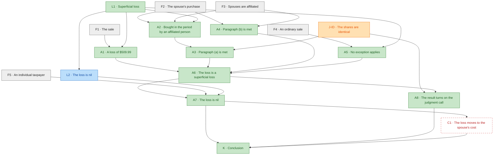

# Memo: shares sold at a loss and bought by the spouse

> Generated from the Lean sources by `scripts/blueprint.sh`. Do not edit by hand.

**Issue.** The taxpayer sold 100 common shares of ABC Ltd. at a loss on 2025-06-15, and the taxpayer's spouse bought 100 common shares of ABC Ltd. five days later. Can the taxpayer use the loss?

**Conclusion.** No, on the position that the spouse's shares are identical to the shares sold (low risk). The loss of $509.99 is a superficial loss, and subparagraph 40(2)(g)(i) makes it nil (A7). If the shares were not identical, the loss would stand (A8). The amount moves to the cost of the spouse's shares under paragraph 53(1)(f), which is not yet formalized (C1).

This is a constructed example, not advice on a real transaction.

**Status of the 18 statements:** 10 proven, 1 encoded, 5 fact, 1 judgment call, 1 not formalized.

## Dependency graph



Green: proven in Lean. Blue: encoded (definitions). Grey: facts. Orange: judgment calls. Dashed red: not yet formalized. An arrow points from a statement to the statements that use it.

## Facts

### F1. The sale

**Status:** fact

On 2025-06-15 the taxpayer sold 100 common shares of ABC Ltd. for $1,000.00. Their adjusted cost base was $1,500.00, and the taxpayer paid a $9.99 commission.

**Lean:** [`Canteen.Transactions.SpouseRepurchase.sale`](../../Canteen/Transactions/SpouseRepurchase.lean#L26)

### F2. The spouse's purchase

**Status:** fact

On 2025-06-20 the taxpayer's spouse bought 100 common shares of ABC Ltd., and still held them on 2025-07-15.

**Lean:** [`Canteen.Transactions.SpouseRepurchase.spousePurchase`](../../Canteen/Transactions/SpouseRepurchase.lean#L31)

### F3. Spouses are affiliated

**Status:** fact · **Citation:** ITA 251.1(1)(a)

“an individual and a spouse or common-law partner of the individual” are affiliated persons. Section 251.1 is not yet encoded, so this is taken as a fact.

**Lean:** [`Canteen.ITA.SuperficialLoss.Acquirer`](../../Canteen/ITA/S54/SuperficialLoss.lean#L116)

### F4. An ordinary sale

**Status:** fact

The sale was not a deemed disposition or the expiry of an option. Paragraph 40(2)(e.1) and subsections 40(3.4) and 69(5) do not apply, and the taxpayer had no loss restriction event or change in exempt status.

**Lean:** [`Canteen.Transactions.SpouseRepurchase.sale`](../../Canteen/Transactions/SpouseRepurchase.lean#L26)

### F5. An individual taxpayer

**Status:** fact

The taxpayer is an individual, so the foreign affiliate carve-out in paragraph 40(2)(g) is not engaged.

**Lean:** [`Canteen.Transactions.SpouseRepurchase.denialFacts`](../../Canteen/Transactions/SpouseRepurchase.lean#L49)

## Judgment call

### J-ID. The shares are identical

**Status:** judgment call

The spouse's shares are identical to the shares sold: they are shares of the same class of the same corporation. Risk of this position: low. Risk of the opposite position: high.

**Lean:** [`Canteen.Transactions.SpouseRepurchase.calls`](../../Canteen/Transactions/SpouseRepurchase.lean#L38), [`Canteen.Transactions.SpouseRepurchase.position`](../../Canteen/Transactions/SpouseRepurchase.lean#L53)

## The law

### L1. Superficial loss

**Status:** proven · **Citation:** ITA 54 "superficial loss"

A loss is a superficial loss if there is a loss, some property acquired by the taxpayer or an affiliated person in the period from 30 days before to 30 days after the disposition is, or is identical to, the property sold and is held at the end of the period, and no exception in (c) to (h) applies. See the provision's blueprint.

**Lean:** [`Canteen.ITA.SuperficialLoss.superficialLoss`](../../Canteen/ITA/S54/SuperficialLoss.lean#L246), [`Canteen.ITA.SuperficialLoss.superficialLoss_iff`](../../Canteen/Lemmas/SuperficialLoss.lean#L11)

### L2. The loss is nil

**Status:** encoded · **Citation:** ITA 40(2)(g)(i) · **Uses:** L1

A loss, to the extent that it is a superficial loss, is nil.

**Lean:** [`Canteen.ITA.LossDenial.rule`](../../Canteen/ITA/S40/LossDenial.lean#L78)

## Analysis

### A1. A loss of $509.99

**Status:** proven · **Citation:** ITA 40(1)(b) · **Uses:** F1, L1

The adjusted cost base plus outlays and expenses ($1,509.99) exceeds the proceeds ($1,000.00) by $509.99.

**Lean:** [`Canteen.Transactions.SpouseRepurchase.loss_amount`](../../Canteen/Transactions/SpouseRepurchase.lean#L63)

**Rests on:** facts F1.

### A2. Bought in the period by an affiliated person

**Status:** proven · **Citation:** ITA 54 "superficial loss" (a) · **Uses:** F2, F3, L1

The spouse's purchase on 2025-06-20 falls in the period from 2025-05-16 to 2025-07-15, and the spouse is affiliated with the taxpayer.

**Lean:** [`Canteen.Transactions.SpouseRepurchase.purchase_in_period`](../../Canteen/Transactions/SpouseRepurchase.lean#L66)

**Rests on:** facts F2, F3.

### A3. Paragraph (a) is met

**Status:** proven · **Citation:** ITA 54 "superficial loss" (a) · **Uses:** A2, J-ID

The spouse's shares are identical to the shares sold, so the purchase meets paragraph (a).

**Lean:** [`Canteen.Transactions.SpouseRepurchase.purchase_meets_a`](../../Canteen/Transactions/SpouseRepurchase.lean#L72)

**Rests on:** judgment calls J-ID; facts F2, F3.

### A4. Paragraph (b) is met

**Status:** proven · **Citation:** ITA 54 "superficial loss" (b) · **Uses:** F2, F3

The spouse still held the shares at the end of the period on 2025-07-15.

**Lean:** [`Canteen.Transactions.SpouseRepurchase.purchase_meets_b`](../../Canteen/Transactions/SpouseRepurchase.lean#L75)

**Rests on:** facts F2, F3.

### A5. No exception applies

**Status:** proven · **Citation:** ITA 54 "superficial loss" (c)–(h) · **Uses:** F4, L1

None of paragraphs (c) to (h) applies to the sale.

**Lean:** [`Canteen.Transactions.SpouseRepurchase.no_exception`](../../Canteen/Transactions/SpouseRepurchase.lean#L79)

**Rests on:** facts F4.

### A6. The loss is a superficial loss

**Status:** proven · **Citation:** ITA 54 "superficial loss" · **Uses:** A1, A3, A4, A5

There is a loss, the spouse's purchase meets (a) and (b), and no exception applies.

**Lean:** [`Canteen.Transactions.SpouseRepurchase.superficial_on_position`](../../Canteen/Transactions/SpouseRepurchase.lean#L82)

**Rests on:** judgment calls J-ID; facts F1, F2, F3, F4.

### A7. The loss is nil

**Status:** proven · **Citation:** ITA 40(2)(g)(i) · **Uses:** A6, F5, L2

The foreign affiliate carve-out is not engaged, so subparagraph 40(2)(g)(i) makes the $509.99 loss nil.

**Lean:** [`Canteen.Transactions.SpouseRepurchase.loss_nil_on_position`](../../Canteen/Transactions/SpouseRepurchase.lean#L87)

**Rests on:** judgment calls J-ID; facts F1, F2, F3, F4, F5.

### A8. The result turns on the judgment call

**Status:** proven · **Uses:** J-ID, A6

If the shares were not identical, the loss would not be a superficial loss. The conclusion depends on J-ID.

**Lean:** [`Canteen.Transactions.SpouseRepurchase.turns_on_identity`](../../Canteen/Transactions/SpouseRepurchase.lean#L95), [`Canteen.Transactions.SpouseRepurchase.not_superficial_on_alternative`](../../Canteen/Transactions/SpouseRepurchase.lean#L92)

**Rests on:** judgment calls J-ID; facts F1, F2, F3, F4.

## Consequence and conclusion

### C1. The loss moves to the spouse's cost

**Status:** not formalized · **Citation:** ITA 53(1)(f) · **Uses:** A7

The superficial loss, less any amount described in subparagraph 53(1)(f)(ii), is added to the adjusted cost base of the spouse's shares. Not yet formalized.

**Rests on:** judgment calls J-ID; facts F1, F2, F3, F4, F5.

### K. Conclusion

**Status:** proven · **Uses:** A7, A8, C1

The taxpayer cannot use the $509.99 loss: it is nil under subparagraph 40(2)(g)(i), on the low-risk position that the spouse's shares are identical. It is instead added to the spouse's cost of the shares.

**Lean:** [`Canteen.Transactions.SpouseRepurchase.loss_nil_on_position`](../../Canteen/Transactions/SpouseRepurchase.lean#L87)

**Rests on:** judgment calls J-ID; facts F1, F2, F3, F4, F5; not yet formalized C1.

## Appendix: the argument as Lean renders it

### Subparagraph 40(2)(g)(i), on the position taken

```
1. The property is not excluded property being considered in computing a foreign affiliate's surplus or deficit, so the opening words of paragraph 40(2)(g) apply to it. [ITA 40(2)(g)]
2. The taxpayer disposed of 100 common shares of ABC Ltd. on 2025-06-15 for proceeds of $1,000.00. The adjusted cost base plus outlays and expenses was $1,509.99, so the taxpayer's loss from the disposition is $509.99. [ITA 40(1)(b)]
3. On 2025-06-20, within the period from 2025-05-16 to 2025-07-15, the taxpayer's spouse, a person affiliated with the taxpayer, acquired 100 common shares of ABC Ltd. That property is identical to the particular property (judgment call J-ID). [ITA 54 "superficial loss" (a)]
4. At the end of that period, on 2025-07-15, the taxpayer or a person affiliated with the taxpayer owned or had a right to acquire that property. [ITA 54 "superficial loss" (b)]
5. The disposition is not one described in paragraphs (c) to (h), so the taxpayer's loss of $509.99 is a superficial loss. [ITA 54 "superficial loss"]
6. Therefore, under subparagraph 40(2)(g)(i), the taxpayer's loss from the disposition is nil to the extent that it is a superficial loss. [ITA 40(2)(g)(i)]
Relies on these judgment calls:
- J-ID: Are the spouse's 100 common shares of ABC Ltd. identical to the 100 common shares of ABC Ltd. the taxpayer sold? Assumed: yes. Risk: low.
Overall risk: low.
```

### Section 54, on both answers to J-ID

```
Branch 1 (J-ID = yes):
1. The taxpayer disposed of 100 common shares of ABC Ltd. on 2025-06-15 for proceeds of $1,000.00. The adjusted cost base plus outlays and expenses was $1,509.99, so the taxpayer's loss from the disposition is $509.99. [ITA 40(1)(b)]
2. On 2025-06-20, within the period from 2025-05-16 to 2025-07-15, the taxpayer's spouse, a person affiliated with the taxpayer, acquired 100 common shares of ABC Ltd. That property is identical to the particular property (judgment call J-ID). [ITA 54 "superficial loss" (a)]
3. At the end of that period, on 2025-07-15, the taxpayer or a person affiliated with the taxpayer owned or had a right to acquire that property. [ITA 54 "superficial loss" (b)]
4. The disposition is not one described in paragraphs (c) to (h), so the taxpayer's loss of $509.99 is a superficial loss. [ITA 54 "superficial loss"]
Conclusion: The superficial loss rule applies. Risk: low.

Branch 2 (J-ID = no):
1. The taxpayer disposed of 100 common shares of ABC Ltd. on 2025-06-15 for proceeds of $1,000.00. The adjusted cost base plus outlays and expenses was $1,509.99, so the taxpayer's loss from the disposition is $509.99. [ITA 40(1)(b)]
2. The property acquired on 2025-06-20 (100 common shares of ABC Ltd.) is not identical to the particular property (judgment call J-ID), so it does not meet paragraph (a). [ITA 54 "superficial loss" (a)]
3. No property meets both paragraphs (a) and (b), so the loss is not a superficial loss. [ITA 54 "superficial loss"]
Conclusion: The superficial loss rule does not apply. Risk: high.

Summary: The superficial loss rule applies on 1 of 2 branches, so the conclusion depends on the judgment calls.
```

