# Section 54 "superficial loss", paragraph 40(2)(g), and related provisions

> Generated from the Lean sources by `scripts/blueprint.sh`. Do not edit by hand.

Each paragraph of the definition is quoted from the *Income Tax Act* (consolidation current to 2026-10-29; verbatim in `statute/`) and linked to the Lean definition that encodes it. Lean cannot check that an encoding matches the statute; that is what [`docs/review/superficial-loss.md`](../review/superficial-loss.md) is for. Everything built on the encoding is proven.

**Status of the 85 statements:** 66 proven, 16 encoded, 3 not formalized.

## Dependency graph

```mermaid
graph TD
  n0["P0 · Opening words: a loss"]:::encoded
  n1["Pa · (a) acquisition in the 61-day period"]:::encoded
  n2["Pb · (b) held at the end of the period"]:::encoded
  n3["Pc · (c) listed deemed dispositions"]:::encoded
  n4["Pd · (d) expiry of an option"]:::encoded
  n5["Pe · (e) paragraph 40(2)(e.1) applies"]:::encoded
  n6["Pf · (f) loss restriction event"]:::encoded
  n7["Pg · (g) change in exempt status"]:::encoded
  n8["Ph · (h) 40(3.4) or 69(5) applies"]:::encoded
  n9["Pi · (i) rights to acquire are identical"]:::encoded
  n10["Pj · (j) SIFT wind-up shares before 2013"]:::encoded
  n11["Pa+ · (a) with the deeming rules"]:::encoded
  n12["D · The definition as a whole"]:::encoded
  n13["E · The English explanation agrees"]:::proven
  n14["S · The definition in statute form"]:::proven
  n15["L1 · Restatement"]:::proven
  n16["L2 · No loss, no superficial loss"]:::proven
  n17["L3 · Exceptions always win"]:::proven
  n18["L4 · Option expiry"]:::proven
  n19["L5 · Death"]:::proven
  n20["L6 · Nothing acquired"]:::proven
  n21["L7 · Outside the period never matters"]:::proven
  n22["L8 · Not held at the end never matters"]:::proven
  n23["L9 · Unaffiliated buyers never matter"]:::proven
  n24["L10 · More acquisitions only add"]:::proven
  n25["L11 · Rights to acquire"]:::proven
  n26["L12 · SIFT shares from 2013"]:::proven
  n27["L13 · When nothing qualifies"]:::proven
  n28["L14 · The 31-day safe harbour"]:::proven
  n29["G0 · Opening words: the foreign affiliate carve-out"]:::encoded
  n30["G1 · The loss is nil"]:::encoded
  n31["GS · 40(2)(g)(i) in statute form"]:::proven
  n32["G2 · (ii) losses on debts"]:::proven
  n33["PUP · Personal-use and listed personal property"]:::encoded
  n34["G3 · (iii) losses on personal-use property"]:::proven
  n35["G4 · (iv) transfers to registered plans"]:::proven
  n36["G5 · Paragraph 40(2)(g) as a whole"]:::proven
  n37["R1 · Spouses are affiliated"]:::proven
  n38["R3 · Affiliated persons, paragraphs (a) to (h)"]:::proven
  n39["R4 · Related persons and arm's length"]:::proven
  n40["R7 · Amalgamations"]:::proven
  n41["R10 · Shares to an affiliated corporation; debts within a related group"]:::proven
  n42["R5 · A personal-use debt that goes bad"]:::proven
  n43["R6 · Suspended losses of corporations, trusts and partnerships"]:::proven
  n44["R8 · The tax result: capital gains and income"]:::proven
  n45["R9 · Net capital losses and taxable income"]:::proven
  n46["R12 · Transfers not at arm's length, and gifts"]:::proven
  n47["R13 · The spousal rollover"]:::proven
  n48["R14 · Death"]:::proven
  n49["R15 · Attribution of capital gains to the transferor"]:::proven
  n50["R16 · Change in use"]:::proven
  n51["R17 · Transfer of property to a corporation"]:::proven
  n52["R18 · Shares sold to a non-arm's length corporation"]:::proven
  n53["R19 · The capital gains deduction"]:::proven
  n54["R20 · Loss restriction events"]:::proven
  n55["R21 · Attribution of income to the transferor or lender"]:::proven
  n56["R22 · Taxable dividends: the gross-up and credit"]:::proven
  n57["R23 · Intercorporate dividends, and when they are gains"]:::proven
  n58["R24 · Depreciable property: recapture and terminal losses"]:::proven
  n59["R25 · Redemptions of shares"]:::proven
  n60["R26 · The capital dividend account"]:::proven
  n61["R27 · Share exchanges in a reorganization of capital"]:::proven
  n62["R28 · Replacement property"]:::proven
  n63["R29 · Identical properties: the average cost"]:::proven
  n64["R30 · Connected corporations"]:::proven
  n65["R31 · Returns of capital, and negative adjusted cost base"]:::proven
  n66["R32 · Winding up a subsidiary, and the bump"]:::proven
  n67["R33 · Amalgamations"]:::proven
  n68["R34 · Convertible property"]:::proven
  n69["R36 · The election for Canadian securities"]:::proven
  n70["R37 · Bad debts and worthless shares"]:::proven
  n71["R38 · Disposing of part of a property"]:::proven
  n72["R39 · Corporate attribution"]:::proven
  n73["R40 · Tax on split income"]:::proven
  n74["R41 · The federal rates"]:::proven
  n75["R42 · The basic personal and spouse amounts"]:::proven
  n76["R43 · The charitable donation credit"]:::proven
  n77["R44 · Corporate rates"]:::proven
  n78["R45 · Refundable taxes and the dividend refund"]:::proven
  n79["R35 · An individual's year, to taxable income and tax"]:::proven
  n80["R11 · The principal residence exemption"]:::proven
  n81["R2 · Cost of the substituted property"]:::proven
  n82["N1 · Inputs decided by other provisions"]:::notFormalized
  n83["N2 · How much is #quot;to the extent that#quot;"]:::notFormalized
  n84["N4 · Inputs for subparagraphs (ii) to (iv)"]:::notFormalized
  n1 --> n11
  n9 --> n11
  n10 --> n11
  n0 --> n12
  n1 --> n12
  n2 --> n12
  n3 --> n12
  n4 --> n12
  n5 --> n12
  n6 --> n12
  n7 --> n12
  n8 --> n12
  n9 --> n12
  n10 --> n12
  n11 --> n12
  n12 --> n13
  n12 --> n14
  n12 --> n15
  n0 --> n16
  n12 --> n16
  n3 --> n17
  n4 --> n17
  n5 --> n17
  n6 --> n17
  n7 --> n17
  n8 --> n17
  n12 --> n17
  n17 --> n18
  n17 --> n19
  n12 --> n20
  n11 --> n21
  n12 --> n21
  n2 --> n22
  n12 --> n22
  n11 --> n23
  n12 --> n23
  n12 --> n24
  n11 --> n25
  n11 --> n26
  n11 --> n27
  n2 --> n27
  n12 --> n27
  n27 --> n28
  n29 --> n30
  n13 --> n30
  n30 --> n31
  n14 --> n31
  n0 --> n32
  n0 --> n34
  n33 --> n34
  n0 --> n35
  n29 --> n36
  n30 --> n36
  n13 --> n36
  n32 --> n36
  n34 --> n36
  n35 --> n36
  n37 --> n38
  n1 --> n38
  n38 --> n40
  n39 --> n40
  n5 --> n41
  n12 --> n41
  n38 --> n41
  n39 --> n41
  n3 --> n43
  n4 --> n43
  n5 --> n43
  n6 --> n43
  n7 --> n43
  n8 --> n43
  n12 --> n43
  n38 --> n43
  n36 --> n44
  n43 --> n44
  n44 --> n45
  n39 --> n46
  n44 --> n46
  n46 --> n47
  n44 --> n48
  n3 --> n48
  n44 --> n49
  n47 --> n49
  n44 --> n50
  n12 --> n50
  n44 --> n51
  n44 --> n52
  n51 --> n52
  n44 --> n53
  n39 --> n54
  n6 --> n54
  n49 --> n55
  n44 --> n58
  n44 --> n59
  n56 --> n59
  n57 --> n59
  n44 --> n60
  n44 --> n61
  n51 --> n61
  n44 --> n62
  n44 --> n63
  n39 --> n64
  n44 --> n65
  n44 --> n66
  n44 --> n67
  n51 --> n67
  n44 --> n68
  n51 --> n68
  n44 --> n69
  n44 --> n70
  n12 --> n70
  n44 --> n71
  n55 --> n72
  n56 --> n72
  n56 --> n73
  n74 --> n75
  n74 --> n76
  n77 --> n78
  n44 --> n79
  n45 --> n79
  n53 --> n79
  n55 --> n79
  n56 --> n79
  n58 --> n79
  n73 --> n79
  n74 --> n79
  n75 --> n79
  n76 --> n79
  n44 --> n80
  n50 --> n80
  n11 --> n81
  n1 --> n82
  n5 --> n82
  n6 --> n82
  n8 --> n82
  n37 --> n82
  n81 --> n82
  n38 --> n82
  n30 --> n83
  n32 --> n84
  n34 --> n84
  n39 --> n84
  n42 --> n84
  classDef proven fill:#c8e6c9,stroke:#2e7d32,color:#1b5e20
  classDef encoded fill:#bbdefb,stroke:#1565c0,color:#0d47a1
  classDef fact fill:#eeeeee,stroke:#616161,color:#212121
  classDef judgment fill:#ffe0b2,stroke:#ef6c00,color:#e65100
  classDef notFormalized fill:#ffffff,stroke:#c62828,color:#b71c1c,stroke-dasharray:5 5
  classDef unproven fill:#ffcdd2,stroke:#c62828,color:#b71c1c
```

Green: proven in Lean. Blue: encoded (definitions). Grey: facts. Orange: judgment calls. Dashed red: not yet formalized. An arrow points from a statement to the statements that use it.

### What the Lean proofs use

The same statements, with the dependencies Lean finds in the proofs themselves (solid) and those stated only in the memo's reasoning (dotted). Every dependency a proof has is also stated in the memo: `Blueprint.check` refuses a memo that hides one.

```mermaid
graph TD
  n0["P0"]:::encoded
  n1["Pa"]:::encoded
  n2["Pb"]:::encoded
  n3["Pc"]:::encoded
  n4["Pd"]:::encoded
  n5["Pe"]:::encoded
  n6["Pf"]:::encoded
  n7["Pg"]:::encoded
  n8["Ph"]:::encoded
  n9["Pi"]:::encoded
  n10["Pj"]:::encoded
  n11["Pa+"]:::encoded
  n12["D"]:::encoded
  n13["E"]:::proven
  n14["S"]:::proven
  n15["L1"]:::proven
  n16["L2"]:::proven
  n17["L3"]:::proven
  n18["L4"]:::proven
  n19["L5"]:::proven
  n20["L6"]:::proven
  n21["L7"]:::proven
  n22["L8"]:::proven
  n23["L9"]:::proven
  n24["L10"]:::proven
  n25["L11"]:::proven
  n26["L12"]:::proven
  n27["L13"]:::proven
  n28["L14"]:::proven
  n29["G0"]:::encoded
  n30["G1"]:::encoded
  n31["GS"]:::proven
  n32["G2"]:::proven
  n33["PUP"]:::encoded
  n34["G3"]:::proven
  n35["G4"]:::proven
  n36["G5"]:::proven
  n37["R1"]:::proven
  n38["R3"]:::proven
  n39["R4"]:::proven
  n40["R7"]:::proven
  n41["R10"]:::proven
  n42["R5"]:::proven
  n43["R6"]:::proven
  n44["R8"]:::proven
  n45["R9"]:::proven
  n46["R12"]:::proven
  n47["R13"]:::proven
  n48["R14"]:::proven
  n49["R15"]:::proven
  n50["R16"]:::proven
  n51["R17"]:::proven
  n52["R18"]:::proven
  n53["R19"]:::proven
  n54["R20"]:::proven
  n55["R21"]:::proven
  n56["R22"]:::proven
  n57["R23"]:::proven
  n58["R24"]:::proven
  n59["R25"]:::proven
  n60["R26"]:::proven
  n61["R27"]:::proven
  n62["R28"]:::proven
  n63["R29"]:::proven
  n64["R30"]:::proven
  n65["R31"]:::proven
  n66["R32"]:::proven
  n67["R33"]:::proven
  n68["R34"]:::proven
  n69["R36"]:::proven
  n70["R37"]:::proven
  n71["R38"]:::proven
  n72["R39"]:::proven
  n73["R40"]:::proven
  n74["R41"]:::proven
  n75["R42"]:::proven
  n76["R43"]:::proven
  n77["R44"]:::proven
  n78["R45"]:::proven
  n79["R35"]:::proven
  n80["R11"]:::proven
  n81["R2"]:::proven
  n82["N1"]:::notFormalized
  n83["N2"]:::notFormalized
  n84["N4"]:::notFormalized
  n10 --> n11
  n1 --> n11
  n9 -.-> n11
  n7 --> n12
  n11 --> n12
  n2 --> n12
  n6 --> n12
  n0 --> n12
  n3 --> n12
  n4 --> n12
  n5 --> n12
  n8 --> n12
  n1 -.-> n12
  n9 -.-> n12
  n10 -.-> n12
  n7 --> n13
  n2 --> n13
  n1 --> n13
  n6 --> n13
  n12 --> n13
  n11 --> n13
  n0 --> n13
  n3 --> n13
  n4 --> n13
  n5 --> n13
  n8 --> n13
  n7 --> n14
  n2 --> n14
  n6 --> n14
  n1 --> n14
  n0 --> n14
  n3 --> n14
  n4 --> n14
  n12 --> n14
  n5 --> n14
  n8 --> n14
  n11 --> n15
  n2 --> n15
  n12 --> n15
  n0 --> n15
  n12 --> n16
  n0 --> n16
  n12 --> n17
  n0 --> n17
  n3 -.-> n17
  n4 -.-> n17
  n5 -.-> n17
  n6 -.-> n17
  n7 -.-> n17
  n8 -.-> n17
  n7 --> n18
  n17 --> n18
  n6 --> n18
  n12 --> n18
  n3 --> n18
  n4 --> n18
  n5 --> n18
  n8 --> n18
  n7 --> n19
  n17 --> n19
  n3 --> n19
  n6 --> n19
  n12 --> n19
  n4 --> n19
  n5 --> n19
  n8 --> n19
  n12 --> n20
  n0 --> n20
  n11 --> n21
  n2 --> n21
  n1 --> n21
  n12 --> n21
  n0 --> n21
  n11 --> n22
  n2 --> n22
  n12 --> n22
  n0 --> n22
  n11 --> n23
  n2 --> n23
  n1 --> n23
  n12 --> n23
  n0 --> n23
  n12 --> n24
  n0 --> n24
  n11 --> n25
  n10 --> n25
  n11 --> n26
  n10 --> n26
  n11 --> n27
  n2 --> n27
  n1 --> n27
  n12 --> n27
  n0 --> n27
  n27 --> n28
  n1 --> n28
  n12 --> n28
  n29 --> n30
  n13 --> n30
  n0 --> n30
  n14 --> n31
  n30 --> n31
  n12 --> n31
  n0 --> n32
  n33 --> n34
  n0 --> n34
  n0 --> n35
  n32 --> n36
  n34 --> n36
  n13 --> n36
  n35 --> n36
  n0 --> n36
  n12 --> n36
  n30 --> n36
  n29 -.-> n36
  n1 --> n38
  n37 -.-> n38
  n38 -.-> n40
  n39 -.-> n40
  n38 --> n41
  n0 --> n41
  n39 --> n41
  n7 --> n41
  n6 --> n41
  n12 --> n41
  n3 --> n41
  n4 --> n41
  n5 --> n41
  n8 --> n41
  n7 --> n43
  n1 --> n43
  n6 --> n43
  n3 --> n43
  n4 --> n43
  n5 --> n43
  n0 --> n43
  n12 --> n43
  n8 --> n43
  n38 -.-> n43
  n36 --> n44
  n0 --> n44
  n43 --> n44
  n44 --> n45
  n39 -.-> n46
  n44 -.-> n46
  n46 --> n47
  n44 -.-> n48
  n3 -.-> n48
  n44 -.-> n49
  n47 -.-> n49
  n7 --> n50
  n6 --> n50
  n12 --> n50
  n0 --> n50
  n3 --> n50
  n4 --> n50
  n5 --> n50
  n8 --> n50
  n44 -.-> n50
  n44 -.-> n51
  n51 --> n52
  n44 -.-> n52
  n44 -.-> n53
  n39 -.-> n54
  n6 -.-> n54
  n49 --> n55
  n44 -.-> n58
  n57 --> n59
  n44 -.-> n59
  n56 -.-> n59
  n44 -.-> n60
  n44 -.-> n61
  n51 -.-> n61
  n44 -.-> n62
  n44 -.-> n63
  n39 -.-> n64
  n44 -.-> n65
  n44 -.-> n66
  n44 -.-> n67
  n51 -.-> n67
  n44 -.-> n68
  n51 -.-> n68
  n44 -.-> n69
  n7 --> n70
  n6 --> n70
  n12 --> n70
  n0 --> n70
  n3 --> n70
  n4 --> n70
  n5 --> n70
  n8 --> n70
  n44 -.-> n70
  n44 -.-> n71
  n56 --> n72
  n55 -.-> n72
  n56 --> n73
  n74 -.-> n75
  n74 -.-> n76
  n77 --> n78
  n55 --> n79
  n58 --> n79
  n73 --> n79
  n56 --> n79
  n45 --> n79
  n44 --> n79
  n53 --> n79
  n74 --> n79
  n76 --> n79
  n75 --> n79
  n44 -.-> n80
  n50 -.-> n80
  n11 -.-> n81
  n1 -.-> n82
  n5 -.-> n82
  n6 -.-> n82
  n8 -.-> n82
  n37 -.-> n82
  n81 -.-> n82
  n38 -.-> n82
  n30 -.-> n83
  n32 -.-> n84
  n34 -.-> n84
  n39 -.-> n84
  n42 -.-> n84
  classDef proven fill:#c8e6c9,stroke:#2e7d32,color:#1b5e20
  classDef encoded fill:#bbdefb,stroke:#1565c0,color:#0d47a1
  classDef fact fill:#eeeeee,stroke:#616161,color:#212121
  classDef judgment fill:#ffe0b2,stroke:#ef6c00,color:#e65100
  classDef notFormalized fill:#ffffff,stroke:#c62828,color:#b71c1c,stroke-dasharray:5 5
```

## The definition, paragraph by paragraph

### P0. Opening words: a loss

**Status:** encoded · **Citation:** ITA 54 "superficial loss"; 40(1)(b)

“superficial loss of a taxpayer means the taxpayer’s loss from the disposition of a particular property where”. The loss is the amount by which the adjusted cost base plus outlays and expenses exceeds the proceeds (paragraph 40(1)(b)).

**Lean:** [`Canteen.ITA.SuperficialLoss.isLoss`](../../Canteen/ITA/S54/SuperficialLoss.lean#L167), [`Canteen.ITA.SuperficialLoss.lossAmount`](../../Canteen/ITA/S54/SuperficialLoss.lean#L172)

### Pa. (a) acquisition in the 61-day period

**Status:** encoded · **Citation:** ITA 54 "superficial loss" (a)

“(a) during the period that begins 30 days before and ends 30 days after the disposition, the taxpayer or a person affiliated with the taxpayer acquires a property (in this definition referred to as the “substituted property”) that is, or is identical to, the particular property, and”

**Lean:** [`Canteen.ITA.SuperficialLoss.inPeriod`](../../Canteen/ITA/S54/SuperficialLoss.lean#L176), [`Canteen.ITA.SuperficialLoss.Acquirer.isTaxpayerOrAffiliated`](../../Canteen/ITA/S54/SuperficialLoss.lean#L181), [`Canteen.ITA.SuperficialLoss.Acquirer`](../../Canteen/ITA/S54/SuperficialLoss.lean#L116)

### Pb. (b) held at the end of the period

**Status:** encoded · **Citation:** ITA 54 "superficial loss" (b)

“(b) at the end of that period, the taxpayer or a person affiliated with the taxpayer owns or had a right to acquire the substituted property,”

**Lean:** [`Canteen.ITA.SuperficialLoss.paraB`](../../Canteen/ITA/S54/SuperficialLoss.lean#L211)

### Pc. (c) listed deemed dispositions

**Status:** encoded · **Citation:** ITA 54 "superficial loss" (c)

“except where the disposition was (c) a disposition deemed to have been made by subsection 45(1), section 48 as it read in its application before 1993, section 50 or 70, subsection 104(4), section 128.1, paragraph 132.2(3)(a) or (c), subsection 138(11.3) or 138.2(4) or 142.5(2), section 142.6 or any of subsections 144(4.1) and (4.2) and 149(10),”

**Lean:** [`Canteen.ITA.SuperficialLoss.DeemingProvision`](../../Canteen/ITA/S54/SuperficialLoss.lean#L40), [`Canteen.ITA.SuperficialLoss.DeemingProvision.listedInC`](../../Canteen/ITA/S54/SuperficialLoss.lean#L83), [`Canteen.ITA.SuperficialLoss.paraC`](../../Canteen/ITA/S54/SuperficialLoss.lean#L219)

### Pd. (d) expiry of an option

**Status:** encoded · **Citation:** ITA 54 "superficial loss" (d)

“(d) the expiry of an option,”

**Lean:** [`Canteen.ITA.SuperficialLoss.paraD`](../../Canteen/ITA/S54/SuperficialLoss.lean#L225)

### Pe. (e) paragraph 40(2)(e.1) applies

**Status:** encoded · **Citation:** ITA 54 "superficial loss" (e)

“(e) a disposition to which paragraph 40(2)(e.1) applies,”

**Lean:** [`Canteen.ITA.SuperficialLoss.paraE`](../../Canteen/ITA/S54/SuperficialLoss.lean#L229)

### Pf. (f) loss restriction event

**Status:** encoded · **Citation:** ITA 54 "superficial loss" (f)

“(f) a disposition by a taxpayer that was subject to a loss restriction event within 30 days after the disposition,”

**Lean:** [`Canteen.ITA.SuperficialLoss.paraF`](../../Canteen/ITA/S54/SuperficialLoss.lean#L233)

### Pg. (g) change in exempt status

**Status:** encoded · **Citation:** ITA 54 "superficial loss" (g)

“(g) a disposition by a person that, within 30 days after the disposition, became or ceased to be exempt from tax under this Part on its taxable income, or”

**Lean:** [`Canteen.ITA.SuperficialLoss.paraG`](../../Canteen/ITA/S54/SuperficialLoss.lean#L240)

### Ph. (h) 40(3.4) or 69(5) applies

**Status:** encoded · **Citation:** ITA 54 "superficial loss" (h)

“(h) a disposition to which subsection 40(3.4) or 69(5) applies,”

**Lean:** [`Canteen.ITA.SuperficialLoss.paraH`](../../Canteen/ITA/S54/SuperficialLoss.lean#L247)

### Pi. (i) rights to acquire are identical

**Status:** encoded · **Citation:** ITA 54 "superficial loss" (i)

“and, for the purpose of this definition, (i) a right to acquire a property (other than a right, as security only, derived from a mortgage, hypothec, agreement for sale or similar obligation) is deemed to be a property that is identical to the property, and”

**Lean:** [`Canteen.ITA.SuperficialLoss.Identity`](../../Canteen/ITA/S54/SuperficialLoss.lean#L129)

### Pj. (j) SIFT wind-up shares before 2013

**Status:** encoded · **Citation:** ITA 54 "superficial loss" (j)

“(j) a share of the capital stock of a SIFT wind-up corporation in respect of a SIFT wind-up entity is, if the share was acquired before 2013, deemed to be a property that is identical to equity in the SIFT wind-up entity.”

**Lean:** [`Canteen.ITA.SuperficialLoss.acquiredBefore2013`](../../Canteen/ITA/S54/SuperficialLoss.lean#L193)

### Pa+. (a) with the deeming rules

**Status:** encoded · **Citation:** ITA 54 "superficial loss" (a), (i), (j) · **Uses:** Pa, Pi, Pj

Whether an acquired property “is, or is identical to, the particular property”, with paragraphs (i) and (j) applied, and paragraph (a) as a whole.

**Lean:** [`Canteen.ITA.SuperficialLoss.isOrIsIdentical`](../../Canteen/ITA/S54/SuperficialLoss.lean#L197), [`Canteen.ITA.SuperficialLoss.paraA`](../../Canteen/ITA/S54/SuperficialLoss.lean#L207)

### D. The definition as a whole

**Status:** encoded · **Citation:** ITA 54 "superficial loss"  · **Uses:** P0, Pa, Pb, Pc, Pd, Pe, Pf, Pg, Ph, Pi, Pj, Pa+

A loss is a superficial loss if there is a loss, some acquired property meets both (a) and (b), and none of (c) to (h) applies.

**Lean:** [`Canteen.ITA.SuperficialLoss.superficialLoss`](../../Canteen/ITA/S54/SuperficialLoss.lean#L255), [`Canteen.ITA.SuperficialLoss.qualifies`](../../Canteen/ITA/S54/SuperficialLoss.lean#L215), [`Canteen.ITA.SuperficialLoss.excepted`](../../Canteen/ITA/S54/SuperficialLoss.lean#L251)

### E. The English explanation agrees

**Status:** proven · **Citation:** ITA 54 "superficial loss"  · **Uses:** D

For every set of facts, the English explanation reaches the same conclusion as the definition. It gives factual reasons before reasons that rest on a judgment call.

**Lean:** [`Canteen.ITA.SuperficialLoss.explain_sound`](../../Canteen/ITA/S54/SuperficialLoss.lean#L440), [`Canteen.ITA.SuperficialLoss.rule`](../../Canteen/ITA/S54/SuperficialLoss.lean#L475)

### S. The definition in statute form

**Status:** proven · **Citation:** ITA 54 "superficial loss"  · **Uses:** D

The definition written with the `statute` command, in the Act's own shape: a loss where (a) and (b), except where (c) to (h). Proven to be the same rule as the paragraph-by-paragraph encoding.

**Lean:** [`Canteen.ITA.SuperficialLoss.superficialLossStatute`](../../Canteen/ITA/S54/SuperficialLossStatute.lean#L22), [`Canteen.ITA.SuperficialLoss.superficialLossStatute_eq`](../../Canteen/ITA/S54/SuperficialLossStatute.lean#L52)

## Truths proven about the definition

Proven once, for every set of facts, and reusable in any transaction (Layer 2).

### L1. Restatement

**Status:** proven · **Uses:** D

A loss is superficial exactly when there is a loss, some acquisition meets (a) and (b), and the disposition is not excepted.

**Lean:** [`Canteen.ITA.SuperficialLoss.superficialLoss_iff`](../../Canteen/Lemmas/SuperficialLoss.lean#L11)

### L2. No loss, no superficial loss

**Status:** proven · **Uses:** P0, D

Without a loss there is never a superficial loss.

**Lean:** [`Canteen.ITA.SuperficialLoss.not_of_no_loss`](../../Canteen/Lemmas/SuperficialLoss.lean#L21)

### L3. Exceptions always win

**Status:** proven · **Uses:** Pc, Pd, Pe, Pf, Pg, Ph, D

If any of (c) to (h) applies, the loss is not superficial, whatever was acquired and however the identity judgment calls are answered.

**Lean:** [`Canteen.ITA.SuperficialLoss.not_of_excepted`](../../Canteen/Lemmas/SuperficialLoss.lean#L26)

### L4. Option expiry

**Status:** proven · **Uses:** L3

The expiry of an option never gives a superficial loss.

**Lean:** [`Canteen.ITA.SuperficialLoss.not_of_option_expiry`](../../Canteen/Lemmas/SuperficialLoss.lean#L32)

### L5. Death

**Status:** proven · **Uses:** L3

A disposition deemed by section 70 never gives a superficial loss.

**Lean:** [`Canteen.ITA.SuperficialLoss.not_of_death`](../../Canteen/Lemmas/SuperficialLoss.lean#L37)

### L6. Nothing acquired

**Status:** proven · **Uses:** D

If nothing was acquired, there is no superficial loss.

**Lean:** [`Canteen.ITA.SuperficialLoss.not_of_no_acquisitions`](../../Canteen/Lemmas/SuperficialLoss.lean#L42)

### L7. Outside the period never matters

**Status:** proven · **Uses:** Pa+, D

An acquisition outside the 61-day period never affects the result.

**Lean:** [`Canteen.ITA.SuperficialLoss.outside_period_irrelevant`](../../Canteen/Lemmas/SuperficialLoss.lean#L47)

### L8. Not held at the end never matters

**Status:** proven · **Uses:** Pb, D

An acquisition not held at the end of the period never affects the result, so its identity judgment call makes no difference.

**Lean:** [`Canteen.ITA.SuperficialLoss.not_held_irrelevant`](../../Canteen/Lemmas/SuperficialLoss.lean#L54)

### L9. Unaffiliated buyers never matter

**Status:** proven · **Uses:** Pa+, D

An acquisition by a person not affiliated with the taxpayer never affects the result.

**Lean:** [`Canteen.ITA.SuperficialLoss.not_affiliated_irrelevant`](../../Canteen/Lemmas/SuperficialLoss.lean#L61)

### L10. More acquisitions only add

**Status:** proven · **Uses:** D

Adding acquisitions can make a loss superficial, never the reverse.

**Lean:** [`Canteen.ITA.SuperficialLoss.mono_acquisitions`](../../Canteen/Lemmas/SuperficialLoss.lean#L67)

### L11. Rights to acquire

**Status:** proven · **Uses:** Pa+

A right to acquire the particular property, other than a security-only right, counts as identical to it.

**Lean:** [`Canteen.ITA.SuperficialLoss.right_to_acquire_identical`](../../Canteen/Lemmas/SuperficialLoss.lean#L74)

### L12. SIFT shares from 2013

**Status:** proven · **Uses:** Pa+

Paragraph (j) does not apply to a SIFT wind-up share acquired in 2013 or later.

**Lean:** [`Canteen.ITA.SuperficialLoss.sift_share_after_2012`](../../Canteen/Lemmas/SuperficialLoss.lean#L80)

### L13. When nothing qualifies

**Status:** proven · **Uses:** Pa+, Pb, D

If every acquisition is outside the period, by someone not affiliated with the taxpayer, or not held at the end of the period, the loss is not superficial, however any judgment calls are answered.

**Lean:** [`Canteen.ITA.SuperficialLoss.not_of_all_fail`](../../Canteen/Lemmas/SuperficialLoss.lean#L87)

### L14. The 31-day safe harbour

**Status:** proven · **Uses:** L13

If every acquisition, by anyone, is more than 30 days after the disposition, the loss is not superficial.

**Lean:** [`Canteen.ITA.SuperficialLoss.safe_harbour`](../../Canteen/Lemmas/SuperficialLoss.lean#L100)

## Subparagraph 40(2)(g)(i)

### G0. Opening words: the foreign affiliate carve-out

**Status:** encoded · **Citation:** ITA 40(2)(g)

Paragraph 40(2)(g) does not reach a property that, for the purposes of computing the exempt, hybrid or taxable surplus or deficit of the taxpayer in respect of another taxpayer of which it is a foreign affiliate, is excluded property (subsection 95(1)).

**Lean:** [`Canteen.ITA.LossDenial.notCarvedOut`](../../Canteen/ITA/S40/LossDenial.lean#L44), [`Canteen.ITA.LossDenial.openingWords`](../../Canteen/ITA/S40/LossDenial.lean#L56)

### G1. The loss is nil

**Status:** encoded · **Citation:** ITA 40(2)(g)(i) · **Uses:** G0, E

“a taxpayer’s loss, if any, from the disposition of a property …, to the extent that it is (i) a superficial loss, … is nil”. Built from the definition and the carve-out with `Rule.and`, so its explanation is sound by construction.

**Lean:** [`Canteen.ITA.LossDenial.rule`](../../Canteen/ITA/S40/LossDenial.lean#L78), [`Canteen.ITA.LossDenial.deniedLoss`](../../Canteen/ITA/S40/LossDenial.lean#L93)

### GS. 40(2)(g)(i) in statute form

**Status:** proven · **Citation:** ITA 40(2)(g)(i) · **Uses:** G1, S

Subparagraph 40(2)(g)(i) written with the `statute` command, with the statute-form definition as subparagraph (i) and the carve-out as the exception. Proven to be the same rule as `LossDenial.rule`.

**Lean:** [`Canteen.ITA.LossDenial.lossDenialStatute`](../../Canteen/ITA/S40/LossDenialStatute.lean#L16), [`Canteen.ITA.LossDenial.lossDenialStatute_eq`](../../Canteen/ITA/S40/LossDenialStatute.lean#L26)

## Subparagraphs 40(2)(g)(ii) to (iv), and the paragraph as a whole

### G2. (ii) losses on debts

**Status:** proven · **Citation:** ITA 40(2)(g)(ii) · **Uses:** P0

“a loss from the disposition of a debt or other right to receive an amount, unless the debt or right, as the case may be, was acquired by the taxpayer for the purpose of gaining or producing income from a business or property (other than exempt income) or as consideration for the disposition of capital property to a person with whom the taxpayer was dealing at arm’s length,”

**Lean:** [`Canteen.ITA.Paragraph40_2_g.debtLoss`](../../Canteen/ITA/S40/DebtLoss.lean#L24), [`Canteen.ITA.Paragraph40_2_g.debtLoss_holds`](../../Canteen/ITA/S40/DebtLoss.lean#L42)

### PUP. Personal-use and listed personal property

**Status:** encoded · **Citation:** ITA 54

Personal-use property includes (a) property used primarily for the personal use or enjoyment of the taxpayer or related individuals, (b) a debt owing in respect of the disposition of personal-use property, and (c) an option to acquire personal-use property. Listed personal property is personal-use property that is, or is a portion of or an interest in or right to, a work of art, jewellery, a rare folio, manuscript or book, a stamp, or a coin.

**Lean:** [`Canteen.ITA.Paragraph40_2_g.personalUseProperty`](../../Canteen/ITA/S40/PersonalUseLoss.lean#L22), [`Canteen.ITA.Paragraph40_2_g.isListed`](../../Canteen/ITA/S40/PersonalUseLoss.lean#L31)

### G3. (iii) losses on personal-use property

**Status:** proven · **Citation:** ITA 40(2)(g)(iii) · **Uses:** P0, PUP

“a loss from the disposition of any personal-use property of the taxpayer (other than listed personal property or a debt referred to in subsection 50(2)),”

**Lean:** [`Canteen.ITA.Paragraph40_2_g.personalUseLoss`](../../Canteen/ITA/S40/PersonalUseLoss.lean#L35), [`Canteen.ITA.Paragraph40_2_g.personalUseLoss_holds`](../../Canteen/ITA/S40/PersonalUseLoss.lean#L50)

### G4. (iv) transfers to registered plans

**Status:** proven · **Citation:** ITA 40(2)(g)(iv) · **Uses:** P0

A loss from the disposition of property to (A) a trust governed by a DPSP, EPSP, FHSA, RDSP, RRIF or TFSA under which the taxpayer is, or immediately after becomes, a beneficiary, or (B) a trust governed by an RRSP under which the taxpayer or the taxpayer's spouse or common-law partner is, or within 60 days after the end of the year becomes, an annuitant.

**Lean:** [`Canteen.ITA.Paragraph40_2_g.planTransferLoss`](../../Canteen/ITA/S40/PlanTransferLoss.lean#L45), [`Canteen.ITA.Paragraph40_2_g.planTransferA`](../../Canteen/ITA/S40/PlanTransferLoss.lean#L25), [`Canteen.ITA.Paragraph40_2_g.planTransferB`](../../Canteen/ITA/S40/PlanTransferLoss.lean#L35), [`Canteen.ITA.Paragraph40_2_g.planTransferLoss_holds`](../../Canteen/ITA/S40/PlanTransferLoss.lean#L53)

### G5. Paragraph 40(2)(g) as a whole

**Status:** proven · **Citation:** ITA 40(2)(g) · **Uses:** G0, G1, E, G2, G3, G4

The loss is nil if it is within any of subparagraphs (i) to (iv), unless the carve-out in the opening words applies. Proven to deny exactly what subparagraph (i) denies when (ii) to (iv) don't apply.

**Lean:** [`Canteen.ITA.Paragraph40_2_g.paragraph`](../../Canteen/ITA/S40/Paragraph40_2_g.lean#L32), [`Canteen.ITA.Paragraph40_2_g.paragraph_holds`](../../Canteen/ITA/S40/Paragraph40_2_g.lean#L45), [`Canteen.ITA.Paragraph40_2_g.paragraph_eq_lossDenial`](../../Canteen/ITA/S40/Paragraph40_2_g.lean#L52), [`Canteen.ITA.Paragraph40_2_g.paragraph_of_lossDenial`](../../Canteen/ITA/S40/Paragraph40_2_g.lean#L60), [`Canteen.ITA.Paragraph40_2_g.deniedLoss`](../../Canteen/ITA/S40/Paragraph40_2_g.lean#L41)

## Related provisions

### R1. Spouses are affiliated

**Status:** proven · **Citation:** ITA 251.1(1)(a)

“an individual and a spouse or common-law partner of the individual” are affiliated persons. Used to decide who is "a person affiliated with the taxpayer" in paragraphs (a) and (b).

**Lean:** [`Canteen.ITA.Affiliation.paragraphA`](../../Canteen/ITA/S251_1/Affiliation.lean#L33), [`Canteen.ITA.Affiliation.affiliated`](../../Canteen/ITA/S251_1/Affiliation.lean#L50), [`Canteen.ITA.Affiliation.spouses_affiliated`](../../Canteen/ITA/S251_1/Affiliation.lean#L58)

### R3. Affiliated persons, paragraphs (a) to (h)

**Status:** proven · **Citation:** ITA 251.1(1)–(4) · **Uses:** R1, Pa

Corporations and their controllers (b), two corporations (c), a corporation and a partnership (d), a partnership and a majority-interest partner (e), two partnerships (f), a person and a trust (g), and two trusts (h), with the definitions in 251.1(3), the rules in 251.1(4), and "majority-interest partner" in 248(1). Computed for a whole world of persons as the smallest relation closed under the paragraphs; reflexive and symmetric (proven).

**Lean:** [`Canteen.ITA.AffiliatedPersons.rule`](../../Canteen/ITA/S251_1/AffiliatedPersons.lean#L606), [`Canteen.ITA.AffiliatedPersons.affiliated_self`](../../Canteen/ITA/S251_1/AffiliatedPersons.lean#L616), [`Canteen.ITA.AffiliatedPersons.affiliated_symm`](../../Canteen/ITA/S251_1/AffiliatedPersons.lean#L620), [`Canteen.ITA.AffiliatedPersons.acquirer_isTaxpayerOrAffiliated`](../../Canteen/ITA/S251_1/AffiliatedPersons.lean#L641)

### R4. Related persons and arm's length

**Status:** proven · **Citation:** ITA 251(1)–(6)

Related persons (251(2), (3), with 251(6) for blood relationship, marriage, common-law partnership and adoption) are deemed not to deal at arm's length (251(1)(a)); otherwise it is a question of fact (c). Used for the arm's length exception in subparagraph 40(2)(g)(ii), and 251(6) also decides who is connected for 251.1(4)(d)(iv).

**Lean:** [`Canteen.ITA.RelatedPersons.rule`](../../Canteen/ITA/S251/RelatedPersons.lean#L205), [`Canteen.ITA.RelatedPersons.armsLengthRule`](../../Canteen/ITA/S251/RelatedPersons.lean#L252), [`Canteen.ITA.RelatedPersons.armsLengthAnswer`](../../Canteen/ITA/S251/RelatedPersons.lean#L265), [`Canteen.ITA.RelatedPersons.not_armsLength_of_related`](../../Canteen/ITA/S251/RelatedPersons.lean#L260), [`Canteen.ITA.RelatedPersons.related_symm`](../../Canteen/ITA/S251/RelatedPersons.lean#L213)

### R7. Amalgamations

**Status:** proven · **Citation:** ITA 251.1(2), 251(3.1), (3.2) · **Uses:** R3, R4

The new corporation and a predecessor are deemed affiliated (251.1(2)) or related (251(3.1)) if they would have been, had the new corporation existed immediately before with the shareholders it had immediately after; and related if the predecessors were each related to each other, otherwise than because of a 251(5)(b) right (251(3.2)). The counterfactual is a hypothetical world given to the affiliation and related-persons rules.

**Lean:** [`Canteen.ITA.Amalgamation.hypothetical`](../../Canteen/ITA/S251/Amalgamation.lean#L54), [`Canteen.ITA.Amalgamation.affiliatedRule`](../../Canteen/ITA/S251/Amalgamation.lean#L102), [`Canteen.ITA.Amalgamation.relatedRule`](../../Canteen/ITA/S251/Amalgamation.lean#L158), [`Canteen.ITA.Amalgamation.related_of_predecessorsRelated`](../../Canteen/ITA/S251/Amalgamation.lean#L173)

### R10. Shares to an affiliated corporation; debts within a related group

**Status:** proven · **Citation:** ITA 40(3.6), (2)(e.1); 53(1)(f.1), (f.2) · **Uses:** Pe, D, R3, R4

A loss on a share disposed of to the issuing corporation, affiliated immediately after, is nil and spread over the taxpayer's remaining shares of it (40(3.6), 53(1)(f.2)). A loss on an obligation disposed of within a group of three related persons is nil (40(2)(e.1)), and paragraph (e) of the superficial loss definition then excludes it.

**Lean:** [`Canteen.ITA.ShareToAffiliate.rule`](../../Canteen/ITA/S40/ShareToAffiliate.lean#L85), [`Canteen.ITA.ShareToAffiliate.addition_le_loss`](../../Canteen/ITA/S40/ShareToAffiliate.lean#L107), [`Canteen.ITA.ShareToAffiliate.not_of_not_affiliated`](../../Canteen/ITA/S40/ShareToAffiliate.lean#L122), [`Canteen.ITA.RelatedDebt.applies`](../../Canteen/ITA/S40/RelatedDebt.lean#L52), [`Canteen.ITA.RelatedDebt.denied`](../../Canteen/ITA/S40/RelatedDebt.lean#L64), [`Canteen.ITA.RelatedDebt.not_superficial`](../../Canteen/ITA/S40/RelatedDebt.lean#L76), [`Canteen.ITA.RelatedDebt.not_of_unrelated_transferee`](../../Canteen/ITA/S40/RelatedDebt.lean#L81)

### R5. A personal-use debt that goes bad

**Status:** proven · **Citation:** ITA 50(2)

A debt that is personal-use property, owing by an arm's length person and established to be bad, is deemed disposed of for its cost less the gain on the sale that gave rise to it; so the loss never exceeds that gain. Subparagraph 40(2)(g)(iii) excludes such a debt.

**Lean:** [`Canteen.ITA.BadDebtPersonalUse.rule`](../../Canteen/ITA/S50/BadDebtPersonalUse.lean#L45), [`Canteen.ITA.BadDebtPersonalUse.deemedProceeds`](../../Canteen/ITA/S50/BadDebtPersonalUse.lean#L58), [`Canteen.ITA.BadDebtPersonalUse.loss_eq_min`](../../Canteen/ITA/S50/BadDebtPersonalUse.lean#L67), [`Canteen.ITA.BadDebtPersonalUse.loss_le_gain`](../../Canteen/ITA/S50/BadDebtPersonalUse.lean#L75)

### R6. Suspended losses of corporations, trusts and partnerships

**Status:** proven · **Citation:** ITA 40(3.3)–(3.5) · **Uses:** Pc, Pd, Pe, Pf, Pg, Ph, D, R3

The counterpart of the superficial loss rule for corporations, trusts and partnerships: the loss is nil but suspended until the first of the times in 40(3.4)(b). Paragraph (h) of the superficial loss definition defers to it, and it uses that definition's period and exceptions (c) to (g). After a merger, an 88(1) winding-up or a redemption, 40(3.5)(c) and (d) deem the share still owned while the new owner is affiliated.

**Lean:** [`Canteen.ITA.SuspendedLoss.applies`](../../Canteen/ITA/S40/SuspendedLoss.lean#L151), [`Canteen.ITA.SuspendedLoss.rule`](../../Canteen/ITA/S40/SuspendedLoss.lean#L231), [`Canteen.ITA.SuspendedLoss.releaseDate`](../../Canteen/ITA/S40/SuspendedLoss.lean#L194), [`Canteen.ITA.SuspendedLoss.deemed_owner_no_release`](../../Canteen/ITA/S40/SuspendedLoss.lean#L290), [`Canteen.ITA.SuspendedLoss.not_superficial_of_applies`](../../Canteen/ITA/S40/SuspendedLoss.lean#L304), [`Canteen.ITA.SuspendedLoss.not_individual`](../../Canteen/ITA/S40/SuspendedLoss.lean#L241), [`Canteen.ITA.SuspendedLoss.not_of_excepted`](../../Canteen/ITA/S40/SuspendedLoss.lean#L246), [`Canteen.ITA.SuspendedLoss.not_of_all_fail`](../../Canteen/Lemmas/SuspendedLoss.lean#L11), [`Canteen.ITA.SuspendedLoss.safe_harbour`](../../Canteen/Lemmas/SuspendedLoss.lean#L23)

### R8. The tax result: capital gains and income

**Status:** proven · **Citation:** ITA 3, 38–41 · **Uses:** G5, R6

A loss made nil by 40(2)(g) or 40(3.4) is no capital loss (39(1)(b)), so no allowable capital loss (38(b)) reduces the year's taxable capital gains in 3(b). Capital losses reduce only capital gains; an allowable business investment loss reduces any income (3(d)). Amounts are exact, in half-cents.

**Lean:** [`Canteen.ITA.CapitalGains.ofParagraph40_2_g`](../../Canteen/ITA/S38/CapitalGains.lean#L204), [`Canteen.ITA.CapitalGains.ofSuspendedLoss`](../../Canteen/ITA/S38/CapitalGains.lean#L210), [`Canteen.ITA.CapitalGains.capitalLoss_of_lossNil`](../../Canteen/ITA/S38/CapitalGains.lean#L234), [`Canteen.ITA.Income.income`](../../Canteen/ITA/S3/Income.lean#L52), [`Canteen.ITA.Income.capital_losses_only_offset_gains`](../../Canteen/ITA/S3/Income.lean#L105), [`Canteen.ITA.Income.abil_reduces_income`](../../Canteen/ITA/S3/Income.lean#L114)

### R9. Net capital losses and taxable income

**Status:** proven · **Citation:** ITA 111(8), (1)(b), (1.1); 2(2) · **Uses:** R8

Allowable capital losses that 3(b) cannot use are a net capital loss (111(8)), deductible against taxable capital gains of preceding years and the three following years (111(1)(b)), adjusted for the loss year's inclusion rate (111(1.1)(a)). A loss denied as superficial never becomes one.

**Lean:** [`Canteen.ITA.NetCapitalLoss.netCapitalLoss`](../../Canteen/ITA/S111/NetCapitalLoss.lean#L41), [`Canteen.ITA.NetCapitalLoss.deduction`](../../Canteen/ITA/S111/NetCapitalLoss.lean#L64), [`Canteen.ITA.NetCapitalLoss.taxableIncome`](../../Canteen/ITA/S111/NetCapitalLoss.lean#L81), [`Canteen.ITA.NetCapitalLoss.deduction_le_para3b`](../../Canteen/ITA/S111/NetCapitalLoss.lean#L105), [`Canteen.ITA.NetCapitalLoss.not_allowed_far_future`](../../Canteen/ITA/S111/NetCapitalLoss.lean#L118)

### R12. Transfers not at arm's length, and gifts

**Status:** proven · **Citation:** ITA 69(1) · **Uses:** R4, R8

A sale below fair market value to a person not at arm's length, a gift, or a transfer to a trust without a change in beneficial ownership is at fair market value for the seller (b); an overpayment to such a person, or a gift received, is at fair market value for the buyer (a), (c). Proven: an undervalue sale is taxed twice.

**Lean:** [`Canteen.ITA.NonArmsLength.sellerAtFairMarketValue`](../../Canteen/ITA/S69/NonArmsLength.lean#L46), [`Canteen.ITA.NonArmsLength.buyerAtFairMarketValue`](../../Canteen/ITA/S69/NonArmsLength.lean#L54), [`Canteen.ITA.NonArmsLength.undervalue_sale_double_counted`](../../Canteen/ITA/S69/NonArmsLength.lean#L76), [`Canteen.ITA.NonArmsLength.gift_at_fair_market_value`](../../Canteen/ITA/S69/NonArmsLength.lean#L90), [`Canteen.ITA.NonArmsLength.sellerDisposition`](../../Canteen/ITA/S69/NonArmsLength.lean#L70)

### R13. The spousal rollover

**Status:** proven · **Citation:** ITA 73(1), (1.01) · **Uses:** R12

Capital property of an individual transferred to a spouse or common-law partner, a former one in settlement, or a qualifying spousal, alter ego or joint trust, both resident, passes at its adjusted cost base unless the individual elects out; then 69(1) governs. Proven: no gain, and the cost carries over.

**Lean:** [`Canteen.ITA.SpousalRollover.rollover`](../../Canteen/ITA/S73/SpousalRollover.lean#L68), [`Canteen.ITA.SpousalRollover.proceeds`](../../Canteen/ITA/S73/SpousalRollover.lean#L88), [`Canteen.ITA.SpousalRollover.transfereeCost`](../../Canteen/ITA/S73/SpousalRollover.lean#L92), [`Canteen.ITA.SpousalRollover.no_gain_on_rollover`](../../Canteen/ITA/S73/SpousalRollover.lean#L102), [`Canteen.ITA.SpousalRollover.elect_out`](../../Canteen/ITA/S73/SpousalRollover.lean#L109)

### R14. Death

**Status:** proven · **Citation:** ITA 70(5), (6), (6.2) · **Uses:** R8, Pc

On death, each capital property is deemed disposed of at fair market value (70(5)); property passing to a resident spouse or a qualifying spousal trust, vested within 36 months, rolls over at its adjusted cost base (70(6)), unless the representative elects out (70(6.2)). The deemed disposition is excepted from the superficial loss definition by its paragraph (c).

**Lean:** [`Canteen.ITA.Death.rollover`](../../Canteen/ITA/S70/Death.lean#L71), [`Canteen.ITA.Death.proceeds`](../../Canteen/ITA/S70/Death.lean#L88), [`Canteen.ITA.Death.terminalDispositions`](../../Canteen/ITA/S70/Death.lean#L100), [`Canteen.ITA.Death.rollover_no_gain`](../../Canteen/ITA/S70/Death.lean#L138), [`Canteen.ITA.Death.to_child_at_fair_market_value`](../../Canteen/ITA/S70/Death.lean#L132), [`Canteen.ITA.Death.slDisposition`](../../Canteen/ITA/S70/Death.lean#L104)

### R15. Attribution of capital gains to the transferor

**Status:** proven · **Citation:** ITA 74.2(1); 74.5(1), (3) · **Uses:** R8, R13

After property is lent or transferred to a spouse or common-law partner, the net taxable capital gains (or allowable capital losses) on the spouse's dispositions of it in the attribution period are the transferor's, and not the spouse's; unless the transfer was for fair market value with the 74.5(1) conditions, or the two are separated and jointly elect.

**Lean:** [`Canteen.ITA.Attribution.toIndividual`](../../Canteen/ITA/S74/Attribution.lean#L81), [`Canteen.ITA.Attribution.recipientYear`](../../Canteen/ITA/S74/Attribution.lean#L93), [`Canteen.ITA.Attribution.fairMarketValueException`](../../Canteen/ITA/S74/Attribution.lean#L54), [`Canteen.ITA.Attribution.net_one_way`](../../Canteen/ITA/S74/Attribution.lean#L104), [`Canteen.ITA.Attribution.nothing_on_fair_market_value`](../../Canteen/ITA/S74/Attribution.lean#L109)

### R16. Change in use

**Status:** proven · **Citation:** ITA 45(1)–(4) · **Uses:** R8, D

A change in the use regularly made of a property between gaining or producing income and other purposes is a deemed disposition, at fair market value, of the proportion that changed, and a reacquisition at that amount; unless the taxpayer elects under 45(2) (toward income) or 45(3) (back to a principal residence, with no capital cost allowance claimed: 45(4)). Proven: the gains add up, and the deemed disposition is never a superficial loss (paragraph (c)).

**Lean:** [`Canteen.ITA.ChangeInUse.deemedDisposition`](../../Canteen/ITA/S45/ChangeInUse.lean#L129), [`Canteen.ITA.ChangeInUse.proceeds`](../../Canteen/ITA/S45/ChangeInUse.lean#L147), [`Canteen.ITA.ChangeInUse.costAfter`](../../Canteen/ITA/S45/ChangeInUse.lean#L162), [`Canteen.ITA.ChangeInUse.elect_45_2`](../../Canteen/ITA/S45/ChangeInUse.lean#L239), [`Canteen.ITA.ChangeInUse.cca_defeats_45_3`](../../Canteen/ITA/S45/ChangeInUse.lean#L245), [`Canteen.ITA.ChangeInUse.gains_add_up`](../../Canteen/ITA/S45/ChangeInUse.lean#L251), [`Canteen.ITA.ChangeInUse.not_superficial`](../../Canteen/ITA/S45/ChangeInUse.lean#L262)

### R17. Transfer of property to a corporation

**Status:** proven · **Citation:** ITA 85(1), (2.1) · **Uses:** R8

Eligible property transferred to a taxable Canadian corporation for consideration including its shares, with a joint election, is disposed of at the elected amount: the amount agreed, but at least the boot and the lesser of cost and value (or, for depreciable property, the least of UCC, cost and value), and at most fair market value; plus any benefit conferred on a related person (e.2). The boot, preferred and common shares take their costs in that order, and the shares' paid-up capital is ground down to the cost less the boot.

**Lean:** [`Canteen.ITA.TransferToCorporation.rollover`](../../Canteen/ITA/S85/TransferToCorporation.lean#L132), [`Canteen.ITA.TransferToCorporation.electedAmount`](../../Canteen/ITA/S85/TransferToCorporation.lean#L176), [`Canteen.ITA.TransferToCorporation.commonCost`](../../Canteen/ITA/S85/TransferToCorporation.lean#L195), [`Canteen.ITA.TransferToCorporation.at_cost_no_gain`](../../Canteen/ITA/S85/TransferToCorporation.lean#L273), [`Canteen.ITA.TransferToCorporation.boot_le_elected`](../../Canteen/ITA/S85/TransferToCorporation.lean#L265), [`Canteen.ITA.TransferToCorporation.puc_single_class`](../../Canteen/ITA/S85/TransferToCorporation.lean#L296)

### R18. Shares sold to a non-arm's length corporation

**Status:** proven · **Citation:** ITA 84.1(1), (2); 54 "proceeds of disposition" (k) · **Uses:** R8, R17

An individual resident in Canada who disposes of shares to a corporation not at arm's length, connected with the subject corporation after, has the new shares' paid-up capital ground down, and is deemed to receive a dividend for what comes out above the greater of the shares' paid-up capital and their hard adjusted cost base; the dividend is not proceeds. Proven: boot above that amount is a dividend, dollar for dollar.

**Lean:** [`Canteen.ITA.SurplusStripping.applies`](../../Canteen/ITA/S84_1/SurplusStripping.lean#L102), [`Canteen.ITA.SurplusStripping.dividend`](../../Canteen/ITA/S84_1/SurplusStripping.lean#L142), [`Canteen.ITA.SurplusStripping.proceeds`](../../Canteen/ITA/S84_1/SurplusStripping.lean#L145), [`Canteen.ITA.SurplusStripping.boot_over_e_is_dividend`](../../Canteen/ITA/S84_1/SurplusStripping.lean#L199), [`Canteen.ITA.SurplusStripping.no_dividend_within_e`](../../Canteen/ITA/S84_1/SurplusStripping.lean#L187), [`Canteen.ITA.SurplusStripping.ofTransfer`](../../Canteen/ITA/S84_1/SurplusStripping.lean#L153)

### R19. The capital gains deduction

**Status:** proven · **Citation:** ITA 110.6(1), (1.3), (2), (2.1) · **Uses:** R8

A resident individual who disposes of qualified small business corporation shares (a small business corporation share, held only by related persons for 24 months, in a CCPC with more than half its assets' value in active business assets) may deduct the least of what is left of the lifetime limit, the cumulative gains limit, the annual gains limit, and the 3(b) amount from those shares. Proven: never past the lifetime limit or the annual gains limit, and a cumulative net investment loss never helps.

**Lean:** [`Canteen.ITA.CapitalGainsDeduction.qualifiedShare`](../../Canteen/ITA/S110_6/CapitalGainsDeduction.lean#L96), [`Canteen.ITA.CapitalGainsDeduction.deduction`](../../Canteen/ITA/S110_6/CapitalGainsDeduction.lean#L225), [`Canteen.ITA.CapitalGainsDeduction.annualGainsLimit`](../../Canteen/ITA/S110_6/CapitalGainsDeduction.lean#L205), [`Canteen.ITA.CapitalGainsDeduction.cumulativeGainsLimit`](../../Canteen/ITA/S110_6/CapitalGainsDeduction.lean#L207), [`Canteen.ITA.CapitalGainsDeduction.lifetime_limit`](../../Canteen/ITA/S110_6/CapitalGainsDeduction.lean#L272), [`Canteen.ITA.CapitalGainsDeduction.deduction_le_annual`](../../Canteen/ITA/S110_6/CapitalGainsDeduction.lean#L287), [`Canteen.ITA.CapitalGainsDeduction.cnil_never_helps`](../../Canteen/ITA/S110_6/CapitalGainsDeduction.lean#L311), [`Canteen.ITA.CapitalGainsDeduction.qualifiedFarmProperty`](../../Canteen/ITA/S110_6/CapitalGainsDeduction.lean#L151), [`Canteen.ITA.CapitalGainsDeduction.farmFishingDeduction`](../../Canteen/ITA/S110_6/CapitalGainsDeduction.lean#L219), [`Canteen.ITA.CapitalGainsDeduction.total_le_annual`](../../Canteen/ITA/S110_6/CapitalGainsDeduction.lean#L296)

### R20. Loss restriction events

**Status:** proven · **Citation:** ITA 251.2(2)(a); 256(7)(a) · **Uses:** R4, Pf

A corporation is subject to a loss restriction event when a person or group acquires control of it (de jure); but not solely because shares are acquired from a related person, by a person related to the corporation, by or from an estate on a death, on a redemption leaving only related persons in control, or by a related group each related to the corporation. The event's date feeds paragraph (f) of the definition.

**Lean:** [`Canteen.ITA.LossRestrictionEvent.lossRestrictionEvent`](../../Canteen/ITA/S251_2/LossRestrictionEvent.lean#L139), [`Canteen.ITA.LossRestrictionEvent.eventDate`](../../Canteen/ITA/S251_2/LossRestrictionEvent.lean#L169), [`Canteen.ITA.LossRestrictionEvent.related_sale`](../../Canteen/ITA/S251_2/LossRestrictionEvent.lean#L180), [`Canteen.ITA.LossRestrictionEvent.no_new_controller`](../../Canteen/ITA/S251_2/LossRestrictionEvent.lean#L176), [`Canteen.ITA.LossRestrictionEvent.to_estate`](../../Canteen/ITA/S251_2/LossRestrictionEvent.lean#L185)

### R21. Attribution of income to the transferor or lender

**Status:** proven · **Citation:** ITA 74.1(1)–(3); 74.5(2), (3)(a) · **Uses:** R15

Income or loss from property transferred or lent to a spouse or common-law partner (in the period of residence and marriage), or to a minor not at arm's length or a niece or nephew (until the year the minor turns 18), is the individual's and not the recipient's; including a share of the income of other property whose debt the property paid down. Not for a transfer at fair market value (74.5(1)), a loan at the prescribed rate with interest paid on time (74.5(2)), or a period of separation (74.5(3)(a)).

**Lean:** [`Canteen.ITA.IncomeAttribution.applies`](../../Canteen/ITA/S74/IncomeAttribution.lean#L113), [`Canteen.ITA.IncomeAttribution.attributedIncome`](../../Canteen/ITA/S74/IncomeAttribution.lean#L139), [`Canteen.ITA.IncomeAttribution.prescribed_rate_loan`](../../Canteen/ITA/S74/IncomeAttribution.lean#L174), [`Canteen.ITA.IncomeAttribution.adult_by_year_end`](../../Canteen/ITA/S74/IncomeAttribution.lean#L178), [`Canteen.ITA.IncomeAttribution.income_split`](../../Canteen/ITA/S74/IncomeAttribution.lean#L202), [`Canteen.ITA.IncomeAttribution.repayment_share_le`](../../Canteen/ITA/S74/IncomeAttribution.lean#L186)

### R22. Taxable dividends: the gross-up and credit

**Status:** proven · **Citation:** ITA 82(1); 121

Taxable dividends from corporations resident in Canada are included in income; an individual adds a gross-up (15% for non-eligible dividends after 2018, 38% for eligible dividends after 2011) and deducts a credit from tax (9/13 and 6/11 of the gross-up). Proven: the credit never exceeds the gross-up.

**Lean:** [`Canteen.ITA.Dividends.inclusion`](../../Canteen/ITA/S82/Dividends.lean#L92), [`Canteen.ITA.Dividends.credit`](../../Canteen/ITA/S82/Dividends.lean#L99), [`Canteen.ITA.Dividends.credit_le_grossUp`](../../Canteen/ITA/S82/Dividends.lean#L133), [`Canteen.ITA.Dividends.non_eligible_2025`](../../Canteen/ITA/S82/Dividends.lean#L155)

### R23. Intercorporate dividends, and when they are gains

**Status:** proven · **Citation:** ITA 112(1); 55(2), (2.1), (3), (5)(f)

A corporation deducts taxable dividends from taxable Canadian corporations (112(1)); but the part of a dividend over safe income, paid with a purpose of reducing a capital gain (or a share's value, or increasing cost), is a capital gain or proceeds of disposition instead (55(2)), unless it is a redemption in a series with no unrelated person (55(3)(a)) or a butterfly. Proven: nothing within safe income is caught, and what is caught moves from the deduction to proceeds or a gain.

**Lean:** [`Canteen.ITA.IntercorporateDividends.subsection55_2`](../../Canteen/ITA/S55/IntercorporateDividends.lean#L113), [`Canteen.ITA.IntercorporateDividends.caught`](../../Canteen/ITA/S55/IntercorporateDividends.lean#L137), [`Canteen.ITA.IntercorporateDividends.deduction`](../../Canteen/ITA/S55/IntercorporateDividends.lean#L146), [`Canteen.ITA.IntercorporateDividends.within_safe_income`](../../Canteen/ITA/S55/IntercorporateDividends.lean#L173), [`Canteen.ITA.IntercorporateDividends.related_redemption`](../../Canteen/ITA/S55/IntercorporateDividends.lean#L185), [`Canteen.ITA.IntercorporateDividends.conserved`](../../Canteen/ITA/S55/IntercorporateDividends.lean#L189)

### R24. Depreciable property: recapture and terminal losses

**Status:** proven · **Citation:** ITA 13(1), (21); 20(16) · **Uses:** R8

A class's undepreciated capital cost is its capital cost (plus earlier recapture) less the capital cost allowance claimed and, for each disposition, the lesser of net proceeds and capital cost. If negative at year end it is recaptured into income; if positive with no property left, it is a terminal loss. Proven: recapture and UCC are never both positive, and recapture never exceeds the allowance claimed.

**Lean:** [`Canteen.ITA.Depreciable.ClassFacts.ucc`](../../Canteen/ITA/S13/Depreciable.lean#L75), [`Canteen.ITA.Depreciable.ClassFacts.recapture`](../../Canteen/ITA/S13/Depreciable.lean#L78), [`Canteen.ITA.Depreciable.ClassFacts.terminalLoss`](../../Canteen/ITA/S13/Depreciable.lean#L81), [`Canteen.ITA.Depreciable.recapture_or_ucc`](../../Canteen/ITA/S13/Depreciable.lean#L123), [`Canteen.ITA.Depreciable.recapture_le_depreciation`](../../Canteen/ITA/S13/Depreciable.lean#L134), [`Canteen.ITA.Depreciable.sold_above_cost`](../../Canteen/ITA/S13/Depreciable.lean#L156)

### R25. Redemptions of shares

**Status:** proven · **Citation:** ITA 84(3); 54 "proceeds of disposition" (j) · **Uses:** R8, R22, R23

A resident corporation that redeems its shares is deemed to pay a dividend of the amount paid over their paid-up capital, shared among the holders by number of shares; the dividend is not proceeds, except to the extent 55(2)(b) makes it so. Proven: a sole holder's dividend and proceeds add up to the amount paid, the proceeds being the paid-up capital.

**Lean:** [`Canteen.ITA.Redemption.dividend`](../../Canteen/ITA/S84/Redemption.lean#L56), [`Canteen.ITA.Redemption.proceeds`](../../Canteen/ITA/S84/Redemption.lean#L62), [`Canteen.ITA.Redemption.sole_holder`](../../Canteen/ITA/S84/Redemption.lean#L103), [`Canteen.ITA.Redemption.no_dividend_within_puc`](../../Canteen/ITA/S84/Redemption.lean#L99), [`Canteen.ITA.Redemption.corporateDisposition`](../../Canteen/ITA/S84/Redemption.lean#L80)

### R26. The capital dividend account

**Status:** proven · **Citation:** ITA 83(2); 89(1) "capital dividend account" · **Uses:** R8

A private corporation's untaxed half of its capital gains (less the unallowed half of its losses), capital dividends received and life insurance proceeds, less capital dividends paid, can be paid out as capital dividends, which no shareholder includes in income. Proven: a capital dividend never exceeds the account, and one ordinary gain puts exactly its untaxed half in it.

**Lean:** [`Canteen.ITA.CapitalDividendAccount.account`](../../Canteen/ITA/S89/CapitalDividendAccount.lean#L62), [`Canteen.ITA.CapitalDividendAccount.capitalDividend`](../../Canteen/ITA/S89/CapitalDividendAccount.lean#L66), [`Canteen.ITA.CapitalDividendAccount.capitalDividend_le_account`](../../Canteen/ITA/S89/CapitalDividendAccount.lean#L90), [`Canteen.ITA.CapitalDividendAccount.untaxed_half`](../../Canteen/ITA/S89/CapitalDividendAccount.lean#L98)

### R27. Share exchanges in a reorganization of capital

**Status:** proven · **Citation:** ITA 86(1)–(3) · **Uses:** R8, R17

All of a taxpayer's shares of a class exchanged in a reorganization of capital for other shares (and boot) are disposed of for the cost of what is received: the boot at its value, the new shares at the old cost less the boot. If the old shares are worth more than what is received and the excess benefits a related person, the proceeds include it and no loss is allowed (86(2)). Proven: an estate freeze has no gain.

**Lean:** [`Canteen.ITA.ShareExchange.applies`](../../Canteen/ITA/S86/ShareExchange.lean#L73), [`Canteen.ITA.ShareExchange.proceeds`](../../Canteen/ITA/S86/ShareExchange.lean#L110), [`Canteen.ITA.ShareExchange.newCost`](../../Canteen/ITA/S86/ShareExchange.lean#L104), [`Canteen.ITA.ShareExchange.freeze_no_gain`](../../Canteen/ITA/S86/ShareExchange.lean#L155), [`Canteen.ITA.ShareExchange.benefit_taxed`](../../Canteen/ITA/S86/ShareExchange.lean#L169), [`Canteen.ITA.ShareExchange.not_with_85`](../../Canteen/ITA/S86/ShareExchange.lean#L176)

### R28. Replacement property

**Status:** proven · **Citation:** ITA 44(1) · **Uses:** R8

Where property (not a share) is expropriated, destroyed or stolen, or a former business property is sold, and a replacement is acquired within two (or one) taxation years after, the taxpayer may elect to recognize only the proceeds not reinvested; the rest of the gain reduces the replacement's cost. Proven: the gain recognized and deferred add up to the gain otherwise, and full reinvestment defers all of it.

**Lean:** [`Canteen.ITA.ReplacementProperty.applies`](../../Canteen/ITA/S44/ReplacementProperty.lean#L79), [`Canteen.ITA.ReplacementProperty.gain`](../../Canteen/ITA/S44/ReplacementProperty.lean#L98), [`Canteen.ITA.ReplacementProperty.replacementCostAfter`](../../Canteen/ITA/S44/ReplacementProperty.lean#L104), [`Canteen.ITA.ReplacementProperty.gain_add_deferred`](../../Canteen/ITA/S44/ReplacementProperty.lean#L135), [`Canteen.ITA.ReplacementProperty.fully_reinvested`](../../Canteen/ITA/S44/ReplacementProperty.lean#L141)

### R29. Identical properties: the average cost

**Status:** proven · **Citation:** ITA 47(1) · **Uses:** R8

Identical properties (such as shares of one class) form a pool, each at the average cost; a sale takes its share of the pool's total cost, and additions to cost (such as a 53(1)(f) superficial loss) are averaged in. Proven: the costs of everything sold plus what is left equal everything that went in, to the cent.

**Lean:** [`Canteen.ITA.IdenticalProperties.run`](../../Canteen/ITA/S47/IdenticalProperties.lean#L53), [`Canteen.ITA.IdenticalProperties.Pool.average`](../../Canteen/ITA/S47/IdenticalProperties.lean#L47), [`Canteen.ITA.IdenticalProperties.conserved`](../../Canteen/ITA/S47/IdenticalProperties.lean#L81), [`Canteen.ITA.IdenticalProperties.sell_all`](../../Canteen/ITA/S47/IdenticalProperties.lean#L100)

### R30. Connected corporations

**Status:** proven · **Citation:** ITA 186(2), (4), (7) · **Uses:** R4

A payer corporation is connected with a particular corporation if controlled by it (de jure, or by 186(2): more than half the voting shares held by it and persons not at arm's length with it), or if it owns more than 10% of both the voting shares and the value of the payer's shares. Used by 84.1 and the qualified small business corporation share definition.

**Lean:** [`Canteen.ITA.Connected.connected`](../../Canteen/ITA/S186/Connected.lean#L77), [`Canteen.ITA.Connected.controlled186_2`](../../Canteen/ITA/S186/Connected.lean#L62), [`Canteen.ITA.Connected.wholly_owned`](../../Canteen/ITA/S186/Connected.lean#L88), [`Canteen.ITA.Connected.not_of_ten_percent`](../../Canteen/ITA/S186/Connected.lean#L99)

### R31. Returns of capital, and negative adjusted cost base

**Status:** proven · **Citation:** ITA 84(4), (4.1); 53(2)(a)(ii); 40(3); 53(1)(a) · **Uses:** R8

A reduction of paid-up capital paid out by a private corporation is a dividend only to the extent it exceeds the reduction; the rest reduces the shareholder's adjusted cost base, and any excess below nil is a gain (40(3)), added back to bring it to nil. A public corporation's is all dividend unless it distributes recent extraordinary proceeds. Proven: the adjusted cost base never goes below nil.

**Lean:** [`Canteen.ITA.ReturnOfCapital.dividend`](../../Canteen/ITA/S84/ReturnOfCapital.lean#L66), [`Canteen.ITA.ReturnOfCapital.returnOfCapital`](../../Canteen/ITA/S84/ReturnOfCapital.lean#L72), [`Canteen.ITA.ReturnOfCapital.deemedGain`](../../Canteen/ITA/S84/ReturnOfCapital.lean#L75), [`Canteen.ITA.ReturnOfCapital.acb_after`](../../Canteen/ITA/S84/ReturnOfCapital.lean#L117), [`Canteen.ITA.ReturnOfCapital.no_dividend_at_puc`](../../Canteen/ITA/S84/ReturnOfCapital.lean#L106)

### R32. Winding up a subsidiary, and the bump

**Status:** proven · **Citation:** ITA 88(1)(a)–(d) · **Uses:** R8

When a 90%-owned taxable Canadian subsidiary is wound up into its parent, its property passes at cost amount; the parent's shares are disposed of for at least their cost; and the excess of that cost over the subsidiary's net tax cost (and dividends received) may be added to the cost of eligible capital property, each up to its value when control was acquired. Proven: no gain to the subsidiary, no loss on the shares, and the bump never exceeds the room.

**Lean:** [`Canteen.ITA.WindingUp.applies`](../../Canteen/ITA/S88/WindingUp.lean#L83), [`Canteen.ITA.WindingUp.shareProceeds`](../../Canteen/ITA/S88/WindingUp.lean#L99), [`Canteen.ITA.WindingUp.bumpOf`](../../Canteen/ITA/S88/WindingUp.lean#L113), [`Canteen.ITA.WindingUp.bump_le_room`](../../Canteen/ITA/S88/WindingUp.lean#L162), [`Canteen.ITA.WindingUp.no_share_loss`](../../Canteen/ITA/S88/WindingUp.lean#L171), [`Canteen.ITA.WindingUp.no_subsidiary_gain`](../../Canteen/ITA/S88/WindingUp.lean#L176)

### R33. Amalgamations

**Status:** proven · **Citation:** ITA 87(1), (2)(a), (e), (4) · **Uses:** R8, R17

In an amalgamation of taxable Canadian corporations, the new corporation takes the predecessors' capital property at their adjusted cost base (87(2)(e)); a shareholder receiving only new shares disposes of the old shares at their cost and takes the new shares at that cost, unless a benefit is conferred on a related person (87(4)). Proven: the shareholder rolls over with no gain or loss, and a gift portion never makes a loss.

**Lean:** [`Canteen.ITA.Amalgamation87.amalgamation`](../../Canteen/ITA/S87/Amalgamation.lean#L52), [`Canteen.ITA.Amalgamation87.newCorporationCost`](../../Canteen/ITA/S87/Amalgamation.lean#L71), [`Canteen.ITA.Amalgamation87.Shareholder.proceeds`](../../Canteen/ITA/S87/Amalgamation.lean#L96), [`Canteen.ITA.Amalgamation87.shareholder_rollover`](../../Canteen/ITA/S87/Amalgamation.lean#L118), [`Canteen.ITA.Amalgamation87.no_loss_on_gift`](../../Canteen/ITA/S87/Amalgamation.lean#L126)

### R34. Convertible property

**Status:** proven · **Citation:** ITA 51(1), (2), (4) · **Uses:** R8, R17

Shares or convertible debt of a corporation exchanged for its shares, with nothing else received, are not disposed of; the new shares take over the cost. If a benefit is conferred on a related person, the gift portion is taxed and any loss is nil. Not where 85 or 86 applies. Proven: a plain conversion is no disposition.

**Lean:** [`Canteen.ITA.ConvertibleProperty.disposition`](../../Canteen/ITA/S51/ConvertibleProperty.lean#L55), [`Canteen.ITA.ConvertibleProperty.costTotal`](../../Canteen/ITA/S51/ConvertibleProperty.lean#L64), [`Canteen.ITA.ConvertibleProperty.no_disposition`](../../Canteen/ITA/S51/ConvertibleProperty.lean#L75), [`Canteen.ITA.ConvertibleProperty.not_with_rollover`](../../Canteen/ITA/S51/ConvertibleProperty.lean#L82)

### R36. The election for Canadian securities

**Status:** proven · **Citation:** ITA 39(4)–(6) · **Uses:** R8

A taxpayer who elects has every Canadian security (shares of resident corporations, mutual fund trust units, and debt of residents) treated as capital property in the election year and after, unless a trader or dealer, financial institution, money-lender or non-resident. The election turns a capital-account judgment call into a fact (proven).

**Lean:** [`Canteen.ITA.CanadianSecurities.deemedCapital`](../../Canteen/ITA/S39/CanadianSecurities.lean#L67), [`Canteen.ITA.CanadianSecurities.withElection`](../../Canteen/ITA/S39/CanadianSecurities.lean#L82), [`Canteen.ITA.CanadianSecurities.settles_capital_account`](../../Canteen/ITA/S39/CanadianSecurities.lean#L88), [`Canteen.ITA.CanadianSecurities.not_for_non_resident`](../../Canteen/ITA/S39/CanadianSecurities.lean#L93)

### R37. Bad debts and worthless shares

**Status:** proven · **Citation:** ITA 50(1) · **Uses:** R8, D

A debt established to have become bad, or a share of a corporation that became bankrupt, was wound up insolvent, or is insolvent and dormant with its dissolution expected, is on election deemed disposed of at year end for nil and reacquired at nil: the whole cost is a capital loss (or business investment loss), never a superficial loss (paragraph (c)).

**Lean:** [`Canteen.ITA.BadDebtOrShare.applies`](../../Canteen/ITA/S50/BadDebtOrShare.lean#L70), [`Canteen.ITA.BadDebtOrShare.disposition`](../../Canteen/ITA/S50/BadDebtOrShare.lean#L86), [`Canteen.ITA.BadDebtOrShare.loss_is_cost`](../../Canteen/ITA/S50/BadDebtOrShare.lean#L104), [`Canteen.ITA.BadDebtOrShare.not_superficial`](../../Canteen/ITA/S50/BadDebtOrShare.lean#L109)

### R38. Disposing of part of a property

**Status:** proven · **Citation:** ITA 43(1) · **Uses:** R8

The cost of a part disposed of is the portion of the whole's adjusted cost base reasonably attributable to it (usually by value, which can be a judgment call); the rest stays with the part kept. Proven: the two add up.

**Lean:** [`Canteen.ITA.PartialDisposition.partCost`](../../Canteen/ITA/S43/PartialDisposition.lean#L37), [`Canteen.ITA.PartialDisposition.costs_add_up`](../../Canteen/ITA/S43/PartialDisposition.lean#L61)

### R39. Corporate attribution

**Status:** proven · **Citation:** ITA 74.4(2); 74.5(5) · **Uses:** R21, R22

An individual who transfers or lends property to a corporation, with a main purpose of reducing their income and benefiting a spouse or minor child, niece or nephew who is a specified shareholder, is deemed to receive interest at the prescribed rate on the amount outstanding, less interest received and dividends included on the shares taken back; not while the corporation is a small business corporation. Proven: dividends on the freeze shares at least equal to the prescribed interest leave nothing deemed.

**Lean:** [`Canteen.ITA.CorporateAttribution.applies`](../../Canteen/ITA/S74/CorporateAttribution.lean#L61), [`Canteen.ITA.CorporateAttribution.deemedInterest`](../../Canteen/ITA/S74/CorporateAttribution.lean#L85), [`Canteen.ITA.CorporateAttribution.dividends_cover`](../../Canteen/ITA/S74/CorporateAttribution.lean#L113), [`Canteen.ITA.CorporateAttribution.not_for_small_business`](../../Canteen/ITA/S74/CorporateAttribution.lean#L109)

### R40. Tax on split income

**Status:** proven · **Citation:** ITA 120.4(1)–(3); 20(1)(ww) · **Uses:** R22

A specified individual's private-company dividends and related-business income, other than excluded amounts (by age: inherited property, exempt gains, no related business or an excluded business, a reasonable return, excluded shares), are split income: deducted from income and taxed at the highest rate, less dividend credits. Proven: excluded shares exclude an adult's dividends; a minor has no age-based exclusion.

**Lean:** [`Canteen.ITA.SplitIncome.splitIncome`](../../Canteen/ITA/S120_4/SplitIncome.lean#L119), [`Canteen.ITA.SplitIncome.excluded`](../../Canteen/ITA/S120_4/SplitIncome.lean#L108), [`Canteen.ITA.SplitIncome.tax`](../../Canteen/ITA/S120_4/SplitIncome.lean#L123), [`Canteen.ITA.SplitIncome.minimumTax`](../../Canteen/ITA/S120_4/SplitIncome.lean#L136), [`Canteen.ITA.SplitIncome.excluded_shares`](../../Canteen/ITA/S120_4/SplitIncome.lean#L165), [`Canteen.ITA.SplitIncome.minor_no_reasonable_return`](../../Canteen/ITA/S120_4/SplitIncome.lean#L169)

### R41. The federal rates

**Status:** proven · **Citation:** ITA 117(2)

An individual's tax is 14% to $57,375, 20.5% to $114,750, 26% to $177,882, 29% to $253,414, and 33% above (2025 amounts, indexed after). Proven: more income never means less tax.

**Lean:** [`Canteen.ITA.Rates.tax`](../../Canteen/ITA/S117/Rates.lean#L43), [`Canteen.ITA.Rates.tax_mono`](../../Canteen/ITA/S117/Rates.lean#L71)

### R42. The basic personal and spouse amounts

**Status:** proven · **Citation:** ITA 118(1)(a), (c), (1.1) · **Uses:** R41

An individual deducts 14% of the basic personal amount ($12,298 plus an enhancement up to $15,000, phased out between the 117(2)(d) and (e) thresholds), plus, if supporting a spouse, the basic personal amount less the spouse's income. Proven: the amount is always between the base and the enhanced amount.

**Lean:** [`Canteen.ITA.PersonalCredits.basicPersonalAmount`](../../Canteen/ITA/S118/PersonalCredits.lean#L54), [`Canteen.ITA.PersonalCredits.credit`](../../Canteen/ITA/S118/PersonalCredits.lean#L63), [`Canteen.ITA.PersonalCredits.bpa_between`](../../Canteen/ITA/S118/PersonalCredits.lean#L86), [`Canteen.ITA.PersonalCredits.full_below`](../../Canteen/ITA/S118/PersonalCredits.lean#L91)

### R43. The charitable donation credit

**Status:** proven · **Citation:** ITA 118.1(1), (3) · **Uses:** R41

Gifts to qualified donees (of the year and five before) count up to 75% of income plus 25% of the gains on gifted property (all of income in the year of death); the credit is 14% of the first $200, 33% of gifts matched by income in the top bracket, and 29% of the rest. Proven: total gifts never exceed income.

**Lean:** [`Canteen.ITA.Donations.totalGifts`](../../Canteen/ITA/S118_1/Donations.lean#L41), [`Canteen.ITA.Donations.credit`](../../Canteen/ITA/S118_1/Donations.lean#L49), [`Canteen.ITA.Donations.totalGifts_le_income`](../../Canteen/ITA/S118_1/Donations.lean#L67), [`Canteen.ITA.Donations.death_year`](../../Canteen/ITA/S118_1/Donations.lean#L73)

### R44. Corporate rates

**Status:** proven · **Citation:** ITA 123(1); 124(1); 123.4(2); 125(1)

A corporation pays 38%, less the 10% provincial abatement, less 13% of its full rate taxable income, less (for a CCPC) 19% of the least of its active business income, taxable income and business limit. Proven: a CCPC's active business income within the limit is taxed at 9%, and a corporation that is not a CCPC pays 15%.

**Lean:** [`Canteen.ITA.CorporateRates.tax`](../../Canteen/ITA/S123/CorporateRates.lean#L52), [`Canteen.ITA.CorporateRates.smallBusinessAmount`](../../Canteen/ITA/S123/CorporateRates.lean#L44), [`Canteen.ITA.CorporateRates.fullRateTaxableIncome`](../../Canteen/ITA/S123/CorporateRates.lean#L48), [`Canteen.ITA.CorporateRates.small_business_rate`](../../Canteen/ITA/S123/CorporateRates.lean#L73), [`Canteen.ITA.CorporateRates.general_rate`](../../Canteen/ITA/S123/CorporateRates.lean#L85)

### R45. Refundable taxes and the dividend refund

**Status:** proven · **Citation:** ITA 123.3; 129(1), (4); 186(1) · **Uses:** R44

A CCPC pays an extra 10⅔% on investment income and Part IV tax of 38⅓% on portfolio dividends; 30⅔% of the investment income and the Part IV tax go into two refundable accounts, refunded at 38⅓% of dividends paid (eligible dividends only from the eligible account). Proven: the refund never exceeds the accounts, and a portfolio dividend paid straight out gets all its Part IV tax back.

**Lean:** [`Canteen.ITA.RefundableTax.additionalTax`](../../Canteen/ITA/S129/RefundableTax.lean#L53), [`Canteen.ITA.RefundableTax.partIV`](../../Canteen/ITA/S129/RefundableTax.lean#L62), [`Canteen.ITA.RefundableTax.nonEligibleAccount`](../../Canteen/ITA/S129/RefundableTax.lean#L67), [`Canteen.ITA.RefundableTax.dividendRefund`](../../Canteen/ITA/S129/RefundableTax.lean#L82), [`Canteen.ITA.RefundableTax.refund_le_accounts`](../../Canteen/ITA/S129/RefundableTax.lean#L100), [`Canteen.ITA.RefundableTax.flow_through`](../../Canteen/ITA/S129/RefundableTax.lean#L111)

### R35. An individual's year, to taxable income and tax

**Status:** proven · **Citation:** ITA 2(2); 3; 111(1)(b); 110.6; 117(2) · **Uses:** R8, R9, R19, R21, R22, R24, R40, R41, R42, R43

Income from sources (employment and business, dividends with the gross-up, recapture, attributed income), net taxable capital gains, less terminal and other losses; then taxable income, after the net capital loss deduction and the capital gains deduction (which the former reduces). Proven: taxable income never exceeds income, and the capital gains deduction never exceeds the net taxable capital gains.

**Lean:** [`Canteen.ITA.IndividualYear.incomeFacts`](../../Canteen/ITA/S3/IndividualYear.lean#L96), [`Canteen.ITA.IndividualYear.taxableIncome`](../../Canteen/ITA/S3/IndividualYear.lean#L118), [`Canteen.ITA.IndividualYear.capitalGainsDeduction`](../../Canteen/ITA/S3/IndividualYear.lean#L108), [`Canteen.ITA.IndividualYear.federalTax`](../../Canteen/ITA/S3/IndividualYear.lean#L137), [`Canteen.ITA.IndividualYear.personalCredit`](../../Canteen/ITA/S3/IndividualYear.lean#L126), [`Canteen.ITA.IndividualYear.donationCredit`](../../Canteen/ITA/S3/IndividualYear.lean#L134), [`Canteen.ITA.IndividualYear.taxable_le_income`](../../Canteen/ITA/S3/IndividualYear.lean#L165), [`Canteen.ITA.IndividualYear.capital_gains_deduction_le`](../../Canteen/ITA/S3/IndividualYear.lean#L170)

### R11. The principal residence exemption

**Status:** proven · **Citation:** ITA 40(2)(b); 54 "principal residence" · **Uses:** R8, R16

A home is the principal residence for a year if owned, ordinarily inhabited by the family (or covered by a 45(2) or (3) election, for at most four years: (d)), designated, and not blocked by another family-unit designation; the gain is A − A × B / C − D, so with the "plus one" a home designated for all but one of its years is fully exempt (proven).

**Lean:** [`Canteen.ITA.PrincipalResidence.principalResidence`](../../Canteen/ITA/S40/PrincipalResidence.lean#L120), [`Canteen.ITA.PrincipalResidence.gain`](../../Canteen/ITA/S40/PrincipalResidence.lean#L158), [`Canteen.ITA.PrincipalResidence.exempt_of_b_ge_c`](../../Canteen/ITA/S40/PrincipalResidence.lean#L192), [`Canteen.ITA.PrincipalResidence.exempt_le`](../../Canteen/ITA/S40/PrincipalResidence.lean#L186), [`Canteen.ITA.PrincipalResidence.paraD`](../../Canteen/ITA/S40/PrincipalResidence.lean#L108), [`Canteen.ITA.CapitalGains.ofPrincipalResidence`](../../Canteen/ITA/S38/CapitalGains.lean#L228)

### R2. Cost of the substituted property

**Status:** proven · **Citation:** ITA 53(1)(f) · **Uses:** Pa+

The superficial loss, less any amount described in subparagraph 53(1)(f)(ii), is added to the cost of the substituted property in computing its adjusted cost base.

**Lean:** [`Canteen.ITA.CostAddition.rule`](../../Canteen/ITA/S53/CostAddition.lean#L86), [`Canteen.ITA.CostAddition.addition`](../../Canteen/ITA/S53/CostAddition.lean#L49), [`Canteen.ITA.CostAddition.cost_le_adjustedCostBase`](../../Canteen/ITA/S53/CostAddition.lean#L96)

## Not yet formalized

These statements are part of the analysis but have no Lean behind them yet. Anything resting on them says so.

### N1. Inputs decided by other provisions

**Status:** not formalized · **Uses:** Pa, Pe, Pf, Ph, R1, R2, R3

Who is a contributor to a trust, a loss restriction event (section 251.2), and whether paragraph 40(2)(e.1) or subsection 40(3.4) or 69(5) applies are taken as facts. So is the amount in subparagraph 53(1)(f)(ii) (subsections 112(3) to (3.2)).

### N2. How much is "to the extent that"

**Status:** not formalized · **Citation:** ITA 40(2)(g)(i) · **Uses:** G1

Where only part of a loss is a superficial loss (for example, fewer shares acquired than sold), the amount made nil is not computed. The Act gives no formula.

### N4. Inputs for subparagraphs (ii) to (iv)

**Status:** not formalized · **Citation:** ITA 40(2)(g) · **Uses:** G2, G3, R4, R5

Whether subsection 50(2) applies to a debt (computed by R5 where its facts are given), arm's length dealing between unrelated persons (a question of fact under 251(1)(c)), and the ordinary meaning of personal-use property beyond the three categories its definition includes are taken as facts or judgment calls.

