# Section 54 "superficial loss", paragraph 40(2)(g), and related provisions

> Generated from the Lean sources by `scripts/blueprint.sh`. Do not edit by hand.

Each paragraph of the definition is quoted from the *Income Tax Act* (consolidation current to 2026-10-29; verbatim in `statute/`) and linked to the Lean definition that encodes it. Lean cannot check that an encoding matches the statute; that is what [`docs/review/superficial-loss.md`](../review/superficial-loss.md) is for. Everything built on the encoding is proven.

**Status of the 132 statements:** 113 proven, 16 encoded, 3 not formalized.

## Dependency graph

```mermaid
graph TD
  n0["P0 · Opening words: a loss"]:::encoded
  n1["Pa · (a) acquisition in the 61-day period"]:::encoded
  n2["Pb · (b) held at the end of the period"]:::encoded
  n3["Pc · (c) listed deemed dispositions"]:::encoded
  n4["Pd · (d) expiry of an option"]:::encoded
  n5["Pe · (e) paragraph 40(2)(e.1) applies"]:::encoded
  n6["Pf · (f) loss restriction event"]:::encoded
  n7["Pg · (g) change in exempt status"]:::encoded
  n8["Ph · (h) 40(3.4) or 69(5) applies"]:::encoded
  n9["Pi · (i) rights to acquire are identical"]:::encoded
  n10["Pj · (j) SIFT wind-up shares before 2013"]:::encoded
  n11["Pa+ · (a) with the deeming rules"]:::encoded
  n12["D · The definition as a whole"]:::encoded
  n13["E · The English explanation agrees"]:::proven
  n14["S · The definition in statute form"]:::proven
  n15["L1 · Restatement"]:::proven
  n16["L2 · No loss, no superficial loss"]:::proven
  n17["L3 · Exceptions always win"]:::proven
  n18["L4 · Option expiry"]:::proven
  n19["L5 · Death"]:::proven
  n20["L6 · Nothing acquired"]:::proven
  n21["L7 · Outside the period never matters"]:::proven
  n22["L8 · Not held at the end never matters"]:::proven
  n23["L9 · Unaffiliated buyers never matter"]:::proven
  n24["L10 · More acquisitions only add"]:::proven
  n25["L11 · Rights to acquire"]:::proven
  n26["L12 · SIFT shares from 2013"]:::proven
  n27["L13 · When nothing qualifies"]:::proven
  n28["L14 · The 31-day safe harbour"]:::proven
  n29["G0 · Opening words: the foreign affiliate carve-out"]:::encoded
  n30["G1 · The loss is nil"]:::encoded
  n31["GS · 40(2)(g)(i) in statute form"]:::proven
  n32["G2 · (ii) losses on debts"]:::proven
  n33["PUP · Personal-use and listed personal property"]:::encoded
  n34["G3 · (iii) losses on personal-use property"]:::proven
  n35["G4 · (iv) transfers to registered plans"]:::proven
  n36["G5 · Paragraph 40(2)(g) as a whole"]:::proven
  n37["R1 · Spouses are affiliated"]:::proven
  n38["R3 · Affiliated persons, paragraphs (a) to (h)"]:::proven
  n39["R4 · Related persons and arm's length"]:::proven
  n40["R7 · Amalgamations"]:::proven
  n41["R10 · Shares to an affiliated corporation; debts within a related group"]:::proven
  n42["R5 · A personal-use debt that goes bad"]:::proven
  n43["R6 · Suspended losses of corporations, trusts and partnerships"]:::proven
  n44["R8 · The tax result: capital gains and income"]:::proven
  n45["R9 · Net capital losses and taxable income"]:::proven
  n46["R12 · Transfers not at arm's length, and gifts"]:::proven
  n47["R13 · The spousal rollover"]:::proven
  n48["R14 · Death"]:::proven
  n49["R15 · Attribution of capital gains to the transferor"]:::proven
  n50["R16 · Change in use"]:::proven
  n51["R17 · Transfer of property to a corporation"]:::proven
  n52["R18 · Shares sold to a non-arm's length corporation"]:::proven
  n53["R19 · The capital gains deduction"]:::proven
  n54["R20 · Loss restriction events"]:::proven
  n55["R21 · Attribution of income to the transferor or lender"]:::proven
  n56["R22 · Taxable dividends: the gross-up and credit"]:::proven
  n57["R23 · Intercorporate dividends, and when they are gains"]:::proven
  n58["R24 · Depreciable property: recapture and terminal losses"]:::proven
  n59["R25 · Redemptions of shares"]:::proven
  n60["R26 · The capital dividend account"]:::proven
  n61["R27 · Share exchanges in a reorganization of capital"]:::proven
  n62["R28 · Replacement property"]:::proven
  n63["R29 · Identical properties: the average cost"]:::proven
  n64["R30 · Connected corporations"]:::proven
  n65["R31 · Returns of capital, and negative adjusted cost base"]:::proven
  n66["R32 · Winding up a subsidiary, and the bump"]:::proven
  n67["R33 · Amalgamations"]:::proven
  n68["R34 · Convertible property"]:::proven
  n69["R36 · The election for Canadian securities"]:::proven
  n70["R37 · Bad debts and worthless shares"]:::proven
  n71["R38 · Disposing of part of a property"]:::proven
  n72["R39 · Corporate attribution"]:::proven
  n73["R40 · Tax on split income"]:::proven
  n74["R41 · The federal rates"]:::proven
  n75["R42 · The basic personal, spouse, eligible dependant and caregiver amounts"]:::proven
  n76["R43 · The charitable donation credit"]:::proven
  n77["R44 · Corporate rates"]:::proven
  n78["R45 · Refundable taxes and the dividend refund"]:::proven
  n79["R46 · Shareholder loans"]:::proven
  n80["R47 · The general rate income pool"]:::proven
  n81["R49 · Interest on borrowed money"]:::proven
  n82["R50 · The medical expense credit"]:::proven
  n83["R51 · The disability tax credit"]:::proven
  n84["R52 · Pension income, the age and pension credits, and pension splitting"]:::proven
  n85["R53 · The OAS recovery tax"]:::proven
  n86["R54 · An increase in paid-up capital"]:::proven
  n87["R55 · The employment, CPP and EI credits"]:::proven
  n88["R56 · Indexing the dollar amounts"]:::proven
  n89["R57 · The adoption, home accessibility, home buyers' and volunteer credits"]:::proven
  n90["R58 · The tuition credit, its carryforward and its transfer"]:::proven
  n91["R59 · Support payments"]:::proven
  n92["R60 · Child care expenses"]:::proven
  n93["R61 · Moving expenses"]:::proven
  n94["R62 · The automobile standby charge"]:::proven
  n95["R63 · The stop-loss on shares"]:::proven
  n96["R64 · A distribution on winding-up"]:::proven
  n97["R65 · Shareholder benefits"]:::proven
  n98["R66 · The small business investment rollover"]:::proven
  n99["R67 · Personal-use property: the $1,000 rule"]:::proven
  n100["R68 · Employee stock options"]:::proven
  n101["R69 · A corporation's charitable gifts"]:::proven
  n102["R71 · Non-capital losses"]:::proven
  n103["R72 · The business limit"]:::proven
  n104["R73 · Associated corporations"]:::proven
  n105["R74 · Meals and entertainment"]:::proven
  n106["R75 · Financing expenses"]:::proven
  n107["R76 · Work space in the home"]:::proven
  n108["R77 · Doubtful and bad debts"]:::proven
  n109["R78 · Amounts received in advance"]:::proven
  n110["R79 · The reserve for unpaid amounts on property sold"]:::proven
  n111["R80 · Prepaid expenses"]:::proven
  n112["R81 · Thin capitalization"]:::proven
  n113["R82 · Part XIII tax on management fees, interest and dividends"]:::proven
  n114["R83 · A non-resident's rent: Part XIII or the 216 election"]:::proven
  n115["R85 · Taxable Canadian property"]:::proven
  n116["R84 · Buying from a non-resident"]:::proven
  n117["R86 · Becoming and ceasing to be resident"]:::proven
  n118["R88 · Reversionary trusts"]:::proven
  n119["R89 · Distributions of trust property"]:::proven
  n120["R90 · The 21-year rule"]:::proven
  n121["R91 · A trust's income paid to beneficiaries, and its tax"]:::proven
  n122["R92 · The Home Buyers' Plan"]:::proven
  n123["R70 · A corporation's year, to taxable income and tax"]:::proven
  n124["R87 · The student loan interest credit"]:::proven
  n125["R35 · An individual's year, to taxable income and tax"]:::proven
  n126["R48 · The minimum tax"]:::proven
  n127["R11 · The principal residence exemption"]:::proven
  n128["R2 · Cost of the substituted property"]:::proven
  n129["N1 · Inputs decided by other provisions"]:::notFormalized
  n130["N2 · How much is #quot;to the extent that#quot;"]:::notFormalized
  n131["N4 · Inputs for subparagraphs (ii) to (iv)"]:::notFormalized
  n1 --> n11
  n9 --> n11
  n10 --> n11
  n0 --> n12
  n1 --> n12
  n2 --> n12
  n3 --> n12
  n4 --> n12
  n5 --> n12
  n6 --> n12
  n7 --> n12
  n8 --> n12
  n9 --> n12
  n10 --> n12
  n11 --> n12
  n12 --> n13
  n12 --> n14
  n12 --> n15
  n0 --> n16
  n12 --> n16
  n3 --> n17
  n4 --> n17
  n5 --> n17
  n6 --> n17
  n7 --> n17
  n8 --> n17
  n12 --> n17
  n17 --> n18
  n17 --> n19
  n12 --> n20
  n11 --> n21
  n12 --> n21
  n2 --> n22
  n12 --> n22
  n11 --> n23
  n12 --> n23
  n12 --> n24
  n11 --> n25
  n11 --> n26
  n11 --> n27
  n2 --> n27
  n12 --> n27
  n27 --> n28
  n29 --> n30
  n13 --> n30
  n30 --> n31
  n14 --> n31
  n0 --> n32
  n0 --> n34
  n33 --> n34
  n0 --> n35
  n29 --> n36
  n30 --> n36
  n13 --> n36
  n32 --> n36
  n34 --> n36
  n35 --> n36
  n37 --> n38
  n1 --> n38
  n38 --> n40
  n39 --> n40
  n5 --> n41
  n12 --> n41
  n38 --> n41
  n39 --> n41
  n3 --> n43
  n4 --> n43
  n5 --> n43
  n6 --> n43
  n7 --> n43
  n8 --> n43
  n12 --> n43
  n38 --> n43
  n36 --> n44
  n43 --> n44
  n44 --> n45
  n39 --> n46
  n44 --> n46
  n46 --> n47
  n44 --> n48
  n3 --> n48
  n44 --> n49
  n47 --> n49
  n44 --> n50
  n12 --> n50
  n44 --> n51
  n44 --> n52
  n51 --> n52
  n44 --> n53
  n39 --> n54
  n6 --> n54
  n49 --> n55
  n44 --> n58
  n44 --> n59
  n56 --> n59
  n57 --> n59
  n44 --> n60
  n44 --> n61
  n51 --> n61
  n44 --> n62
  n44 --> n63
  n39 --> n64
  n44 --> n65
  n44 --> n66
  n44 --> n67
  n51 --> n67
  n44 --> n68
  n51 --> n68
  n44 --> n69
  n44 --> n70
  n12 --> n70
  n44 --> n71
  n55 --> n72
  n56 --> n72
  n56 --> n73
  n74 --> n75
  n74 --> n76
  n77 --> n78
  n77 --> n80
  n39 --> n104
  n74 --> n114
  n88 --> n114
  n115 --> n116
  n44 --> n117
  n115 --> n117
  n118 --> n119
  n44 --> n120
  n56 --> n121
  n74 --> n121
  n76 --> n121
  n88 --> n121
  n44 --> n123
  n45 --> n123
  n57 --> n123
  n60 --> n123
  n77 --> n123
  n78 --> n123
  n80 --> n123
  n101 --> n123
  n102 --> n123
  n103 --> n123
  n44 --> n125
  n45 --> n125
  n53 --> n125
  n55 --> n125
  n56 --> n125
  n58 --> n125
  n73 --> n125
  n74 --> n125
  n75 --> n125
  n76 --> n125
  n81 --> n125
  n82 --> n125
  n83 --> n125
  n84 --> n125
  n85 --> n125
  n87 --> n125
  n88 --> n125
  n89 --> n125
  n90 --> n125
  n91 --> n125
  n92 --> n125
  n93 --> n125
  n94 --> n125
  n97 --> n125
  n100 --> n125
  n124 --> n125
  n125 --> n126
  n44 --> n127
  n50 --> n127
  n11 --> n128
  n1 --> n129
  n5 --> n129
  n6 --> n129
  n8 --> n129
  n37 --> n129
  n128 --> n129
  n38 --> n129
  n30 --> n130
  n32 --> n131
  n34 --> n131
  n39 --> n131
  n42 --> n131
  classDef proven fill:#c8e6c9,stroke:#2e7d32,color:#1b5e20
  classDef encoded fill:#bbdefb,stroke:#1565c0,color:#0d47a1
  classDef fact fill:#eeeeee,stroke:#616161,color:#212121
  classDef judgment fill:#ffe0b2,stroke:#ef6c00,color:#e65100
  classDef notFormalized fill:#ffffff,stroke:#c62828,color:#b71c1c,stroke-dasharray:5 5
  classDef unproven fill:#ffcdd2,stroke:#c62828,color:#b71c1c
```

Green: proven in Lean. Blue: encoded (definitions). Grey: facts. Orange: judgment calls. Dashed red: not yet formalized. An arrow points from a statement to the statements that use it.

### What the Lean proofs use

The same statements, with the dependencies Lean finds in the proofs themselves (solid) and those stated only in the memo's reasoning (dotted). Every dependency a proof has is also stated in the memo: `Blueprint.check` refuses a memo that hides one.

```mermaid
graph TD
  n0["P0"]:::encoded
  n1["Pa"]:::encoded
  n2["Pb"]:::encoded
  n3["Pc"]:::encoded
  n4["Pd"]:::encoded
  n5["Pe"]:::encoded
  n6["Pf"]:::encoded
  n7["Pg"]:::encoded
  n8["Ph"]:::encoded
  n9["Pi"]:::encoded
  n10["Pj"]:::encoded
  n11["Pa+"]:::encoded
  n12["D"]:::encoded
  n13["E"]:::proven
  n14["S"]:::proven
  n15["L1"]:::proven
  n16["L2"]:::proven
  n17["L3"]:::proven
  n18["L4"]:::proven
  n19["L5"]:::proven
  n20["L6"]:::proven
  n21["L7"]:::proven
  n22["L8"]:::proven
  n23["L9"]:::proven
  n24["L10"]:::proven
  n25["L11"]:::proven
  n26["L12"]:::proven
  n27["L13"]:::proven
  n28["L14"]:::proven
  n29["G0"]:::encoded
  n30["G1"]:::encoded
  n31["GS"]:::proven
  n32["G2"]:::proven
  n33["PUP"]:::encoded
  n34["G3"]:::proven
  n35["G4"]:::proven
  n36["G5"]:::proven
  n37["R1"]:::proven
  n38["R3"]:::proven
  n39["R4"]:::proven
  n40["R7"]:::proven
  n41["R10"]:::proven
  n42["R5"]:::proven
  n43["R6"]:::proven
  n44["R8"]:::proven
  n45["R9"]:::proven
  n46["R12"]:::proven
  n47["R13"]:::proven
  n48["R14"]:::proven
  n49["R15"]:::proven
  n50["R16"]:::proven
  n51["R17"]:::proven
  n52["R18"]:::proven
  n53["R19"]:::proven
  n54["R20"]:::proven
  n55["R21"]:::proven
  n56["R22"]:::proven
  n57["R23"]:::proven
  n58["R24"]:::proven
  n59["R25"]:::proven
  n60["R26"]:::proven
  n61["R27"]:::proven
  n62["R28"]:::proven
  n63["R29"]:::proven
  n64["R30"]:::proven
  n65["R31"]:::proven
  n66["R32"]:::proven
  n67["R33"]:::proven
  n68["R34"]:::proven
  n69["R36"]:::proven
  n70["R37"]:::proven
  n71["R38"]:::proven
  n72["R39"]:::proven
  n73["R40"]:::proven
  n74["R41"]:::proven
  n75["R42"]:::proven
  n76["R43"]:::proven
  n77["R44"]:::proven
  n78["R45"]:::proven
  n79["R46"]:::proven
  n80["R47"]:::proven
  n81["R49"]:::proven
  n82["R50"]:::proven
  n83["R51"]:::proven
  n84["R52"]:::proven
  n85["R53"]:::proven
  n86["R54"]:::proven
  n87["R55"]:::proven
  n88["R56"]:::proven
  n89["R57"]:::proven
  n90["R58"]:::proven
  n91["R59"]:::proven
  n92["R60"]:::proven
  n93["R61"]:::proven
  n94["R62"]:::proven
  n95["R63"]:::proven
  n96["R64"]:::proven
  n97["R65"]:::proven
  n98["R66"]:::proven
  n99["R67"]:::proven
  n100["R68"]:::proven
  n101["R69"]:::proven
  n102["R71"]:::proven
  n103["R72"]:::proven
  n104["R73"]:::proven
  n105["R74"]:::proven
  n106["R75"]:::proven
  n107["R76"]:::proven
  n108["R77"]:::proven
  n109["R78"]:::proven
  n110["R79"]:::proven
  n111["R80"]:::proven
  n112["R81"]:::proven
  n113["R82"]:::proven
  n114["R83"]:::proven
  n115["R85"]:::proven
  n116["R84"]:::proven
  n117["R86"]:::proven
  n118["R88"]:::proven
  n119["R89"]:::proven
  n120["R90"]:::proven
  n121["R91"]:::proven
  n122["R92"]:::proven
  n123["R70"]:::proven
  n124["R87"]:::proven
  n125["R35"]:::proven
  n126["R48"]:::proven
  n127["R11"]:::proven
  n128["R2"]:::proven
  n129["N1"]:::notFormalized
  n130["N2"]:::notFormalized
  n131["N4"]:::notFormalized
  n10 --> n11
  n1 --> n11
  n9 -.-> n11
  n7 --> n12
  n11 --> n12
  n2 --> n12
  n6 --> n12
  n0 --> n12
  n3 --> n12
  n4 --> n12
  n5 --> n12
  n8 --> n12
  n1 -.-> n12
  n9 -.-> n12
  n10 -.-> n12
  n7 --> n13
  n2 --> n13
  n1 --> n13
  n6 --> n13
  n12 --> n13
  n11 --> n13
  n0 --> n13
  n3 --> n13
  n4 --> n13
  n5 --> n13
  n8 --> n13
  n7 --> n14
  n2 --> n14
  n6 --> n14
  n1 --> n14
  n0 --> n14
  n3 --> n14
  n4 --> n14
  n12 --> n14
  n5 --> n14
  n8 --> n14
  n11 --> n15
  n2 --> n15
  n12 --> n15
  n0 --> n15
  n12 --> n16
  n0 --> n16
  n12 --> n17
  n0 --> n17
  n3 -.-> n17
  n4 -.-> n17
  n5 -.-> n17
  n6 -.-> n17
  n7 -.-> n17
  n8 -.-> n17
  n7 --> n18
  n17 --> n18
  n6 --> n18
  n12 --> n18
  n3 --> n18
  n4 --> n18
  n5 --> n18
  n8 --> n18
  n7 --> n19
  n17 --> n19
  n3 --> n19
  n6 --> n19
  n12 --> n19
  n4 --> n19
  n5 --> n19
  n8 --> n19
  n12 --> n20
  n0 --> n20
  n11 --> n21
  n2 --> n21
  n1 --> n21
  n12 --> n21
  n0 --> n21
  n11 --> n22
  n2 --> n22
  n12 --> n22
  n0 --> n22
  n11 --> n23
  n2 --> n23
  n1 --> n23
  n12 --> n23
  n0 --> n23
  n12 --> n24
  n0 --> n24
  n11 --> n25
  n10 --> n25
  n11 --> n26
  n10 --> n26
  n11 --> n27
  n2 --> n27
  n1 --> n27
  n12 --> n27
  n0 --> n27
  n27 --> n28
  n1 --> n28
  n12 --> n28
  n29 --> n30
  n13 --> n30
  n0 --> n30
  n14 --> n31
  n30 --> n31
  n12 --> n31
  n0 --> n32
  n33 --> n34
  n0 --> n34
  n0 --> n35
  n32 --> n36
  n34 --> n36
  n13 --> n36
  n35 --> n36
  n0 --> n36
  n12 --> n36
  n30 --> n36
  n29 -.-> n36
  n1 --> n38
  n37 -.-> n38
  n38 -.-> n40
  n39 -.-> n40
  n38 --> n41
  n0 --> n41
  n39 --> n41
  n7 --> n41
  n6 --> n41
  n12 --> n41
  n3 --> n41
  n4 --> n41
  n5 --> n41
  n8 --> n41
  n7 --> n43
  n1 --> n43
  n6 --> n43
  n3 --> n43
  n4 --> n43
  n5 --> n43
  n0 --> n43
  n12 --> n43
  n8 --> n43
  n38 -.-> n43
  n36 --> n44
  n0 --> n44
  n43 --> n44
  n44 --> n45
  n39 -.-> n46
  n44 -.-> n46
  n46 --> n47
  n44 -.-> n48
  n3 -.-> n48
  n44 -.-> n49
  n47 -.-> n49
  n7 --> n50
  n6 --> n50
  n12 --> n50
  n0 --> n50
  n3 --> n50
  n4 --> n50
  n5 --> n50
  n8 --> n50
  n44 -.-> n50
  n44 -.-> n51
  n51 --> n52
  n44 -.-> n52
  n44 -.-> n53
  n39 -.-> n54
  n6 -.-> n54
  n49 --> n55
  n44 -.-> n58
  n57 --> n59
  n44 -.-> n59
  n56 -.-> n59
  n44 -.-> n60
  n44 -.-> n61
  n51 -.-> n61
  n44 -.-> n62
  n44 -.-> n63
  n39 -.-> n64
  n44 -.-> n65
  n44 -.-> n66
  n44 -.-> n67
  n51 -.-> n67
  n44 -.-> n68
  n51 -.-> n68
  n44 -.-> n69
  n7 --> n70
  n6 --> n70
  n12 --> n70
  n0 --> n70
  n3 --> n70
  n4 --> n70
  n5 --> n70
  n8 --> n70
  n44 -.-> n70
  n44 -.-> n71
  n56 --> n72
  n55 -.-> n72
  n56 --> n73
  n74 -.-> n75
  n74 -.-> n76
  n77 --> n78
  n77 --> n80
  n39 -.-> n104
  n74 --> n114
  n88 -.-> n114
  n115 --> n116
  n115 --> n117
  n44 -.-> n117
  n118 -.-> n119
  n44 -.-> n120
  n76 --> n121
  n56 --> n121
  n74 --> n121
  n88 -.-> n121
  n44 --> n123
  n57 --> n123
  n45 --> n123
  n101 --> n123
  n102 --> n123
  n103 --> n123
  n78 --> n123
  n77 --> n123
  n80 --> n123
  n60 -.-> n123
  n93 --> n125
  n55 --> n125
  n94 --> n125
  n81 --> n125
  n91 --> n125
  n84 --> n125
  n58 --> n125
  n97 --> n125
  n44 --> n125
  n87 --> n125
  n73 --> n125
  n56 --> n125
  n100 --> n125
  n92 --> n125
  n85 --> n125
  n45 --> n125
  n53 --> n125
  n89 --> n125
  n90 --> n125
  n124 --> n125
  n82 --> n125
  n74 --> n125
  n83 --> n125
  n76 --> n125
  n75 --> n125
  n88 -.-> n125
  n55 --> n126
  n125 --> n126
  n81 --> n126
  n91 --> n126
  n84 --> n126
  n58 --> n126
  n45 --> n126
  n87 --> n126
  n73 --> n126
  n100 --> n126
  n44 -.-> n127
  n50 -.-> n127
  n11 -.-> n128
  n1 -.-> n129
  n5 -.-> n129
  n6 -.-> n129
  n8 -.-> n129
  n37 -.-> n129
  n128 -.-> n129
  n38 -.-> n129
  n30 -.-> n130
  n32 -.-> n131
  n34 -.-> n131
  n39 -.-> n131
  n42 -.-> n131
  classDef proven fill:#c8e6c9,stroke:#2e7d32,color:#1b5e20
  classDef encoded fill:#bbdefb,stroke:#1565c0,color:#0d47a1
  classDef fact fill:#eeeeee,stroke:#616161,color:#212121
  classDef judgment fill:#ffe0b2,stroke:#ef6c00,color:#e65100
  classDef notFormalized fill:#ffffff,stroke:#c62828,color:#b71c1c,stroke-dasharray:5 5
```

## The definition, paragraph by paragraph

### P0. Opening words: a loss

**Status:** encoded · **Citation:** ITA 54 "superficial loss"; 40(1)(b)

“superficial loss of a taxpayer means the taxpayer’s loss from the disposition of a particular property where”. The loss is the amount by which the adjusted cost base plus outlays and expenses exceeds the proceeds (paragraph 40(1)(b)).

**Lean:** [`Canteen.ITA.SuperficialLoss.isLoss`](../../Canteen/ITA/S54/SuperficialLoss.lean#L167), [`Canteen.ITA.SuperficialLoss.lossAmount`](../../Canteen/ITA/S54/SuperficialLoss.lean#L172)

### Pa. (a) acquisition in the 61-day period

**Status:** encoded · **Citation:** ITA 54 "superficial loss" (a)

“(a) during the period that begins 30 days before and ends 30 days after the disposition, the taxpayer or a person affiliated with the taxpayer acquires a property (in this definition referred to as the “substituted property”) that is, or is identical to, the particular property, and”

**Lean:** [`Canteen.ITA.SuperficialLoss.inPeriod`](../../Canteen/ITA/S54/SuperficialLoss.lean#L176), [`Canteen.ITA.SuperficialLoss.Acquirer.isTaxpayerOrAffiliated`](../../Canteen/ITA/S54/SuperficialLoss.lean#L181), [`Canteen.ITA.SuperficialLoss.Acquirer`](../../Canteen/ITA/S54/SuperficialLoss.lean#L116)

### Pb. (b) held at the end of the period

**Status:** encoded · **Citation:** ITA 54 "superficial loss" (b)

“(b) at the end of that period, the taxpayer or a person affiliated with the taxpayer owns or had a right to acquire the substituted property,”

**Lean:** [`Canteen.ITA.SuperficialLoss.paraB`](../../Canteen/ITA/S54/SuperficialLoss.lean#L211)

### Pc. (c) listed deemed dispositions

**Status:** encoded · **Citation:** ITA 54 "superficial loss" (c)

“except where the disposition was (c) a disposition deemed to have been made by subsection 45(1), section 48 as it read in its application before 1993, section 50 or 70, subsection 104(4), section 128.1, paragraph 132.2(3)(a) or (c), subsection 138(11.3) or 138.2(4) or 142.5(2), section 142.6 or any of subsections 144(4.1) and (4.2) and 149(10),”

**Lean:** [`Canteen.ITA.SuperficialLoss.DeemingProvision`](../../Canteen/ITA/S54/SuperficialLoss.lean#L40), [`Canteen.ITA.SuperficialLoss.DeemingProvision.listedInC`](../../Canteen/ITA/S54/SuperficialLoss.lean#L83), [`Canteen.ITA.SuperficialLoss.paraC`](../../Canteen/ITA/S54/SuperficialLoss.lean#L219)

### Pd. (d) expiry of an option

**Status:** encoded · **Citation:** ITA 54 "superficial loss" (d)

“(d) the expiry of an option,”

**Lean:** [`Canteen.ITA.SuperficialLoss.paraD`](../../Canteen/ITA/S54/SuperficialLoss.lean#L225)

### Pe. (e) paragraph 40(2)(e.1) applies

**Status:** encoded · **Citation:** ITA 54 "superficial loss" (e)

“(e) a disposition to which paragraph 40(2)(e.1) applies,”

**Lean:** [`Canteen.ITA.SuperficialLoss.paraE`](../../Canteen/ITA/S54/SuperficialLoss.lean#L229)

### Pf. (f) loss restriction event

**Status:** encoded · **Citation:** ITA 54 "superficial loss" (f)

“(f) a disposition by a taxpayer that was subject to a loss restriction event within 30 days after the disposition,”

**Lean:** [`Canteen.ITA.SuperficialLoss.paraF`](../../Canteen/ITA/S54/SuperficialLoss.lean#L233)

### Pg. (g) change in exempt status

**Status:** encoded · **Citation:** ITA 54 "superficial loss" (g)

“(g) a disposition by a person that, within 30 days after the disposition, became or ceased to be exempt from tax under this Part on its taxable income, or”

**Lean:** [`Canteen.ITA.SuperficialLoss.paraG`](../../Canteen/ITA/S54/SuperficialLoss.lean#L240)

### Ph. (h) 40(3.4) or 69(5) applies

**Status:** encoded · **Citation:** ITA 54 "superficial loss" (h)

“(h) a disposition to which subsection 40(3.4) or 69(5) applies,”

**Lean:** [`Canteen.ITA.SuperficialLoss.paraH`](../../Canteen/ITA/S54/SuperficialLoss.lean#L247)

### Pi. (i) rights to acquire are identical

**Status:** encoded · **Citation:** ITA 54 "superficial loss" (i)

“and, for the purpose of this definition, (i) a right to acquire a property (other than a right, as security only, derived from a mortgage, hypothec, agreement for sale or similar obligation) is deemed to be a property that is identical to the property, and”

**Lean:** [`Canteen.ITA.SuperficialLoss.Identity`](../../Canteen/ITA/S54/SuperficialLoss.lean#L129)

### Pj. (j) SIFT wind-up shares before 2013

**Status:** encoded · **Citation:** ITA 54 "superficial loss" (j)

“(j) a share of the capital stock of a SIFT wind-up corporation in respect of a SIFT wind-up entity is, if the share was acquired before 2013, deemed to be a property that is identical to equity in the SIFT wind-up entity.”

**Lean:** [`Canteen.ITA.SuperficialLoss.acquiredBefore2013`](../../Canteen/ITA/S54/SuperficialLoss.lean#L193)

### Pa+. (a) with the deeming rules

**Status:** encoded · **Citation:** ITA 54 "superficial loss" (a), (i), (j) · **Uses:** Pa, Pi, Pj

Whether an acquired property “is, or is identical to, the particular property”, with paragraphs (i) and (j) applied, and paragraph (a) as a whole.

**Lean:** [`Canteen.ITA.SuperficialLoss.isOrIsIdentical`](../../Canteen/ITA/S54/SuperficialLoss.lean#L197), [`Canteen.ITA.SuperficialLoss.paraA`](../../Canteen/ITA/S54/SuperficialLoss.lean#L207)

### D. The definition as a whole

**Status:** encoded · **Citation:** ITA 54 "superficial loss"  · **Uses:** P0, Pa, Pb, Pc, Pd, Pe, Pf, Pg, Ph, Pi, Pj, Pa+

A loss is a superficial loss if there is a loss, some acquired property meets both (a) and (b), and none of (c) to (h) applies.

**Lean:** [`Canteen.ITA.SuperficialLoss.superficialLoss`](../../Canteen/ITA/S54/SuperficialLoss.lean#L255), [`Canteen.ITA.SuperficialLoss.qualifies`](../../Canteen/ITA/S54/SuperficialLoss.lean#L215), [`Canteen.ITA.SuperficialLoss.excepted`](../../Canteen/ITA/S54/SuperficialLoss.lean#L251)

### E. The English explanation agrees

**Status:** proven · **Citation:** ITA 54 "superficial loss"  · **Uses:** D

For every set of facts, the English explanation reaches the same conclusion as the definition. It gives factual reasons before reasons that rest on a judgment call.

**Lean:** [`Canteen.ITA.SuperficialLoss.explain_sound`](../../Canteen/ITA/S54/SuperficialLoss.lean#L440), [`Canteen.ITA.SuperficialLoss.rule`](../../Canteen/ITA/S54/SuperficialLoss.lean#L475)

### S. The definition in statute form

**Status:** proven · **Citation:** ITA 54 "superficial loss"  · **Uses:** D

The definition written with the `statute` command, in the Act's own shape: a loss where (a) and (b), except where (c) to (h). Proven to be the same rule as the paragraph-by-paragraph encoding.

**Lean:** [`Canteen.ITA.SuperficialLoss.superficialLossStatute`](../../Canteen/ITA/S54/SuperficialLossStatute.lean#L22), [`Canteen.ITA.SuperficialLoss.superficialLossStatute_eq`](../../Canteen/ITA/S54/SuperficialLossStatute.lean#L52)

## Truths proven about the definition

Proven once, for every set of facts, and reusable in any transaction (Layer 2).

### L1. Restatement

**Status:** proven · **Uses:** D

A loss is superficial exactly when there is a loss, some acquisition meets (a) and (b), and the disposition is not excepted.

**Lean:** [`Canteen.ITA.SuperficialLoss.superficialLoss_iff`](../../Canteen/Lemmas/SuperficialLoss.lean#L11)

### L2. No loss, no superficial loss

**Status:** proven · **Uses:** P0, D

Without a loss there is never a superficial loss.

**Lean:** [`Canteen.ITA.SuperficialLoss.not_of_no_loss`](../../Canteen/Lemmas/SuperficialLoss.lean#L21)

### L3. Exceptions always win

**Status:** proven · **Uses:** Pc, Pd, Pe, Pf, Pg, Ph, D

If any of (c) to (h) applies, the loss is not superficial, whatever was acquired and however the identity judgment calls are answered.

**Lean:** [`Canteen.ITA.SuperficialLoss.not_of_excepted`](../../Canteen/Lemmas/SuperficialLoss.lean#L26)

### L4. Option expiry

**Status:** proven · **Uses:** L3

The expiry of an option never gives a superficial loss.

**Lean:** [`Canteen.ITA.SuperficialLoss.not_of_option_expiry`](../../Canteen/Lemmas/SuperficialLoss.lean#L32)

### L5. Death

**Status:** proven · **Uses:** L3

A disposition deemed by section 70 never gives a superficial loss.

**Lean:** [`Canteen.ITA.SuperficialLoss.not_of_death`](../../Canteen/Lemmas/SuperficialLoss.lean#L37)

### L6. Nothing acquired

**Status:** proven · **Uses:** D

If nothing was acquired, there is no superficial loss.

**Lean:** [`Canteen.ITA.SuperficialLoss.not_of_no_acquisitions`](../../Canteen/Lemmas/SuperficialLoss.lean#L42)

### L7. Outside the period never matters

**Status:** proven · **Uses:** Pa+, D

An acquisition outside the 61-day period never affects the result.

**Lean:** [`Canteen.ITA.SuperficialLoss.outside_period_irrelevant`](../../Canteen/Lemmas/SuperficialLoss.lean#L47)

### L8. Not held at the end never matters

**Status:** proven · **Uses:** Pb, D

An acquisition not held at the end of the period never affects the result, so its identity judgment call makes no difference.

**Lean:** [`Canteen.ITA.SuperficialLoss.not_held_irrelevant`](../../Canteen/Lemmas/SuperficialLoss.lean#L54)

### L9. Unaffiliated buyers never matter

**Status:** proven · **Uses:** Pa+, D

An acquisition by a person not affiliated with the taxpayer never affects the result.

**Lean:** [`Canteen.ITA.SuperficialLoss.not_affiliated_irrelevant`](../../Canteen/Lemmas/SuperficialLoss.lean#L61)

### L10. More acquisitions only add

**Status:** proven · **Uses:** D

Adding acquisitions can make a loss superficial, never the reverse.

**Lean:** [`Canteen.ITA.SuperficialLoss.mono_acquisitions`](../../Canteen/Lemmas/SuperficialLoss.lean#L67)

### L11. Rights to acquire

**Status:** proven · **Uses:** Pa+

A right to acquire the particular property, other than a security-only right, counts as identical to it.

**Lean:** [`Canteen.ITA.SuperficialLoss.right_to_acquire_identical`](../../Canteen/Lemmas/SuperficialLoss.lean#L74)

### L12. SIFT shares from 2013

**Status:** proven · **Uses:** Pa+

Paragraph (j) does not apply to a SIFT wind-up share acquired in 2013 or later.

**Lean:** [`Canteen.ITA.SuperficialLoss.sift_share_after_2012`](../../Canteen/Lemmas/SuperficialLoss.lean#L80)

### L13. When nothing qualifies

**Status:** proven · **Uses:** Pa+, Pb, D

If every acquisition is outside the period, by someone not affiliated with the taxpayer, or not held at the end of the period, the loss is not superficial, however any judgment calls are answered.

**Lean:** [`Canteen.ITA.SuperficialLoss.not_of_all_fail`](../../Canteen/Lemmas/SuperficialLoss.lean#L87)

### L14. The 31-day safe harbour

**Status:** proven · **Uses:** L13

If every acquisition, by anyone, is more than 30 days after the disposition, the loss is not superficial.

**Lean:** [`Canteen.ITA.SuperficialLoss.safe_harbour`](../../Canteen/Lemmas/SuperficialLoss.lean#L100)

## Subparagraph 40(2)(g)(i)

### G0. Opening words: the foreign affiliate carve-out

**Status:** encoded · **Citation:** ITA 40(2)(g)

Paragraph 40(2)(g) does not reach a property that, for the purposes of computing the exempt, hybrid or taxable surplus or deficit of the taxpayer in respect of another taxpayer of which it is a foreign affiliate, is excluded property (subsection 95(1)).

**Lean:** [`Canteen.ITA.LossDenial.notCarvedOut`](../../Canteen/ITA/S40/LossDenial.lean#L44), [`Canteen.ITA.LossDenial.openingWords`](../../Canteen/ITA/S40/LossDenial.lean#L56)

### G1. The loss is nil

**Status:** encoded · **Citation:** ITA 40(2)(g)(i) · **Uses:** G0, E

“a taxpayer’s loss, if any, from the disposition of a property …, to the extent that it is (i) a superficial loss, … is nil”. Built from the definition and the carve-out with `Rule.and`, so its explanation is sound by construction.

**Lean:** [`Canteen.ITA.LossDenial.rule`](../../Canteen/ITA/S40/LossDenial.lean#L78), [`Canteen.ITA.LossDenial.deniedLoss`](../../Canteen/ITA/S40/LossDenial.lean#L93)

### GS. 40(2)(g)(i) in statute form

**Status:** proven · **Citation:** ITA 40(2)(g)(i) · **Uses:** G1, S

Subparagraph 40(2)(g)(i) written with the `statute` command, with the statute-form definition as subparagraph (i) and the carve-out as the exception. Proven to be the same rule as `LossDenial.rule`.

**Lean:** [`Canteen.ITA.LossDenial.lossDenialStatute`](../../Canteen/ITA/S40/LossDenialStatute.lean#L16), [`Canteen.ITA.LossDenial.lossDenialStatute_eq`](../../Canteen/ITA/S40/LossDenialStatute.lean#L26)

## Subparagraphs 40(2)(g)(ii) to (iv), and the paragraph as a whole

### G2. (ii) losses on debts

**Status:** proven · **Citation:** ITA 40(2)(g)(ii) · **Uses:** P0

“a loss from the disposition of a debt or other right to receive an amount, unless the debt or right, as the case may be, was acquired by the taxpayer for the purpose of gaining or producing income from a business or property (other than exempt income) or as consideration for the disposition of capital property to a person with whom the taxpayer was dealing at arm’s length,”

**Lean:** [`Canteen.ITA.Paragraph40_2_g.debtLoss`](../../Canteen/ITA/S40/DebtLoss.lean#L24), [`Canteen.ITA.Paragraph40_2_g.debtLoss_holds`](../../Canteen/ITA/S40/DebtLoss.lean#L42)

### PUP. Personal-use and listed personal property

**Status:** encoded · **Citation:** ITA 54

Personal-use property includes (a) property used primarily for the personal use or enjoyment of the taxpayer or related individuals, (b) a debt owing in respect of the disposition of personal-use property, and (c) an option to acquire personal-use property. Listed personal property is personal-use property that is, or is a portion of or an interest in or right to, a work of art, jewellery, a rare folio, manuscript or book, a stamp, or a coin.

**Lean:** [`Canteen.ITA.Paragraph40_2_g.personalUseProperty`](../../Canteen/ITA/S40/PersonalUseLoss.lean#L22), [`Canteen.ITA.Paragraph40_2_g.isListed`](../../Canteen/ITA/S40/PersonalUseLoss.lean#L31)

### G3. (iii) losses on personal-use property

**Status:** proven · **Citation:** ITA 40(2)(g)(iii) · **Uses:** P0, PUP

“a loss from the disposition of any personal-use property of the taxpayer (other than listed personal property or a debt referred to in subsection 50(2)),”

**Lean:** [`Canteen.ITA.Paragraph40_2_g.personalUseLoss`](../../Canteen/ITA/S40/PersonalUseLoss.lean#L35), [`Canteen.ITA.Paragraph40_2_g.personalUseLoss_holds`](../../Canteen/ITA/S40/PersonalUseLoss.lean#L50)

### G4. (iv) transfers to registered plans

**Status:** proven · **Citation:** ITA 40(2)(g)(iv) · **Uses:** P0

A loss from the disposition of property to (A) a trust governed by a DPSP, EPSP, FHSA, RDSP, RRIF or TFSA under which the taxpayer is, or immediately after becomes, a beneficiary, or (B) a trust governed by an RRSP under which the taxpayer or the taxpayer's spouse or common-law partner is, or within 60 days after the end of the year becomes, an annuitant.

**Lean:** [`Canteen.ITA.Paragraph40_2_g.planTransferLoss`](../../Canteen/ITA/S40/PlanTransferLoss.lean#L45), [`Canteen.ITA.Paragraph40_2_g.planTransferA`](../../Canteen/ITA/S40/PlanTransferLoss.lean#L25), [`Canteen.ITA.Paragraph40_2_g.planTransferB`](../../Canteen/ITA/S40/PlanTransferLoss.lean#L35), [`Canteen.ITA.Paragraph40_2_g.planTransferLoss_holds`](../../Canteen/ITA/S40/PlanTransferLoss.lean#L53)

### G5. Paragraph 40(2)(g) as a whole

**Status:** proven · **Citation:** ITA 40(2)(g) · **Uses:** G0, G1, E, G2, G3, G4

The loss is nil if it is within any of subparagraphs (i) to (iv), unless the carve-out in the opening words applies. Proven to deny exactly what subparagraph (i) denies when (ii) to (iv) don't apply.

**Lean:** [`Canteen.ITA.Paragraph40_2_g.paragraph`](../../Canteen/ITA/S40/Paragraph40_2_g.lean#L32), [`Canteen.ITA.Paragraph40_2_g.paragraph_holds`](../../Canteen/ITA/S40/Paragraph40_2_g.lean#L45), [`Canteen.ITA.Paragraph40_2_g.paragraph_eq_lossDenial`](../../Canteen/ITA/S40/Paragraph40_2_g.lean#L52), [`Canteen.ITA.Paragraph40_2_g.paragraph_of_lossDenial`](../../Canteen/ITA/S40/Paragraph40_2_g.lean#L60), [`Canteen.ITA.Paragraph40_2_g.deniedLoss`](../../Canteen/ITA/S40/Paragraph40_2_g.lean#L41)

## Related provisions

### R1. Spouses are affiliated

**Status:** proven · **Citation:** ITA 251.1(1)(a)

“an individual and a spouse or common-law partner of the individual” are affiliated persons. Used to decide who is "a person affiliated with the taxpayer" in paragraphs (a) and (b).

**Lean:** [`Canteen.ITA.Affiliation.paragraphA`](../../Canteen/ITA/S251_1/Affiliation.lean#L33), [`Canteen.ITA.Affiliation.affiliated`](../../Canteen/ITA/S251_1/Affiliation.lean#L50), [`Canteen.ITA.Affiliation.spouses_affiliated`](../../Canteen/ITA/S251_1/Affiliation.lean#L58)

### R3. Affiliated persons, paragraphs (a) to (h)

**Status:** proven · **Citation:** ITA 251.1(1)–(4) · **Uses:** R1, Pa

Corporations and their controllers (b), two corporations (c), a corporation and a partnership (d), a partnership and a majority-interest partner (e), two partnerships (f), a person and a trust (g), and two trusts (h), with the definitions in 251.1(3), the rules in 251.1(4), and "majority-interest partner" in 248(1). Computed for a whole world of persons as the smallest relation closed under the paragraphs; reflexive and symmetric (proven).

**Lean:** [`Canteen.ITA.AffiliatedPersons.rule`](../../Canteen/ITA/S251_1/AffiliatedPersons.lean#L606), [`Canteen.ITA.AffiliatedPersons.affiliated_self`](../../Canteen/ITA/S251_1/AffiliatedPersons.lean#L616), [`Canteen.ITA.AffiliatedPersons.affiliated_symm`](../../Canteen/ITA/S251_1/AffiliatedPersons.lean#L620), [`Canteen.ITA.AffiliatedPersons.acquirer_isTaxpayerOrAffiliated`](../../Canteen/ITA/S251_1/AffiliatedPersons.lean#L641)

### R4. Related persons and arm's length

**Status:** proven · **Citation:** ITA 251(1)–(6)

Related persons (251(2), (3), with 251(6) for blood relationship, marriage, common-law partnership and adoption) are deemed not to deal at arm's length (251(1)(a)); otherwise it is a question of fact (c). Used for the arm's length exception in subparagraph 40(2)(g)(ii), and 251(6) also decides who is connected for 251.1(4)(d)(iv).

**Lean:** [`Canteen.ITA.RelatedPersons.rule`](../../Canteen/ITA/S251/RelatedPersons.lean#L205), [`Canteen.ITA.RelatedPersons.armsLengthRule`](../../Canteen/ITA/S251/RelatedPersons.lean#L252), [`Canteen.ITA.RelatedPersons.armsLengthAnswer`](../../Canteen/ITA/S251/RelatedPersons.lean#L265), [`Canteen.ITA.RelatedPersons.not_armsLength_of_related`](../../Canteen/ITA/S251/RelatedPersons.lean#L260), [`Canteen.ITA.RelatedPersons.related_symm`](../../Canteen/ITA/S251/RelatedPersons.lean#L213)

### R7. Amalgamations

**Status:** proven · **Citation:** ITA 251.1(2), 251(3.1), (3.2) · **Uses:** R3, R4

The new corporation and a predecessor are deemed affiliated (251.1(2)) or related (251(3.1)) if they would have been, had the new corporation existed immediately before with the shareholders it had immediately after; and related if the predecessors were each related to each other, otherwise than because of a 251(5)(b) right (251(3.2)). The counterfactual is a hypothetical world given to the affiliation and related-persons rules.

**Lean:** [`Canteen.ITA.Amalgamation.hypothetical`](../../Canteen/ITA/S251/Amalgamation.lean#L54), [`Canteen.ITA.Amalgamation.affiliatedRule`](../../Canteen/ITA/S251/Amalgamation.lean#L102), [`Canteen.ITA.Amalgamation.relatedRule`](../../Canteen/ITA/S251/Amalgamation.lean#L158), [`Canteen.ITA.Amalgamation.related_of_predecessorsRelated`](../../Canteen/ITA/S251/Amalgamation.lean#L173)

### R10. Shares to an affiliated corporation; debts within a related group

**Status:** proven · **Citation:** ITA 40(3.6), (2)(e.1); 53(1)(f.1), (f.2) · **Uses:** Pe, D, R3, R4

A loss on a share disposed of to the issuing corporation, affiliated immediately after, is nil and spread over the taxpayer's remaining shares of it (40(3.6), 53(1)(f.2)). A loss on an obligation disposed of within a group of three related persons is nil (40(2)(e.1)), and paragraph (e) of the superficial loss definition then excludes it.

**Lean:** [`Canteen.ITA.ShareToAffiliate.rule`](../../Canteen/ITA/S40/ShareToAffiliate.lean#L85), [`Canteen.ITA.ShareToAffiliate.addition_le_loss`](../../Canteen/ITA/S40/ShareToAffiliate.lean#L107), [`Canteen.ITA.ShareToAffiliate.not_of_not_affiliated`](../../Canteen/ITA/S40/ShareToAffiliate.lean#L122), [`Canteen.ITA.RelatedDebt.applies`](../../Canteen/ITA/S40/RelatedDebt.lean#L52), [`Canteen.ITA.RelatedDebt.denied`](../../Canteen/ITA/S40/RelatedDebt.lean#L64), [`Canteen.ITA.RelatedDebt.not_superficial`](../../Canteen/ITA/S40/RelatedDebt.lean#L76), [`Canteen.ITA.RelatedDebt.not_of_unrelated_transferee`](../../Canteen/ITA/S40/RelatedDebt.lean#L81)

### R5. A personal-use debt that goes bad

**Status:** proven · **Citation:** ITA 50(2)

A debt that is personal-use property, owing by an arm's length person and established to be bad, is deemed disposed of for its cost less the gain on the sale that gave rise to it; so the loss never exceeds that gain. Subparagraph 40(2)(g)(iii) excludes such a debt.

**Lean:** [`Canteen.ITA.BadDebtPersonalUse.rule`](../../Canteen/ITA/S50/BadDebtPersonalUse.lean#L45), [`Canteen.ITA.BadDebtPersonalUse.deemedProceeds`](../../Canteen/ITA/S50/BadDebtPersonalUse.lean#L58), [`Canteen.ITA.BadDebtPersonalUse.loss_eq_min`](../../Canteen/ITA/S50/BadDebtPersonalUse.lean#L67), [`Canteen.ITA.BadDebtPersonalUse.loss_le_gain`](../../Canteen/ITA/S50/BadDebtPersonalUse.lean#L75)

### R6. Suspended losses of corporations, trusts and partnerships

**Status:** proven · **Citation:** ITA 40(3.3)–(3.5) · **Uses:** Pc, Pd, Pe, Pf, Pg, Ph, D, R3

The counterpart of the superficial loss rule for corporations, trusts and partnerships: the loss is nil but suspended until the first of the times in 40(3.4)(b). Paragraph (h) of the superficial loss definition defers to it, and it uses that definition's period and exceptions (c) to (g). After a merger, an 88(1) winding-up or a redemption, 40(3.5)(c) and (d) deem the share still owned while the new owner is affiliated.

**Lean:** [`Canteen.ITA.SuspendedLoss.applies`](../../Canteen/ITA/S40/SuspendedLoss.lean#L151), [`Canteen.ITA.SuspendedLoss.rule`](../../Canteen/ITA/S40/SuspendedLoss.lean#L231), [`Canteen.ITA.SuspendedLoss.releaseDate`](../../Canteen/ITA/S40/SuspendedLoss.lean#L194), [`Canteen.ITA.SuspendedLoss.deemed_owner_no_release`](../../Canteen/ITA/S40/SuspendedLoss.lean#L290), [`Canteen.ITA.SuspendedLoss.not_superficial_of_applies`](../../Canteen/ITA/S40/SuspendedLoss.lean#L304), [`Canteen.ITA.SuspendedLoss.not_individual`](../../Canteen/ITA/S40/SuspendedLoss.lean#L241), [`Canteen.ITA.SuspendedLoss.not_of_excepted`](../../Canteen/ITA/S40/SuspendedLoss.lean#L246), [`Canteen.ITA.SuspendedLoss.not_of_all_fail`](../../Canteen/Lemmas/SuspendedLoss.lean#L11), [`Canteen.ITA.SuspendedLoss.safe_harbour`](../../Canteen/Lemmas/SuspendedLoss.lean#L23)

### R8. The tax result: capital gains and income

**Status:** proven · **Citation:** ITA 3, 38–41 · **Uses:** G5, R6

A loss made nil by 40(2)(g) or 40(3.4) is no capital loss (39(1)(b)), so no allowable capital loss (38(b)) reduces the year's taxable capital gains in 3(b). Capital losses reduce only capital gains; an allowable business investment loss reduces any income (3(d)). Amounts are exact, in half-cents.

**Lean:** [`Canteen.ITA.CapitalGains.ofParagraph40_2_g`](../../Canteen/ITA/S38/CapitalGains.lean#L204), [`Canteen.ITA.CapitalGains.ofSuspendedLoss`](../../Canteen/ITA/S38/CapitalGains.lean#L210), [`Canteen.ITA.CapitalGains.capitalLoss_of_lossNil`](../../Canteen/ITA/S38/CapitalGains.lean#L234), [`Canteen.ITA.Income.income`](../../Canteen/ITA/S3/Income.lean#L52), [`Canteen.ITA.Income.capital_losses_only_offset_gains`](../../Canteen/ITA/S3/Income.lean#L105), [`Canteen.ITA.Income.abil_reduces_income`](../../Canteen/ITA/S3/Income.lean#L114)

### R9. Net capital losses and taxable income

**Status:** proven · **Citation:** ITA 111(8), (1)(b), (1.1); 2(2) · **Uses:** R8

Allowable capital losses that 3(b) cannot use are a net capital loss (111(8)), deductible against taxable capital gains of preceding years and the three following years (111(1)(b)), adjusted for the loss year's inclusion rate (111(1.1)(a)). A loss denied as superficial never becomes one.

**Lean:** [`Canteen.ITA.NetCapitalLoss.netCapitalLoss`](../../Canteen/ITA/S111/NetCapitalLoss.lean#L41), [`Canteen.ITA.NetCapitalLoss.deduction`](../../Canteen/ITA/S111/NetCapitalLoss.lean#L64), [`Canteen.ITA.NetCapitalLoss.taxableIncome`](../../Canteen/ITA/S111/NetCapitalLoss.lean#L81), [`Canteen.ITA.NetCapitalLoss.deduction_le_para3b`](../../Canteen/ITA/S111/NetCapitalLoss.lean#L105), [`Canteen.ITA.NetCapitalLoss.not_allowed_far_future`](../../Canteen/ITA/S111/NetCapitalLoss.lean#L118)

### R12. Transfers not at arm's length, and gifts

**Status:** proven · **Citation:** ITA 69(1) · **Uses:** R4, R8

A sale below fair market value to a person not at arm's length, a gift, or a transfer to a trust without a change in beneficial ownership is at fair market value for the seller (b); an overpayment to such a person, or a gift received, is at fair market value for the buyer (a), (c). Proven: an undervalue sale is taxed twice.

**Lean:** [`Canteen.ITA.NonArmsLength.sellerAtFairMarketValue`](../../Canteen/ITA/S69/NonArmsLength.lean#L46), [`Canteen.ITA.NonArmsLength.buyerAtFairMarketValue`](../../Canteen/ITA/S69/NonArmsLength.lean#L54), [`Canteen.ITA.NonArmsLength.undervalue_sale_double_counted`](../../Canteen/ITA/S69/NonArmsLength.lean#L76), [`Canteen.ITA.NonArmsLength.gift_at_fair_market_value`](../../Canteen/ITA/S69/NonArmsLength.lean#L90), [`Canteen.ITA.NonArmsLength.sellerDisposition`](../../Canteen/ITA/S69/NonArmsLength.lean#L70)

### R13. The spousal rollover

**Status:** proven · **Citation:** ITA 73(1), (1.01) · **Uses:** R12

Capital property of an individual transferred to a spouse or common-law partner, a former one in settlement, or a qualifying spousal, alter ego or joint trust, both resident, passes at its adjusted cost base unless the individual elects out; then 69(1) governs. Proven: no gain, and the cost carries over.

**Lean:** [`Canteen.ITA.SpousalRollover.rollover`](../../Canteen/ITA/S73/SpousalRollover.lean#L68), [`Canteen.ITA.SpousalRollover.proceeds`](../../Canteen/ITA/S73/SpousalRollover.lean#L88), [`Canteen.ITA.SpousalRollover.transfereeCost`](../../Canteen/ITA/S73/SpousalRollover.lean#L92), [`Canteen.ITA.SpousalRollover.no_gain_on_rollover`](../../Canteen/ITA/S73/SpousalRollover.lean#L102), [`Canteen.ITA.SpousalRollover.elect_out`](../../Canteen/ITA/S73/SpousalRollover.lean#L109)

### R14. Death

**Status:** proven · **Citation:** ITA 70(5), (6), (6.2) · **Uses:** R8, Pc

On death, each capital property is deemed disposed of at fair market value (70(5)); property passing to a resident spouse or a qualifying spousal trust, vested within 36 months, rolls over at its adjusted cost base (70(6)), unless the representative elects out (70(6.2)). The deemed disposition is excepted from the superficial loss definition by its paragraph (c).

**Lean:** [`Canteen.ITA.Death.rollover`](../../Canteen/ITA/S70/Death.lean#L71), [`Canteen.ITA.Death.proceeds`](../../Canteen/ITA/S70/Death.lean#L88), [`Canteen.ITA.Death.terminalDispositions`](../../Canteen/ITA/S70/Death.lean#L100), [`Canteen.ITA.Death.rollover_no_gain`](../../Canteen/ITA/S70/Death.lean#L138), [`Canteen.ITA.Death.to_child_at_fair_market_value`](../../Canteen/ITA/S70/Death.lean#L132), [`Canteen.ITA.Death.slDisposition`](../../Canteen/ITA/S70/Death.lean#L104)

### R15. Attribution of capital gains to the transferor

**Status:** proven · **Citation:** ITA 74.2(1); 74.5(1), (3) · **Uses:** R8, R13

After property is lent or transferred to a spouse or common-law partner, the net taxable capital gains (or allowable capital losses) on the spouse's dispositions of it in the attribution period are the transferor's, and not the spouse's; unless the transfer was for fair market value with the 74.5(1) conditions, or the two are separated and jointly elect.

**Lean:** [`Canteen.ITA.Attribution.toIndividual`](../../Canteen/ITA/S74/Attribution.lean#L81), [`Canteen.ITA.Attribution.recipientYear`](../../Canteen/ITA/S74/Attribution.lean#L93), [`Canteen.ITA.Attribution.fairMarketValueException`](../../Canteen/ITA/S74/Attribution.lean#L54), [`Canteen.ITA.Attribution.net_one_way`](../../Canteen/ITA/S74/Attribution.lean#L104), [`Canteen.ITA.Attribution.nothing_on_fair_market_value`](../../Canteen/ITA/S74/Attribution.lean#L109)

### R16. Change in use

**Status:** proven · **Citation:** ITA 45(1)–(4) · **Uses:** R8, D

A change in the use regularly made of a property between gaining or producing income and other purposes is a deemed disposition, at fair market value, of the proportion that changed, and a reacquisition at that amount; unless the taxpayer elects under 45(2) (toward income) or 45(3) (back to a principal residence, with no capital cost allowance claimed: 45(4)). Proven: the gains add up, and the deemed disposition is never a superficial loss (paragraph (c)).

**Lean:** [`Canteen.ITA.ChangeInUse.deemedDisposition`](../../Canteen/ITA/S45/ChangeInUse.lean#L129), [`Canteen.ITA.ChangeInUse.proceeds`](../../Canteen/ITA/S45/ChangeInUse.lean#L147), [`Canteen.ITA.ChangeInUse.costAfter`](../../Canteen/ITA/S45/ChangeInUse.lean#L162), [`Canteen.ITA.ChangeInUse.elect_45_2`](../../Canteen/ITA/S45/ChangeInUse.lean#L239), [`Canteen.ITA.ChangeInUse.cca_defeats_45_3`](../../Canteen/ITA/S45/ChangeInUse.lean#L245), [`Canteen.ITA.ChangeInUse.gains_add_up`](../../Canteen/ITA/S45/ChangeInUse.lean#L251), [`Canteen.ITA.ChangeInUse.not_superficial`](../../Canteen/ITA/S45/ChangeInUse.lean#L262)

### R17. Transfer of property to a corporation

**Status:** proven · **Citation:** ITA 85(1), (2.1) · **Uses:** R8

Eligible property transferred to a taxable Canadian corporation for consideration including its shares, with a joint election, is disposed of at the elected amount: the amount agreed, but at least the boot and the lesser of cost and value (or, for depreciable property, the least of UCC, cost and value), and at most fair market value; plus any benefit conferred on a related person (e.2). The boot, preferred and common shares take their costs in that order, and the shares' paid-up capital is ground down to the cost less the boot.

**Lean:** [`Canteen.ITA.TransferToCorporation.rollover`](../../Canteen/ITA/S85/TransferToCorporation.lean#L132), [`Canteen.ITA.TransferToCorporation.electedAmount`](../../Canteen/ITA/S85/TransferToCorporation.lean#L176), [`Canteen.ITA.TransferToCorporation.commonCost`](../../Canteen/ITA/S85/TransferToCorporation.lean#L195), [`Canteen.ITA.TransferToCorporation.at_cost_no_gain`](../../Canteen/ITA/S85/TransferToCorporation.lean#L273), [`Canteen.ITA.TransferToCorporation.boot_le_elected`](../../Canteen/ITA/S85/TransferToCorporation.lean#L265), [`Canteen.ITA.TransferToCorporation.puc_single_class`](../../Canteen/ITA/S85/TransferToCorporation.lean#L296)

### R18. Shares sold to a non-arm's length corporation

**Status:** proven · **Citation:** ITA 84.1(1), (2); 54 "proceeds of disposition" (k) · **Uses:** R8, R17

An individual resident in Canada who disposes of shares to a corporation not at arm's length, connected with the subject corporation after, has the new shares' paid-up capital ground down, and is deemed to receive a dividend for what comes out above the greater of the shares' paid-up capital and their hard adjusted cost base; the dividend is not proceeds. Proven: boot above that amount is a dividend, dollar for dollar.

**Lean:** [`Canteen.ITA.SurplusStripping.applies`](../../Canteen/ITA/S84_1/SurplusStripping.lean#L102), [`Canteen.ITA.SurplusStripping.dividend`](../../Canteen/ITA/S84_1/SurplusStripping.lean#L142), [`Canteen.ITA.SurplusStripping.proceeds`](../../Canteen/ITA/S84_1/SurplusStripping.lean#L145), [`Canteen.ITA.SurplusStripping.boot_over_e_is_dividend`](../../Canteen/ITA/S84_1/SurplusStripping.lean#L199), [`Canteen.ITA.SurplusStripping.no_dividend_within_e`](../../Canteen/ITA/S84_1/SurplusStripping.lean#L187), [`Canteen.ITA.SurplusStripping.ofTransfer`](../../Canteen/ITA/S84_1/SurplusStripping.lean#L153)

### R19. The capital gains deduction

**Status:** proven · **Citation:** ITA 110.6(1), (1.3), (2), (2.1) · **Uses:** R8

A resident individual who disposes of qualified small business corporation shares (a small business corporation share, held only by related persons for 24 months, in a CCPC with more than half its assets' value in active business assets) may deduct the least of what is left of the lifetime limit, the cumulative gains limit, the annual gains limit, and the 3(b) amount from those shares. Proven: never past the lifetime limit or the annual gains limit, and a cumulative net investment loss never helps.

**Lean:** [`Canteen.ITA.CapitalGainsDeduction.qualifiedShare`](../../Canteen/ITA/S110_6/CapitalGainsDeduction.lean#L97), [`Canteen.ITA.CapitalGainsDeduction.deduction`](../../Canteen/ITA/S110_6/CapitalGainsDeduction.lean#L226), [`Canteen.ITA.CapitalGainsDeduction.annualGainsLimit`](../../Canteen/ITA/S110_6/CapitalGainsDeduction.lean#L206), [`Canteen.ITA.CapitalGainsDeduction.cumulativeGainsLimit`](../../Canteen/ITA/S110_6/CapitalGainsDeduction.lean#L208), [`Canteen.ITA.CapitalGainsDeduction.lifetime_limit`](../../Canteen/ITA/S110_6/CapitalGainsDeduction.lean#L273), [`Canteen.ITA.CapitalGainsDeduction.deduction_le_annual`](../../Canteen/ITA/S110_6/CapitalGainsDeduction.lean#L288), [`Canteen.ITA.CapitalGainsDeduction.cnil_never_helps`](../../Canteen/ITA/S110_6/CapitalGainsDeduction.lean#L312), [`Canteen.ITA.CapitalGainsDeduction.qualifiedFarmProperty`](../../Canteen/ITA/S110_6/CapitalGainsDeduction.lean#L152), [`Canteen.ITA.CapitalGainsDeduction.farmFishingDeduction`](../../Canteen/ITA/S110_6/CapitalGainsDeduction.lean#L220), [`Canteen.ITA.CapitalGainsDeduction.total_le_annual`](../../Canteen/ITA/S110_6/CapitalGainsDeduction.lean#L297)

### R20. Loss restriction events

**Status:** proven · **Citation:** ITA 251.2(2)(a); 256(7)(a) · **Uses:** R4, Pf

A corporation is subject to a loss restriction event when a person or group acquires control of it (de jure); but not solely because shares are acquired from a related person, by a person related to the corporation, by or from an estate on a death, on a redemption leaving only related persons in control, or by a related group each related to the corporation. The event's date feeds paragraph (f) of the definition.

**Lean:** [`Canteen.ITA.LossRestrictionEvent.lossRestrictionEvent`](../../Canteen/ITA/S251_2/LossRestrictionEvent.lean#L139), [`Canteen.ITA.LossRestrictionEvent.eventDate`](../../Canteen/ITA/S251_2/LossRestrictionEvent.lean#L169), [`Canteen.ITA.LossRestrictionEvent.related_sale`](../../Canteen/ITA/S251_2/LossRestrictionEvent.lean#L180), [`Canteen.ITA.LossRestrictionEvent.no_new_controller`](../../Canteen/ITA/S251_2/LossRestrictionEvent.lean#L176), [`Canteen.ITA.LossRestrictionEvent.to_estate`](../../Canteen/ITA/S251_2/LossRestrictionEvent.lean#L185)

### R21. Attribution of income to the transferor or lender

**Status:** proven · **Citation:** ITA 74.1(1)–(3); 74.5(2), (3)(a) · **Uses:** R15

Income or loss from property transferred or lent to a spouse or common-law partner (in the period of residence and marriage), or to a minor not at arm's length or a niece or nephew (until the year the minor turns 18), is the individual's and not the recipient's; including a share of the income of other property whose debt the property paid down. Not for a transfer at fair market value (74.5(1)), a loan at the prescribed rate with interest paid on time (74.5(2)), or a period of separation (74.5(3)(a)).

**Lean:** [`Canteen.ITA.IncomeAttribution.applies`](../../Canteen/ITA/S74/IncomeAttribution.lean#L113), [`Canteen.ITA.IncomeAttribution.attributedIncome`](../../Canteen/ITA/S74/IncomeAttribution.lean#L139), [`Canteen.ITA.IncomeAttribution.prescribed_rate_loan`](../../Canteen/ITA/S74/IncomeAttribution.lean#L174), [`Canteen.ITA.IncomeAttribution.adult_by_year_end`](../../Canteen/ITA/S74/IncomeAttribution.lean#L178), [`Canteen.ITA.IncomeAttribution.income_split`](../../Canteen/ITA/S74/IncomeAttribution.lean#L202), [`Canteen.ITA.IncomeAttribution.repayment_share_le`](../../Canteen/ITA/S74/IncomeAttribution.lean#L186)

### R22. Taxable dividends: the gross-up and credit

**Status:** proven · **Citation:** ITA 82(1); 121

Taxable dividends from corporations resident in Canada are included in income; an individual adds a gross-up (15% for non-eligible dividends after 2018, 38% for eligible dividends after 2011) and deducts a credit from tax (9/13 and 6/11 of the gross-up). Proven: the credit never exceeds the gross-up.

**Lean:** [`Canteen.ITA.Dividends.inclusion`](../../Canteen/ITA/S82/Dividends.lean#L92), [`Canteen.ITA.Dividends.credit`](../../Canteen/ITA/S82/Dividends.lean#L99), [`Canteen.ITA.Dividends.credit_le_grossUp`](../../Canteen/ITA/S82/Dividends.lean#L133), [`Canteen.ITA.Dividends.non_eligible_2025`](../../Canteen/ITA/S82/Dividends.lean#L155)

### R23. Intercorporate dividends, and when they are gains

**Status:** proven · **Citation:** ITA 112(1); 55(2), (2.1), (3), (5)(f)

A corporation deducts taxable dividends from taxable Canadian corporations (112(1)); but the part of a dividend over safe income, paid with a purpose of reducing a capital gain (or a share's value, or increasing cost), is a capital gain or proceeds of disposition instead (55(2)), unless it is a redemption in a series with no unrelated person (55(3)(a)) or a butterfly. Proven: nothing within safe income is caught, and what is caught moves from the deduction to proceeds or a gain.

**Lean:** [`Canteen.ITA.IntercorporateDividends.subsection55_2`](../../Canteen/ITA/S55/IntercorporateDividends.lean#L113), [`Canteen.ITA.IntercorporateDividends.caught`](../../Canteen/ITA/S55/IntercorporateDividends.lean#L137), [`Canteen.ITA.IntercorporateDividends.deduction`](../../Canteen/ITA/S55/IntercorporateDividends.lean#L146), [`Canteen.ITA.IntercorporateDividends.within_safe_income`](../../Canteen/ITA/S55/IntercorporateDividends.lean#L173), [`Canteen.ITA.IntercorporateDividends.related_redemption`](../../Canteen/ITA/S55/IntercorporateDividends.lean#L185), [`Canteen.ITA.IntercorporateDividends.conserved`](../../Canteen/ITA/S55/IntercorporateDividends.lean#L189)

### R24. Depreciable property: recapture and terminal losses

**Status:** proven · **Citation:** ITA 13(1), (21); 20(16) · **Uses:** R8

A class's undepreciated capital cost is its capital cost (plus earlier recapture) less the capital cost allowance claimed and, for each disposition, the lesser of net proceeds and capital cost. If negative at year end it is recaptured into income; if positive with no property left, it is a terminal loss. Proven: recapture and UCC are never both positive, and recapture never exceeds the allowance claimed.

**Lean:** [`Canteen.ITA.Depreciable.ClassFacts.ucc`](../../Canteen/ITA/S13/Depreciable.lean#L75), [`Canteen.ITA.Depreciable.ClassFacts.recapture`](../../Canteen/ITA/S13/Depreciable.lean#L78), [`Canteen.ITA.Depreciable.ClassFacts.terminalLoss`](../../Canteen/ITA/S13/Depreciable.lean#L81), [`Canteen.ITA.Depreciable.recapture_or_ucc`](../../Canteen/ITA/S13/Depreciable.lean#L123), [`Canteen.ITA.Depreciable.recapture_le_depreciation`](../../Canteen/ITA/S13/Depreciable.lean#L134), [`Canteen.ITA.Depreciable.sold_above_cost`](../../Canteen/ITA/S13/Depreciable.lean#L156)

### R25. Redemptions of shares

**Status:** proven · **Citation:** ITA 84(3); 54 "proceeds of disposition" (j) · **Uses:** R8, R22, R23

A resident corporation that redeems its shares is deemed to pay a dividend of the amount paid over their paid-up capital, shared among the holders by number of shares; the dividend is not proceeds, except to the extent 55(2)(b) makes it so. Proven: a sole holder's dividend and proceeds add up to the amount paid, the proceeds being the paid-up capital.

**Lean:** [`Canteen.ITA.Redemption.dividend`](../../Canteen/ITA/S84/Redemption.lean#L56), [`Canteen.ITA.Redemption.proceeds`](../../Canteen/ITA/S84/Redemption.lean#L62), [`Canteen.ITA.Redemption.sole_holder`](../../Canteen/ITA/S84/Redemption.lean#L103), [`Canteen.ITA.Redemption.no_dividend_within_puc`](../../Canteen/ITA/S84/Redemption.lean#L99), [`Canteen.ITA.Redemption.corporateDisposition`](../../Canteen/ITA/S84/Redemption.lean#L80)

### R26. The capital dividend account

**Status:** proven · **Citation:** ITA 83(2); 89(1) "capital dividend account" · **Uses:** R8

A private corporation's untaxed half of its capital gains (less the unallowed half of its losses), capital dividends received and life insurance proceeds, less capital dividends paid, can be paid out as capital dividends, which no shareholder includes in income. Proven: a capital dividend never exceeds the account, and one ordinary gain puts exactly its untaxed half in it.

**Lean:** [`Canteen.ITA.CapitalDividendAccount.account`](../../Canteen/ITA/S89/CapitalDividendAccount.lean#L62), [`Canteen.ITA.CapitalDividendAccount.capitalDividend`](../../Canteen/ITA/S89/CapitalDividendAccount.lean#L66), [`Canteen.ITA.CapitalDividendAccount.capitalDividend_le_account`](../../Canteen/ITA/S89/CapitalDividendAccount.lean#L90), [`Canteen.ITA.CapitalDividendAccount.untaxed_half`](../../Canteen/ITA/S89/CapitalDividendAccount.lean#L98)

### R27. Share exchanges in a reorganization of capital

**Status:** proven · **Citation:** ITA 86(1)–(3) · **Uses:** R8, R17

All of a taxpayer's shares of a class exchanged in a reorganization of capital for other shares (and boot) are disposed of for the cost of what is received: the boot at its value, the new shares at the old cost less the boot. If the old shares are worth more than what is received and the excess benefits a related person, the proceeds include it and no loss is allowed (86(2)). Proven: an estate freeze has no gain.

**Lean:** [`Canteen.ITA.ShareExchange.applies`](../../Canteen/ITA/S86/ShareExchange.lean#L73), [`Canteen.ITA.ShareExchange.proceeds`](../../Canteen/ITA/S86/ShareExchange.lean#L110), [`Canteen.ITA.ShareExchange.newCost`](../../Canteen/ITA/S86/ShareExchange.lean#L104), [`Canteen.ITA.ShareExchange.freeze_no_gain`](../../Canteen/ITA/S86/ShareExchange.lean#L155), [`Canteen.ITA.ShareExchange.benefit_taxed`](../../Canteen/ITA/S86/ShareExchange.lean#L169), [`Canteen.ITA.ShareExchange.not_with_85`](../../Canteen/ITA/S86/ShareExchange.lean#L176)

### R28. Replacement property

**Status:** proven · **Citation:** ITA 44(1) · **Uses:** R8

Where property (not a share) is expropriated, destroyed or stolen, or a former business property is sold, and a replacement is acquired within two (or one) taxation years after, the taxpayer may elect to recognize only the proceeds not reinvested; the rest of the gain reduces the replacement's cost. Proven: the gain recognized and deferred add up to the gain otherwise, and full reinvestment defers all of it.

**Lean:** [`Canteen.ITA.ReplacementProperty.applies`](../../Canteen/ITA/S44/ReplacementProperty.lean#L79), [`Canteen.ITA.ReplacementProperty.gain`](../../Canteen/ITA/S44/ReplacementProperty.lean#L98), [`Canteen.ITA.ReplacementProperty.replacementCostAfter`](../../Canteen/ITA/S44/ReplacementProperty.lean#L104), [`Canteen.ITA.ReplacementProperty.gain_add_deferred`](../../Canteen/ITA/S44/ReplacementProperty.lean#L135), [`Canteen.ITA.ReplacementProperty.fully_reinvested`](../../Canteen/ITA/S44/ReplacementProperty.lean#L141)

### R29. Identical properties: the average cost

**Status:** proven · **Citation:** ITA 47(1) · **Uses:** R8

Identical properties (such as shares of one class) form a pool, each at the average cost; a sale takes its share of the pool's total cost, and additions to cost (such as a 53(1)(f) superficial loss) are averaged in. Proven: the costs of everything sold plus what is left equal everything that went in, to the cent.

**Lean:** [`Canteen.ITA.IdenticalProperties.run`](../../Canteen/ITA/S47/IdenticalProperties.lean#L53), [`Canteen.ITA.IdenticalProperties.Pool.average`](../../Canteen/ITA/S47/IdenticalProperties.lean#L47), [`Canteen.ITA.IdenticalProperties.conserved`](../../Canteen/ITA/S47/IdenticalProperties.lean#L81), [`Canteen.ITA.IdenticalProperties.sell_all`](../../Canteen/ITA/S47/IdenticalProperties.lean#L100)

### R30. Connected corporations

**Status:** proven · **Citation:** ITA 186(2), (4), (7) · **Uses:** R4

A payer corporation is connected with a particular corporation if controlled by it (de jure, or by 186(2): more than half the voting shares held by it and persons not at arm's length with it), or if it owns more than 10% of both the voting shares and the value of the payer's shares. Used by 84.1 and the qualified small business corporation share definition.

**Lean:** [`Canteen.ITA.Connected.connected`](../../Canteen/ITA/S186/Connected.lean#L77), [`Canteen.ITA.Connected.controlled186_2`](../../Canteen/ITA/S186/Connected.lean#L62), [`Canteen.ITA.Connected.wholly_owned`](../../Canteen/ITA/S186/Connected.lean#L88), [`Canteen.ITA.Connected.not_of_ten_percent`](../../Canteen/ITA/S186/Connected.lean#L99)

### R31. Returns of capital, and negative adjusted cost base

**Status:** proven · **Citation:** ITA 84(4), (4.1); 53(2)(a)(ii); 40(3); 53(1)(a) · **Uses:** R8

A reduction of paid-up capital paid out by a private corporation is a dividend only to the extent it exceeds the reduction; the rest reduces the shareholder's adjusted cost base, and any excess below nil is a gain (40(3)), added back to bring it to nil. A public corporation's is all dividend unless it distributes recent extraordinary proceeds. Proven: the adjusted cost base never goes below nil.

**Lean:** [`Canteen.ITA.ReturnOfCapital.dividend`](../../Canteen/ITA/S84/ReturnOfCapital.lean#L66), [`Canteen.ITA.ReturnOfCapital.returnOfCapital`](../../Canteen/ITA/S84/ReturnOfCapital.lean#L72), [`Canteen.ITA.ReturnOfCapital.deemedGain`](../../Canteen/ITA/S84/ReturnOfCapital.lean#L75), [`Canteen.ITA.ReturnOfCapital.acb_after`](../../Canteen/ITA/S84/ReturnOfCapital.lean#L117), [`Canteen.ITA.ReturnOfCapital.no_dividend_at_puc`](../../Canteen/ITA/S84/ReturnOfCapital.lean#L106)

### R32. Winding up a subsidiary, and the bump

**Status:** proven · **Citation:** ITA 88(1)(a)–(d) · **Uses:** R8

When a 90%-owned taxable Canadian subsidiary is wound up into its parent, its property passes at cost amount; the parent's shares are disposed of for at least their cost; and the excess of that cost over the subsidiary's net tax cost (and dividends received) may be added to the cost of eligible capital property, each up to its value when control was acquired. Proven: no gain to the subsidiary, no loss on the shares, and the bump never exceeds the room.

**Lean:** [`Canteen.ITA.WindingUp.applies`](../../Canteen/ITA/S88/WindingUp.lean#L83), [`Canteen.ITA.WindingUp.shareProceeds`](../../Canteen/ITA/S88/WindingUp.lean#L99), [`Canteen.ITA.WindingUp.bumpOf`](../../Canteen/ITA/S88/WindingUp.lean#L113), [`Canteen.ITA.WindingUp.bump_le_room`](../../Canteen/ITA/S88/WindingUp.lean#L162), [`Canteen.ITA.WindingUp.no_share_loss`](../../Canteen/ITA/S88/WindingUp.lean#L171), [`Canteen.ITA.WindingUp.no_subsidiary_gain`](../../Canteen/ITA/S88/WindingUp.lean#L176)

### R33. Amalgamations

**Status:** proven · **Citation:** ITA 87(1), (2)(a), (e), (4) · **Uses:** R8, R17

In an amalgamation of taxable Canadian corporations, the new corporation takes the predecessors' capital property at their adjusted cost base (87(2)(e)); a shareholder receiving only new shares disposes of the old shares at their cost and takes the new shares at that cost, unless a benefit is conferred on a related person (87(4)). Proven: the shareholder rolls over with no gain or loss, and a gift portion never makes a loss.

**Lean:** [`Canteen.ITA.Amalgamation87.amalgamation`](../../Canteen/ITA/S87/Amalgamation.lean#L52), [`Canteen.ITA.Amalgamation87.newCorporationCost`](../../Canteen/ITA/S87/Amalgamation.lean#L71), [`Canteen.ITA.Amalgamation87.Shareholder.proceeds`](../../Canteen/ITA/S87/Amalgamation.lean#L96), [`Canteen.ITA.Amalgamation87.shareholder_rollover`](../../Canteen/ITA/S87/Amalgamation.lean#L118), [`Canteen.ITA.Amalgamation87.no_loss_on_gift`](../../Canteen/ITA/S87/Amalgamation.lean#L126)

### R34. Convertible property

**Status:** proven · **Citation:** ITA 51(1), (2), (4) · **Uses:** R8, R17

Shares or convertible debt of a corporation exchanged for its shares, with nothing else received, are not disposed of; the new shares take over the cost. If a benefit is conferred on a related person, the gift portion is taxed and any loss is nil. Not where 85 or 86 applies. Proven: a plain conversion is no disposition.

**Lean:** [`Canteen.ITA.ConvertibleProperty.disposition`](../../Canteen/ITA/S51/ConvertibleProperty.lean#L55), [`Canteen.ITA.ConvertibleProperty.costTotal`](../../Canteen/ITA/S51/ConvertibleProperty.lean#L64), [`Canteen.ITA.ConvertibleProperty.no_disposition`](../../Canteen/ITA/S51/ConvertibleProperty.lean#L75), [`Canteen.ITA.ConvertibleProperty.not_with_rollover`](../../Canteen/ITA/S51/ConvertibleProperty.lean#L82)

### R36. The election for Canadian securities

**Status:** proven · **Citation:** ITA 39(4)–(6) · **Uses:** R8

A taxpayer who elects has every Canadian security (shares of resident corporations, mutual fund trust units, and debt of residents) treated as capital property in the election year and after, unless a trader or dealer, financial institution, money-lender or non-resident. The election turns a capital-account judgment call into a fact (proven).

**Lean:** [`Canteen.ITA.CanadianSecurities.deemedCapital`](../../Canteen/ITA/S39/CanadianSecurities.lean#L67), [`Canteen.ITA.CanadianSecurities.withElection`](../../Canteen/ITA/S39/CanadianSecurities.lean#L82), [`Canteen.ITA.CanadianSecurities.settles_capital_account`](../../Canteen/ITA/S39/CanadianSecurities.lean#L88), [`Canteen.ITA.CanadianSecurities.not_for_non_resident`](../../Canteen/ITA/S39/CanadianSecurities.lean#L93)

### R37. Bad debts and worthless shares

**Status:** proven · **Citation:** ITA 50(1) · **Uses:** R8, D

A debt established to have become bad, or a share of a corporation that became bankrupt, was wound up insolvent, or is insolvent and dormant with its dissolution expected, is on election deemed disposed of at year end for nil and reacquired at nil: the whole cost is a capital loss (or business investment loss), never a superficial loss (paragraph (c)).

**Lean:** [`Canteen.ITA.BadDebtOrShare.applies`](../../Canteen/ITA/S50/BadDebtOrShare.lean#L70), [`Canteen.ITA.BadDebtOrShare.disposition`](../../Canteen/ITA/S50/BadDebtOrShare.lean#L86), [`Canteen.ITA.BadDebtOrShare.loss_is_cost`](../../Canteen/ITA/S50/BadDebtOrShare.lean#L104), [`Canteen.ITA.BadDebtOrShare.not_superficial`](../../Canteen/ITA/S50/BadDebtOrShare.lean#L109)

### R38. Disposing of part of a property

**Status:** proven · **Citation:** ITA 43(1) · **Uses:** R8

The cost of a part disposed of is the portion of the whole's adjusted cost base reasonably attributable to it (usually by value, which can be a judgment call); the rest stays with the part kept. Proven: the two add up.

**Lean:** [`Canteen.ITA.PartialDisposition.partCost`](../../Canteen/ITA/S43/PartialDisposition.lean#L37), [`Canteen.ITA.PartialDisposition.costs_add_up`](../../Canteen/ITA/S43/PartialDisposition.lean#L61)

### R39. Corporate attribution

**Status:** proven · **Citation:** ITA 74.4(2); 74.5(5) · **Uses:** R21, R22

An individual who transfers or lends property to a corporation, with a main purpose of reducing their income and benefiting a spouse or minor child, niece or nephew who is a specified shareholder, is deemed to receive interest at the prescribed rate on the amount outstanding, less interest received and dividends included on the shares taken back; not while the corporation is a small business corporation. Proven: dividends on the freeze shares at least equal to the prescribed interest leave nothing deemed.

**Lean:** [`Canteen.ITA.CorporateAttribution.applies`](../../Canteen/ITA/S74/CorporateAttribution.lean#L61), [`Canteen.ITA.CorporateAttribution.deemedInterest`](../../Canteen/ITA/S74/CorporateAttribution.lean#L85), [`Canteen.ITA.CorporateAttribution.dividends_cover`](../../Canteen/ITA/S74/CorporateAttribution.lean#L113), [`Canteen.ITA.CorporateAttribution.not_for_small_business`](../../Canteen/ITA/S74/CorporateAttribution.lean#L109)

### R40. Tax on split income

**Status:** proven · **Citation:** ITA 120.4(1)–(3); 20(1)(ww) · **Uses:** R22

A specified individual's private-company dividends and related-business income, other than excluded amounts (by age: inherited property, exempt gains, no related business or an excluded business, a reasonable return, excluded shares), are split income: deducted from income and taxed at the highest rate, less dividend credits. Proven: excluded shares exclude an adult's dividends; a minor has no age-based exclusion.

**Lean:** [`Canteen.ITA.SplitIncome.splitIncome`](../../Canteen/ITA/S120_4/SplitIncome.lean#L119), [`Canteen.ITA.SplitIncome.excluded`](../../Canteen/ITA/S120_4/SplitIncome.lean#L108), [`Canteen.ITA.SplitIncome.tax`](../../Canteen/ITA/S120_4/SplitIncome.lean#L123), [`Canteen.ITA.SplitIncome.minimumTax`](../../Canteen/ITA/S120_4/SplitIncome.lean#L136), [`Canteen.ITA.SplitIncome.excluded_shares`](../../Canteen/ITA/S120_4/SplitIncome.lean#L165), [`Canteen.ITA.SplitIncome.minor_no_reasonable_return`](../../Canteen/ITA/S120_4/SplitIncome.lean#L169)

### R41. The federal rates

**Status:** proven · **Citation:** ITA 117(2)

An individual's tax is 14% to $57,375, 20.5% to $114,750, 26% to $177,882, 29% to $253,414, and 33% above (2025 amounts, indexed after). Proven: more income never means less tax.

**Lean:** [`Canteen.ITA.Rates.tax`](../../Canteen/ITA/S117/Rates.lean#L43), [`Canteen.ITA.Rates.tax_mono`](../../Canteen/ITA/S117/Rates.lean#L71)

### R42. The basic personal, spouse, eligible dependant and caregiver amounts

**Status:** proven · **Citation:** ITA 118(1)(a), (b), (b.1), (c), (d), (e), (1.1) · **Uses:** R41

An individual deducts 14% of the basic personal amount ($12,298 plus an enhancement up to $15,000, phased out between the 117(2)(d) and (e) thresholds), plus, if supporting a spouse, the basic personal amount less the spouse's income, or else, for a single individual supporting a related, wholly dependent person at home, the same less that person's income; plus the infirmity amount for each infirm child, and the caregiver amount for each infirm adult dependant (less income over a threshold, with a top-up where the spouse or dependant is one). Proven: the basic personal amount is always between the base and the enhanced amount, the dependant amount never more than twice it plus the infirmity amount, and the caregiver amount never more than its maximum.

**Lean:** [`Canteen.ITA.PersonalCredits.basicPersonalAmount`](../../Canteen/ITA/S118/PersonalCredits.lean#L119), [`Canteen.ITA.PersonalCredits.eligibleDependant`](../../Canteen/ITA/S118/PersonalCredits.lean#L70), [`Canteen.ITA.PersonalCredits.credit`](../../Canteen/ITA/S118/PersonalCredits.lean#L155), [`Canteen.ITA.PersonalCredits.bpa_between`](../../Canteen/ITA/S118/PersonalCredits.lean#L183), [`Canteen.ITA.PersonalCredits.full_below`](../../Canteen/ITA/S118/PersonalCredits.lean#L188), [`Canteen.ITA.PersonalCredits.dependant_le`](../../Canteen/ITA/S118/PersonalCredits.lean#L196), [`Canteen.ITA.PersonalCredits.caregiverAmounts`](../../Canteen/ITA/S118/PersonalCredits.lean#L148), [`Canteen.ITA.PersonalCredits.caregiver_le`](../../Canteen/ITA/S118/PersonalCredits.lean#L207)

### R43. The charitable donation credit

**Status:** proven · **Citation:** ITA 118.1(1), (3) · **Uses:** R41

Gifts to qualified donees (of the year and five before) count up to 75% of income plus 25% of the gains on gifted property (all of income in the year of death); the credit is 14% of the first $200, 33% of gifts matched by income in the top bracket, and 29% of the rest. Proven: total gifts never exceed income.

**Lean:** [`Canteen.ITA.Donations.totalGifts`](../../Canteen/ITA/S118_1/Donations.lean#L43), [`Canteen.ITA.Donations.credit`](../../Canteen/ITA/S118_1/Donations.lean#L53), [`Canteen.ITA.Donations.totalGifts_le_income`](../../Canteen/ITA/S118_1/Donations.lean#L71), [`Canteen.ITA.Donations.death_year`](../../Canteen/ITA/S118_1/Donations.lean#L77)

### R44. Corporate rates

**Status:** proven · **Citation:** ITA 123(1); 124(1); 123.4(2); 125(1)

A corporation pays 38%, less the 10% provincial abatement, less 13% of its full rate taxable income, less (for a CCPC) 19% of the least of its active business income, taxable income and business limit. Proven: a CCPC's active business income within the limit is taxed at 9%, and a corporation that is not a CCPC pays 15%.

**Lean:** [`Canteen.ITA.CorporateRates.tax`](../../Canteen/ITA/S123/CorporateRates.lean#L52), [`Canteen.ITA.CorporateRates.smallBusinessAmount`](../../Canteen/ITA/S123/CorporateRates.lean#L44), [`Canteen.ITA.CorporateRates.fullRateTaxableIncome`](../../Canteen/ITA/S123/CorporateRates.lean#L48), [`Canteen.ITA.CorporateRates.small_business_rate`](../../Canteen/ITA/S123/CorporateRates.lean#L73), [`Canteen.ITA.CorporateRates.general_rate`](../../Canteen/ITA/S123/CorporateRates.lean#L85)

### R45. Refundable taxes and the dividend refund

**Status:** proven · **Citation:** ITA 123.3; 129(1), (4); 186(1)(a) to (d) · **Uses:** R44

A CCPC pays an extra 10⅔% on investment income and Part IV tax of 38⅓% on portfolio dividends; 30⅔% of the investment income and the Part IV tax go into two refundable accounts, refunded at 38⅓% of dividends paid (eligible dividends only from the eligible account); non-capital losses claimed take 38⅓% of themselves off Part IV tax. Proven: the refund never exceeds the accounts, a portfolio dividend paid straight out gets all its Part IV tax back, and losses claimed never raise Part IV tax.

**Lean:** [`Canteen.ITA.RefundableTax.additionalTax`](../../Canteen/ITA/S129/RefundableTax.lean#L56), [`Canteen.ITA.RefundableTax.partIV`](../../Canteen/ITA/S129/RefundableTax.lean#L68), [`Canteen.ITA.RefundableTax.lossReduction`](../../Canteen/ITA/S129/RefundableTax.lean#L66), [`Canteen.ITA.RefundableTax.nonEligibleAccount`](../../Canteen/ITA/S129/RefundableTax.lean#L75), [`Canteen.ITA.RefundableTax.dividendRefund`](../../Canteen/ITA/S129/RefundableTax.lean#L90), [`Canteen.ITA.RefundableTax.refund_le_accounts`](../../Canteen/ITA/S129/RefundableTax.lean#L108), [`Canteen.ITA.RefundableTax.flow_through`](../../Canteen/ITA/S129/RefundableTax.lean#L119), [`Canteen.ITA.RefundableTax.partIV_le_gross`](../../Canteen/ITA/S129/RefundableTax.lean#L127)

### R46. Shareholder loans

**Status:** proven · **Citation:** ITA 15(2), (2.6); 80.4(2), (3); 20(1)(j)

A loan from a corporation to a shareholder (or a person connected with one) is income, unless repaid within a year after the corporation's year end, not as part of a series; if it is not income, interest at the prescribed rate (less interest paid) is a benefit; a loan taxed under 15(2) is deducted when repaid. Proven: never both, and a repayment restores what was included.

**Lean:** [`Canteen.ITA.ShareholderLoans.included`](../../Canteen/ITA/S15/ShareholderLoans.lean#L63), [`Canteen.ITA.ShareholderLoans.inclusion`](../../Canteen/ITA/S15/ShareholderLoans.lean#L78), [`Canteen.ITA.ShareholderLoans.deemedInterest`](../../Canteen/ITA/S15/ShareholderLoans.lean#L81), [`Canteen.ITA.ShareholderLoans.not_both`](../../Canteen/ITA/S15/ShareholderLoans.lean#L102), [`Canteen.ITA.ShareholderLoans.repaid_in_time`](../../Canteen/ITA/S15/ShareholderLoans.lean#L107), [`Canteen.ITA.ShareholderLoans.repayment_restores`](../../Canteen/ITA/S15/ShareholderLoans.lean#L111)

### R47. The general rate income pool

**Status:** proven · **Citation:** ITA 89(1); 185.1(1), (2) · **Uses:** R44

A CCPC's pool grows by 72% of its income taxed at the general rate (taxable income less the small business amount and investment income) and by eligible dividends received, and shrinks by last year's eligible dividends; eligible dividends beyond it are excessive and bear Part III.1 tax of 20% (30%, and the whole dividend, where the pool was artificially increased), unless the excess is elected to be a separate non-eligible dividend. Proven: dividends within the pool are never excessive, and electing the whole excess leaves no Part III.1 tax.

**Lean:** [`Canteen.ITA.GeneralRateIncomePool.adjustedTaxableIncome`](../../Canteen/ITA/S89/GeneralRateIncomePool.lean#L49), [`Canteen.ITA.GeneralRateIncomePool.pool`](../../Canteen/ITA/S89/GeneralRateIncomePool.lean#L54), [`Canteen.ITA.GeneralRateIncomePool.excessive`](../../Canteen/ITA/S89/GeneralRateIncomePool.lean#L59), [`Canteen.ITA.GeneralRateIncomePool.partIII1`](../../Canteen/ITA/S89/GeneralRateIncomePool.lean#L63), [`Canteen.ITA.GeneralRateIncomePool.partIII1After`](../../Canteen/ITA/S89/GeneralRateIncomePool.lean#L82), [`Canteen.ITA.GeneralRateIncomePool.within_pool`](../../Canteen/ITA/S89/GeneralRateIncomePool.lean#L98), [`Canteen.ITA.GeneralRateIncomePool.excessive_le`](../../Canteen/ITA/S89/GeneralRateIncomePool.lean#L105), [`Canteen.ITA.GeneralRateIncomePool.full_election`](../../Canteen/ITA/S89/GeneralRateIncomePool.lean#L111)

### R49. Interest on borrowed money

**Status:** proven · **Citation:** ITA 20(1)(c)(i); 20(3)

Interest under a legal obligation on money borrowed and used for the purpose of earning income from a business or property is deductible, apportioned to the part traced to that use and capped at a reasonable amount; not for property with exempt income or life insurance; money borrowed to repay a borrowing takes its use. Proven: never more than the interest, nil for a personal use, and a refinancing inherits the original use.

**Lean:** [`Canteen.ITA.InterestDeductibility.deductible`](../../Canteen/ITA/S20/InterestDeductibility.lean#L61), [`Canteen.ITA.InterestDeductibility.deduction`](../../Canteen/ITA/S20/InterestDeductibility.lean#L84), [`Canteen.ITA.InterestDeductibility.deduction_le`](../../Canteen/ITA/S20/InterestDeductibility.lean#L102), [`Canteen.ITA.InterestDeductibility.personal_nil`](../../Canteen/ITA/S20/InterestDeductibility.lean#L122), [`Canteen.ITA.InterestDeductibility.refinancing_inherits`](../../Canteen/ITA/S20/InterestDeductibility.lean#L114)

### R50. The medical expense credit

**Status:** proven · **Citation:** ITA 118.2(1)

14% of medical expenses for the individual, spouse and minor children over the lesser of $2,834 (2025) and 3% of income, plus each other dependant's over the lesser of $2,834 and 3% of the dependant's income; only receipted expenses, paid in a 12-month period ending in the year, not claimed elsewhere. Proven: nothing below the floor.

**Lean:** [`Canteen.ITA.MedicalExpenses.amount`](../../Canteen/ITA/S118_2/MedicalExpenses.lean#L80), [`Canteen.ITA.MedicalExpenses.credit`](../../Canteen/ITA/S118_2/MedicalExpenses.lean#L83), [`Canteen.ITA.MedicalExpenses.reduction_le`](../../Canteen/ITA/S118_2/MedicalExpenses.lean#L97), [`Canteen.ITA.MedicalExpenses.below_floor`](../../Canteen/ITA/S118_2/MedicalExpenses.lean#L100)

### R51. The disability tax credit

**Status:** proven · **Citation:** ITA 118.3(1), (2)

14% of $10,138 (2025), plus for a minor $5,914 less care expenses over $3,464, for a severe and prolonged impairment markedly restricting a basic activity of daily living, certified and filed, where no attendant or nursing home care for the individual is claimed as a medical expense; what the person cannot use transfers to a supporting relative. Proven: the supplement never exceeds its amount, claiming attendant care rules the credit out, and the person and supporter never use more than the credit between them.

**Lean:** [`Canteen.ITA.Disability.eligible`](../../Canteen/ITA/S118_3/Disability.lean#L59), [`Canteen.ITA.Disability.amount`](../../Canteen/ITA/S118_3/Disability.lean#L80), [`Canteen.ITA.Disability.credit`](../../Canteen/ITA/S118_3/Disability.lean#L83), [`Canteen.ITA.Disability.supplement_le`](../../Canteen/ITA/S118_3/Disability.lean#L110), [`Canteen.ITA.Disability.not_with_attendant_care`](../../Canteen/ITA/S118_3/Disability.lean#L116), [`Canteen.ITA.Disability.transfer`](../../Canteen/ITA/S118_3/Disability.lean#L103), [`Canteen.ITA.Disability.transfer_le`](../../Canteen/ITA/S118_3/Disability.lean#L124)

### R52. Pension income, the age and pension credits, and pension splitting

**Status:** proven · **Citation:** ITA 118(2), (3), (7), (8); 60.03; 60(c); 56(1)(a.2)

Eligible pension income (pension income at 65, qualified pension income before; never OAS or CPP); the age credit, 14% of $9,028 less 15% of income over $45,522; the pension credit, 14% of up to $2,000; and the joint election to move up to half of eligible pension income to a spouse. Proven: government benefits are never eligible, the split is at most half, and the pension credit at most $280.

**Lean:** [`Canteen.ITA.PensionSplitting.eligiblePensionIncome`](../../Canteen/ITA/S60_03/PensionSplitting.lean#L57), [`Canteen.ITA.PensionSplitting.splitLimit`](../../Canteen/ITA/S60_03/PensionSplitting.lean#L61), [`Canteen.ITA.PensionSplitting.ageCredit`](../../Canteen/ITA/S60_03/PensionSplitting.lean#L73), [`Canteen.ITA.PensionSplitting.pensionCredit`](../../Canteen/ITA/S60_03/PensionSplitting.lean#L76), [`Canteen.ITA.PensionSplitting.government_not_eligible`](../../Canteen/ITA/S60_03/PensionSplitting.lean#L81), [`Canteen.ITA.PensionSplitting.split_le_half`](../../Canteen/ITA/S60_03/PensionSplitting.lean#L88), [`Canteen.ITA.PensionSplitting.pension_credit_le`](../../Canteen/ITA/S60_03/PensionSplitting.lean#L97)

### R53. The OAS recovery tax

**Status:** proven · **Citation:** ITA 180.2(1), (2); 60(w)

Part I.2 tax of 15% of adjusted income (income before the 60(w) deduction) over $93,454 (2025), up to the Old Age Security received, and deducted in computing income. Proven: never more than the benefits, and nothing at or below the threshold.

**Lean:** [`Canteen.ITA.OasRecovery.tax`](../../Canteen/ITA/S180_2/OasRecovery.lean#L21), [`Canteen.ITA.OasRecovery.tax_le_oas`](../../Canteen/ITA/S180_2/OasRecovery.lean#L25), [`Canteen.ITA.OasRecovery.below_threshold`](../../Canteen/ITA/S180_2/OasRecovery.lean#L28)

### R54. An increase in paid-up capital

**Status:** proven · **Citation:** ITA 84(1); 53(1)(b)

A corporation resident in Canada that increases the paid-up capital of a class, other than by a stock dividend or for net assets, a reduction of other classes or qualifying surplus, is deemed to pay a dividend of the rest, shared by the holders, who add it to their cost. Proven: never more than the increase, nil when paid for in full, and a sole holder's cost rises by the whole dividend.

**Lean:** [`Canteen.ITA.PaidUpCapitalIncrease.dividendPaid`](../../Canteen/ITA/S84/PaidUpCapitalIncrease.lean#L44), [`Canteen.ITA.PaidUpCapitalIncrease.dividend`](../../Canteen/ITA/S84/PaidUpCapitalIncrease.lean#L50), [`Canteen.ITA.PaidUpCapitalIncrease.costAddition`](../../Canteen/ITA/S84/PaidUpCapitalIncrease.lean#L54), [`Canteen.ITA.PaidUpCapitalIncrease.dividendPaid_le`](../../Canteen/ITA/S84/PaidUpCapitalIncrease.lean#L75), [`Canteen.ITA.PaidUpCapitalIncrease.paid_for`](../../Canteen/ITA/S84/PaidUpCapitalIncrease.lean#L81), [`Canteen.ITA.PaidUpCapitalIncrease.sole_holder`](../../Canteen/ITA/S84/PaidUpCapitalIncrease.lean#L87)

### R55. The employment, CPP and EI credits

**Status:** proven · **Citation:** ITA 118(10); 118.7; 60(e.1)

14% of the lesser of $1,471 (2025) and employment income; 14% of EI premiums and base CPP contributions, each up to its maximum; the enhanced CPP contributions deducted from income. Proven: the employment credit is at most 14% of the indexed amount, and nil without employment income.

**Lean:** [`Canteen.ITA.EmploymentCredits.employmentCredit`](../../Canteen/ITA/S118_7/EmploymentCredits.lean#L50), [`Canteen.ITA.EmploymentCredits.contributionCredit`](../../Canteen/ITA/S118_7/EmploymentCredits.lean#L53), [`Canteen.ITA.EmploymentCredits.enhancedDeduction`](../../Canteen/ITA/S118_7/EmploymentCredits.lean#L57), [`Canteen.ITA.EmploymentCredits.employmentCredit_le`](../../Canteen/ITA/S118_7/EmploymentCredits.lean#L64), [`Canteen.ITA.EmploymentCredits.no_employment`](../../Canteen/ITA/S118_7/EmploymentCredits.lean#L68)

### R56. Indexing the dollar amounts

**Status:** proven · **Citation:** ITA 117.1(1) to (4)

Each specified amount is last year's (unrounded) amount increased by the change in the 12-month average CPI to September 30, rounded to a thousandth, and rounded to the dollar for use. The factors are computed from Statistics Canada's monthly CPI. Proven: every factor from 1999 to 2027 is the one the formula gives from the data; the Act's figures reproduce the 2025 amounts the CRA published; and each year's table row is the computation.

**Lean:** [`Canteen.ITA.Indexation.computedFactor`](../../Canteen/ITA/S117_1/Indexation.lean#L49), [`Canteen.ITA.Indexation.factorTable_correct`](../../Canteen/ITA/S117_1/Indexation.lean#L65), [`Canteen.ITA.Indexation.Specified.forYear`](../../Canteen/ITA/S117_1/Indexation.lean#L77), [`Canteen.ITA.Indexation.published_2025`](../../Canteen/ITA/S117_1/Indexation.lean#L120), [`Canteen.ITA.YearAmounts.computed`](../../Canteen/ITA/S117_1/YearAmounts.lean#L51), [`Canteen.ITA.YearAmounts.table_correct`](../../Canteen/ITA/S117_1/YearAmounts.lean#L77)

### R57. The adoption, home accessibility, home buyers' and volunteer credits

**Status:** proven · **Citation:** ITA 118.01(2), (3); 118.041(3); 118.05(3), (4); 118.06(2); 118.07(2)

14% of: adoption expenses less assistance, up to the indexed limit ($19,580 for 2025); home accessibility expenditures up to $20,000; $10,000 in the year a first home is bought; and $6,000 for 200 hours of volunteer firefighting or search and rescue, once. Shared credits take the agreed share. Proven: the adoption amount never exceeds the limit, and the volunteer amount never exceeds $6,000.

**Lean:** [`Canteen.ITA.SmallCredits.adoptionAmount`](../../Canteen/ITA/S118_01/SmallCredits.lean#L47), [`Canteen.ITA.SmallCredits.accessibilityAmount`](../../Canteen/ITA/S118_01/SmallCredits.lean#L57), [`Canteen.ITA.SmallCredits.homeBuyerAmount`](../../Canteen/ITA/S118_01/SmallCredits.lean#L60), [`Canteen.ITA.SmallCredits.volunteerAmount`](../../Canteen/ITA/S118_01/SmallCredits.lean#L64), [`Canteen.ITA.SmallCredits.adoption_le`](../../Canteen/ITA/S118_01/SmallCredits.lean#L75), [`Canteen.ITA.SmallCredits.volunteer_le`](../../Canteen/ITA/S118_01/SmallCredits.lean#L83)

### R58. The tuition credit, its carryforward and its transfer

**Status:** proven · **Citation:** ITA 118.5(1)(a); 118.61; 118.81; 118.9

14% of qualifying tuition fees; unused credits carried forward and used first in later years; up to $700 (14% of $5,000) of the year's credit not needed against the student's own tax transferred, as designated, to a parent or grandparent. Proven: the transfer never exceeds $700, and what is carried in plus the year's credit always equals what is used, transferred and carried out.

**Lean:** [`Canteen.ITA.Tuition.credit`](../../Canteen/ITA/S118_5/Tuition.lean#L27), [`Canteen.ITA.Tuition.carryforwardUsed`](../../Canteen/ITA/S118_5/Tuition.lean#L30), [`Canteen.ITA.Tuition.transferred`](../../Canteen/ITA/S118_5/Tuition.lean#L36), [`Canteen.ITA.Tuition.unused`](../../Canteen/ITA/S118_5/Tuition.lean#L41), [`Canteen.ITA.Tuition.transferred_le`](../../Canteen/ITA/S118_5/Tuition.lean#L50), [`Canteen.ITA.Tuition.conservation`](../../Canteen/ITA/S118_5/Tuition.lean#L58)

### R59. Support payments

**Status:** proven · **Citation:** ITA 56(1)(b); 56.1(4); 60(b)

A periodic allowance for maintenance, at the recipient's discretion, to a spouse living apart under an order or written agreement (or by a legal parent under a provincial order) is deducted by the payer and included by the recipient, less child support payable since the commencement day and amounts deducted before. Proven: nothing until child support payable is paid, and never more than what was paid.

**Lean:** [`Canteen.ITA.Support.supportAmount`](../../Canteen/ITA/S56/Support.lean#L51), [`Canteen.ITA.Support.amount`](../../Canteen/ITA/S56/Support.lean#L64), [`Canteen.ITA.Support.child_support_first`](../../Canteen/ITA/S56/Support.lean#L79), [`Canteen.ITA.Support.amount_le`](../../Canteen/ITA/S56/Support.lean#L85)

### R60. Child care expenses

**Status:** proven · **Citation:** ITA 63(1), (2), (3)

Child care expenses paid for eligible children are deducted, up to $8,000 for each child under 7, $5,000 for older children and $11,000 for a child eligible for the disability credit, and up to two-thirds of earned income; the higher-income supporting person deducts only 1/40 of those amounts a week while the other is a student, incapacitated, in prison or separated. Proven: never more than paid or two-thirds of earned income, and nothing for the higher-income spouse while the other is at home.

**Lean:** [`Canteen.ITA.ChildCare.Child.annual`](../../Canteen/ITA/S63/ChildCare.lean#L42), [`Canteen.ITA.ChildCare.deduction`](../../Canteen/ITA/S63/ChildCare.lean#L70), [`Canteen.ITA.ChildCare.deduction_le`](../../Canteen/ITA/S63/ChildCare.lean#L87), [`Canteen.ITA.ChildCare.higher_income_nil`](../../Canteen/ITA/S63/ChildCare.lean#L97)

### R61. Moving expenses

**Status:** proven · **Citation:** ITA 62(1); 248(1) "eligible relocation"

Moving expenses for a relocation to work (or study full time) in Canada that brings the taxpayer at least 40 km closer to the new work location are deducted, up to the year's income from the new location (or scholarships), the rest in later years, if reimbursements are included in income. Proven: never more than that income or the expenses, and what is deducted plus what is carried is what was paid.

**Lean:** [`Canteen.ITA.MovingExpenses.eligible`](../../Canteen/ITA/S62/MovingExpenses.lean#L47), [`Canteen.ITA.MovingExpenses.deduction`](../../Canteen/ITA/S62/MovingExpenses.lean#L60), [`Canteen.ITA.MovingExpenses.unused`](../../Canteen/ITA/S62/MovingExpenses.lean#L64), [`Canteen.ITA.MovingExpenses.deduction_le`](../../Canteen/ITA/S62/MovingExpenses.lean#L78), [`Canteen.ITA.MovingExpenses.deducted_plus_unused`](../../Canteen/ITA/S62/MovingExpenses.lean#L87)

### R62. The automobile standby charge

**Status:** proven · **Citation:** ITA 6(1)(e); 6(2)

An employee includes 2% a month of the cost of an employer's car (or 2/3 of the lease cost, less insurance), reduced in proportion to personal kilometres under 1,667 a month where the car must be used and is used primarily for work, less what the employee pays for its use. Proven: an owned car available all year gives 24% of its cost.

**Lean:** [`Canteen.ITA.StandbyCharge.months`](../../Canteen/ITA/S6/StandbyCharge.lean#L41), [`Canteen.ITA.StandbyCharge.charge`](../../Canteen/ITA/S6/StandbyCharge.lean#L55), [`Canteen.ITA.StandbyCharge.benefit`](../../Canteen/ITA/S6/StandbyCharge.lean#L63), [`Canteen.ITA.StandbyCharge.full_year`](../../Canteen/ITA/S6/StandbyCharge.lean#L79)

### R63. The stop-loss on shares

**Status:** proven · **Citation:** ITA 112(3), (3.01), (6.1)

A loss on a share is reduced: for an individual, by the capital dividends received on it, but only down to the loss less the taxable dividends; for a corporation, by the taxable dividends it deducted under section 112, the capital dividends and the life insurance capital dividends; except qualified dividends on a holding of 5% or less owned 365 days. Proven: never more than the loss, and an individual with no capital dividends keeps it all.

**Lean:** [`Canteen.ITA.StopLoss.qualified`](../../Canteen/ITA/S112/StopLoss.lean#L55), [`Canteen.ITA.StopLoss.reduction`](../../Canteen/ITA/S112/StopLoss.lean#L74), [`Canteen.ITA.StopLoss.apply`](../../Canteen/ITA/S112/StopLoss.lean#L79), [`Canteen.ITA.StopLoss.reduction_le`](../../Canteen/ITA/S112/StopLoss.lean#L85), [`Canteen.ITA.StopLoss.individual_taxable_only`](../../Canteen/ITA/S112/StopLoss.lean#L96)

### R64. A distribution on winding-up

**Status:** proven · **Citation:** ITA 84(2); 54 "proceeds of disposition" (j)

Funds or property a Canadian corporation distributes to shareholders on the winding-up, discontinuance or reorganization of its business are a dividend to the extent they exceed the paid-up capital reduction; the holders' proceeds exclude it. Proven: never more than what was distributed, and a sole shareholder's proceeds are the paid-up capital returned.

**Lean:** [`Canteen.ITA.WindingUpDividend.applies`](../../Canteen/ITA/S84/WindingUpDividend.lean#L40), [`Canteen.ITA.WindingUpDividend.dividendPaid`](../../Canteen/ITA/S84/WindingUpDividend.lean#L50), [`Canteen.ITA.WindingUpDividend.proceeds`](../../Canteen/ITA/S84/WindingUpDividend.lean#L59), [`Canteen.ITA.WindingUpDividend.dividendPaid_le`](../../Canteen/ITA/S84/WindingUpDividend.lean#L88), [`Canteen.ITA.WindingUpDividend.sole_proceeds`](../../Canteen/ITA/S84/WindingUpDividend.lean#L81)

### R65. Shareholder benefits

**Status:** proven · **Citation:** ITA 15(1)

The value of a benefit a corporation confers on a shareholder as shareholder, less what was paid for it and any part section 84 deems a dividend, is income, unless conferred by a return of capital, a redemption, a winding-up, a dividend, a rights offering to all common shareholders and the like. Proven: nothing when paid for in full, and a dividend is never also a 15(1) benefit.

**Lean:** [`Canteen.ITA.ShareholderBenefit.applies`](../../Canteen/ITA/S15/ShareholderBenefit.lean#L72), [`Canteen.ITA.ShareholderBenefit.inclusion`](../../Canteen/ITA/S15/ShareholderBenefit.lean#L86), [`Canteen.ITA.ShareholderBenefit.paid_in_full`](../../Canteen/ITA/S15/ShareholderBenefit.lean#L99), [`Canteen.ITA.ShareholderBenefit.not_dividend`](../../Canteen/ITA/S15/ShareholderBenefit.lean#L105)

### R66. The small business investment rollover

**Status:** proven · **Citation:** ITA 44.1(1), (2)

An individual's gain on eligible small business corporation shares, of an active business corporation throughout and held 185 days, is deferred in the proportion of the proceeds reinvested in replacement shares in the year or the next, whose cost is reduced by the deferral. Proven: never more than the gain, and all of it when all the proceeds are reinvested.

**Lean:** [`Canteen.ITA.SmallBusinessRollover.qualifying`](../../Canteen/ITA/S44_1/SmallBusinessRollover.lean#L60), [`Canteen.ITA.SmallBusinessRollover.permittedDeferral`](../../Canteen/ITA/S44_1/SmallBusinessRollover.lean#L82), [`Canteen.ITA.SmallBusinessRollover.acbReduction`](../../Canteen/ITA/S44_1/SmallBusinessRollover.lean#L89), [`Canteen.ITA.SmallBusinessRollover.deferral_le`](../../Canteen/ITA/S44_1/SmallBusinessRollover.lean#L104), [`Canteen.ITA.SmallBusinessRollover.full_reinvestment`](../../Canteen/ITA/S44_1/SmallBusinessRollover.lean#L112)

### R67. Personal-use property: the $1,000 rule

**Status:** proven · **Citation:** ITA 46(1), (2), (3), (5)

On a disposition of personal-use property, its cost and the proceeds are each at least $1,000 (a part takes its share of the $1,000), and properties ordinarily sold as a set, sold piecemeal to one buyer or group, are one property; not for excluded property given to a charity. Proven: no gain or loss below the floor, and the floor never lowers the cost or the proceeds.

**Lean:** [`Canteen.ITA.PersonalUse.apply`](../../Canteen/ITA/S46/PersonalUse.lean#L27), [`Canteen.ITA.PersonalUse.applyPart`](../../Canteen/ITA/S46/PersonalUse.lean#L34), [`Canteen.ITA.PersonalUse.set`](../../Canteen/ITA/S46/PersonalUse.lean#L49), [`Canteen.ITA.PersonalUse.applyPiece`](../../Canteen/ITA/S46/PersonalUse.lean#L62), [`Canteen.ITA.PersonalUse.below_floor`](../../Canteen/ITA/S46/PersonalUse.lean#L68), [`Canteen.ITA.PersonalUse.never_lower`](../../Canteen/ITA/S46/PersonalUse.lean#L73)

### R68. Employee stock options

**Status:** proven · **Citation:** ITA 7(1)(a), (1.1); 110(1)(d), (d.1); 53(1)(j)

Securities acquired under an employee option are a benefit of their value less what was paid, in the year acquired (or, for an arm's length employee of a CCPC, the year sold); half is deducted if the share is a prescribed, qualified share priced at no less than its value at grant, or (for a CCPC share) kept two years; the benefit is added to the share's cost. Proven: never more than half deducted, and the share costs its value.

**Lean:** [`Canteen.ITA.StockOptions.benefit`](../../Canteen/ITA/S7/StockOptions.lean#L47), [`Canteen.ITA.StockOptions.inclusionYear`](../../Canteen/ITA/S7/StockOptions.lean#L50), [`Canteen.ITA.StockOptions.deduction`](../../Canteen/ITA/S7/StockOptions.lean#L62), [`Canteen.ITA.StockOptions.adjustedCostBase`](../../Canteen/ITA/S7/StockOptions.lean#L65), [`Canteen.ITA.StockOptions.deduction_le`](../../Canteen/ITA/S7/StockOptions.lean#L82), [`Canteen.ITA.StockOptions.cost_is_value`](../../Canteen/ITA/S7/StockOptions.lean#L88)

### R69. A corporation's charitable gifts

**Status:** proven · **Citation:** ITA 110.1(1)(a)

A corporation deducts its gifts of the year and the five before, up to the lesser of its income and 75% of it plus 25% of the gains on gifts (and recapture on gifted property); the rest carries forward. Proven: never more than income, no more than 75% of it without gains on gifts, and deducted plus carried is what was available.

**Lean:** [`Canteen.ITA.CorporateDonations.limit`](../../Canteen/ITA/S110_1/CorporateDonations.lean#L47), [`Canteen.ITA.CorporateDonations.deduction`](../../Canteen/ITA/S110_1/CorporateDonations.lean#L51), [`Canteen.ITA.CorporateDonations.carriedForward`](../../Canteen/ITA/S110_1/CorporateDonations.lean#L54), [`Canteen.ITA.CorporateDonations.deduction_le_income`](../../Canteen/ITA/S110_1/CorporateDonations.lean#L66), [`Canteen.ITA.CorporateDonations.three_quarters`](../../Canteen/ITA/S110_1/CorporateDonations.lean#L70), [`Canteen.ITA.CorporateDonations.deducted_plus_carried`](../../Canteen/ITA/S110_1/CorporateDonations.lean#L78)

### R71. Non-capital losses

**Status:** proven · **Citation:** ITA 111(1)(a), (3), (8)

A year's non-capital loss is its losses from business and property, the 112(1) and other listed deductions and (until the eleventh year after) its allowable business investment loss, over its 3(c) amount. It is deducted in the 20 following years or the 3 before, oldest losses first. Proven: a claim takes the lesser of itself and the losses available, a later loss is used only once an earlier one is used up, and a loss of the same year or more than 20 years old cannot be deducted.

**Lean:** [`Canteen.ITA.NonCapitalLoss.amount`](../../Canteen/ITA/S111/NonCapitalLoss.lean#L56), [`Canteen.ITA.NonCapitalLoss.amountAt`](../../Canteen/ITA/S111/NonCapitalLoss.lean#L53), [`Canteen.ITA.NonCapitalLoss.queue`](../../Canteen/ITA/S111/NonCapitalLoss.lean#L78), [`Canteen.ITA.NonCapitalLoss.deduction`](../../Canteen/ITA/S111/NonCapitalLoss.lean#L88), [`Canteen.ITA.NonCapitalLoss.remaining`](../../Canteen/ITA/S111/NonCapitalLoss.lean#L91), [`Canteen.ITA.NonCapitalLoss.deduction_eq`](../../Canteen/ITA/S111/NonCapitalLoss.lean#L114), [`Canteen.ITA.NonCapitalLoss.deduction_le_claim`](../../Canteen/ITA/S111/NonCapitalLoss.lean#L117), [`Canteen.ITA.NonCapitalLoss.deduction_le_available`](../../Canteen/ITA/S111/NonCapitalLoss.lean#L121), [`Canteen.ITA.NonCapitalLoss.earlier_first`](../../Canteen/ITA/S111/NonCapitalLoss.lean#L130), [`Canteen.ITA.NonCapitalLoss.not_same_year`](../../Canteen/ITA/S111/NonCapitalLoss.lean#L139), [`Canteen.ITA.NonCapitalLoss.expired`](../../Canteen/ITA/S111/NonCapitalLoss.lean#L143), [`Canteen.ITA.NonCapitalLoss.no_losses`](../../Canteen/ITA/S111/NonCapitalLoss.lean#L149)

### R72. The business limit

**Status:** proven · **Citation:** ITA 125(2), (3), (5)(b), (5.1)

The business limit is $500,000, shared by agreement among associated CCPCs (nil without one, or if the shares exceed 100%, or for a third corporation electing under 256(2)), prorated for a year under 51 weeks, and reduced by the greater of the grind for taxable capital over $10 million and 5 times the group's adjusted aggregate investment income over $50,000. Proven: never more than the shared limit, nil from $150,000 of investment income or $50 million of capital, and no reduction below both thresholds.

**Lean:** [`Canteen.ITA.BusinessLimit.shared`](../../Canteen/ITA/S125/BusinessLimit.lean#L58), [`Canteen.ITA.BusinessLimit.prorated`](../../Canteen/ITA/S125/BusinessLimit.lean#L66), [`Canteen.ITA.BusinessLimit.capitalReduction`](../../Canteen/ITA/S125/BusinessLimit.lean#L69), [`Canteen.ITA.BusinessLimit.investmentReduction`](../../Canteen/ITA/S125/BusinessLimit.lean#L72), [`Canteen.ITA.BusinessLimit.limit`](../../Canteen/ITA/S125/BusinessLimit.lean#L75), [`Canteen.ITA.BusinessLimit.shared_le`](../../Canteen/ITA/S125/BusinessLimit.lean#L92), [`Canteen.ITA.BusinessLimit.limit_le`](../../Canteen/ITA/S125/BusinessLimit.lean#L107), [`Canteen.ITA.BusinessLimit.investment_grind_full`](../../Canteen/ITA/S125/BusinessLimit.lean#L124), [`Canteen.ITA.BusinessLimit.capital_grind_full`](../../Canteen/ITA/S125/BusinessLimit.lean#L132), [`Canteen.ITA.BusinessLimit.no_grind`](../../Canteen/ITA/S125/BusinessLimit.lean#L141)

### R73. Associated corporations

**Status:** proven · **Citation:** ITA 256(1), (1.1), (1.2), (1.3), (1.4), (1.5), (2), (2.1), (5.1) · **Uses:** R4

Two corporations are associated if one controls the other, the same person or group controls both (a group including any group of shareholders of both whose members control them), or they are controlled by related persons or related groups one of whom owns at least 25% of a class (not a specified class) of the other or of each, counting shares held through corporations, partnerships and trusts, rights to acquire shares (and to have others' redeemed), and a minor child's shares; or if kept separate mainly to reduce tax. De facto control counts. Two corporations each associated with a third are associated (for section 125, only through a CCPC that has not elected; an electing third has no business limit). Proven: a corporation that controls another is associated with it, two corporations with the same controller are associated, and uncontrolled corporations are not (but for 256(2.1)).

**Lean:** [`Canteen.ITA.Associated.paraA`](../../Canteen/ITA/S256/Associated.lean#L200), [`Canteen.ITA.Associated.paraB`](../../Canteen/ITA/S256/Associated.lean#L204), [`Canteen.ITA.Associated.paraC`](../../Canteen/ITA/S256/Associated.lean#L211), [`Canteen.ITA.Associated.paraD`](../../Canteen/ITA/S256/Associated.lean#L226), [`Canteen.ITA.Associated.paraE`](../../Canteen/ITA/S256/Associated.lean#L228), [`Canteen.ITA.Associated.associated`](../../Canteen/ITA/S256/Associated.lean#L238), [`Canteen.ITA.Associated.associatedWithAny`](../../Canteen/ITA/S256/Associated.lean#L283), [`Canteen.ITA.Associated.controls_other`](../../Canteen/ITA/S256/Associated.lean#L310), [`Canteen.ITA.Associated.same_controller`](../../Canteen/ITA/S256/Associated.lean#L321), [`Canteen.ITA.Associated.uncontrolled`](../../Canteen/ITA/S256/Associated.lean#L334), [`Canteen.ITA.Associated.shareOf`](../../Canteen/ITA/S256/Associated.lean#L147), [`Canteen.ITA.Associated.classBp`](../../Canteen/ITA/S256/Associated.lean#L159), [`Canteen.ITA.Associated.ownedBp`](../../Canteen/ITA/S256/Associated.lean#L172), [`Canteen.ITA.Associated.minorsOf`](../../Canteen/ITA/S256/Associated.lean#L179), [`Canteen.ITA.Associated.Group.associatedWith`](../../Canteen/ITA/S256/Associated.lean#L270), [`Canteen.ITA.Associated.Group.electedNil`](../../Canteen/ITA/S256/Associated.lean#L274), [`Canteen.ITA.Associated.Group.direct_associated`](../../Canteen/ITA/S256/Associated.lean#L277)

### R74. Meals and entertainment

**Status:** proven · **Citation:** ITA 67.1

An amount for food, beverages or entertainment is deemed to be 50% of the lesser of what was paid and a reasonable amount (a long-haul truck driver's road meals, 80%), except where the business sells them, for a charity fundraiser, when billed to a client, as a taxable benefit, at a remote site or camp, or for up to six staff events a year; a conference fee that does not identify its food part includes $50 of food a day. Proven: never more than was paid, half without an exception, and a seventh staff event loses the exception.

**Lean:** [`Canteen.ITA.MealsEntertainment.specifiedPercentage`](../../Canteen/ITA/S67_1/MealsEntertainment.lean#L79), [`Canteen.ITA.MealsEntertainment.Expense.deemed`](../../Canteen/ITA/S67_1/MealsEntertainment.lean#L96), [`Canteen.ITA.MealsEntertainment.Conference.deemed`](../../Canteen/ITA/S67_1/MealsEntertainment.lean#L113), [`Canteen.ITA.MealsEntertainment.deductible`](../../Canteen/ITA/S67_1/MealsEntertainment.lean#L125), [`Canteen.ITA.MealsEntertainment.Expense.deemed_le`](../../Canteen/ITA/S67_1/MealsEntertainment.lean#L153), [`Canteen.ITA.MealsEntertainment.Expense.half`](../../Canteen/ITA/S67_1/MealsEntertainment.lean#L163), [`Canteen.ITA.MealsEntertainment.Expense.seventh_event`](../../Canteen/ITA/S67_1/MealsEntertainment.lean#L168)

### R75. Financing expenses

**Status:** proven · **Citation:** ITA 20(1)(e), (e.1)

The costs of issuing shares or of borrowing for a business or property are deducted at 20% a year (prorated for a short year), up to what is left; when the debt is repaid at arm's length, the rest. Annual standby and similar fees are deducted in their year. Principal, interest and profit-based amounts are excluded. Proven: never more than what is left, and a fifth in a full year.

**Lean:** [`Canteen.ITA.FinancingExpenses.Expense.deduction`](../../Canteen/ITA/S20/FinancingExpenses.lean#L66), [`Canteen.ITA.FinancingExpenses.Expense.schedule`](../../Canteen/ITA/S20/FinancingExpenses.lean#L70), [`Canteen.ITA.FinancingExpenses.Fee.deduction`](../../Canteen/ITA/S20/FinancingExpenses.lean#L85), [`Canteen.ITA.FinancingExpenses.deduction`](../../Canteen/ITA/S20/FinancingExpenses.lean#L94), [`Canteen.ITA.FinancingExpenses.Expense.deduction_le_remaining`](../../Canteen/ITA/S20/FinancingExpenses.lean#L110), [`Canteen.ITA.FinancingExpenses.Expense.full_year`](../../Canteen/ITA/S20/FinancingExpenses.lean#L119)

### R76. Work space in the home

**Status:** proven · **Citation:** ITA 18(12); 8(13)

A home work space is deductible only if it is the principal place of business (or where an employee principally works), or used exclusively and regularly for meeting clients; then at most the income from the business or employment, the rest carried forward. Proven: it never creates a loss, nothing is lost while the space qualifies, and an unqualified space gives nothing.

**Lean:** [`Canteen.ITA.WorkSpace.eligible`](../../Canteen/ITA/S18/WorkSpace.lean#L48), [`Canteen.ITA.WorkSpace.deduction`](../../Canteen/ITA/S18/WorkSpace.lean#L52), [`Canteen.ITA.WorkSpace.carriedForward`](../../Canteen/ITA/S18/WorkSpace.lean#L54), [`Canteen.ITA.WorkSpace.deduction_le_income`](../../Canteen/ITA/S18/WorkSpace.lean#L77), [`Canteen.ITA.WorkSpace.nothing_lost`](../../Canteen/ITA/S18/WorkSpace.lean#L83), [`Canteen.ITA.WorkSpace.not_eligible`](../../Canteen/ITA/S18/WorkSpace.lean#L88)

### R77. Doubtful and bad debts

**Status:** proven · **Citation:** ITA 12(1)(d), (i); 20(1)(l)(i), (p)(i)

A business deducts a reasonable reserve for doubtful debts it has included in income, and adds it back the next year; debts established to be bad are deducted, and amounts later recovered on them included. Proven: a reserve never exceeds the debt, no debt is both reserved and written off, a debt never included in income gives neither, and the reserve reverses the next year.

**Lean:** [`Canteen.ITA.DoubtfulDebts.reserve`](../../Canteen/ITA/S20/DoubtfulDebts.lean#L52), [`Canteen.ITA.DoubtfulDebts.badDebts`](../../Canteen/ITA/S20/DoubtfulDebts.lean#L53), [`Canteen.ITA.DoubtfulDebts.inclusions`](../../Canteen/ITA/S20/DoubtfulDebts.lean#L55), [`Canteen.ITA.DoubtfulDebts.net`](../../Canteen/ITA/S20/DoubtfulDebts.lean#L57), [`Canteen.ITA.DoubtfulDebts.Receivable.reserve_le`](../../Canteen/ITA/S20/DoubtfulDebts.lean#L77), [`Canteen.ITA.DoubtfulDebts.Receivable.not_both`](../../Canteen/ITA/S20/DoubtfulDebts.lean#L82), [`Canteen.ITA.DoubtfulDebts.Receivable.not_included`](../../Canteen/ITA/S20/DoubtfulDebts.lean#L87), [`Canteen.ITA.DoubtfulDebts.reverses`](../../Canteen/ITA/S20/DoubtfulDebts.lean#L91)

### R78. Amounts received in advance

**Status:** proven · **Citation:** ITA 12(1)(a), (e)(i); 20(1)(m)

Amounts received for goods or services not yet delivered are income when received, less a reasonable reserve for what remains after the year, which comes back into income the next year. Proven: the reserve never exceeds the advances, and over the two years an advance is income exactly once.

**Lean:** [`Canteen.ITA.AdvancePayments.included`](../../Canteen/ITA/S20/AdvancePayments.lean#L53), [`Canteen.ITA.AdvancePayments.reserve`](../../Canteen/ITA/S20/AdvancePayments.lean#L55), [`Canteen.ITA.AdvancePayments.net`](../../Canteen/ITA/S20/AdvancePayments.lean#L57), [`Canteen.ITA.AdvancePayments.Advance.reserve_le`](../../Canteen/ITA/S20/AdvancePayments.lean#L70), [`Canteen.ITA.AdvancePayments.reserve_le`](../../Canteen/ITA/S20/AdvancePayments.lean#L75), [`Canteen.ITA.AdvancePayments.two_years`](../../Canteen/ITA/S20/AdvancePayments.lean#L82)

### R79. The reserve for unpaid amounts on property sold

**Status:** proven · **Citation:** ITA 20(1)(n); 20(8); 12(1)(e)(ii)

When property sold in the course of a business is paid for over two years or more, a reasonable reserve for the profit in the unpaid part is deducted, and added back the next year; never for a sale more than 36 months before the year end, to a related corporation or partnership, or by an exempt or non-resident taxpayer. Proven: never more than the profit, and none after 36 months.

**Lean:** [`Canteen.ITA.InstalmentSales.Sale.longTerm`](../../Canteen/ITA/S20/InstalmentSales.lean#L54), [`Canteen.ITA.InstalmentSales.Sale.tooOld`](../../Canteen/ITA/S20/InstalmentSales.lean#L57), [`Canteen.ITA.InstalmentSales.Sale.reserve`](../../Canteen/ITA/S20/InstalmentSales.lean#L66), [`Canteen.ITA.InstalmentSales.reserve`](../../Canteen/ITA/S20/InstalmentSales.lean#L69), [`Canteen.ITA.InstalmentSales.net`](../../Canteen/ITA/S20/InstalmentSales.lean#L71), [`Canteen.ITA.InstalmentSales.Sale.reserve_le_profit`](../../Canteen/ITA/S20/InstalmentSales.lean#L87), [`Canteen.ITA.InstalmentSales.Sale.none_after_three_years`](../../Canteen/ITA/S20/InstalmentSales.lean#L92)

### R80. Prepaid expenses

**Status:** proven · **Citation:** ITA 18(9)(a), (b)

An amount paid for services, interest, taxes, rent, royalties or insurance for a period after the year is deducted day by day in the years it relates to (prepaid interest of a corporation, partnership or trust excepted). Proven: no year's share exceeds the amount, and a period within the year is deducted in full.

**Lean:** [`Canteen.ITA.PrepaidExpenses.Outlay.share`](../../Canteen/ITA/S18/PrepaidExpenses.lean#L56), [`Canteen.ITA.PrepaidExpenses.Outlay.upTo`](../../Canteen/ITA/S18/PrepaidExpenses.lean#L59), [`Canteen.ITA.PrepaidExpenses.Outlay.deduction`](../../Canteen/ITA/S18/PrepaidExpenses.lean#L63), [`Canteen.ITA.PrepaidExpenses.deduction`](../../Canteen/ITA/S18/PrepaidExpenses.lean#L80), [`Canteen.ITA.PrepaidExpenses.Outlay.share_le`](../../Canteen/ITA/S18/PrepaidExpenses.lean#L91), [`Canteen.ITA.PrepaidExpenses.Outlay.within`](../../Canteen/ITA/S18/PrepaidExpenses.lean#L99)

### R81. Thin capitalization

**Status:** proven · **Citation:** ITA 18(4); 18(5) "equity amount"; 212(2); 214(16)(a), (17)(a)

A Canadian corporation cannot deduct the part of its interest on debts to specified non-residents that corresponds to the average debt over 1.5 times its equity (retained earnings at the start of the year, and the average contributed surplus and paid-up capital from specified non-resident shareholders); the interest denied is a dividend to the non-resident, for Part XIII withholding. Proven: never more than the interest, nothing within the 1.5 to 1 ratio, and a treaty rate under 25% withholds less.

**Lean:** [`Canteen.ITA.ThinCapitalization.averageDebt`](../../Canteen/ITA/S18/ThinCapitalization.lean#L59), [`Canteen.ITA.ThinCapitalization.equityAmount`](../../Canteen/ITA/S18/ThinCapitalization.lean#L62), [`Canteen.ITA.ThinCapitalization.excessDebt`](../../Canteen/ITA/S18/ThinCapitalization.lean#L65), [`Canteen.ITA.ThinCapitalization.denied`](../../Canteen/ITA/S18/ThinCapitalization.lean#L68), [`Canteen.ITA.ThinCapitalization.deemedDividend`](../../Canteen/ITA/S18/ThinCapitalization.lean#L73), [`Canteen.ITA.ThinCapitalization.partXIII`](../../Canteen/ITA/S18/ThinCapitalization.lean#L77), [`Canteen.ITA.ThinCapitalization.denied_le`](../../Canteen/ITA/S18/ThinCapitalization.lean#L99), [`Canteen.ITA.ThinCapitalization.within_ratio`](../../Canteen/ITA/S18/ThinCapitalization.lean#L105), [`Canteen.ITA.ThinCapitalization.treaty_le`](../../Canteen/ITA/S18/ThinCapitalization.lean#L110)

### R82. Part XIII tax on management fees, interest and dividends

**Status:** proven · **Citation:** ITA 212(1)(a), (b), (2), (3), (4)

A non-resident pays 25% (or a lower treaty rate) on dividends from a Canadian corporation, and on interest that is paid to a non-arm's length person and not fully exempt, or is participating debt interest, and on management fees other than reasonable amounts for arm's length services in the ordinary course of the non-resident's business or reimbursing specific expenses. Proven: never more than 25%, arm's length interest that is not participating bears none, and neither does a reasonable ordinary-course fee.

**Lean:** [`Canteen.ITA.Withholding.Payment.taxable`](../../Canteen/ITA/S212/Withholding.lean#L61), [`Canteen.ITA.Withholding.Payment.rate`](../../Canteen/ITA/S212/Withholding.lean#L68), [`Canteen.ITA.Withholding.Payment.tax`](../../Canteen/ITA/S212/Withholding.lean#L80), [`Canteen.ITA.Withholding.tax`](../../Canteen/ITA/S212/Withholding.lean#L82), [`Canteen.ITA.Withholding.Payment.excluded`](../../Canteen/ITA/S212/Withholding.lean#L70), [`Canteen.ITA.Withholding.Payment.base`](../../Canteen/ITA/S212/Withholding.lean#L74), [`Canteen.ITA.Withholding.Payment.base_le`](../../Canteen/ITA/S212/Withholding.lean#L101), [`Canteen.ITA.Withholding.Payment.tax_le`](../../Canteen/ITA/S212/Withholding.lean#L108), [`Canteen.ITA.Withholding.arms_length_interest`](../../Canteen/ITA/S212/Withholding.lean#L111), [`Canteen.ITA.Withholding.ordinary_course_fee`](../../Canteen/ITA/S212/Withholding.lean#L116)

### R83. A non-resident's rent: Part XIII or the 216 election

**Status:** proven · **Citation:** ITA 212(1)(d); 216(1); 120(1); 118.94 · **Uses:** R41, R56

A non-resident individual's rent from Canadian real property bears 25% of the gross under Part XIII, or, on electing, Part I tax on the net income at the year's rates, plus 48% for income not earned in a province, without personal credits unless substantially all income is earned in Canada. Proven: no net income, no tax on electing.

**Lean:** [`Canteen.ITA.RentalElection.partXIII`](../../Canteen/ITA/S216/RentalElection.lean#L39), [`Canteen.ITA.RentalElection.credits`](../../Canteen/ITA/S216/RentalElection.lean#L42), [`Canteen.ITA.RentalElection.basicTax`](../../Canteen/ITA/S216/RentalElection.lean#L45), [`Canteen.ITA.RentalElection.surtax`](../../Canteen/ITA/S216/RentalElection.lean#L48), [`Canteen.ITA.RentalElection.electedTax`](../../Canteen/ITA/S216/RentalElection.lean#L51), [`Canteen.ITA.RentalElection.saving`](../../Canteen/ITA/S216/RentalElection.lean#L54), [`Canteen.ITA.RentalElection.no_net_income`](../../Canteen/ITA/S216/RentalElection.lean#L68)

### R85. Taxable Canadian property

**Status:** proven · **Citation:** ITA 248(1) "taxable Canadian property" (a) to (f)

Canadian real property and Canadian business property are taxable Canadian property; so is an unlisted share or a partnership or trust interest that drew more than half its value from Canadian real, resource or timber property at any time in the last 60 months, and a listed share if at the same time the taxpayer's non-arm's length group also held 25% of the class; and options on any of them. Proven: an unlisted share at 50% or less throughout is not, a listed share held under 25% throughout is not, and an option follows what it is over.

**Lean:** [`Canteen.ITA.TaxableCanadianProperty.Property.isTCP`](../../Canteen/ITA/S248/TaxableCanadianProperty.lean#L55), [`Canteen.ITA.TaxableCanadianProperty.unlisted_below_half`](../../Canteen/ITA/S248/TaxableCanadianProperty.lean#L85), [`Canteen.ITA.TaxableCanadianProperty.listed_small_holding`](../../Canteen/ITA/S248/TaxableCanadianProperty.lean#L90), [`Canteen.ITA.TaxableCanadianProperty.option_iff`](../../Canteen/ITA/S248/TaxableCanadianProperty.lean#L95)

### R84. Buying from a non-resident

**Status:** proven · **Citation:** ITA 116(5), (5.01), (5.3) · **Uses:** R85

A purchaser of taxable Canadian property from a non-resident must remit 25% of the cost over any certificate limit (50% for depreciable, resource and similar property), unless it had no reason after reasonable inquiry to think the vendor non-resident, the property is treaty-protected with notice given, or a 116(4) certificate was issued. Proven: never more than half the cost, and nothing when the certificate covers it.

**Lean:** [`Canteen.ITA.Purchaser.Purchase.rate`](../../Canteen/ITA/S116/Purchaser.lean#L61), [`Canteen.ITA.Purchaser.Purchase.notTCP`](../../Canteen/ITA/S116/Purchaser.lean#L63), [`Canteen.ITA.Purchaser.Purchase.excepted`](../../Canteen/ITA/S116/Purchaser.lean#L66), [`Canteen.ITA.Purchaser.Purchase.liability`](../../Canteen/ITA/S116/Purchaser.lean#L69), [`Canteen.ITA.Purchaser.Purchase.liability_le`](../../Canteen/ITA/S116/Purchaser.lean#L88), [`Canteen.ITA.Purchaser.Purchase.full_certificate`](../../Canteen/ITA/S116/Purchaser.lean#L95)

### R86. Becoming and ceasing to be resident

**Status:** proven · **Citation:** ITA 128.1(1)(b), (c); 128.1(4)(b), (c) · **Uses:** R8, R85

An individual who leaves Canada is deemed to have sold each property at its value and bought it back, except Canadian real and resource property, property of a business in Canada, excluded rights such as pensions and RRSPs, property brought to Canada by a short-term resident, and property elected on returning; the gains and losses are capital gains and losses of the year. An individual who arrives takes each property (other than taxable Canadian property, Canadian business property and excluded rights) at its value. Proven: excepted property keeps its cost, property deemed disposed of costs its value, Canadian real property is never deemed disposed of on leaving, and on arriving foreign property is stepped up while taxable Canadian property is not.

**Lean:** [`Canteen.ITA.Emigration.Holding.deemed`](../../Canteen/ITA/S128_1/Emigration.lean#L61), [`Canteen.ITA.Emigration.dispositions`](../../Canteen/ITA/S128_1/Emigration.lean#L65), [`Canteen.ITA.Emigration.Holding.costAfter`](../../Canteen/ITA/S128_1/Emigration.lean#L70), [`Canteen.ITA.Emigration.netTaxableGains`](../../Canteen/ITA/S128_1/Emigration.lean#L73), [`Canteen.ITA.Emigration.Holding.excepted_keeps_cost`](../../Canteen/ITA/S128_1/Emigration.lean#L89), [`Canteen.ITA.Emigration.Holding.deemed_cost`](../../Canteen/ITA/S128_1/Emigration.lean#L93), [`Canteen.ITA.Emigration.Holding.real_property`](../../Canteen/ITA/S128_1/Emigration.lean#L97), [`Canteen.ITA.Emigration.Arriving.deemed`](../../Canteen/ITA/S128_1/Emigration.lean#L118), [`Canteen.ITA.Emigration.Arriving.costOnArrival`](../../Canteen/ITA/S128_1/Emigration.lean#L121), [`Canteen.ITA.Emigration.Arriving.step_up`](../../Canteen/ITA/S128_1/Emigration.lean#L124), [`Canteen.ITA.Emigration.Arriving.tcp_keeps_cost`](../../Canteen/ITA/S128_1/Emigration.lean#L129)

### R88. Reversionary trusts

**Status:** proven · **Citation:** ITA 75(2), (3)

Where a resident trust holds property that may revert to the person who contributed it, pass as that person later decides, or not be sold without that person's consent, the income, losses and taxable gains from it are that person's while alive and resident, unless the trust is a registered plan or another 75(3) trust. Proven: each amount is either the contributor's or the trust's, and an excluded trust is never caught.

**Lean:** [`Canteen.ITA.ReversionaryTrust.applies`](../../Canteen/ITA/S75/ReversionaryTrust.lean#L54), [`Canteen.ITA.ReversionaryTrust.toContributor`](../../Canteen/ITA/S75/ReversionaryTrust.lean#L57), [`Canteen.ITA.ReversionaryTrust.toTrust`](../../Canteen/ITA/S75/ReversionaryTrust.lean#L59), [`Canteen.ITA.ReversionaryTrust.split`](../../Canteen/ITA/S75/ReversionaryTrust.lean#L78), [`Canteen.ITA.ReversionaryTrust.excluded_trust`](../../Canteen/ITA/S75/ReversionaryTrust.lean#L82)

### R89. Distributions of trust property

**Status:** proven · **Citation:** ITA 107(2), (2.1), (4.1) · **Uses:** R88

A personal trust that distributes property to a beneficiary for a capital interest does so at its cost, the beneficiary taking that cost (bumped for a capital interest bought for more than its cost amount); but where 75(2) applied to the trust's property and the beneficiary is not the contributor or the contributor's spouse, the distribution is at value. Proven: no gain on a rollover, value both ways when 107(4.1) applies, and a distribution back to the contributor is never caught.

**Lean:** [`Canteen.ITA.TrustDistribution.Distribution.tainted`](../../Canteen/ITA/S107/TrustDistribution.lean#L51), [`Canteen.ITA.TrustDistribution.Distribution.rollover`](../../Canteen/ITA/S107/TrustDistribution.lean#L54), [`Canteen.ITA.TrustDistribution.Distribution.trustGain`](../../Canteen/ITA/S107/TrustDistribution.lean#L62), [`Canteen.ITA.TrustDistribution.Distribution.beneficiaryCost`](../../Canteen/ITA/S107/TrustDistribution.lean#L65), [`Canteen.ITA.TrustDistribution.Distribution.interestProceeds`](../../Canteen/ITA/S107/TrustDistribution.lean#L69), [`Canteen.ITA.TrustDistribution.Distribution.no_gain_on_rollover`](../../Canteen/ITA/S107/TrustDistribution.lean#L85), [`Canteen.ITA.TrustDistribution.Distribution.tainted_at_value`](../../Canteen/ITA/S107/TrustDistribution.lean#L88), [`Canteen.ITA.TrustDistribution.Distribution.to_contributor`](../../Canteen/ITA/S107/TrustDistribution.lean#L92)

### R90. The 21-year rule

**Status:** proven · **Citation:** ITA 104(4)(a) to (c) · **Uses:** R8

A trust is deemed to sell its capital property (other than depreciable property) and land inventory at value, and buy it back, on its 21st anniversary and every 21 years after; a spousal, alter ego or joint trust on the life beneficiary's death and every 21 years after. Proven: an ordinary trust's first day is 21 years after its creation, there is no day before the first, and a spousal trust has none while the spouse lives.

**Lean:** [`Canteen.ITA.TwentyOneYear.firstDay`](../../Canteen/ITA/S104/TwentyOneYear.lean#L36), [`Canteen.ITA.TwentyOneYear.dayIn`](../../Canteen/ITA/S104/TwentyOneYear.lean#L41), [`Canteen.ITA.TwentyOneYear.dispositions`](../../Canteen/ITA/S104/TwentyOneYear.lean#L57), [`Canteen.ITA.TwentyOneYear.netTaxableGains`](../../Canteen/ITA/S104/TwentyOneYear.lean#L64), [`Canteen.ITA.TwentyOneYear.ordinary_first`](../../Canteen/ITA/S104/TwentyOneYear.lean#L74), [`Canteen.ITA.TwentyOneYear.none_before`](../../Canteen/ITA/S104/TwentyOneYear.lean#L79), [`Canteen.ITA.TwentyOneYear.life_interest_alive`](../../Canteen/ITA/S104/TwentyOneYear.lean#L82)

### R91. A trust's income paid to beneficiaries, and its tax

**Status:** proven · **Citation:** ITA 104(6)(b), (13)(a), (19), (21), (24); 122(1)(a), (1.1); 82(1); 121; 118.1(3); 120.2(1) · **Uses:** R22, R41, R43, R56

A trust deducts the income that became payable to beneficiaries (paid, or enforceable, in the year), and they include it; dividends and capital gains designated for a beneficiary keep their character, within the trust's totals and each beneficiary's share. What the trust keeps is taxed at 33%, or at the graduated rates for a graduated rate estate or qualified disability trust, with the gross-up and dividend tax credit on the dividends it keeps, the donation credit (every dollar over $200 at 33% for a flat-rate trust) and the recovery of earlier minimum tax. Proven: the deduction never exceeds the trust's income, the dividends designated never exceed what the trust received, and a trust that pays it all out pays no tax.

**Lean:** [`Canteen.ITA.TrustIncome.income`](../../Canteen/ITA/S104/TrustIncome.lean#L77), [`Canteen.ITA.TrustIncome.deduction`](../../Canteen/ITA/S104/TrustIncome.lean#L81), [`Canteen.ITA.TrustIncome.retained`](../../Canteen/ITA/S104/TrustIncome.lean#L84), [`Canteen.ITA.TrustIncome.dividendsTo`](../../Canteen/ITA/S104/TrustIncome.lean#L101), [`Canteen.ITA.TrustIncome.gainsTo`](../../Canteen/ITA/S104/TrustIncome.lean#L102), [`Canteen.ITA.TrustIncome.shares`](../../Canteen/ITA/S104/TrustIncome.lean#L154), [`Canteen.ITA.TrustIncome.keptDividends`](../../Canteen/ITA/S104/TrustIncome.lean#L105), [`Canteen.ITA.TrustIncome.grossUp`](../../Canteen/ITA/S104/TrustIncome.lean#L112), [`Canteen.ITA.TrustIncome.amountTaxable`](../../Canteen/ITA/S104/TrustIncome.lean#L115), [`Canteen.ITA.TrustIncome.donationCredit`](../../Canteen/ITA/S104/TrustIncome.lean#L126), [`Canteen.ITA.TrustIncome.minimumTaxRecovery`](../../Canteen/ITA/S104/TrustIncome.lean#L137), [`Canteen.ITA.TrustIncome.tax`](../../Canteen/ITA/S104/TrustIncome.lean#L142), [`Canteen.ITA.TrustIncome.deduction_le_income`](../../Canteen/ITA/S104/TrustIncome.lean#L169), [`Canteen.ITA.TrustIncome.allowDividends_le`](../../Canteen/ITA/S104/TrustIncome.lean#L173), [`Canteen.ITA.TrustIncome.all_out`](../../Canteen/ITA/S104/TrustIncome.lean#L181)

### R92. The Home Buyers' Plan

**Status:** proven · **Citation:** ITA 146.01(1), (3) to (6)

A first-time buyer may withdraw up to $60,000 a year from an RRSP for a home, starting from a nil balance, and repays it over 15 years: each year's requirement is the balance over the years left, and what is not repaid is income; the balance is income on emigration (less what is repaid within 60 days) or death. Proven: repaying what is required includes nothing, and in the fifteenth year the whole balance is required.

**Lean:** [`Canteen.ITA.HomeBuyersPlan.withinLimit`](../../Canteen/ITA/S146_01/HomeBuyersPlan.lean#L36), [`Canteen.ITA.HomeBuyersPlan.required`](../../Canteen/ITA/S146_01/HomeBuyersPlan.lean#L44), [`Canteen.ITA.HomeBuyersPlan.inclusion`](../../Canteen/ITA/S146_01/HomeBuyersPlan.lean#L39), [`Canteen.ITA.HomeBuyersPlan.schedule`](../../Canteen/ITA/S146_01/HomeBuyersPlan.lean#L47), [`Canteen.ITA.HomeBuyersPlan.onEmigration`](../../Canteen/ITA/S146_01/HomeBuyersPlan.lean#L61), [`Canteen.ITA.HomeBuyersPlan.onDeath`](../../Canteen/ITA/S146_01/HomeBuyersPlan.lean#L64), [`Canteen.ITA.HomeBuyersPlan.repaid`](../../Canteen/ITA/S146_01/HomeBuyersPlan.lean#L69), [`Canteen.ITA.HomeBuyersPlan.last_year`](../../Canteen/ITA/S146_01/HomeBuyersPlan.lean#L73)

### R70. A corporation's year, to taxable income and tax

**Status:** proven · **Citation:** ITA 2(2); 3; 110.1; 111(1), (8); 112(1); 125(7); 129(4) · **Uses:** R8, R9, R23, R26, R44, R45, R47, R69, R71, R72

A corporation's income from active business, personal services business, property and dividends received, with its net taxable capital gains (a 55(2) dividend as a gain); taxable income after gifts, the 112(1) deduction and losses (other years' non-capital losses oldest first); the year's own non-capital loss; aggregate investment income, leaving out the deducted dividends, and adjusted aggregate investment income for the business limit; then Part I, Part IV (less losses claimed) and Part III.1 tax, the dividend refund, the pool and the capital dividend account. Proven: taxable income never exceeds income; 112(1) never deducts more than income includes; a deductible dividend 55(2) does not reach is not investment income; a year with a non-capital loss has no taxable income; and a loss claimed against Part IV tax plus what carries forward is the loss.

**Lean:** [`Canteen.ITA.CorporateYear.income`](../../Canteen/ITA/S3/CorporateYear.lean#L163), [`Canteen.ITA.CorporateYear.taxableIncome`](../../Canteen/ITA/S3/CorporateYear.lean#L185), [`Canteen.ITA.CorporateYear.aggregateInvestmentIncome`](../../Canteen/ITA/S3/CorporateYear.lean#L222), [`Canteen.ITA.CorporateYear.ratesFacts`](../../Canteen/ITA/S3/CorporateYear.lean#L236), [`Canteen.ITA.CorporateYear.refundableFacts`](../../Canteen/ITA/S3/CorporateYear.lean#L244), [`Canteen.ITA.CorporateYear.gripFacts`](../../Canteen/ITA/S3/CorporateYear.lean#L252), [`Canteen.ITA.CorporateYear.cdaFacts`](../../Canteen/ITA/S3/CorporateYear.lean#L258), [`Canteen.ITA.CorporateYear.netTax`](../../Canteen/ITA/S3/CorporateYear.lean#L269), [`Canteen.ITA.CorporateYear.taxableIncome_le_income`](../../Canteen/ITA/S3/CorporateYear.lean#L309), [`Canteen.ITA.CorporateYear.dividendDeduction_le`](../../Canteen/ITA/S3/CorporateYear.lean#L333), [`Canteen.ITA.CorporateYear.deductible_dividend_not_investment_income`](../../Canteen/ITA/S3/CorporateYear.lean#L337), [`Canteen.ITA.CorporateYear.nonCapitalLossDeduction`](../../Canteen/ITA/S3/CorporateYear.lean#L181), [`Canteen.ITA.CorporateYear.nonCapitalLoss`](../../Canteen/ITA/S3/CorporateYear.lean#L195), [`Canteen.ITA.CorporateYear.nonCapitalLossesForward`](../../Canteen/ITA/S3/CorporateYear.lean#L211), [`Canteen.ITA.CorporateYear.loss_year_no_taxable_income`](../../Canteen/ITA/S3/CorporateYear.lean#L316), [`Canteen.ITA.CorporateYear.partIVOwnClaim`](../../Canteen/ITA/S3/CorporateYear.lean#L201), [`Canteen.ITA.CorporateYear.partIVCarriedClaim`](../../Canteen/ITA/S3/CorporateYear.lean#L206), [`Canteen.ITA.CorporateYear.own_loss_conserved`](../../Canteen/ITA/S3/CorporateYear.lean#L350), [`Canteen.ITA.CorporateYear.adjustedAggregateInvestmentIncome`](../../Canteen/ITA/S3/CorporateYear.lean#L226), [`Canteen.ITA.CorporateYear.businessLimit`](../../Canteen/ITA/S3/CorporateYear.lean#L233)

### R87. The student loan interest credit

**Status:** proven · **Citation:** ITA 118.62

Interest paid on government student loans in the year, or in the five years before and not yet used, gives a credit at the lowest rate; what the year's tax cannot absorb carries forward. Interest paid under a judgment does not count. Proven: never more claimed than available, claimed plus carried is what was available, and judgment interest is excluded.

**Lean:** [`Canteen.ITA.StudentLoanInterest.availableTotal`](../../Canteen/ITA/S118_62/StudentLoanInterest.lean#L41), [`Canteen.ITA.StudentLoanInterest.claimed`](../../Canteen/ITA/S118_62/StudentLoanInterest.lean#L43), [`Canteen.ITA.StudentLoanInterest.credit`](../../Canteen/ITA/S118_62/StudentLoanInterest.lean#L45), [`Canteen.ITA.StudentLoanInterest.carriedForward`](../../Canteen/ITA/S118_62/StudentLoanInterest.lean#L48), [`Canteen.ITA.StudentLoanInterest.claimed_le`](../../Canteen/ITA/S118_62/StudentLoanInterest.lean#L59), [`Canteen.ITA.StudentLoanInterest.claimed_plus_carried`](../../Canteen/ITA/S118_62/StudentLoanInterest.lean#L61), [`Canteen.ITA.StudentLoanInterest.judgment_excluded`](../../Canteen/ITA/S118_62/StudentLoanInterest.lean#L64)

### R35. An individual's year, to taxable income and tax

**Status:** proven · **Citation:** ITA 2(2); 3; 111(1)(b); 110.6; 117(2) · **Uses:** R8, R9, R19, R21, R22, R24, R40, R41, R42, R43, R49, R50, R51, R52, R53, R55, R56, R57, R58, R59, R60, R61, R62, R65, R68, R87

Income from sources (employment and business, dividends with the gross-up, recapture, attributed income), net taxable capital gains, less terminal and other losses; then taxable income, after the net capital loss deduction and the capital gains deduction (which the former reduces). Proven: taxable income never exceeds income, and the capital gains deduction never exceeds the net taxable capital gains.

**Lean:** [`Canteen.ITA.IndividualYear.incomeFacts`](../../Canteen/ITA/S3/IndividualYear.lean#L262), [`Canteen.ITA.IndividualYear.taxableIncome`](../../Canteen/ITA/S3/IndividualYear.lean#L282), [`Canteen.ITA.IndividualYear.capitalGainsDeduction`](../../Canteen/ITA/S3/IndividualYear.lean#L272), [`Canteen.ITA.IndividualYear.federalTax`](../../Canteen/ITA/S3/IndividualYear.lean#L361), [`Canteen.ITA.IndividualYear.personalCredit`](../../Canteen/ITA/S3/IndividualYear.lean#L294), [`Canteen.ITA.IndividualYear.donationCredit`](../../Canteen/ITA/S3/IndividualYear.lean#L299), [`Canteen.ITA.IndividualYear.interestDeduction`](../../Canteen/ITA/S3/IndividualYear.lean#L185), [`Canteen.ITA.IndividualYear.medicalCredit`](../../Canteen/ITA/S3/IndividualYear.lean#L302), [`Canteen.ITA.IndividualYear.disabilityCredit`](../../Canteen/ITA/S3/IndividualYear.lean#L319), [`Canteen.ITA.IndividualYear.ageAndPensionCredits`](../../Canteen/ITA/S3/IndividualYear.lean#L311), [`Canteen.ITA.IndividualYear.oasRecovery`](../../Canteen/ITA/S3/IndividualYear.lean#L259), [`Canteen.ITA.IndividualYear.employmentCredits`](../../Canteen/ITA/S3/IndividualYear.lean#L196), [`Canteen.ITA.IndividualYear.amounts`](../../Canteen/ITA/S3/IndividualYear.lean#L161), [`Canteen.ITA.IndividualYear.smallCredits`](../../Canteen/ITA/S3/IndividualYear.lean#L322), [`Canteen.ITA.IndividualYear.tuitionCredits`](../../Canteen/ITA/S3/IndividualYear.lean#L350), [`Canteen.ITA.IndividualYear.supportDeducted`](../../Canteen/ITA/S3/IndividualYear.lean#L201), [`Canteen.ITA.IndividualYear.childCareDeduction`](../../Canteen/ITA/S3/IndividualYear.lean#L247), [`Canteen.ITA.IndividualYear.movingDeduction`](../../Canteen/ITA/S3/IndividualYear.lean#L223), [`Canteen.ITA.IndividualYear.standbyBenefits`](../../Canteen/ITA/S3/IndividualYear.lean#L203), [`Canteen.ITA.IndividualYear.shareholderBenefitIncome`](../../Canteen/ITA/S3/IndividualYear.lean#L215), [`Canteen.ITA.IndividualYear.stockOptionDeduction`](../../Canteen/ITA/S3/IndividualYear.lean#L212), [`Canteen.ITA.IndividualYear.studentLoanCredit`](../../Canteen/ITA/S3/IndividualYear.lean#L359), [`Canteen.ITA.IndividualYear.taxable_le_income`](../../Canteen/ITA/S3/IndividualYear.lean#L400), [`Canteen.ITA.IndividualYear.capital_gains_deduction_le`](../../Canteen/ITA/S3/IndividualYear.lean#L405)

### R48. The minimum tax

**Status:** proven · **Citation:** ITA 127.5; 127.51; 127.52(1); 127.531; 120.2 · **Uses:** R35

An individual pays at least 20.5% of adjusted taxable income over the 117(2)(d) threshold, less half the personal credits and 4/5 of the donation credit; adjusted taxable income counts capital gains in full (3/10 on gifts of listed securities), drops the dividend gross-up and allows 7/5 of the capital gains deduction. Minimum tax paid is recovered over the next seven years (120.2). Proven: it never lowers tax, does not apply within the exemption, and recovery never takes tax below the minimum amount.

**Lean:** [`Canteen.ITA.MinimumTax.adjustedTaxableIncome`](../../Canteen/ITA/S127_5/MinimumTax.lean#L60), [`Canteen.ITA.MinimumTax.minimumAmount`](../../Canteen/ITA/S127_5/MinimumTax.lean#L72), [`Canteen.ITA.MinimumTax.taxPayable`](../../Canteen/ITA/S127_5/MinimumTax.lean#L76), [`Canteen.ITA.MinimumTax.recovery`](../../Canteen/ITA/S127_5/MinimumTax.lean#L92), [`Canteen.ITA.MinimumTax.regular_le`](../../Canteen/ITA/S127_5/MinimumTax.lean#L112), [`Canteen.ITA.MinimumTax.within_exemption`](../../Canteen/ITA/S127_5/MinimumTax.lean#L115), [`Canteen.ITA.MinimumTax.split`](../../Canteen/ITA/S127_5/MinimumTax.lean#L125), [`Canteen.ITA.MinimumTax.recovery_floor`](../../Canteen/ITA/S127_5/MinimumTax.lean#L131)

### R11. The principal residence exemption

**Status:** proven · **Citation:** ITA 40(2)(b); 54 "principal residence" · **Uses:** R8, R16

A home is the principal residence for a year if owned, ordinarily inhabited by the family (or covered by a 45(2) or (3) election, for at most four years: (d)), designated, and not blocked by another family-unit designation; the gain is A − A × B / C − D, so with the "plus one" a home designated for all but one of its years is fully exempt (proven).

**Lean:** [`Canteen.ITA.PrincipalResidence.principalResidence`](../../Canteen/ITA/S40/PrincipalResidence.lean#L120), [`Canteen.ITA.PrincipalResidence.gain`](../../Canteen/ITA/S40/PrincipalResidence.lean#L158), [`Canteen.ITA.PrincipalResidence.exempt_of_b_ge_c`](../../Canteen/ITA/S40/PrincipalResidence.lean#L192), [`Canteen.ITA.PrincipalResidence.exempt_le`](../../Canteen/ITA/S40/PrincipalResidence.lean#L186), [`Canteen.ITA.PrincipalResidence.paraD`](../../Canteen/ITA/S40/PrincipalResidence.lean#L108), [`Canteen.ITA.CapitalGains.ofPrincipalResidence`](../../Canteen/ITA/S38/CapitalGains.lean#L228)

### R2. Cost of the substituted property

**Status:** proven · **Citation:** ITA 53(1)(f) · **Uses:** Pa+

The superficial loss, less any amount described in subparagraph 53(1)(f)(ii), is added to the cost of the substituted property in computing its adjusted cost base.

**Lean:** [`Canteen.ITA.CostAddition.rule`](../../Canteen/ITA/S53/CostAddition.lean#L86), [`Canteen.ITA.CostAddition.addition`](../../Canteen/ITA/S53/CostAddition.lean#L49), [`Canteen.ITA.CostAddition.cost_le_adjustedCostBase`](../../Canteen/ITA/S53/CostAddition.lean#L96)

## Not yet formalized

These statements are part of the analysis but have no Lean behind them yet. Anything resting on them says so.

### N1. Inputs decided by other provisions

**Status:** not formalized · **Uses:** Pa, Pe, Pf, Ph, R1, R2, R3

Who is a contributor to a trust, a loss restriction event (section 251.2), and whether paragraph 40(2)(e.1) or subsection 40(3.4) or 69(5) applies are taken as facts. So is the amount in subparagraph 53(1)(f)(ii) (subsections 112(3) to (3.2)).

### N2. How much is "to the extent that"

**Status:** not formalized · **Citation:** ITA 40(2)(g)(i) · **Uses:** G1

Where only part of a loss is a superficial loss (for example, fewer shares acquired than sold), the amount made nil is not computed. The Act gives no formula.

### N4. Inputs for subparagraphs (ii) to (iv)

**Status:** not formalized · **Citation:** ITA 40(2)(g) · **Uses:** G2, G3, R4, R5

Whether subsection 50(2) applies to a debt (computed by R5 where its facts are given), arm's length dealing between unrelated persons (a question of fact under 251(1)(c)), and the ordinary meaning of personal-use property beyond the three categories its definition includes are taken as facts or judgment calls.

