# Section 54 "superficial loss", paragraph 40(2)(g), and related provisions

> Generated from the Lean sources by `scripts/blueprint.sh`. Do not edit by hand.

Each paragraph of the definition is quoted from the *Income Tax Act* (consolidation current to 2026-10-29; verbatim in `statute/`) and linked to the Lean definition that encodes it. Lean cannot check that an encoding matches the statute; that is what [`docs/review/superficial-loss.md`](../review/superficial-loss.md) is for. Everything built on the encoding is proven.

**Status of the 47 statements:** 28 proven, 16 encoded, 3 not formalized.

## Dependency graph

```mermaid
graph TD
  n0["P0 · Opening words: a loss"]:::encoded
  n1["Pa · (a) acquisition in the 61-day period"]:::encoded
  n2["Pb · (b) held at the end of the period"]:::encoded
  n3["Pc · (c) listed deemed dispositions"]:::encoded
  n4["Pd · (d) expiry of an option"]:::encoded
  n5["Pe · (e) paragraph 40(2)(e.1) applies"]:::encoded
  n6["Pf · (f) loss restriction event"]:::encoded
  n7["Pg · (g) change in exempt status"]:::encoded
  n8["Ph · (h) 40(3.4) or 69(5) applies"]:::encoded
  n9["Pi · (i) rights to acquire are identical"]:::encoded
  n10["Pj · (j) SIFT wind-up shares before 2013"]:::encoded
  n11["Pa+ · (a) with the deeming rules"]:::encoded
  n12["D · The definition as a whole"]:::encoded
  n13["E · The English explanation agrees"]:::proven
  n14["S · The definition in statute form"]:::proven
  n15["L1 · Restatement"]:::proven
  n16["L2 · No loss, no superficial loss"]:::proven
  n17["L3 · Exceptions always win"]:::proven
  n18["L4 · Option expiry"]:::proven
  n19["L5 · Death"]:::proven
  n20["L6 · Nothing acquired"]:::proven
  n21["L7 · Outside the period never matters"]:::proven
  n22["L8 · Not held at the end never matters"]:::proven
  n23["L9 · Unaffiliated buyers never matter"]:::proven
  n24["L10 · More acquisitions only add"]:::proven
  n25["L11 · Rights to acquire"]:::proven
  n26["L12 · SIFT shares from 2013"]:::proven
  n27["L13 · When nothing qualifies"]:::proven
  n28["L14 · The 31-day safe harbour"]:::proven
  n29["G0 · Opening words: the foreign affiliate carve-out"]:::encoded
  n30["G1 · The loss is nil"]:::encoded
  n31["GS · 40(2)(g)(i) in statute form"]:::proven
  n32["G2 · (ii) losses on debts"]:::proven
  n33["PUP · Personal-use and listed personal property"]:::encoded
  n34["G3 · (iii) losses on personal-use property"]:::proven
  n35["G4 · (iv) transfers to registered plans"]:::proven
  n36["G5 · Paragraph 40(2)(g) as a whole"]:::proven
  n37["R1 · Spouses are affiliated"]:::proven
  n38["R3 · Affiliated persons, paragraphs (a) to (h)"]:::proven
  n39["R4 · Related persons and arm's length"]:::proven
  n40["R7 · Amalgamations"]:::proven
  n41["R5 · A personal-use debt that goes bad"]:::proven
  n42["R6 · Suspended losses of corporations, trusts and partnerships"]:::proven
  n43["R2 · Cost of the substituted property"]:::proven
  n44["N1 · Inputs decided by other provisions"]:::notFormalized
  n45["N2 · How much is #quot;to the extent that#quot;"]:::notFormalized
  n46["N4 · Inputs for subparagraphs (ii) to (iv)"]:::notFormalized
  n1 --> n11
  n9 --> n11
  n10 --> n11
  n0 --> n12
  n1 --> n12
  n2 --> n12
  n3 --> n12
  n4 --> n12
  n5 --> n12
  n6 --> n12
  n7 --> n12
  n8 --> n12
  n9 --> n12
  n10 --> n12
  n11 --> n12
  n12 --> n13
  n12 --> n14
  n12 --> n15
  n0 --> n16
  n12 --> n16
  n3 --> n17
  n4 --> n17
  n5 --> n17
  n6 --> n17
  n7 --> n17
  n8 --> n17
  n12 --> n17
  n17 --> n18
  n17 --> n19
  n12 --> n20
  n11 --> n21
  n12 --> n21
  n2 --> n22
  n12 --> n22
  n11 --> n23
  n12 --> n23
  n12 --> n24
  n11 --> n25
  n11 --> n26
  n11 --> n27
  n2 --> n27
  n12 --> n27
  n27 --> n28
  n29 --> n30
  n13 --> n30
  n30 --> n31
  n14 --> n31
  n0 --> n32
  n0 --> n34
  n33 --> n34
  n0 --> n35
  n29 --> n36
  n30 --> n36
  n13 --> n36
  n32 --> n36
  n34 --> n36
  n35 --> n36
  n37 --> n38
  n1 --> n38
  n38 --> n40
  n39 --> n40
  n3 --> n42
  n4 --> n42
  n5 --> n42
  n6 --> n42
  n7 --> n42
  n8 --> n42
  n12 --> n42
  n38 --> n42
  n11 --> n43
  n1 --> n44
  n5 --> n44
  n6 --> n44
  n8 --> n44
  n37 --> n44
  n43 --> n44
  n38 --> n44
  n30 --> n45
  n32 --> n46
  n34 --> n46
  n39 --> n46
  n41 --> n46
  classDef proven fill:#c8e6c9,stroke:#2e7d32,color:#1b5e20
  classDef encoded fill:#bbdefb,stroke:#1565c0,color:#0d47a1
  classDef fact fill:#eeeeee,stroke:#616161,color:#212121
  classDef judgment fill:#ffe0b2,stroke:#ef6c00,color:#e65100
  classDef notFormalized fill:#ffffff,stroke:#c62828,color:#b71c1c,stroke-dasharray:5 5
  classDef unproven fill:#ffcdd2,stroke:#c62828,color:#b71c1c
```

Green: proven in Lean. Blue: encoded (definitions). Grey: facts. Orange: judgment calls. Dashed red: not yet formalized. An arrow points from a statement to the statements that use it.

### What the Lean proofs use

The same statements, with the dependencies Lean finds in the proofs themselves (solid) and those stated only in the memo's reasoning (dotted). Every dependency a proof has is also stated in the memo: `Blueprint.check` refuses a memo that hides one.

```mermaid
graph TD
  n0["P0"]:::encoded
  n1["Pa"]:::encoded
  n2["Pb"]:::encoded
  n3["Pc"]:::encoded
  n4["Pd"]:::encoded
  n5["Pe"]:::encoded
  n6["Pf"]:::encoded
  n7["Pg"]:::encoded
  n8["Ph"]:::encoded
  n9["Pi"]:::encoded
  n10["Pj"]:::encoded
  n11["Pa+"]:::encoded
  n12["D"]:::encoded
  n13["E"]:::proven
  n14["S"]:::proven
  n15["L1"]:::proven
  n16["L2"]:::proven
  n17["L3"]:::proven
  n18["L4"]:::proven
  n19["L5"]:::proven
  n20["L6"]:::proven
  n21["L7"]:::proven
  n22["L8"]:::proven
  n23["L9"]:::proven
  n24["L10"]:::proven
  n25["L11"]:::proven
  n26["L12"]:::proven
  n27["L13"]:::proven
  n28["L14"]:::proven
  n29["G0"]:::encoded
  n30["G1"]:::encoded
  n31["GS"]:::proven
  n32["G2"]:::proven
  n33["PUP"]:::encoded
  n34["G3"]:::proven
  n35["G4"]:::proven
  n36["G5"]:::proven
  n37["R1"]:::proven
  n38["R3"]:::proven
  n39["R4"]:::proven
  n40["R7"]:::proven
  n41["R5"]:::proven
  n42["R6"]:::proven
  n43["R2"]:::proven
  n44["N1"]:::notFormalized
  n45["N2"]:::notFormalized
  n46["N4"]:::notFormalized
  n10 --> n11
  n1 --> n11
  n9 -.-> n11
  n7 --> n12
  n11 --> n12
  n2 --> n12
  n6 --> n12
  n0 --> n12
  n3 --> n12
  n4 --> n12
  n5 --> n12
  n8 --> n12
  n1 -.-> n12
  n9 -.-> n12
  n10 -.-> n12
  n7 --> n13
  n2 --> n13
  n1 --> n13
  n6 --> n13
  n12 --> n13
  n11 --> n13
  n0 --> n13
  n3 --> n13
  n4 --> n13
  n5 --> n13
  n8 --> n13
  n7 --> n14
  n2 --> n14
  n6 --> n14
  n1 --> n14
  n0 --> n14
  n3 --> n14
  n4 --> n14
  n12 --> n14
  n5 --> n14
  n8 --> n14
  n11 --> n15
  n2 --> n15
  n12 --> n15
  n0 --> n15
  n12 --> n16
  n0 --> n16
  n12 --> n17
  n0 --> n17
  n3 -.-> n17
  n4 -.-> n17
  n5 -.-> n17
  n6 -.-> n17
  n7 -.-> n17
  n8 -.-> n17
  n7 --> n18
  n17 --> n18
  n6 --> n18
  n12 --> n18
  n3 --> n18
  n4 --> n18
  n5 --> n18
  n8 --> n18
  n7 --> n19
  n17 --> n19
  n3 --> n19
  n6 --> n19
  n12 --> n19
  n4 --> n19
  n5 --> n19
  n8 --> n19
  n12 --> n20
  n0 --> n20
  n11 --> n21
  n2 --> n21
  n1 --> n21
  n12 --> n21
  n0 --> n21
  n11 --> n22
  n2 --> n22
  n12 --> n22
  n0 --> n22
  n11 --> n23
  n2 --> n23
  n1 --> n23
  n12 --> n23
  n0 --> n23
  n12 --> n24
  n0 --> n24
  n11 --> n25
  n10 --> n25
  n11 --> n26
  n10 --> n26
  n11 --> n27
  n2 --> n27
  n1 --> n27
  n12 --> n27
  n0 --> n27
  n27 --> n28
  n1 --> n28
  n12 --> n28
  n29 --> n30
  n13 --> n30
  n0 --> n30
  n14 --> n31
  n30 --> n31
  n12 --> n31
  n0 --> n32
  n33 --> n34
  n0 --> n34
  n0 --> n35
  n32 --> n36
  n34 --> n36
  n13 --> n36
  n35 --> n36
  n0 --> n36
  n12 --> n36
  n30 --> n36
  n29 -.-> n36
  n1 --> n38
  n37 -.-> n38
  n38 -.-> n40
  n39 -.-> n40
  n7 --> n42
  n1 --> n42
  n6 --> n42
  n3 --> n42
  n4 --> n42
  n5 --> n42
  n0 --> n42
  n12 --> n42
  n8 --> n42
  n38 -.-> n42
  n11 -.-> n43
  n1 -.-> n44
  n5 -.-> n44
  n6 -.-> n44
  n8 -.-> n44
  n37 -.-> n44
  n43 -.-> n44
  n38 -.-> n44
  n30 -.-> n45
  n32 -.-> n46
  n34 -.-> n46
  n39 -.-> n46
  n41 -.-> n46
  classDef proven fill:#c8e6c9,stroke:#2e7d32,color:#1b5e20
  classDef encoded fill:#bbdefb,stroke:#1565c0,color:#0d47a1
  classDef fact fill:#eeeeee,stroke:#616161,color:#212121
  classDef judgment fill:#ffe0b2,stroke:#ef6c00,color:#e65100
  classDef notFormalized fill:#ffffff,stroke:#c62828,color:#b71c1c,stroke-dasharray:5 5
```

## The definition, paragraph by paragraph

### P0. Opening words: a loss

**Status:** encoded · **Citation:** ITA 54 "superficial loss"; 40(1)(b)

“superficial loss of a taxpayer means the taxpayer’s loss from the disposition of a particular property where”. The loss is the amount by which the adjusted cost base plus outlays and expenses exceeds the proceeds (paragraph 40(1)(b)).

**Lean:** [`Canteen.ITA.SuperficialLoss.isLoss`](../../Canteen/ITA/S54/SuperficialLoss.lean#L167), [`Canteen.ITA.SuperficialLoss.lossAmount`](../../Canteen/ITA/S54/SuperficialLoss.lean#L172)

### Pa. (a) acquisition in the 61-day period

**Status:** encoded · **Citation:** ITA 54 "superficial loss" (a)

“(a) during the period that begins 30 days before and ends 30 days after the disposition, the taxpayer or a person affiliated with the taxpayer acquires a property (in this definition referred to as the “substituted property”) that is, or is identical to, the particular property, and”

**Lean:** [`Canteen.ITA.SuperficialLoss.inPeriod`](../../Canteen/ITA/S54/SuperficialLoss.lean#L176), [`Canteen.ITA.SuperficialLoss.Acquirer.isTaxpayerOrAffiliated`](../../Canteen/ITA/S54/SuperficialLoss.lean#L181), [`Canteen.ITA.SuperficialLoss.Acquirer`](../../Canteen/ITA/S54/SuperficialLoss.lean#L116)

### Pb. (b) held at the end of the period

**Status:** encoded · **Citation:** ITA 54 "superficial loss" (b)

“(b) at the end of that period, the taxpayer or a person affiliated with the taxpayer owns or had a right to acquire the substituted property,”

**Lean:** [`Canteen.ITA.SuperficialLoss.paraB`](../../Canteen/ITA/S54/SuperficialLoss.lean#L211)

### Pc. (c) listed deemed dispositions

**Status:** encoded · **Citation:** ITA 54 "superficial loss" (c)

“except where the disposition was (c) a disposition deemed to have been made by subsection 45(1), section 48 as it read in its application before 1993, section 50 or 70, subsection 104(4), section 128.1, paragraph 132.2(3)(a) or (c), subsection 138(11.3) or 138.2(4) or 142.5(2), section 142.6 or any of subsections 144(4.1) and (4.2) and 149(10),”

**Lean:** [`Canteen.ITA.SuperficialLoss.DeemingProvision`](../../Canteen/ITA/S54/SuperficialLoss.lean#L40), [`Canteen.ITA.SuperficialLoss.DeemingProvision.listedInC`](../../Canteen/ITA/S54/SuperficialLoss.lean#L83), [`Canteen.ITA.SuperficialLoss.paraC`](../../Canteen/ITA/S54/SuperficialLoss.lean#L219)

### Pd. (d) expiry of an option

**Status:** encoded · **Citation:** ITA 54 "superficial loss" (d)

“(d) the expiry of an option,”

**Lean:** [`Canteen.ITA.SuperficialLoss.paraD`](../../Canteen/ITA/S54/SuperficialLoss.lean#L225)

### Pe. (e) paragraph 40(2)(e.1) applies

**Status:** encoded · **Citation:** ITA 54 "superficial loss" (e)

“(e) a disposition to which paragraph 40(2)(e.1) applies,”

**Lean:** [`Canteen.ITA.SuperficialLoss.paraE`](../../Canteen/ITA/S54/SuperficialLoss.lean#L229)

### Pf. (f) loss restriction event

**Status:** encoded · **Citation:** ITA 54 "superficial loss" (f)

“(f) a disposition by a taxpayer that was subject to a loss restriction event within 30 days after the disposition,”

**Lean:** [`Canteen.ITA.SuperficialLoss.paraF`](../../Canteen/ITA/S54/SuperficialLoss.lean#L233)

### Pg. (g) change in exempt status

**Status:** encoded · **Citation:** ITA 54 "superficial loss" (g)

“(g) a disposition by a person that, within 30 days after the disposition, became or ceased to be exempt from tax under this Part on its taxable income, or”

**Lean:** [`Canteen.ITA.SuperficialLoss.paraG`](../../Canteen/ITA/S54/SuperficialLoss.lean#L240)

### Ph. (h) 40(3.4) or 69(5) applies

**Status:** encoded · **Citation:** ITA 54 "superficial loss" (h)

“(h) a disposition to which subsection 40(3.4) or 69(5) applies,”

**Lean:** [`Canteen.ITA.SuperficialLoss.paraH`](../../Canteen/ITA/S54/SuperficialLoss.lean#L247)

### Pi. (i) rights to acquire are identical

**Status:** encoded · **Citation:** ITA 54 "superficial loss" (i)

“and, for the purpose of this definition, (i) a right to acquire a property (other than a right, as security only, derived from a mortgage, hypothec, agreement for sale or similar obligation) is deemed to be a property that is identical to the property, and”

**Lean:** [`Canteen.ITA.SuperficialLoss.Identity`](../../Canteen/ITA/S54/SuperficialLoss.lean#L129)

### Pj. (j) SIFT wind-up shares before 2013

**Status:** encoded · **Citation:** ITA 54 "superficial loss" (j)

“(j) a share of the capital stock of a SIFT wind-up corporation in respect of a SIFT wind-up entity is, if the share was acquired before 2013, deemed to be a property that is identical to equity in the SIFT wind-up entity.”

**Lean:** [`Canteen.ITA.SuperficialLoss.acquiredBefore2013`](../../Canteen/ITA/S54/SuperficialLoss.lean#L193)

### Pa+. (a) with the deeming rules

**Status:** encoded · **Citation:** ITA 54 "superficial loss" (a), (i), (j) · **Uses:** Pa, Pi, Pj

Whether an acquired property “is, or is identical to, the particular property”, with paragraphs (i) and (j) applied, and paragraph (a) as a whole.

**Lean:** [`Canteen.ITA.SuperficialLoss.isOrIsIdentical`](../../Canteen/ITA/S54/SuperficialLoss.lean#L197), [`Canteen.ITA.SuperficialLoss.paraA`](../../Canteen/ITA/S54/SuperficialLoss.lean#L207)

### D. The definition as a whole

**Status:** encoded · **Citation:** ITA 54 "superficial loss"  · **Uses:** P0, Pa, Pb, Pc, Pd, Pe, Pf, Pg, Ph, Pi, Pj, Pa+

A loss is a superficial loss if there is a loss, some acquired property meets both (a) and (b), and none of (c) to (h) applies.

**Lean:** [`Canteen.ITA.SuperficialLoss.superficialLoss`](../../Canteen/ITA/S54/SuperficialLoss.lean#L255), [`Canteen.ITA.SuperficialLoss.qualifies`](../../Canteen/ITA/S54/SuperficialLoss.lean#L215), [`Canteen.ITA.SuperficialLoss.excepted`](../../Canteen/ITA/S54/SuperficialLoss.lean#L251)

### E. The English explanation agrees

**Status:** proven · **Citation:** ITA 54 "superficial loss"  · **Uses:** D

For every set of facts, the English explanation reaches the same conclusion as the definition. It gives factual reasons before reasons that rest on a judgment call.

**Lean:** [`Canteen.ITA.SuperficialLoss.explain_sound`](../../Canteen/ITA/S54/SuperficialLoss.lean#L440), [`Canteen.ITA.SuperficialLoss.rule`](../../Canteen/ITA/S54/SuperficialLoss.lean#L475)

### S. The definition in statute form

**Status:** proven · **Citation:** ITA 54 "superficial loss"  · **Uses:** D

The definition written with the `statute` command, in the Act's own shape: a loss where (a) and (b), except where (c) to (h). Proven to be the same rule as the paragraph-by-paragraph encoding.

**Lean:** [`Canteen.ITA.SuperficialLoss.superficialLossStatute`](../../Canteen/ITA/S54/SuperficialLossStatute.lean#L22), [`Canteen.ITA.SuperficialLoss.superficialLossStatute_eq`](../../Canteen/ITA/S54/SuperficialLossStatute.lean#L52)

## Truths proven about the definition

Proven once, for every set of facts, and reusable in any transaction (Layer 2).

### L1. Restatement

**Status:** proven · **Uses:** D

A loss is superficial exactly when there is a loss, some acquisition meets (a) and (b), and the disposition is not excepted.

**Lean:** [`Canteen.ITA.SuperficialLoss.superficialLoss_iff`](../../Canteen/Lemmas/SuperficialLoss.lean#L11)

### L2. No loss, no superficial loss

**Status:** proven · **Uses:** P0, D

Without a loss there is never a superficial loss.

**Lean:** [`Canteen.ITA.SuperficialLoss.not_of_no_loss`](../../Canteen/Lemmas/SuperficialLoss.lean#L21)

### L3. Exceptions always win

**Status:** proven · **Uses:** Pc, Pd, Pe, Pf, Pg, Ph, D

If any of (c) to (h) applies, the loss is not superficial, whatever was acquired and however the identity judgment calls are answered.

**Lean:** [`Canteen.ITA.SuperficialLoss.not_of_excepted`](../../Canteen/Lemmas/SuperficialLoss.lean#L26)

### L4. Option expiry

**Status:** proven · **Uses:** L3

The expiry of an option never gives a superficial loss.

**Lean:** [`Canteen.ITA.SuperficialLoss.not_of_option_expiry`](../../Canteen/Lemmas/SuperficialLoss.lean#L32)

### L5. Death

**Status:** proven · **Uses:** L3

A disposition deemed by section 70 never gives a superficial loss.

**Lean:** [`Canteen.ITA.SuperficialLoss.not_of_death`](../../Canteen/Lemmas/SuperficialLoss.lean#L37)

### L6. Nothing acquired

**Status:** proven · **Uses:** D

If nothing was acquired, there is no superficial loss.

**Lean:** [`Canteen.ITA.SuperficialLoss.not_of_no_acquisitions`](../../Canteen/Lemmas/SuperficialLoss.lean#L42)

### L7. Outside the period never matters

**Status:** proven · **Uses:** Pa+, D

An acquisition outside the 61-day period never affects the result.

**Lean:** [`Canteen.ITA.SuperficialLoss.outside_period_irrelevant`](../../Canteen/Lemmas/SuperficialLoss.lean#L47)

### L8. Not held at the end never matters

**Status:** proven · **Uses:** Pb, D

An acquisition not held at the end of the period never affects the result, so its identity judgment call makes no difference.

**Lean:** [`Canteen.ITA.SuperficialLoss.not_held_irrelevant`](../../Canteen/Lemmas/SuperficialLoss.lean#L54)

### L9. Unaffiliated buyers never matter

**Status:** proven · **Uses:** Pa+, D

An acquisition by a person not affiliated with the taxpayer never affects the result.

**Lean:** [`Canteen.ITA.SuperficialLoss.not_affiliated_irrelevant`](../../Canteen/Lemmas/SuperficialLoss.lean#L61)

### L10. More acquisitions only add

**Status:** proven · **Uses:** D

Adding acquisitions can make a loss superficial, never the reverse.

**Lean:** [`Canteen.ITA.SuperficialLoss.mono_acquisitions`](../../Canteen/Lemmas/SuperficialLoss.lean#L67)

### L11. Rights to acquire

**Status:** proven · **Uses:** Pa+

A right to acquire the particular property, other than a security-only right, counts as identical to it.

**Lean:** [`Canteen.ITA.SuperficialLoss.right_to_acquire_identical`](../../Canteen/Lemmas/SuperficialLoss.lean#L74)

### L12. SIFT shares from 2013

**Status:** proven · **Uses:** Pa+

Paragraph (j) does not apply to a SIFT wind-up share acquired in 2013 or later.

**Lean:** [`Canteen.ITA.SuperficialLoss.sift_share_after_2012`](../../Canteen/Lemmas/SuperficialLoss.lean#L80)

### L13. When nothing qualifies

**Status:** proven · **Uses:** Pa+, Pb, D

If every acquisition is outside the period, by someone not affiliated with the taxpayer, or not held at the end of the period, the loss is not superficial, however any judgment calls are answered.

**Lean:** [`Canteen.ITA.SuperficialLoss.not_of_all_fail`](../../Canteen/Lemmas/SuperficialLoss.lean#L87)

### L14. The 31-day safe harbour

**Status:** proven · **Uses:** L13

If every acquisition, by anyone, is more than 30 days after the disposition, the loss is not superficial.

**Lean:** [`Canteen.ITA.SuperficialLoss.safe_harbour`](../../Canteen/Lemmas/SuperficialLoss.lean#L100)

## Subparagraph 40(2)(g)(i)

### G0. Opening words: the foreign affiliate carve-out

**Status:** encoded · **Citation:** ITA 40(2)(g)

Paragraph 40(2)(g) does not reach a property that, for the purposes of computing the exempt, hybrid or taxable surplus or deficit of the taxpayer in respect of another taxpayer of which it is a foreign affiliate, is excluded property (subsection 95(1)).

**Lean:** [`Canteen.ITA.LossDenial.notCarvedOut`](../../Canteen/ITA/S40/LossDenial.lean#L44), [`Canteen.ITA.LossDenial.openingWords`](../../Canteen/ITA/S40/LossDenial.lean#L56)

### G1. The loss is nil

**Status:** encoded · **Citation:** ITA 40(2)(g)(i) · **Uses:** G0, E

“a taxpayer’s loss, if any, from the disposition of a property …, to the extent that it is (i) a superficial loss, … is nil”. Built from the definition and the carve-out with `Rule.and`, so its explanation is sound by construction.

**Lean:** [`Canteen.ITA.LossDenial.rule`](../../Canteen/ITA/S40/LossDenial.lean#L78), [`Canteen.ITA.LossDenial.deniedLoss`](../../Canteen/ITA/S40/LossDenial.lean#L93)

### GS. 40(2)(g)(i) in statute form

**Status:** proven · **Citation:** ITA 40(2)(g)(i) · **Uses:** G1, S

Subparagraph 40(2)(g)(i) written with the `statute` command, with the statute-form definition as subparagraph (i) and the carve-out as the exception. Proven to be the same rule as `LossDenial.rule`.

**Lean:** [`Canteen.ITA.LossDenial.lossDenialStatute`](../../Canteen/ITA/S40/LossDenialStatute.lean#L16), [`Canteen.ITA.LossDenial.lossDenialStatute_eq`](../../Canteen/ITA/S40/LossDenialStatute.lean#L26)

## Subparagraphs 40(2)(g)(ii) to (iv), and the paragraph as a whole

### G2. (ii) losses on debts

**Status:** proven · **Citation:** ITA 40(2)(g)(ii) · **Uses:** P0

“a loss from the disposition of a debt or other right to receive an amount, unless the debt or right, as the case may be, was acquired by the taxpayer for the purpose of gaining or producing income from a business or property (other than exempt income) or as consideration for the disposition of capital property to a person with whom the taxpayer was dealing at arm’s length,”

**Lean:** [`Canteen.ITA.Paragraph40_2_g.debtLoss`](../../Canteen/ITA/S40/DebtLoss.lean#L24), [`Canteen.ITA.Paragraph40_2_g.debtLoss_holds`](../../Canteen/ITA/S40/DebtLoss.lean#L42)

### PUP. Personal-use and listed personal property

**Status:** encoded · **Citation:** ITA 54

Personal-use property includes (a) property used primarily for the personal use or enjoyment of the taxpayer or related individuals, (b) a debt owing in respect of the disposition of personal-use property, and (c) an option to acquire personal-use property. Listed personal property is personal-use property that is, or is a portion of or an interest in or right to, a work of art, jewellery, a rare folio, manuscript or book, a stamp, or a coin.

**Lean:** [`Canteen.ITA.Paragraph40_2_g.personalUseProperty`](../../Canteen/ITA/S40/PersonalUseLoss.lean#L22), [`Canteen.ITA.Paragraph40_2_g.isListed`](../../Canteen/ITA/S40/PersonalUseLoss.lean#L31)

### G3. (iii) losses on personal-use property

**Status:** proven · **Citation:** ITA 40(2)(g)(iii) · **Uses:** P0, PUP

“a loss from the disposition of any personal-use property of the taxpayer (other than listed personal property or a debt referred to in subsection 50(2)),”

**Lean:** [`Canteen.ITA.Paragraph40_2_g.personalUseLoss`](../../Canteen/ITA/S40/PersonalUseLoss.lean#L35), [`Canteen.ITA.Paragraph40_2_g.personalUseLoss_holds`](../../Canteen/ITA/S40/PersonalUseLoss.lean#L50)

### G4. (iv) transfers to registered plans

**Status:** proven · **Citation:** ITA 40(2)(g)(iv) · **Uses:** P0

A loss from the disposition of property to (A) a trust governed by a DPSP, EPSP, FHSA, RDSP, RRIF or TFSA under which the taxpayer is, or immediately after becomes, a beneficiary, or (B) a trust governed by an RRSP under which the taxpayer or the taxpayer's spouse or common-law partner is, or within 60 days after the end of the year becomes, an annuitant.

**Lean:** [`Canteen.ITA.Paragraph40_2_g.planTransferLoss`](../../Canteen/ITA/S40/PlanTransferLoss.lean#L45), [`Canteen.ITA.Paragraph40_2_g.planTransferA`](../../Canteen/ITA/S40/PlanTransferLoss.lean#L25), [`Canteen.ITA.Paragraph40_2_g.planTransferB`](../../Canteen/ITA/S40/PlanTransferLoss.lean#L35), [`Canteen.ITA.Paragraph40_2_g.planTransferLoss_holds`](../../Canteen/ITA/S40/PlanTransferLoss.lean#L53)

### G5. Paragraph 40(2)(g) as a whole

**Status:** proven · **Citation:** ITA 40(2)(g) · **Uses:** G0, G1, E, G2, G3, G4

The loss is nil if it is within any of subparagraphs (i) to (iv), unless the carve-out in the opening words applies. Proven to deny exactly what subparagraph (i) denies when (ii) to (iv) don't apply.

**Lean:** [`Canteen.ITA.Paragraph40_2_g.paragraph`](../../Canteen/ITA/S40/Paragraph40_2_g.lean#L32), [`Canteen.ITA.Paragraph40_2_g.paragraph_holds`](../../Canteen/ITA/S40/Paragraph40_2_g.lean#L45), [`Canteen.ITA.Paragraph40_2_g.paragraph_eq_lossDenial`](../../Canteen/ITA/S40/Paragraph40_2_g.lean#L52), [`Canteen.ITA.Paragraph40_2_g.paragraph_of_lossDenial`](../../Canteen/ITA/S40/Paragraph40_2_g.lean#L60), [`Canteen.ITA.Paragraph40_2_g.deniedLoss`](../../Canteen/ITA/S40/Paragraph40_2_g.lean#L41)

## Related provisions

### R1. Spouses are affiliated

**Status:** proven · **Citation:** ITA 251.1(1)(a)

“an individual and a spouse or common-law partner of the individual” are affiliated persons. Used to decide who is "a person affiliated with the taxpayer" in paragraphs (a) and (b).

**Lean:** [`Canteen.ITA.Affiliation.paragraphA`](../../Canteen/ITA/S251_1/Affiliation.lean#L33), [`Canteen.ITA.Affiliation.affiliated`](../../Canteen/ITA/S251_1/Affiliation.lean#L50), [`Canteen.ITA.Affiliation.spouses_affiliated`](../../Canteen/ITA/S251_1/Affiliation.lean#L58)

### R3. Affiliated persons, paragraphs (a) to (h)

**Status:** proven · **Citation:** ITA 251.1(1)–(4) · **Uses:** R1, Pa

Corporations and their controllers (b), two corporations (c), a corporation and a partnership (d), a partnership and a majority-interest partner (e), two partnerships (f), a person and a trust (g), and two trusts (h), with the definitions in 251.1(3), the rules in 251.1(4), and "majority-interest partner" in 248(1). Computed for a whole world of persons as the smallest relation closed under the paragraphs; reflexive and symmetric (proven).

**Lean:** [`Canteen.ITA.AffiliatedPersons.rule`](../../Canteen/ITA/S251_1/AffiliatedPersons.lean#L606), [`Canteen.ITA.AffiliatedPersons.affiliated_self`](../../Canteen/ITA/S251_1/AffiliatedPersons.lean#L616), [`Canteen.ITA.AffiliatedPersons.affiliated_symm`](../../Canteen/ITA/S251_1/AffiliatedPersons.lean#L620), [`Canteen.ITA.AffiliatedPersons.acquirer_isTaxpayerOrAffiliated`](../../Canteen/ITA/S251_1/AffiliatedPersons.lean#L641)

### R4. Related persons and arm's length

**Status:** proven · **Citation:** ITA 251(1)–(6)

Related persons (251(2), (3), with 251(6) for blood relationship, marriage, common-law partnership and adoption) are deemed not to deal at arm's length (251(1)(a)); otherwise it is a question of fact (c). Used for the arm's length exception in subparagraph 40(2)(g)(ii), and 251(6) also decides who is connected for 251.1(4)(d)(iv).

**Lean:** [`Canteen.ITA.RelatedPersons.rule`](../../Canteen/ITA/S251/RelatedPersons.lean#L205), [`Canteen.ITA.RelatedPersons.armsLengthRule`](../../Canteen/ITA/S251/RelatedPersons.lean#L252), [`Canteen.ITA.RelatedPersons.armsLengthAnswer`](../../Canteen/ITA/S251/RelatedPersons.lean#L265), [`Canteen.ITA.RelatedPersons.not_armsLength_of_related`](../../Canteen/ITA/S251/RelatedPersons.lean#L260), [`Canteen.ITA.RelatedPersons.related_symm`](../../Canteen/ITA/S251/RelatedPersons.lean#L213)

### R7. Amalgamations

**Status:** proven · **Citation:** ITA 251.1(2), 251(3.1), (3.2) · **Uses:** R3, R4

The new corporation and a predecessor are deemed affiliated (251.1(2)) or related (251(3.1)) if they would have been, had the new corporation existed immediately before with the shareholders it had immediately after; and related if the predecessors were each related to each other, otherwise than because of a 251(5)(b) right (251(3.2)). The counterfactual is a hypothetical world given to the affiliation and related-persons rules.

**Lean:** [`Canteen.ITA.Amalgamation.hypothetical`](../../Canteen/ITA/S251/Amalgamation.lean#L54), [`Canteen.ITA.Amalgamation.affiliatedRule`](../../Canteen/ITA/S251/Amalgamation.lean#L102), [`Canteen.ITA.Amalgamation.relatedRule`](../../Canteen/ITA/S251/Amalgamation.lean#L158), [`Canteen.ITA.Amalgamation.related_of_predecessorsRelated`](../../Canteen/ITA/S251/Amalgamation.lean#L173)

### R5. A personal-use debt that goes bad

**Status:** proven · **Citation:** ITA 50(2)

A debt that is personal-use property, owing by an arm's length person and established to be bad, is deemed disposed of for its cost less the gain on the sale that gave rise to it; so the loss never exceeds that gain. Subparagraph 40(2)(g)(iii) excludes such a debt.

**Lean:** [`Canteen.ITA.BadDebtPersonalUse.rule`](../../Canteen/ITA/S50/BadDebtPersonalUse.lean#L45), [`Canteen.ITA.BadDebtPersonalUse.deemedProceeds`](../../Canteen/ITA/S50/BadDebtPersonalUse.lean#L58), [`Canteen.ITA.BadDebtPersonalUse.loss_eq_min`](../../Canteen/ITA/S50/BadDebtPersonalUse.lean#L67), [`Canteen.ITA.BadDebtPersonalUse.loss_le_gain`](../../Canteen/ITA/S50/BadDebtPersonalUse.lean#L75)

### R6. Suspended losses of corporations, trusts and partnerships

**Status:** proven · **Citation:** ITA 40(3.3)–(3.5) · **Uses:** Pc, Pd, Pe, Pf, Pg, Ph, D, R3

The counterpart of the superficial loss rule for corporations, trusts and partnerships: the loss is nil but suspended until the first of the times in 40(3.4)(b). Paragraph (h) of the superficial loss definition defers to it, and it uses that definition's period and exceptions (c) to (g).

**Lean:** [`Canteen.ITA.SuspendedLoss.applies`](../../Canteen/ITA/S40/SuspendedLoss.lean#L123), [`Canteen.ITA.SuspendedLoss.rule`](../../Canteen/ITA/S40/SuspendedLoss.lean#L195), [`Canteen.ITA.SuspendedLoss.releaseDate`](../../Canteen/ITA/S40/SuspendedLoss.lean#L158), [`Canteen.ITA.SuspendedLoss.not_superficial_of_applies`](../../Canteen/ITA/S40/SuspendedLoss.lean#L261), [`Canteen.ITA.SuspendedLoss.not_individual`](../../Canteen/ITA/S40/SuspendedLoss.lean#L205), [`Canteen.ITA.SuspendedLoss.not_of_excepted`](../../Canteen/ITA/S40/SuspendedLoss.lean#L210), [`Canteen.ITA.SuspendedLoss.not_of_all_fail`](../../Canteen/Lemmas/SuspendedLoss.lean#L11), [`Canteen.ITA.SuspendedLoss.safe_harbour`](../../Canteen/Lemmas/SuspendedLoss.lean#L23)

### R2. Cost of the substituted property

**Status:** proven · **Citation:** ITA 53(1)(f) · **Uses:** Pa+

The superficial loss, less any amount described in subparagraph 53(1)(f)(ii), is added to the cost of the substituted property in computing its adjusted cost base.

**Lean:** [`Canteen.ITA.CostAddition.rule`](../../Canteen/ITA/S53/CostAddition.lean#L86), [`Canteen.ITA.CostAddition.addition`](../../Canteen/ITA/S53/CostAddition.lean#L49), [`Canteen.ITA.CostAddition.cost_le_adjustedCostBase`](../../Canteen/ITA/S53/CostAddition.lean#L96)

## Not yet formalized

These statements are part of the analysis but have no Lean behind them yet. Anything resting on them says so.

### N1. Inputs decided by other provisions

**Status:** not formalized · **Uses:** Pa, Pe, Pf, Ph, R1, R2, R3

Who is a contributor to a trust, a loss restriction event (section 251.2), and whether paragraph 40(2)(e.1) or subsection 40(3.4) or 69(5) applies are taken as facts. So is the amount in subparagraph 53(1)(f)(ii) (subsections 112(3) to (3.2)).

### N2. How much is "to the extent that"

**Status:** not formalized · **Citation:** ITA 40(2)(g)(i) · **Uses:** G1

Where only part of a loss is a superficial loss (for example, fewer shares acquired than sold), the amount made nil is not computed. The Act gives no formula.

### N4. Inputs for subparagraphs (ii) to (iv)

**Status:** not formalized · **Citation:** ITA 40(2)(g) · **Uses:** G2, G3, R4, R5

Whether subsection 50(2) applies to a debt (computed by R5 where its facts are given), arm's length dealing between unrelated persons (a question of fact under 251(1)(c)), and the ordinary meaning of personal-use property beyond the three categories its definition includes are taken as facts or judgment calls.

