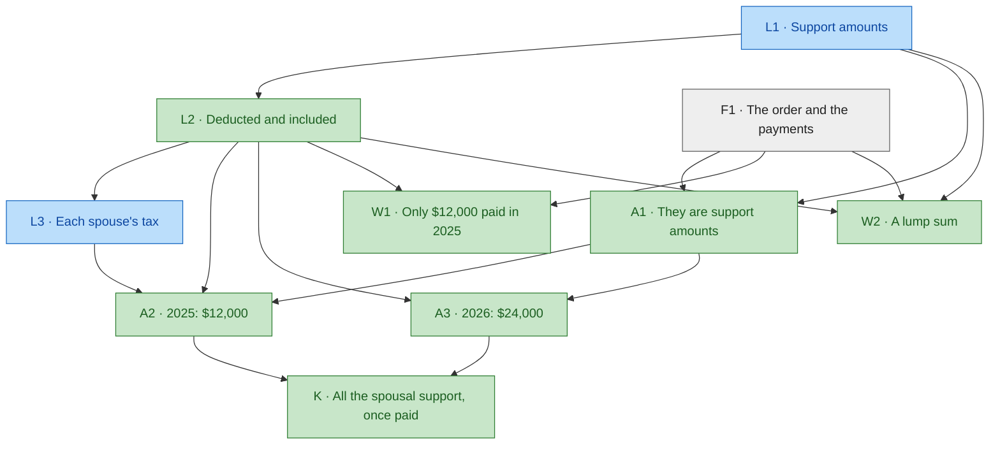
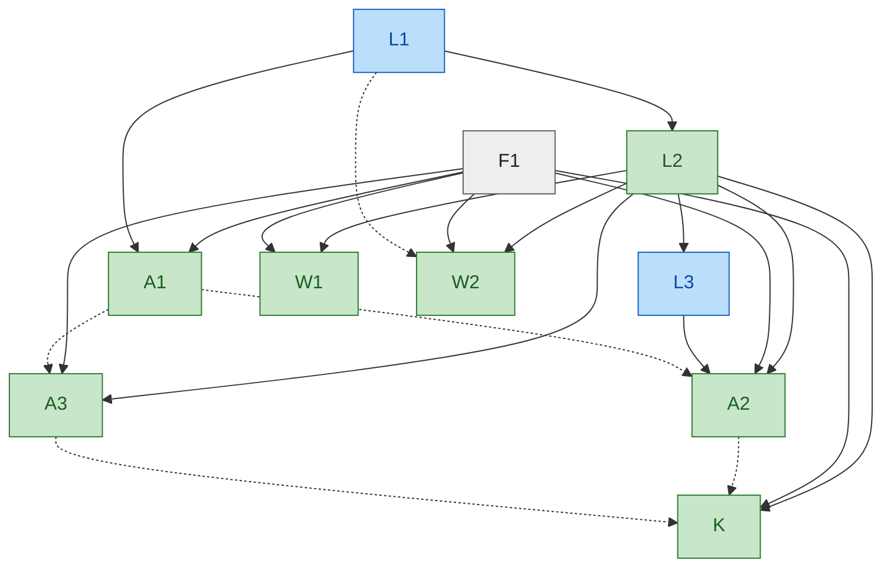
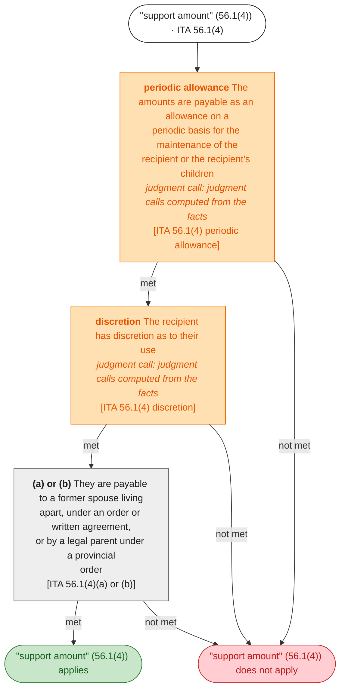

# Memo: support in arrears, and child support first

> Generated from the Lean sources by `scripts/blueprint.sh`. Do not edit by hand.

**Issue.** A 2025 court order requires $1,000 a month of child support and $1,500 of spousal support. The payer pays $24,000 of the $30,000 in 2025 and catches up in 2026. How much is deductible (and included) each year?

**Conclusion.** $12,000 in 2025, not $18,000: payments go to child support first, because 60(b) subtracts the child support payable, not the child support paid (A2). In 2026, $24,000: the year's $18,000 of spousal support and the $6,000 in arrears (A3). Over the two years, all $36,000 of spousal support is deducted, once paid (K). Had only $12,000 been paid in 2025, nothing would have been (W1). Provincial tax is not computed.

This is a constructed example, not advice.

**Status of the 10 statements:** 7 proven, 2 encoded, 1 fact.

## Dependency graph



Green: proven in Lean. Blue: encoded (definitions). Grey: facts. Orange: judgment calls. Dashed red: not yet formalized. An arrow points from a statement to the statements that use it.

### What the Lean proofs use

The same statements, with the dependencies Lean finds in the proofs themselves (solid) and those stated only in the memo's reasoning (dotted). Every dependency a proof has is also stated in the memo: `Blueprint.check` refuses a memo that hides one.



### Flowchart: "support amount" (56.1(4))



## The law

### L1. Support amounts

**Status:** encoded · **Citation:** ITA 56.1(4)

A periodic allowance for maintenance, at the recipient's discretion, to a spouse living apart under an order or written agreement (or by a legal parent under a provincial order); child support is what is not identified as solely for the recipient.

**Lean:** [`Canteen.ITA.Support.supportAmount`](../../Canteen/ITA/S56/Support.lean#L51)

### L2. Deducted and included

**Status:** proven · **Citation:** ITA 60(b); 56(1)(b) · **Uses:** L1

The support paid since 1997, less the child support payable since the commencement day and the amounts deducted before. Proven: nothing until child support payable is paid.

**Lean:** [`Canteen.ITA.Support.amount`](../../Canteen/ITA/S56/Support.lean#L64), [`Canteen.ITA.Support.child_support_first`](../../Canteen/ITA/S56/Support.lean#L79)

### L3. Each spouse's tax

**Status:** encoded · **Citation:** ITA 3; 117(2); 118(1) · **Uses:** L2

The deduction in the payer's income, the inclusion in the recipient's.

**Lean:** [`Canteen.ITA.IndividualYear.supportDeducted`](../../Canteen/ITA/S3/IndividualYear.lean#L201), [`Canteen.ITA.IndividualYear.supportIncluded`](../../Canteen/ITA/S3/IndividualYear.lean#L199), [`Canteen.ITA.IndividualYear.federalTax`](../../Canteen/ITA/S3/IndividualYear.lean#L361)

## Facts

### F1. The order and the payments

**Status:** fact

An order made 1 January 2025: $12,000 a year of child support and $18,000 of spousal support. $24,000 paid in 2025, $36,000 in 2026. The payer earns $120,000, the recipient $40,000.

**Lean:** [`Canteen.Transactions.SupportArrears.support2025`](../../Canteen/Transactions/SupportArrears.lean#L20), [`Canteen.Transactions.SupportArrears.support2026`](../../Canteen/Transactions/SupportArrears.lean#L22), [`Canteen.Transactions.SupportArrears.payer`](../../Canteen/Transactions/SupportArrears.lean#L24), [`Canteen.Transactions.SupportArrears.recipient`](../../Canteen/Transactions/SupportArrears.lean#L26)

## Analysis

### A1. They are support amounts

**Status:** proven · **Citation:** ITA 56.1(4) · **Uses:** F1, L1

Periodic, at the recipient's discretion, under a court order to a spouse living apart.

**Lean:** [`Canteen.Transactions.SupportArrears.is_support`](../../Canteen/Transactions/SupportArrears.lean#L31)

**Rests on:** facts F1.

### A2. 2025: $12,000

**Status:** proven · **Citation:** ITA 60(b) · **Uses:** A1, L2, L3

$24,000 paid less the $12,000 of child support payable. The payer's tax falls by $2,748.75, the recipient's rises by $1,680.

**Lean:** [`Canteen.Transactions.SupportArrears.deductible_2025`](../../Canteen/Transactions/SupportArrears.lean#L35), [`Canteen.Transactions.SupportArrears.tax_2025`](../../Canteen/Transactions/SupportArrears.lean#L39)

**Rests on:** facts F1.

### A3. 2026: $24,000

**Status:** proven · **Citation:** ITA 60(b) · **Uses:** A1, L2

$60,000 paid in all, less $24,000 of child support payable and the $12,000 deducted in 2025.

**Lean:** [`Canteen.Transactions.SupportArrears.deductible_2026`](../../Canteen/Transactions/SupportArrears.lean#L46)

**Rests on:** facts F1.

## Conclusion

### K. All the spousal support, once paid

**Status:** proven · **Uses:** A2, A3

$36,000 over the two years: the spousal support ordered, deducted in the year it is caught up.

**Lean:** [`Canteen.Transactions.SupportArrears.two_years`](../../Canteen/Transactions/SupportArrears.lean#L50)

**Rests on:** facts F1.

## What if

### W1. Only $12,000 paid in 2025

**Status:** proven · **Citation:** ITA 60(b) · **Uses:** F1, L2

All of it child support: nothing deductible.

**Lean:** [`Canteen.Transactions.SupportArrears.nothing_until_caught_up`](../../Canteen/Transactions/SupportArrears.lean#L53)

**Rests on:** facts F1.

### W2. A lump sum

**Status:** proven · **Citation:** ITA 56.1(4) · **Uses:** F1, L1, L2

Not an allowance on a periodic basis: not deductible.

**Lean:** [`Canteen.Transactions.SupportArrears.lump_sum`](../../Canteen/Transactions/SupportArrears.lean#L56)

**Rests on:** facts F1.

## Appendix: the argument as Lean renders it

### 2025

```
1. The amounts are payable as an allowance on a periodic basis for the maintenance of the recipient or the recipient's children. [ITA 56.1(4) periodic allowance]
2. The recipient has discretion as to their use. [ITA 56.1(4) discretion]
3. They are payable to a former spouse living apart, under an order or written agreement, or by a legal parent under a provincial order. [ITA 56.1(4)(a) or (b)]
4. Therefore "support amount" (56.1(4)) applies. [ITA 56.1(4)]
5. Support paid since 1997 of $24,000.00, less child support payable since the commencement day of $12,000.00 and amounts deducted before of $0.00: $12,000.00. [ITA 60(b); 56(1)(b)]
Relies on no judgment calls.
```

### 2026

```
1. The amounts are payable as an allowance on a periodic basis for the maintenance of the recipient or the recipient's children. [ITA 56.1(4) periodic allowance]
2. The recipient has discretion as to their use. [ITA 56.1(4) discretion]
3. They are payable to a former spouse living apart, under an order or written agreement, or by a legal parent under a provincial order. [ITA 56.1(4)(a) or (b)]
4. Therefore "support amount" (56.1(4)) applies. [ITA 56.1(4)]
5. Support paid since 1997 of $60,000.00, less child support payable since the commencement day of $24,000.00 and amounts deducted before of $12,000.00: $24,000.00. [ITA 60(b); 56(1)(b)]
Relies on no judgment calls.
```

