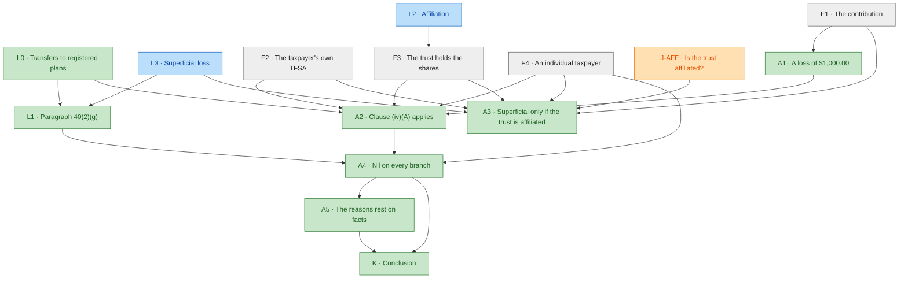
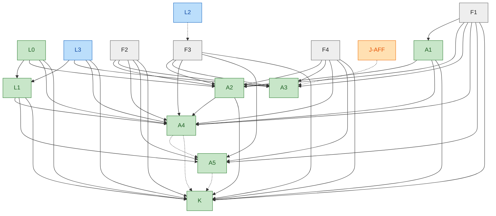
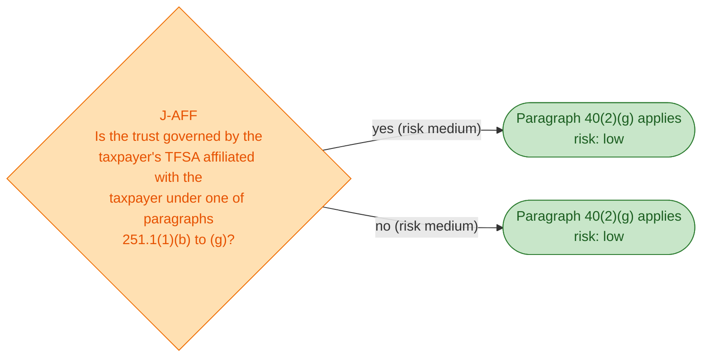
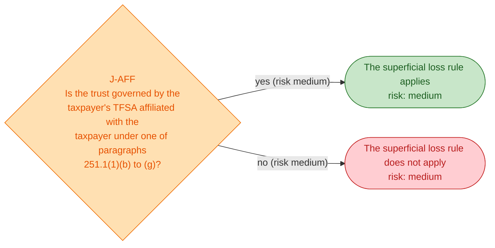
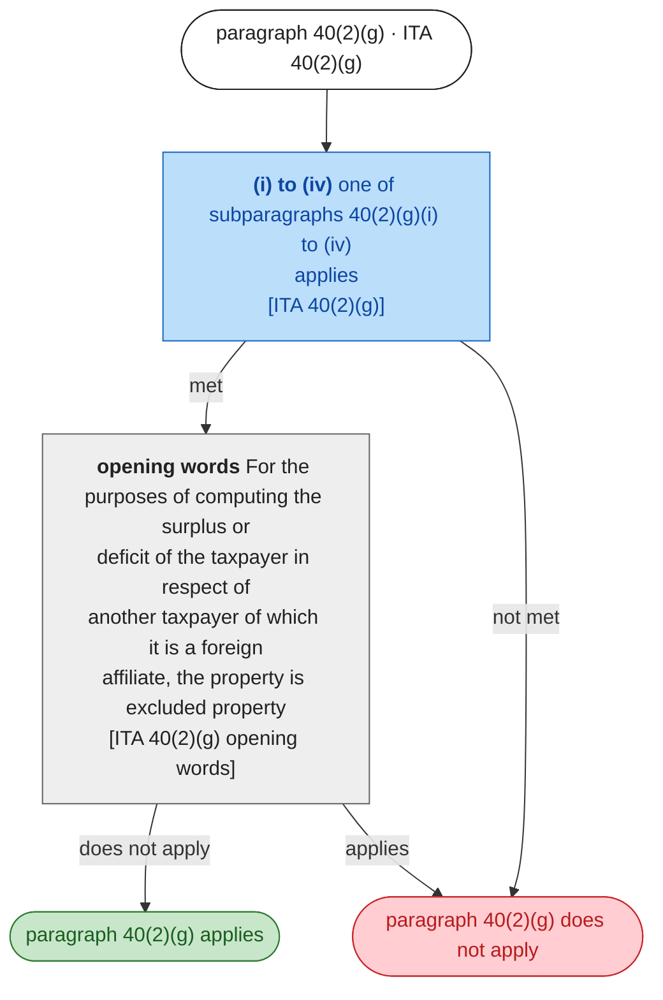
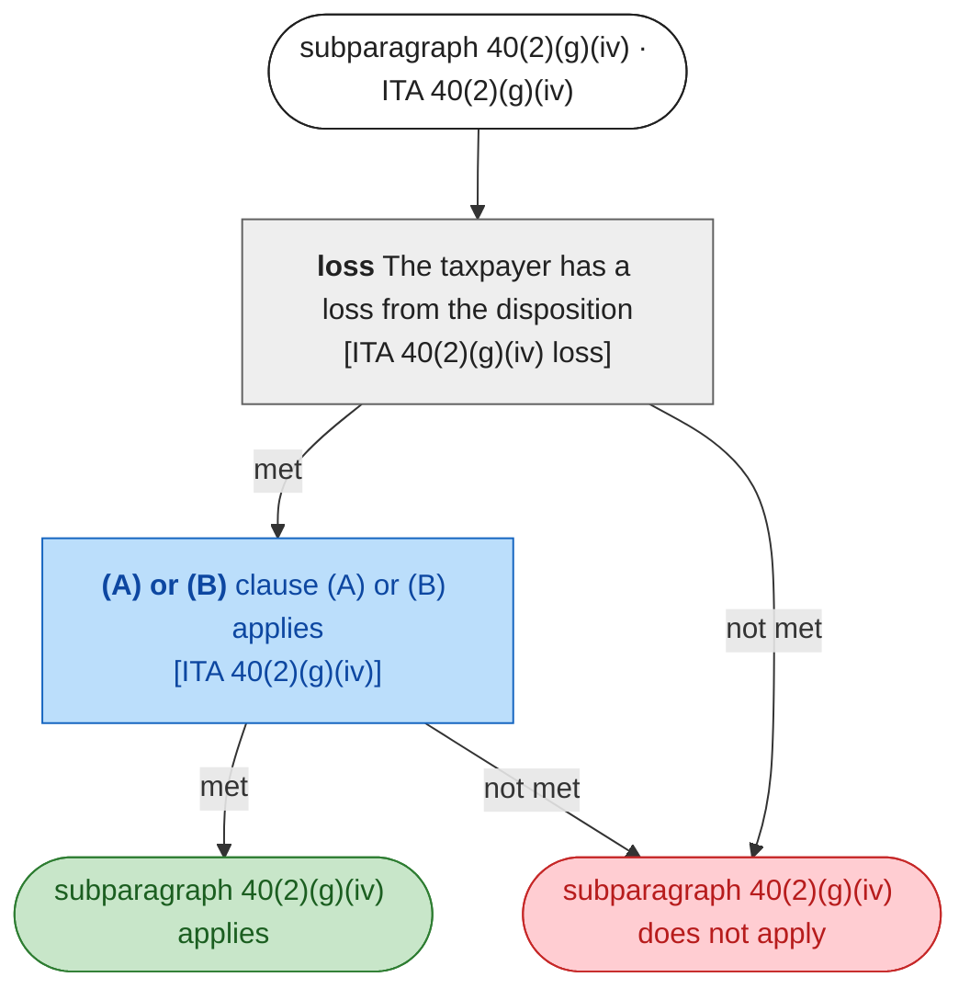

# Memo: shares contributed in kind to a TFSA at a loss

> Generated from the Lean sources by `scripts/blueprint.sh`. Do not edit by hand.

**Issue.** On 2025-09-02 the taxpayer contributed 80 common shares of JKL Corp., worth $4,000.00 and with an adjusted cost base of $5,000.00, to the taxpayer's TFSA. Can the taxpayer use the $1,000.00 loss?

**Conclusion.** No. Clause 40(2)(g)(iv)(A) makes a loss on property disposed of to a TFSA trust under which the taxpayer is a beneficiary nil (A2, A5). Whether the trust is affiliated with the taxpayer is a judgment call (J-AFF) that decides whether the loss is also a superficial loss (A3), but not the outcome: the loss is nil either way (A4), and the conclusion rests on no judgment call.

This is a constructed example, not advice on a real transaction.

**Status of the 15 statements:** 8 proven, 2 encoded, 4 fact, 1 judgment call.

## Dependency graph



Green: proven in Lean. Blue: encoded (definitions). Grey: facts. Orange: judgment calls. Dashed red: not yet formalized. An arrow points from a statement to the statements that use it.

### What the Lean proofs use

The same statements, with the dependencies Lean finds in the proofs themselves (solid) and those stated only in the memo's reasoning (dotted). Every dependency a proof has is also stated in the memo: `Blueprint.check` refuses a memo that hides one.



### Decision tree: J-AFF doesn't matter



### Subparagraph (i) alone does turn on J-AFF



### Paragraph 40(2)(g) as a flowchart



### Subparagraph (iv) as a flowchart



### Timeline of the superficial loss period

```mermaid
gantt
    title Superficial loss period for the disposition on 2025-09-02
    dateFormat YYYY-MM-DD
    axisFormat %b %d
    section Period (a)
    2025-08-03 to 2025-10-02 :active, period, 2025-08-03, 61d
    section Disposition
    2025-09-02 disposition of 80 common shares of JKL Corp. (loss $1,000.00) :milestone, disp, 2025-09-02, 0d
    section Acquisitions
    2025-09-02 the trust governed by the taxpayer's TFSA (affiliated, judgment call J-AFF) acquires 80 common shares of JKL Corp. (in period, held at end) :milestone, crit, a0, 2025-09-02, 0d
    section End of period (b)
    2025-10-02 end of period :milestone, endp, 2025-10-02, 0d
```

## The law

### L0. Transfers to registered plans

**Status:** proven · **Citation:** ITA 40(2)(g)(iv)

A loss from the disposition of property to a trust governed by a DPSP, EPSP, FHSA, RDSP, RRIF or TFSA under which the taxpayer is (or immediately after becomes) a beneficiary, or to an RRSP trust under which the taxpayer or spouse or common-law partner is (or within 60 days after the year becomes) an annuitant, is nil.

**Lean:** [`Canteen.ITA.Paragraph40_2_g.planTransferLoss`](../../Canteen/ITA/S40/PlanTransferLoss.lean#L45), [`Canteen.ITA.Paragraph40_2_g.planTransferLoss_tfsa`](../../Canteen/ITA/S40/PlanTransferLoss.lean#L59)

### L3. Superficial loss

**Status:** encoded · **Citation:** ITA 54 "superficial loss"

The definition, as in the provision's blueprint.

**Lean:** [`Canteen.ITA.SuperficialLoss.superficialLoss`](../../Canteen/ITA/S54/SuperficialLoss.lean#L255)

### L2. Affiliation

**Status:** encoded · **Citation:** ITA 251.1(1)

Paragraph 251.1(1)(a) covers an individual and a spouse or common-law partner; paragraphs (b) to (g) are not encoded, so whether one applies is taken as given.

**Lean:** [`Canteen.ITA.Affiliation.affiliated`](../../Canteen/ITA/S251_1/Affiliation.lean#L50)

### L1. Paragraph 40(2)(g)

**Status:** proven · **Citation:** ITA 40(2)(g) · **Uses:** L0, L3

A loss is nil to the extent it is within any of subparagraphs (i) to (iv), unless the carve-out in the opening words applies.

**Lean:** [`Canteen.ITA.Paragraph40_2_g.paragraph`](../../Canteen/ITA/S40/Paragraph40_2_g.lean#L32), [`Canteen.ITA.Paragraph40_2_g.paragraph_holds`](../../Canteen/ITA/S40/Paragraph40_2_g.lean#L45)

## Facts

### F1. The contribution

**Status:** fact

On 2025-09-02 the taxpayer contributed 80 common shares of JKL Corp. to the TFSA: proceeds $4,000.00 (their value), adjusted cost base $5,000.00.

**Lean:** [`Canteen.Transactions.TfsaContribution.contribution`](../../Canteen/Transactions/TfsaContribution.lean#L29)

### F2. The taxpayer's own TFSA

**Status:** fact

The shares went to the trust governed by the taxpayer's TFSA. The taxpayer is its holder, so a beneficiary under it.

**Lean:** [`Canteen.Transactions.TfsaContribution.transferFacts`](../../Canteen/Transactions/TfsaContribution.lean#L33)

### F3. The trust holds the shares

**Status:** fact · **Uses:** L2

The trust acquired the same shares that day and still held them at the end of the period. It is an individual (subsection 104(2)) but not the taxpayer's spouse.

**Lean:** [`Canteen.Transactions.TfsaContribution.trustAcquisition`](../../Canteen/Transactions/TfsaContribution.lean#L42), [`Canteen.Transactions.TfsaContribution.trustRelation`](../../Canteen/Transactions/TfsaContribution.lean#L37)

### F4. An individual taxpayer

**Status:** fact

The taxpayer is an individual, so the foreign affiliate carve-out is not engaged.

**Lean:** [`Canteen.Transactions.TfsaContribution.surplusCarveOut`](../../Canteen/Transactions/TfsaContribution.lean#L53)

## Judgment call

### J-AFF. Is the trust affiliated?

**Status:** judgment call

Whether the TFSA trust is affiliated with the taxpayer under one of paragraphs 251.1(1)(b) to (g). Risk: medium either way.

## Analysis

### A1. A loss of $1,000.00

**Status:** proven · **Citation:** ITA 40(1)(b) · **Uses:** F1

The adjusted cost base ($5,000.00) exceeds the proceeds ($4,000.00) by $1,000.00.

**Lean:** [`Canteen.Transactions.TfsaContribution.loss_amount`](../../Canteen/Transactions/TfsaContribution.lean#L65)

**Rests on:** facts F1.

### A2. Clause (iv)(A) applies

**Status:** proven · **Citation:** ITA 40(2)(g)(iv)(A) · **Uses:** A1, F2, F3, F4, L0

The loss is from the disposition of property to a trust governed by a TFSA under which the taxpayer is a beneficiary.

**Lean:** [`Canteen.Transactions.TfsaContribution.iv_applies`](../../Canteen/Transactions/TfsaContribution.lean#L67)

**Rests on:** facts F1, F2, F3, F4.

### A3. Superficial only if the trust is affiliated

**Status:** proven · **Citation:** ITA 54 "superficial loss" · **Uses:** F1, F2, F3, F4, J-AFF, L3

The trust acquired the same shares in the period and held them at its end. So the loss is also a superficial loss if the trust is affiliated with the taxpayer, and not otherwise.

**Lean:** [`Canteen.Transactions.TfsaContribution.superficial_iff_affiliated`](../../Canteen/Transactions/TfsaContribution.lean#L72)

**Rests on:** judgment calls J-AFF; facts F1, F2, F3, F4.

### A4. Nil on every branch

**Status:** proven · **Citation:** ITA 40(2)(g) · **Uses:** A2, F4, L1

Clause (iv)(A) applies whatever the answer to J-AFF, and the carve-out is not engaged, so paragraph 40(2)(g) makes the loss nil on every branch.

**Lean:** [`Canteen.Transactions.TfsaContribution.nil_on_every_branch`](../../Canteen/Transactions/TfsaContribution.lean#L77), [`Canteen.Transactions.TfsaContribution.denied_loss`](../../Canteen/Transactions/TfsaContribution.lean#L81)

**Rests on:** facts F1, F2, F3, F4.

### A5. The reasons rest on facts

**Status:** proven · **Uses:** A4

On either answer, the explanation cites clause (iv)(A), which rests on facts, rather than subparagraph (i), which would rest on J-AFF.

**Lean:** [`Canteen.Transactions.TfsaContribution.explanation_factual`](../../Canteen/Transactions/TfsaContribution.lean#L89)

**Rests on:** facts F1, F2, F3, F4.

### K. Conclusion

**Status:** proven · **Uses:** A4, A5

The taxpayer cannot use the $1,000.00 loss: paragraph 40(2)(g) makes it nil, under clause (iv)(A), on the facts alone.

**Lean:** [`Canteen.Transactions.TfsaContribution.denied_loss`](../../Canteen/Transactions/TfsaContribution.lean#L81)

**Rests on:** facts F1, F2, F3, F4.

## Appendix: the argument as Lean renders it

### Paragraph 40(2)(g), if the trust is affiliated

```
1. The taxpayer has a loss from the disposition. [ITA 40(2)(g)(iv) loss]
2. The property was disposed of to a trust governed by a deferred profit sharing plan, an employees profit sharing plan, a FHSA, a registered disability savings plan, a registered retirement income fund or a TFSA. [ITA 40(2)(g)(iv)(A) trust]
3. The taxpayer is, or immediately after the disposition becomes, a beneficiary under it. [ITA 40(2)(g)(iv)(A) beneficiary]
4. Therefore clause 40(2)(g)(iv)(A) applies. [ITA 40(2)(g)(iv)(A)]
5. Therefore clause (A) or (B) applies. [ITA 40(2)(g)(iv)]
6. Therefore subparagraph 40(2)(g)(iv) applies. [ITA 40(2)(g)(iv)]
7. Therefore one of subparagraphs 40(2)(g)(i) to (iv) applies. [ITA 40(2)(g)]
8. The property is not excluded property being considered in computing a foreign affiliate's surplus or deficit. [ITA 40(2)(g) opening words]
9. Therefore paragraph 40(2)(g) applies. [ITA 40(2)(g)]
Relies on no judgment calls.
```

### Paragraph 40(2)(g), if it is not

```
1. The taxpayer has a loss from the disposition. [ITA 40(2)(g)(iv) loss]
2. The property was disposed of to a trust governed by a deferred profit sharing plan, an employees profit sharing plan, a FHSA, a registered disability savings plan, a registered retirement income fund or a TFSA. [ITA 40(2)(g)(iv)(A) trust]
3. The taxpayer is, or immediately after the disposition becomes, a beneficiary under it. [ITA 40(2)(g)(iv)(A) beneficiary]
4. Therefore clause 40(2)(g)(iv)(A) applies. [ITA 40(2)(g)(iv)(A)]
5. Therefore clause (A) or (B) applies. [ITA 40(2)(g)(iv)]
6. Therefore subparagraph 40(2)(g)(iv) applies. [ITA 40(2)(g)(iv)]
7. Therefore one of subparagraphs 40(2)(g)(i) to (iv) applies. [ITA 40(2)(g)]
8. The property is not excluded property being considered in computing a foreign affiliate's surplus or deficit. [ITA 40(2)(g) opening words]
9. Therefore paragraph 40(2)(g) applies. [ITA 40(2)(g)]
Relies on no judgment calls.
```

