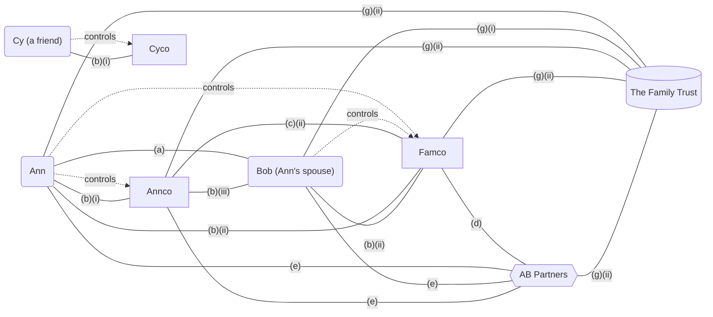
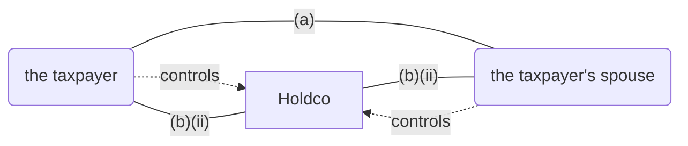
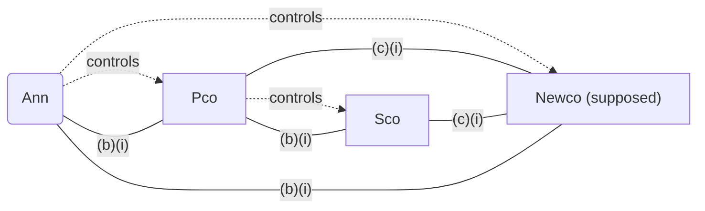
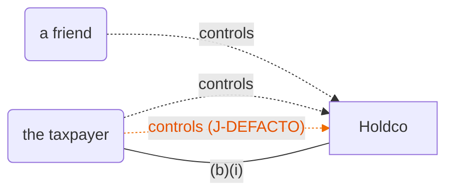

# Who is affiliated with whom

> Generated from the Lean sources by `scripts/blueprint.sh`. Do not edit by hand.

Worlds of persons under section 251.1, drawn from the computed relation. Rounded boxes are individuals, boxes corporations, hexagons partnerships, cylinders trusts. Dashed arrows are control (orange where a judgment call); each solid line is an affiliated pair, labelled with the paragraph that makes it so. Affiliation is not transitive: Cy's company is affiliated with Cy, but not with Ann.

## A family group

## Holdco, owned by the taxpayer and spouse

## An amalgamation: the hypothetical world of 251.1(2), with Newco supposed to exist immediately before

## Holdco, owned with a friend, if the taxpayer controls it de facto

