# Architecture

> Generated from the Lean sources by `scripts/blueprint.sh`. Do not edit by hand.

Every module of the library (tests left out), grouped by layer, with an arrow from a module to each module that builds on it. Imports already implied by others are left out. Read from the compiled modules.

```mermaid
flowchart BT
  subgraph Core["Layer 0: core language"]
    m0["Core.Risk"]
    m1["Core.Date"]
    m2["Core.Money"]
    m3["Core.Judgment"]
    m4["Core.Finding"]
    m5["Core.Rule"]
    m6["Core.Render"]
    m7["Core.Argument"]
    m8["Core.Combine"]
    m9["Core.Branch"]
    m10["Core.Answer"]
    m11["Core.Statute"]
    m12["Core.StatuteSyntax"]
    m13["Core.Series"]
    m14["Core.SeriesReport"]
    m15["Core.Audit"]
    m16["Core.Blueprint"]
    m17["Core.Graphs"]
    m18["Core.LeanGraph"]
  end
  subgraph ITA["Layer 1: statute encoding"]
    m23["ITA.S54.SuperficialLoss"]
    m24["ITA.S40.LossDenial"]
    m25["ITA.S54.SuperficialLossStatute"]
    m26["ITA.S40.LossDenialStatute"]
    m27["ITA.S53.CostAddition"]
    m28["ITA.S251_1.Affiliation"]
    m29["ITA.S251_1.AffiliatedPersons"]
    m30["ITA.S251.RelatedPersons"]
    m31["ITA.S50.BadDebtPersonalUse"]
    m32["ITA.S54.Timeline"]
    m33["ITA.S40.Paragraph40_2_g_Facts"]
    m34["ITA.S40.DebtLoss"]
    m35["ITA.S40.PersonalUseLoss"]
    m36["ITA.S40.PlanTransferLoss"]
    m37["ITA.S40.Paragraph40_2_g"]
  end
  subgraph Lemmas["Layer 2: reusable lemmas"]
    m38["Lemmas.SuperficialLoss"]
  end
  subgraph Transactions["Layer 3: transactions"]
    m39["Transactions.SpouseRepurchase"]
    m40["Transactions.SiblingAndLateRepurchase"]
    m41["Transactions.TfsaContribution"]
    m42["Transactions.HoldcoRepurchase"]
  end
  subgraph Blueprints["Blueprints"]
    m43["Blueprints.SuperficialLoss"]
    m44["Blueprints.SpouseRepurchase"]
    m45["Blueprints.SiblingAndLateRepurchase"]
    m46["Blueprints.TfsaContribution"]
    m47["Blueprints.HoldcoRepurchase"]
    m48["Blueprints.All"]
  end
  subgraph Examples["Examples"]
    m19["Examples.RuleX"]
    m20["Examples.RuleZ"]
    m21["Examples.ToySeries"]
    m22["Examples.RuleXStatute"]
  end
  subgraph Graphs["Graphs"]
    m49["Graphs.All"]
  end
  subgraph Root["Root"]
    m50["Canteen"]
  end
  m0 --> m3
  m3 --> m4
  m4 --> m5
  m5 --> m6
  m6 --> m7
  m5 --> m8
  m7 --> m9
  m9 --> m10
  m8 --> m11
  m11 --> m12
  m7 --> m14
  m13 --> m14
  m4 --> m16
  m15 --> m16
  m11 --> m17
  m9 --> m17
  m14 --> m17
  m17 --> m18
  m7 --> m19
  m19 --> m20
  m8 --> m20
  m19 --> m21
  m8 --> m21
  m9 --> m21
  m14 --> m21
  m12 --> m22
  m19 --> m22
  m7 --> m23
  m1 --> m23
  m2 --> m23
  m23 --> m24
  m8 --> m24
  m12 --> m25
  m23 --> m25
  m24 --> m26
  m25 --> m26
  m23 --> m27
  m12 --> m28
  m23 --> m28
  m10 --> m28
  m10 --> m29
  m23 --> m29
  m17 --> m29
  m29 --> m30
  m12 --> m31
  m10 --> m31
  m2 --> m31
  m23 --> m32
  m10 --> m33
  m23 --> m33
  m12 --> m34
  m33 --> m34
  m12 --> m35
  m33 --> m35
  m12 --> m36
  m33 --> m36
  m34 --> m37
  m35 --> m37
  m36 --> m37
  m24 --> m37
  m23 --> m38
  m24 --> m39
  m38 --> m39
  m27 --> m39
  m28 --> m39
  m24 --> m40
  m28 --> m40
  m38 --> m40
  m37 --> m41
  m28 --> m41
  m37 --> m42
  m27 --> m42
  m29 --> m42
  m16 --> m43
  m38 --> m43
  m26 --> m43
  m27 --> m43
  m28 --> m43
  m30 --> m43
  m31 --> m43
  m37 --> m43
  m16 --> m44
  m17 --> m44
  m39 --> m44
  m25 --> m44
  m32 --> m44
  m16 --> m45
  m17 --> m45
  m40 --> m45
  m32 --> m45
  m16 --> m46
  m17 --> m46
  m41 --> m46
  m32 --> m46
  m16 --> m47
  m42 --> m47
  m32 --> m47
  m43 --> m48
  m44 --> m48
  m45 --> m48
  m46 --> m48
  m47 --> m48
  m22 --> m49
  m21 --> m49
  m32 --> m49
  m26 --> m49
  m39 --> m49
  m40 --> m49
  m41 --> m49
  m42 --> m49
  m30 --> m49
  m18 --> m50
  m20 --> m50
  m48 --> m50
  m49 --> m50
```

