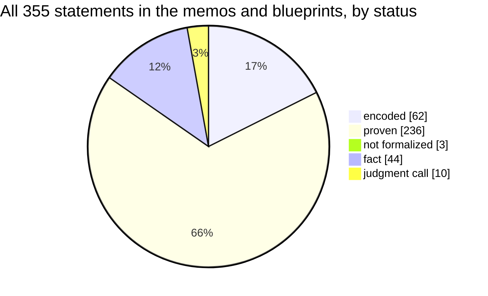
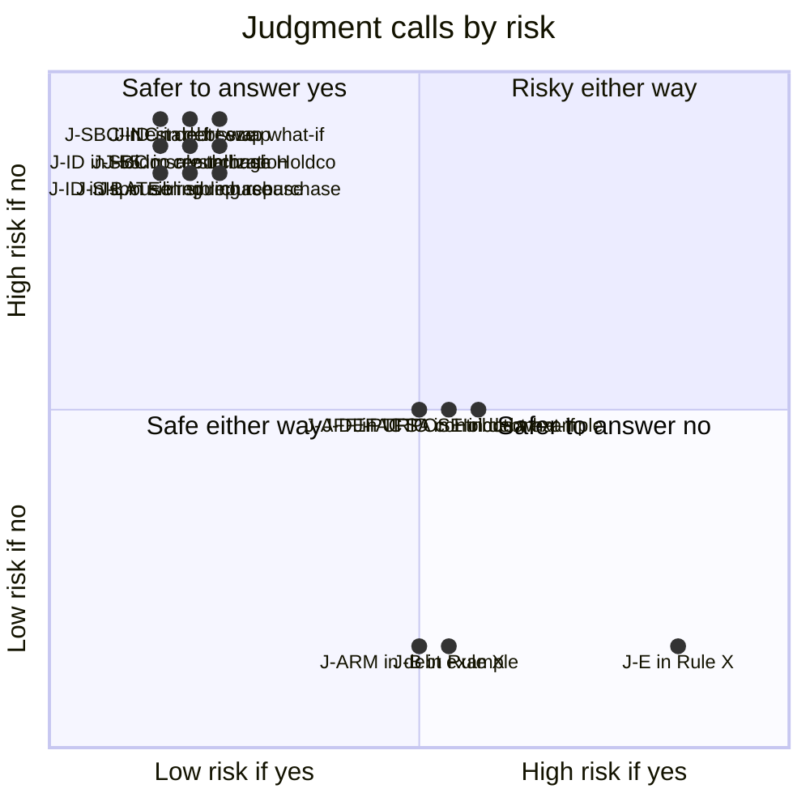
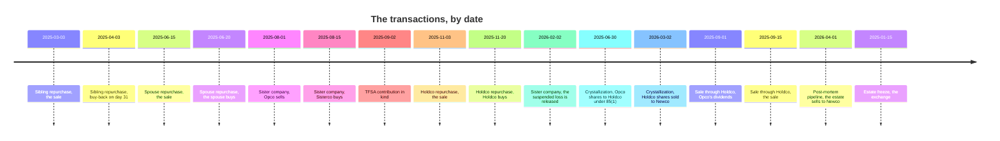

# Dashboard

> Generated from the Lean sources by `scripts/blueprint.sh`. Do not edit by hand.

An overview of the project, drawn from the Lean.

## Statements by status

Every statement in every blueprint, by the status Lean computes for it.

## Judgment calls by risk

Every judgment call in the transactions and examples, placed by the risk of answering "yes" (across) and "no" (up). Calls in the same place are spread out a little.

## The transactions, by date

The key dates, read from each transaction's facts.

## The Act, as encoded

```mermaid
mindmap
  root((Income Tax Act, as encoded))
    n0["`ss. 2, 3`"]
      n1["`income for the year: (a) to (f)`"]
      n2["`2(2): taxable income`"]
      n3["`a corporation's year`"]
    n4["`s. 6`"]
      n5["`6(1)(e), 6(2): automobile standby charge`"]
    n6["`s. 7`"]
      n7["`7(1)(a): the option benefit`"]
      n8["`7(1.1): CCPC deferral`"]
    n9["`s. 13`"]
      n10["`13(21): undepreciated capital cost`"]
      n11["`13(1): recapture`"]
    n12["`s. 15`"]
      n13["`15(1): shareholder benefits`"]
      n14["`15(2), (2.6): shareholder loans`"]
    n15["`s. 20`"]
      n16["`20(16): terminal loss`"]
      n17["`20(1)(j): loan repaid`"]
      n18["`20(1)(c): interest`"]
      n19["`20(1)(e), (e.1): financing expenses`"]
      n20["`20(3): refinancing`"]
    n21["`ss. 38 to 41`"]
      n22["`38: inclusion rates`"]
      n23["`39(1): capital gains and losses`"]
      n24["`39(4): the Canadian securities election`"]
      n25["`40(1): gains and losses, reserves`"]
      n26["`41: listed personal property`"]
    n27["`s. 40`"]
      n28["`40(2)(b): the principal residence exemption`"]
      n29["`40(2)(g): losses that are nil`"]
        n30["`(i) superficial losses`"]
        n31["`(ii) debts`"]
        n32["`(iii) personal-use property`"]
        n33["`(iv) TFSAs, RRSPs and other plans`"]
      n34["`40(2)(e.1): debts within a related group`"]
      n35["`40(3.3) to (3.5): suspended losses`"]
      n36["`40(3.6): shares to an affiliated corporation`"]
      n37["`40(3): negative adjusted cost base`"]
    n38["`s. 43`"]
      n39["`43(1): part of a property`"]
    n40["`s. 44`"]
      n41["`44(1): replacement property`"]
    n42["`s. 44.1`"]
      n43["`44.1(2): small business investment rollover`"]
    n44["`s. 45`"]
      n45["`45(1): change in use`"]
      n46["`45(2), (3), (4): the elections`"]
    n47["`s. 46`"]
      n48["`46(1), (2): the $1,000 floor`"]
      n49["`46(3): sets`"]
    n50["`s. 47`"]
      n51["`47(1): identical properties, average cost`"]
    n52["`s. 50`"]
      n53["`50(1): bad debts, worthless shares`"]
      n54["`50(2): bad personal-use debts`"]
    n55["`s. 51`"]
      n56["`51(1), (2): convertible property`"]
    n57["`s. 53`"]
      n58["`53(1)(f): cost of substituted property`"]
      n59["`53(1)(f.1), (f.2): cost after 40(2)(e.1), 40(3.6)`"]
    n60["`s. 54`"]
      n61["`superficial loss`"]
      n62["`principal residence`"]
      n63["`personal-use property`"]
      n64["`listed personal property`"]
    n65["`s. 55`"]
      n66["`55(2), (2.1): dividends over safe income`"]
      n67["`55(3): related parties, butterflies`"]
    n68["`s. 67.1`"]
      n69["`67.1(1): 50% of food and entertainment`"]
      n70["`67.1(2): the exceptions`"]
      n71["`67.1(3): conference fees`"]
    n72["`s. 69`"]
      n73["`69(1): not at arm's length, gifts`"]
    n74["`s. 70`"]
      n75["`70(5): deemed disposition on death`"]
      n76["`70(6): rollover to a spouse or spousal trust`"]
    n77["`s. 73`"]
      n78["`73(1), (1.01): the spousal rollover`"]
    n79["`ss. 74.1, 74.2, 74.4, 74.5`"]
      n80["`74.1(1), (2): income attributed back`"]
      n81["`74.1(3): repaying debt`"]
      n82["`74.2(1): capital gains attributed back`"]
      n83["`74.4(2): corporate attribution`"]
      n84["`74.5(1) to (3): fair market value, loans for value, separation`"]
    n85["`s. 80.4`"]
      n86["`80.4(2): deemed interest on shareholder loans`"]
    n87["`s. 82`"]
      n88["`82(1): taxable dividends and the gross-up`"]
    n89["`s. 83`"]
      n90["`83(2): capital dividends`"]
    n91["`s. 84`"]
      n92["`84(1): paid-up capital increased`"]
      n93["`84(2): distributions on winding-up`"]
      n94["`84(3): redemptions, the deemed dividend`"]
      n95["`84(4), (4.1): returns of capital`"]
    n96["`s. 84.1`"]
      n97["`84.1(1): paid-up capital, and the deemed dividend`"]
      n98["`84.1(2): hard cost, arm's length`"]
    n99["`s. 85`"]
      n100["`85(1): the elected amount, and the cost of the consideration`"]
      n101["`85(2.1): paid-up capital`"]
    n102["`s. 86`"]
      n103["`86(1): share exchange in a reorganization`"]
      n104["`86(2): benefit to a related person`"]
    n105["`s. 87`"]
      n106["`87(1): amalgamation`"]
      n107["`87(2)(e): cost of capital property`"]
      n108["`87(4): shareholders`"]
    n109["`s. 88`"]
      n110["`88(1): winding up a subsidiary`"]
      n111["`88(1)(c), (d): the bump`"]
    n112["`s. 89`"]
      n113["`89(1): capital dividend account`"]
      n114["`89(1): general rate income pool`"]
    n115["`s. 125`"]
      n116["`125(2), (3): the business limit, shared`"]
      n117["`125(5.1): the capital and passive income grinds`"]
      n118["`125(7): adjusted aggregate investment income`"]
    n119["`s. 110.1`"]
      n120["`110.1(1)(a): a corporation's gifts`"]
    n121["`s. 110.6`"]
      n122["`qualified small business corporation share`"]
      n123["`annual and cumulative gains limits`"]
      n124["`110.6(2.1): the deduction`"]
    n125["`s. 110`"]
      n126["`110(1)(d), (d.1): the option deduction`"]
    n127["`s. 111`"]
      n128["`111(8): net capital loss`"]
      n129["`111(1)(b), (1.1): deduction`"]
      n130["`111(8): non-capital loss`"]
      n131["`111(1)(a), (3): its deduction, oldest first`"]
    n132["`s. 112`"]
      n133["`112(1): intercorporate dividend deduction`"]
      n134["`112(3), (3.01): the stop-loss on shares`"]
    n135["`ss. 56, 56.1, 60`"]
      n136["`56.1(4): support amount, child support`"]
      n137["`56(1)(b), 60(b): included and deducted`"]
    n138["`s. 62`"]
      n139["`62(1): moving expenses`"]
      n140["`248(1): eligible relocation, the 40 km test`"]
    n141["`s. 63`"]
      n142["`63(1): child care expenses`"]
      n143["`63(2): the higher-income spouse`"]
    n144["`s. 60.03`"]
      n145["`60.03(1): split-pension amount`"]
      n146["`60(c), 56(1)(a.2): deducted and included`"]
    n147["`s. 256`"]
      n148["`256(1): associated corporations, (a) to (e)`"]
      n149["`256(1.2)(b)(i): a member's control is the group's`"]
      n150["`256(5.1): de facto control`"]
      n151["`256(2): through a third corporation`"]
    n152["`s. 117`"]
      n153["`117(2): the federal rates`"]
    n154["`s. 117.1`"]
      n155["`117.1(1), (4): indexing by the CPI`"]
      n156["`117.1(3): rounding`"]
    n157["`s. 118`"]
      n158["`118(1.1): basic personal amount`"]
      n159["`118(1)(a): spouse amount`"]
      n160["`118(1)(b): eligible dependant`"]
      n161["`118(1)(b.1), (d), (e): caregiver amounts`"]
      n162["`118(2): age credit`"]
      n163["`118(10): Canada employment credit`"]
      n164["`118(3), (7): pension credit`"]
    n165["`s. 118.2`"]
      n166["`118.2(1): the medical expense credit`"]
    n167["`s. 118.3`"]
      n168["`118.3(1): the disability credit`"]
      n169["`118.3(2): transfer to a supporting person`"]
    n170["`ss. 118.01 to 118.07`"]
      n171["`118.01: adoption`"]
      n172["`118.041: home accessibility`"]
      n173["`118.05: home buyers`"]
      n174["`118.06, 118.07: volunteers`"]
    n175["`s. 118.1`"]
      n176["`118.1(1): total gifts`"]
      n177["`118.1(3): the credit`"]
    n178["`ss. 118.5, 118.61, 118.81, 118.9`"]
      n179["`118.5(1)(a): tuition`"]
      n180["`118.61: carryforward`"]
      n181["`118.81, 118.9: transfer to a parent`"]
    n182["`s. 118.7`"]
      n183["`118.7: CPP and EI credits`"]
    n184["`s. 120.4`"]
      n185["`120.4(1): split income, excluded amounts`"]
      n186["`120.4(2), (3): the tax`"]
    n187["`s. 121`"]
      n188["`121: the dividend tax credit`"]
    n189["`ss. 127.5 to 127.531`"]
      n190["`127.51: the minimum amount`"]
      n191["`127.52(1): adjusted taxable income`"]
      n192["`127.531: the basic minimum tax credit`"]
      n193["`120.2: recovering minimum tax`"]
    n194["`ss. 123 to 125`"]
      n195["`123(1), 124(1): 38%, the abatement`"]
      n196["`123.4(2): general rate reduction`"]
      n197["`125(1): small business deduction`"]
    n198["`ss. 123.3, 129`"]
      n199["`123.3: refundable tax on investment income`"]
      n200["`129(1), (4): the dividend refund`"]
    n201["`s. 185.1`"]
      n202["`185.1(1): Part III.1 tax on excessive designations`"]
      n203["`185.1(2), (3): the election`"]
    n204["`s. 180.2`"]
      n205["`180.2(2): OAS recovery tax`"]
    n206["`s. 186`"]
      n207["`186(1): Part IV tax`"]
      n208["`186(4): connected corporations`"]
      n209["`186(2): control with non-arm's length persons`"]
    n210["`s. 248`"]
      n211["`248(1): majority-interest partner`"]
    n212["`s. 251`"]
      n213["`251(1): arm's length`"]
      n214["`251(2), (3): related persons`"]
      n215["`251(3.1), (3.2): amalgamations`"]
      n216["`251(6): blood, marriage, adoption`"]
    n217["`s. 251.1`"]
      n218["`251.1(1)(a) to (h): affiliated persons`"]
      n219["`251.1(2): amalgamations`"]
      n220["`251.1(3), (4): definitions and rules`"]
    n221["`s. 251.2`"]
      n222["`251.2(2)(a): loss restriction event`"]
    n223["`s. 256`"]
      n224["`256(7)(a): control not acquired`"]
```

