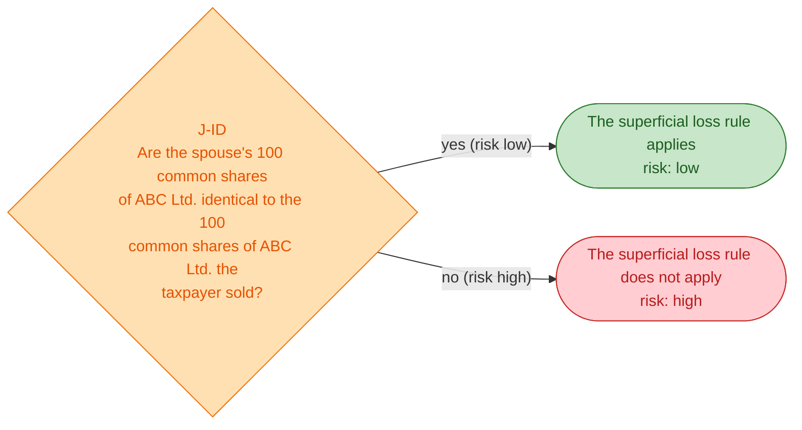
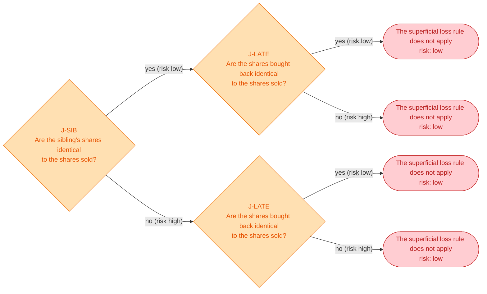
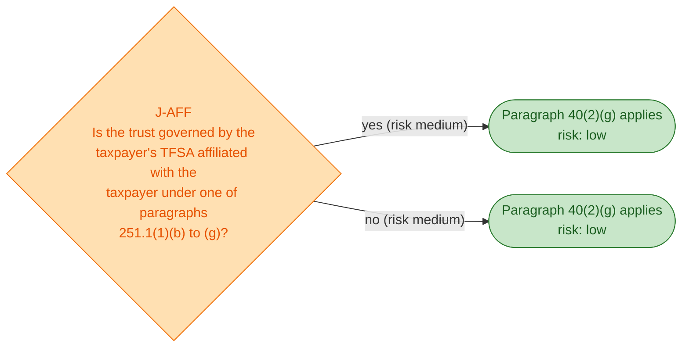
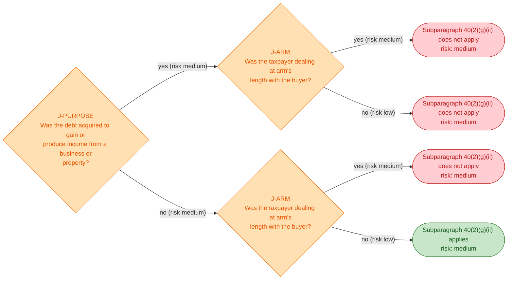
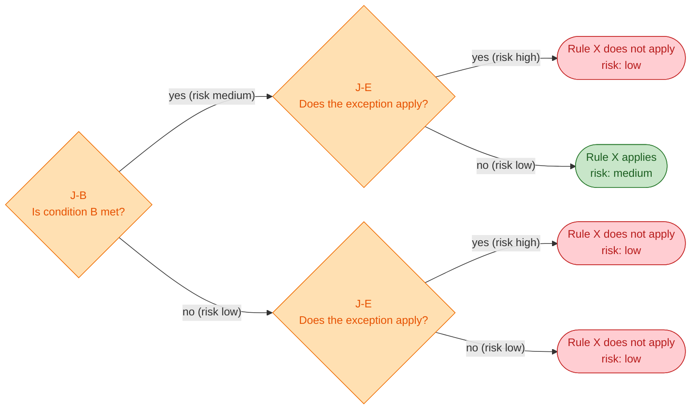

# Decision trees over the judgment calls

> Generated from the Lean sources by `scripts/blueprint.sh`. Do not edit by hand.

Every way of answering a rule's judgment calls, with the conclusion and its risk at each leaf. A tree whose leaves all agree is a judgment call that doesn't matter.

## Spouse repurchase: are the shares identical?

## Sibling and day-31 repurchase: two judgment calls, one answer

## TFSA contribution: paragraph 40(2)(g) on both answers to J-AFF

## A debt sold at a loss: income purpose and arm's length dealing both judged

## Rule X with condition B and the exception both left to judgment

