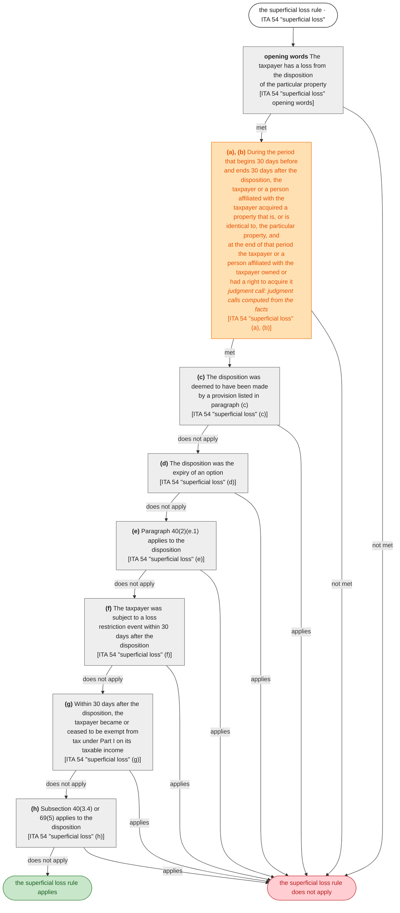
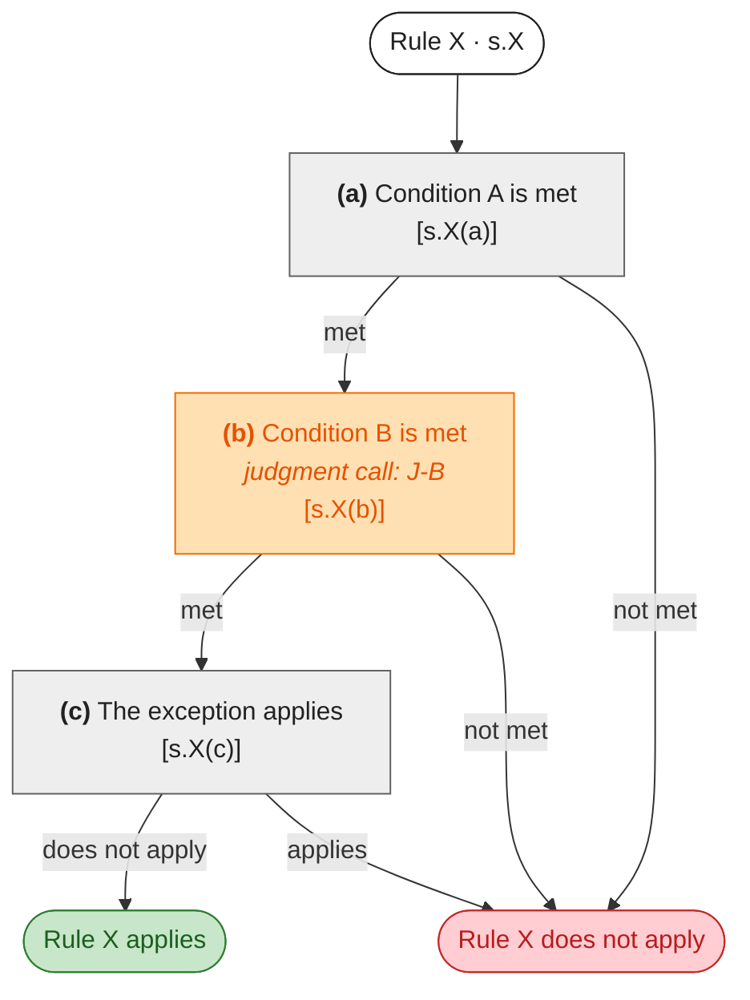

# Flowcharts of the rules

> Generated from the Lean sources by `scripts/blueprint.sh`. Do not edit by hand.

Each rule written with the `statute` command, drawn from its outline: every condition must be met, and no exception may apply. Grey clauses are facts, orange clauses rest on a judgment call, and blue clauses are other rules. The explanation Lean gives cites a failure on the facts before one that rests on judgment.

## Section 54, "superficial loss"

## Subparagraph 40(2)(g)(i)

## Paragraph 251.1(1)(a)

## Rule X (the placeholder from the design)

