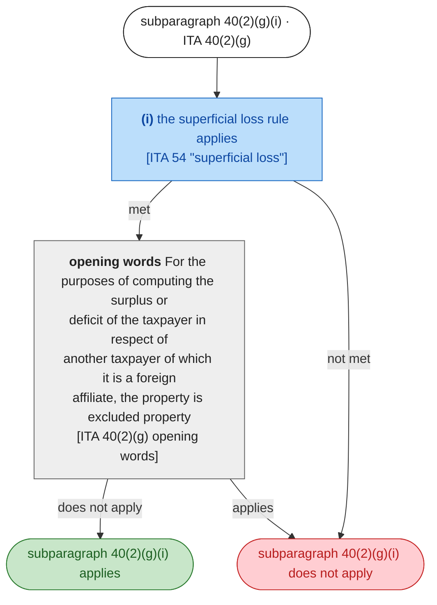
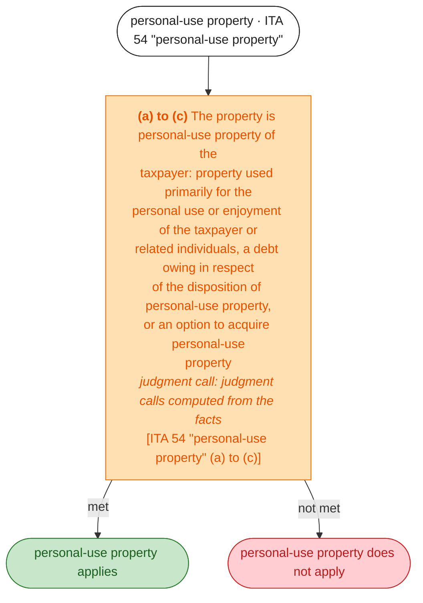
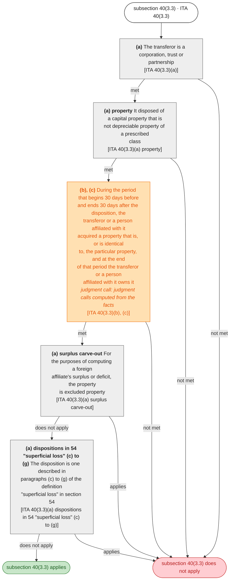
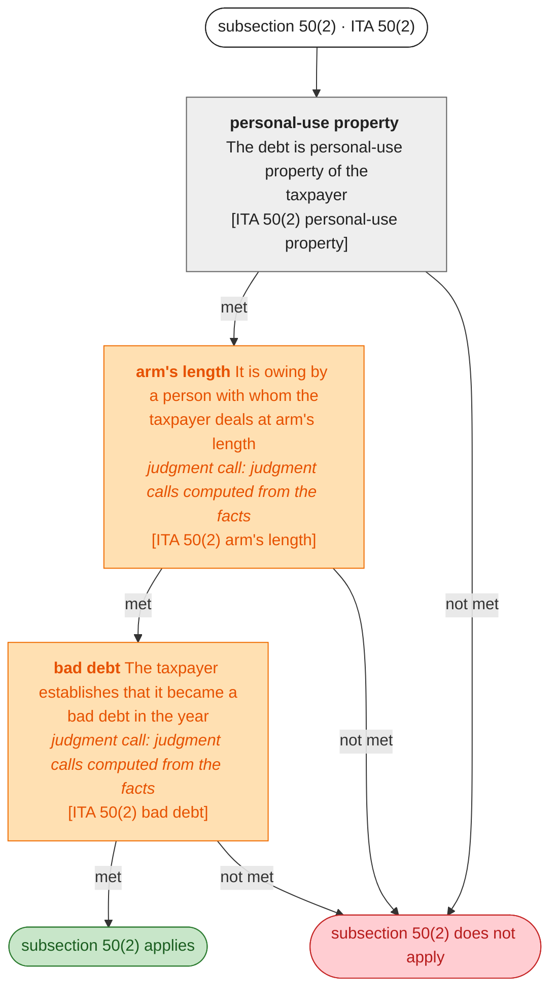
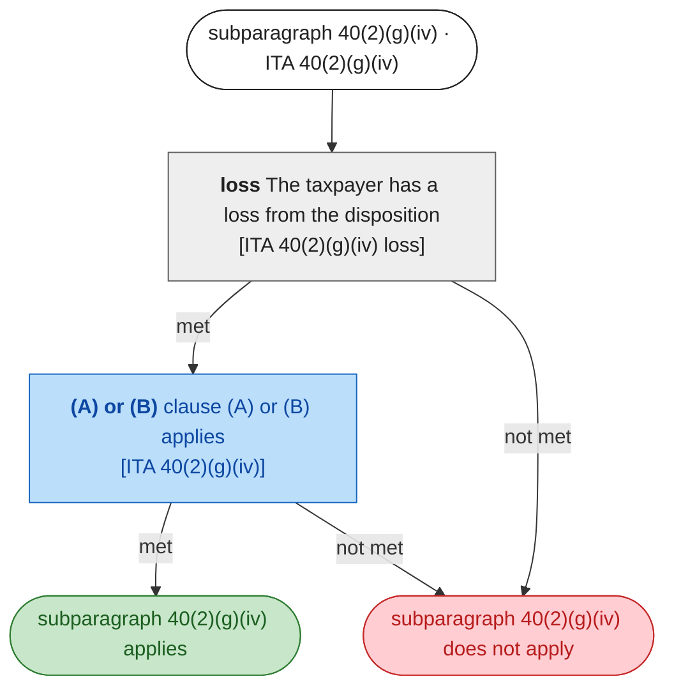
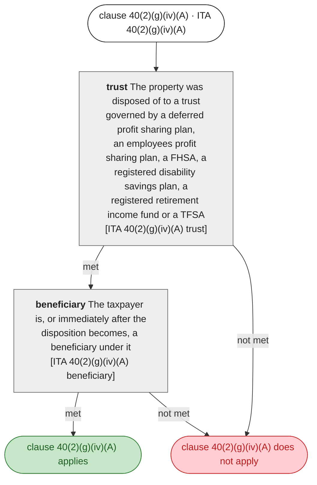
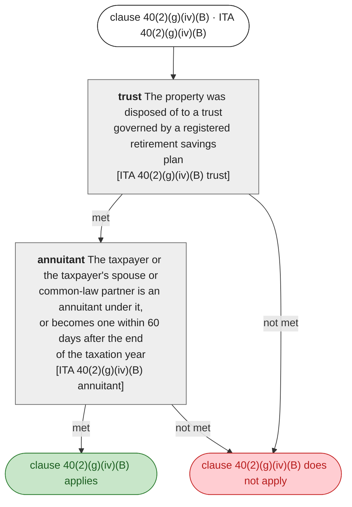
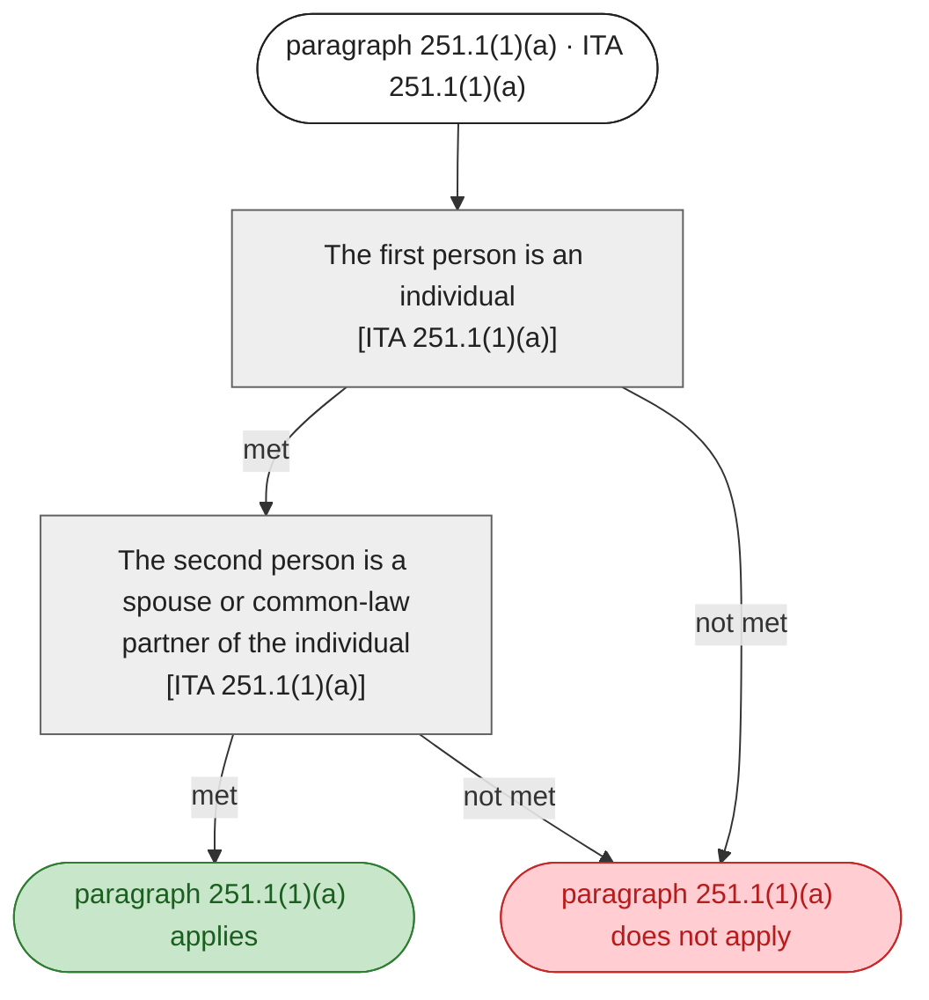

# Flowcharts of the rules

> Generated from the Lean sources by `scripts/blueprint.sh`. Do not edit by hand.

Each rule written with the `statute` command, drawn from its outline: every condition must be met, and no exception may apply. Grey clauses are facts, orange clauses rest on a judgment call, and blue clauses are other rules. The explanation Lean gives cites a failure on the facts before one that rests on judgment.

## Section 54, "superficial loss"

## Paragraph 40(2)(g) as a whole

## Subparagraph 40(2)(g)(i)

## Subparagraph 40(2)(g)(ii): debts

## Subparagraph 40(2)(g)(iii): personal-use property

## Section 54 "personal-use property"

## Subsection 40(3.3): suspended losses

## Subsection 50(2): a personal-use debt that goes bad

## Subparagraph 40(2)(g)(iv): transfers to registered plans

## Clause 40(2)(g)(iv)(A)

## Clause 40(2)(g)(iv)(B)

## Paragraph 251.1(1)(a)

## Rule X (the placeholder from the design)

