# Flowcharts of the rules

> Generated from the Lean sources by `scripts/blueprint.sh`. Do not edit by hand.

Each rule written with the `statute` command, drawn from its outline: every condition must be met, and no exception may apply. Grey clauses are facts, orange clauses rest on a judgment call, and blue clauses are other rules. The explanation Lean gives cites a failure on the facts before one that rests on judgment.

## Section 54, "superficial loss"


## Paragraph 40(2)(g) as a whole

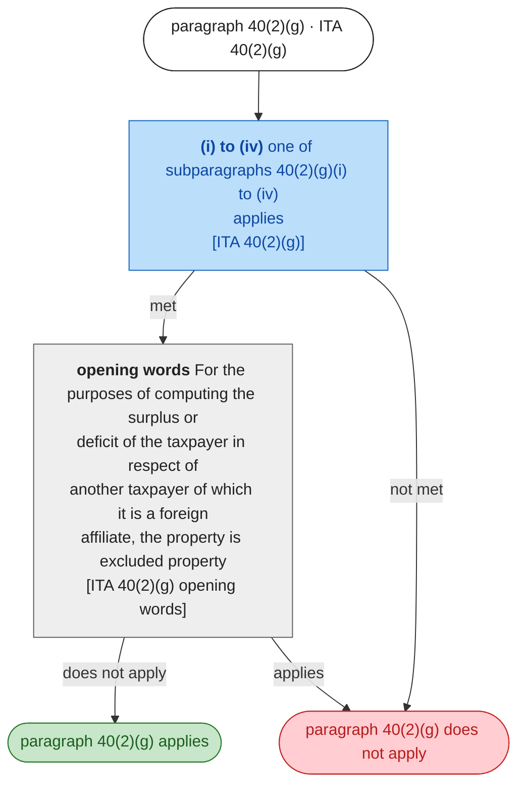

## Subparagraph 40(2)(g)(i)


## Subparagraph 40(2)(g)(ii): debts

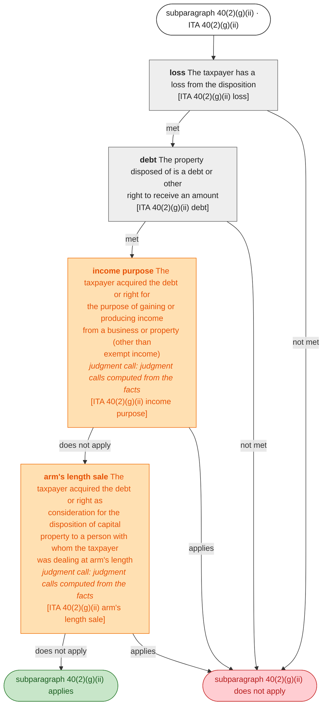

## Subparagraph 40(2)(g)(iii): personal-use property

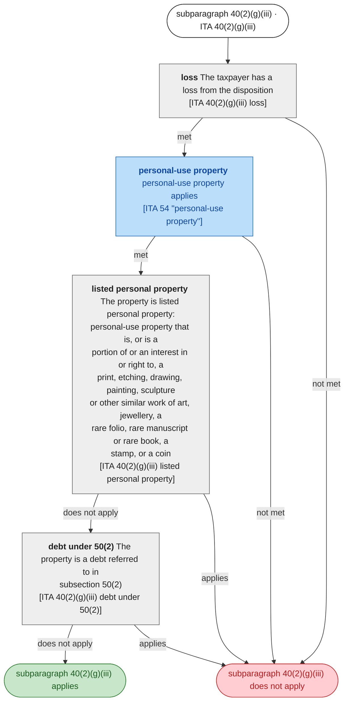

## Section 54 "personal-use property"


## Subsection 40(3.3): suspended losses


## Subsection 50(2): a personal-use debt that goes bad


## Subsection 40(3.6): a share disposed of to an affiliated corporation

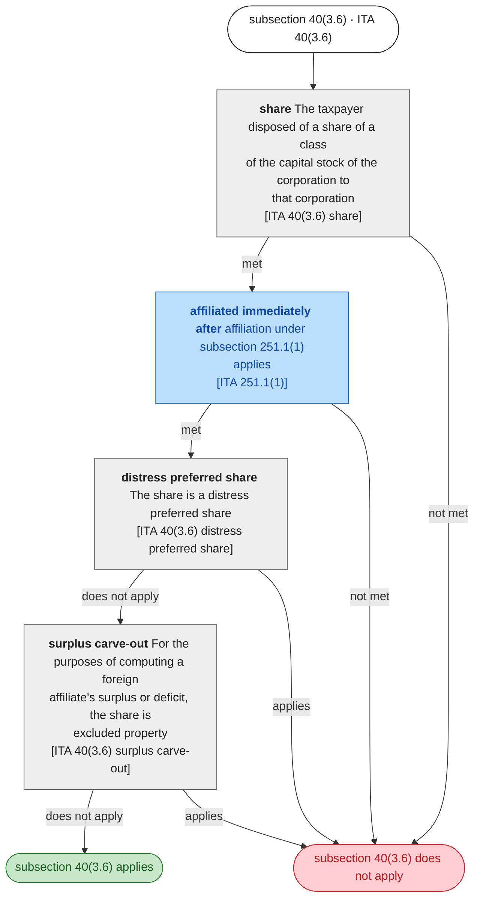

## Paragraph 40(2)(e.1): a debt within a related group

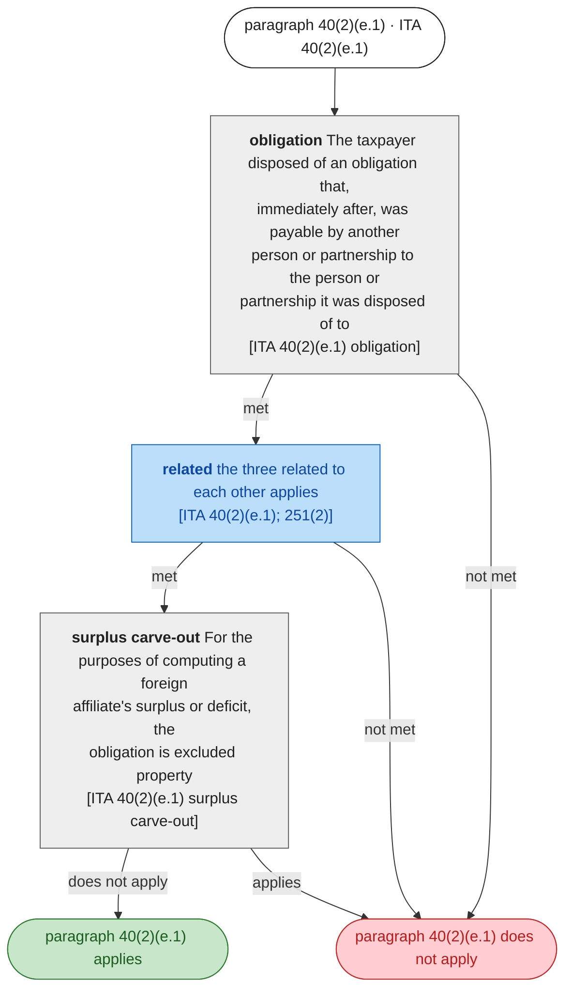

## Section 54 "principal residence", for an individual and a year

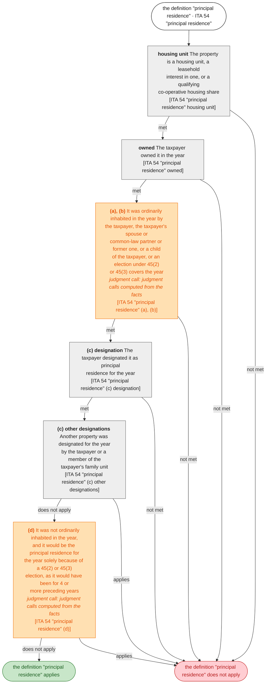

## Subsection 73(1): the spousal rollover

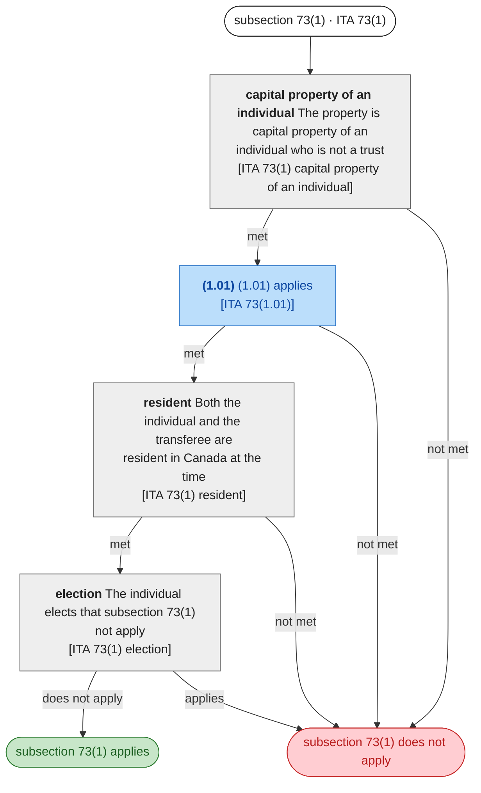

## Subsection 70(6): rollover on death

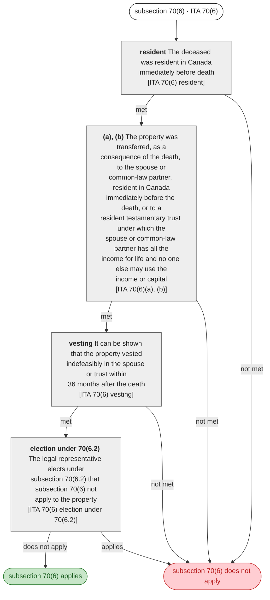

## Subsection 74.5(1): the fair market value exception to attribution

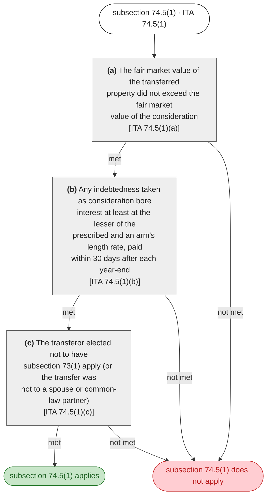

## Subsection 45(1): change in use, with the elections

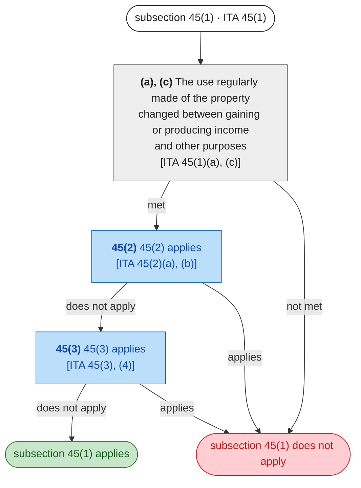

## Subsection 85(1): transfer of property to a corporation

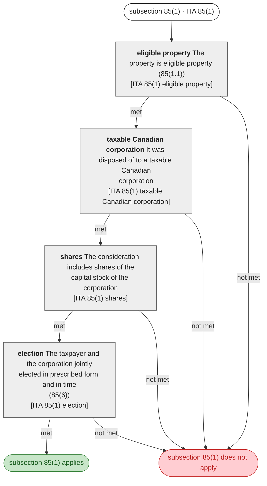

## Subsection 84.1(1): shares sold to a non-arm's length corporation

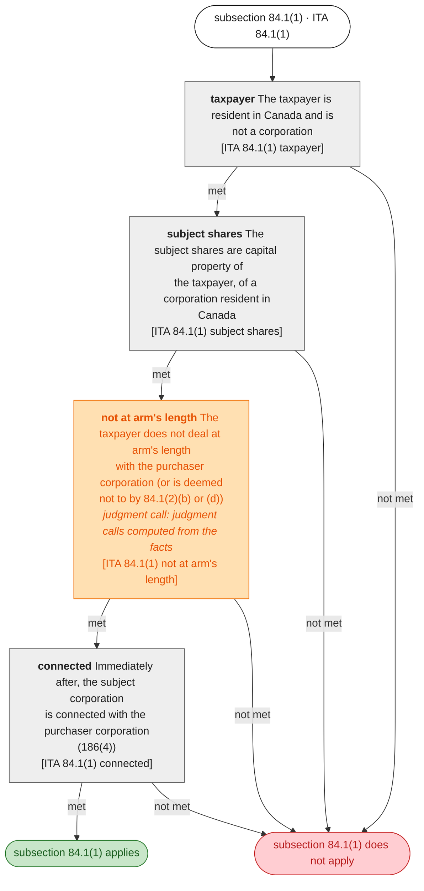

## Section 110.6 "qualified small business corporation share"

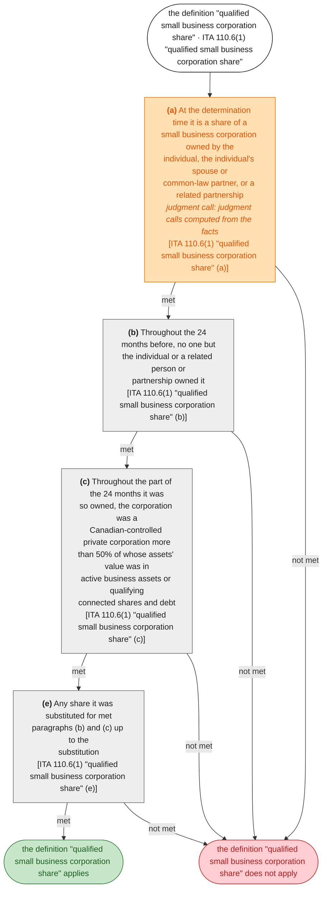

## Paragraph 251.2(2)(a), with 256(7)(a): loss restriction events

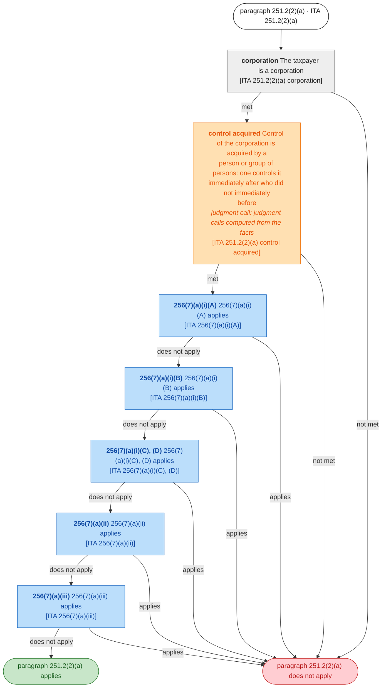

## Subsections 74.1(1) and (2): income attribution

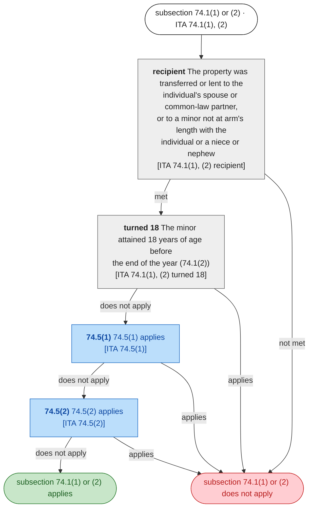

## Subsection 55(2): dividends over safe income

```mermaid
flowchart TD
  S(["subsection 55(2) · ITA 55(2)"]):::start
  C0["<b>(2.1) recipient</b> The dividend recipient is a corporation<br/>resident in Canada<br/>[ITA 55(2)(2.1) recipient]"]:::fact
  C1["<b>(2.1)(a)</b> (2.1)(a) applies<br/>[ITA 55(2.1)(a)]"]:::rule
  C2["<b>(2.1)(b)</b> (2.1)(b) applies<br/>[ITA 55(2.1)(b)]"]:::rule
  C3["<b>(2.1)(c), (5)(f)</b> (2.1)(c), (5)(f) applies<br/>[ITA 55(2.1)(c); 55(5)(f)]"]:::rule
  E0["<b>(3)(a)</b> (3)(a) applies<br/>[ITA 55(3)(a)]"]:::rule
  E1["<b>(3)(b)</b> (3)(b) applies<br/>[ITA 55(3)(b)]"]:::rule
  Y(["subsection 55(2) applies"]):::yes
  N(["subsection 55(2) does not apply"]):::no
  S --> C0
  C0 -->|met| C1
  C0 -->|not met| N
  C1 -->|met| C2
  C1 -->|not met| N
  C2 -->|met| C3
  C2 -->|not met| N
  C3 -->|met| E0
  C3 -->|not met| N
  E0 -->|does not apply| E1
  E0 -->|applies| N
  E1 -->|does not apply| Y
  E1 -->|applies| N
  classDef fact fill:#eeeeee,stroke:#616161,color:#212121
  classDef judgment fill:#ffe0b2,stroke:#ef6c00,color:#e65100
  classDef rule fill:#bbdefb,stroke:#1565c0,color:#0d47a1
  classDef yes fill:#c8e6c9,stroke:#2e7d32,color:#1b5e20
  classDef no fill:#ffcdd2,stroke:#c62828,color:#b71c1c
  classDef start fill:#ffffff,stroke:#212121,color:#212121
```

## Subsection 86(1): share exchanges

```mermaid
flowchart TD
  S(["subsection 86(1) · ITA 86(1)"]):::start
  C0["<b>reorganization</b> The shares were disposed of in the course of<br/>a reorganization of the capital of the<br/>corporation<br/>[ITA 86(1) reorganization]"]:::fact
  C1["<b>old shares</b> They were capital property, all the shares<br/>of their class the taxpayer owned<br/>[ITA 86(1) old shares]"]:::fact
  C2["<b>new shares</b> Property receivable for them includes other<br/>shares of the corporation<br/>[ITA 86(1) new shares]"]:::fact
  E0["<b>86(3)</b> 86(3) applies<br/>[ITA 86(3)]"]:::rule
  Y(["subsection 86(1) applies"]):::yes
  N(["subsection 86(1) does not apply"]):::no
  S --> C0
  C0 -->|met| C1
  C0 -->|not met| N
  C1 -->|met| C2
  C1 -->|not met| N
  C2 -->|met| E0
  C2 -->|not met| N
  E0 -->|does not apply| Y
  E0 -->|applies| N
  classDef fact fill:#eeeeee,stroke:#616161,color:#212121
  classDef judgment fill:#ffe0b2,stroke:#ef6c00,color:#e65100
  classDef rule fill:#bbdefb,stroke:#1565c0,color:#0d47a1
  classDef yes fill:#c8e6c9,stroke:#2e7d32,color:#1b5e20
  classDef no fill:#ffcdd2,stroke:#c62828,color:#b71c1c
  classDef start fill:#ffffff,stroke:#212121,color:#212121
```

## Subsection 44(1): replacement property

```mermaid
flowchart TD
  S(["subsection 44(1) · ITA 44(1)"]):::start
  C0["<b>former property</b> The former property is capital property (not<br/>a share) whose proceeds are compensation for<br/>its loss, destruction or expropriation, or a<br/>former business property<br/>[ITA 44(1) former property]"]:::fact
  C1["<b>(c), (d)</b> A replacement property was acquired in time<br/>(by the end of the second taxation year<br/>after the initial year for (a), the first<br/>for (b))<br/>[ITA 44(1)(c), (d)]"]:::fact
  C2["<b>election</b> The taxpayer elects under subsection 44(1)<br/>[ITA 44(1) election]"]:::fact
  Y(["subsection 44(1) applies"]):::yes
  N(["subsection 44(1) does not apply"]):::no
  S --> C0
  C0 -->|met| C1
  C0 -->|not met| N
  C1 -->|met| C2
  C1 -->|not met| N
  C2 -->|met| Y
  C2 -->|not met| N
  classDef fact fill:#eeeeee,stroke:#616161,color:#212121
  classDef judgment fill:#ffe0b2,stroke:#ef6c00,color:#e65100
  classDef rule fill:#bbdefb,stroke:#1565c0,color:#0d47a1
  classDef yes fill:#c8e6c9,stroke:#2e7d32,color:#1b5e20
  classDef no fill:#ffcdd2,stroke:#c62828,color:#b71c1c
  classDef start fill:#ffffff,stroke:#212121,color:#212121
```

## Subsection 186(4): connected corporations

```mermaid
flowchart TD
  S(["subsection 186(4) · ITA 186(4)"]):::start
  C0["<b>(a) or (b)</b> The payer is controlled by the particular<br/>corporation (de jure, or by 186(2) with<br/>persons not at arm's length with it), or the<br/>particular corporation owns more than 10% of<br/>its voting shares and more than 10% of the<br/>value of all its shares<br/>[ITA 186(4)(a) or (b)]"]:::fact
  Y(["subsection 186(4) applies"]):::yes
  N(["subsection 186(4) does not apply"]):::no
  S --> C0
  C0 -->|met| Y
  C0 -->|not met| N
  classDef fact fill:#eeeeee,stroke:#616161,color:#212121
  classDef judgment fill:#ffe0b2,stroke:#ef6c00,color:#e65100
  classDef rule fill:#bbdefb,stroke:#1565c0,color:#0d47a1
  classDef yes fill:#c8e6c9,stroke:#2e7d32,color:#1b5e20
  classDef no fill:#ffcdd2,stroke:#c62828,color:#b71c1c
  classDef start fill:#ffffff,stroke:#212121,color:#212121
```

## Subsection 88(1): winding up a subsidiary

```mermaid
flowchart TD
  S(["subsection 88(1) · ITA 88(1)"]):::start
  C0["<b>taxable Canadian corporations</b> The subsidiary and the parent are taxable<br/>Canadian corporations<br/>[ITA 88(1) taxable Canadian corporations]"]:::fact
  C1["<b>90%</b> The parent owned at least 90% of the issued<br/>shares of each class of the subsidiary<br/>immediately before the winding-up<br/>[ITA 88(1) 90%]"]:::fact
  C2["<b>minority</b> The other shares were owned by persons<br/>dealing at arm's length with the parent<br/>[ITA 88(1) minority]"]:::fact
  Y(["subsection 88(1) applies"]):::yes
  N(["subsection 88(1) does not apply"]):::no
  S --> C0
  C0 -->|met| C1
  C0 -->|not met| N
  C1 -->|met| C2
  C1 -->|not met| N
  C2 -->|met| Y
  C2 -->|not met| N
  classDef fact fill:#eeeeee,stroke:#616161,color:#212121
  classDef judgment fill:#ffe0b2,stroke:#ef6c00,color:#e65100
  classDef rule fill:#bbdefb,stroke:#1565c0,color:#0d47a1
  classDef yes fill:#c8e6c9,stroke:#2e7d32,color:#1b5e20
  classDef no fill:#ffcdd2,stroke:#c62828,color:#b71c1c
  classDef start fill:#ffffff,stroke:#212121,color:#212121
```

## Subsection 87(1): amalgamation

```mermaid
flowchart TD
  S(["subsection 87(1) · ITA 87(1)"]):::start
  C0["<b>predecessors</b> Each merging corporation was a taxable<br/>Canadian corporation immediately before the<br/>merger<br/>[ITA 87(1) predecessors]"]:::fact
  C1["<b>(a)</b> All of the predecessors' property (other<br/>than intercompany receivables and shares)<br/>becomes the new corporation's<br/>[ITA 87(1)(a)]"]:::fact
  C2["<b>(b)</b> All of their liabilities (other than<br/>intercompany payables) become the new<br/>corporation's<br/>[ITA 87(1)(b)]"]:::fact
  C3["<b>(c)</b> All of their shareholders (other than<br/>predecessors) receive shares of the new<br/>corporation<br/>[ITA 87(1)(c)]"]:::fact
  C4["<b>not a purchase or winding-up</b> The property is not acquired by a purchase<br/>or on a winding-up<br/>[ITA 87(1) not a purchase or winding-up]"]:::fact
  Y(["subsection 87(1) applies"]):::yes
  N(["subsection 87(1) does not apply"]):::no
  S --> C0
  C0 -->|met| C1
  C0 -->|not met| N
  C1 -->|met| C2
  C1 -->|not met| N
  C2 -->|met| C3
  C2 -->|not met| N
  C3 -->|met| C4
  C3 -->|not met| N
  C4 -->|met| Y
  C4 -->|not met| N
  classDef fact fill:#eeeeee,stroke:#616161,color:#212121
  classDef judgment fill:#ffe0b2,stroke:#ef6c00,color:#e65100
  classDef rule fill:#bbdefb,stroke:#1565c0,color:#0d47a1
  classDef yes fill:#c8e6c9,stroke:#2e7d32,color:#1b5e20
  classDef no fill:#ffcdd2,stroke:#c62828,color:#b71c1c
  classDef start fill:#ffffff,stroke:#212121,color:#212121
```

## Subsection 39(4): the Canadian securities election

```mermaid
flowchart TD
  S(["subsection 39(4) · ITA 39(4)"]):::start
  C0["<b>(6) Canadian security</b> The property is a Canadian security<br/>[ITA 39(4)(6) Canadian security]"]:::fact
  C1["<b>election</b> The taxpayer elected under subsection 39(4)<br/>for this or an earlier year<br/>[ITA 39(4) election]"]:::fact
  E0["<b>(5)</b> The taxpayer is a trader or dealer in<br/>securities, a financial institution, a<br/>money-lending corporation, or a non-resident<br/><i>judgment call: judgment calls computed from the facts</i><br/>[ITA 39(4)(5)]"]:::judgment
  Y(["subsection 39(4) applies"]):::yes
  N(["subsection 39(4) does not apply"]):::no
  S --> C0
  C0 -->|met| C1
  C0 -->|not met| N
  C1 -->|met| E0
  C1 -->|not met| N
  E0 -->|does not apply| Y
  E0 -->|applies| N
  classDef fact fill:#eeeeee,stroke:#616161,color:#212121
  classDef judgment fill:#ffe0b2,stroke:#ef6c00,color:#e65100
  classDef rule fill:#bbdefb,stroke:#1565c0,color:#0d47a1
  classDef yes fill:#c8e6c9,stroke:#2e7d32,color:#1b5e20
  classDef no fill:#ffcdd2,stroke:#c62828,color:#b71c1c
  classDef start fill:#ffffff,stroke:#212121,color:#212121
```

## Subsection 50(1): bad debts and worthless shares

```mermaid
flowchart TD
  S(["subsection 50(1) · ITA 50(1)"]):::start
  C0["<b>(a), (b)</b> The debt is established to have become bad<br/>in the year, or the corporation became<br/>bankrupt, was wound up insolvent, or is<br/>insolvent, dormant, its shares worthless and<br/>its dissolution expected<br/><i>judgment call: judgment calls computed from the facts</i><br/>[ITA 50(1)(a), (b)]"]:::judgment
  C1["<b>held</b> The taxpayer held it at the end of the year<br/>[ITA 50(1) held]"]:::fact
  C2["<b>not personal-use</b> It did not arise from a disposition of<br/>personal-use property<br/>[ITA 50(1) not personal-use]"]:::fact
  C3["<b>election</b> The taxpayer elects to have subsection 50(1)<br/>apply<br/>[ITA 50(1) election]"]:::fact
  Y(["subsection 50(1) applies"]):::yes
  N(["subsection 50(1) does not apply"]):::no
  S --> C0
  C0 -->|met| C1
  C0 -->|not met| N
  C1 -->|met| C2
  C1 -->|not met| N
  C2 -->|met| C3
  C2 -->|not met| N
  C3 -->|met| Y
  C3 -->|not met| N
  classDef fact fill:#eeeeee,stroke:#616161,color:#212121
  classDef judgment fill:#ffe0b2,stroke:#ef6c00,color:#e65100
  classDef rule fill:#bbdefb,stroke:#1565c0,color:#0d47a1
  classDef yes fill:#c8e6c9,stroke:#2e7d32,color:#1b5e20
  classDef no fill:#ffcdd2,stroke:#c62828,color:#b71c1c
  classDef start fill:#ffffff,stroke:#212121,color:#212121
```

## Subsection 74.4(2): corporate attribution

```mermaid
flowchart TD
  S(["subsection 74.4(2) · ITA 74.4(2)"]):::start
  C0["<b>main purpose</b> One of the main purposes of the transfer or<br/>loan may reasonably be considered to be to<br/>reduce the individual's income and benefit a<br/>designated person<br/><i>judgment call: judgment calls computed from the facts</i><br/>[ITA 74.4(2) main purpose]"]:::judgment
  C1["<b>(a)</b> A designated person (a spouse or common-law<br/>partner, or a minor child, niece or nephew)<br/>is a specified shareholder of the<br/>corporation<br/>[ITA 74.4(2)(a)]"]:::fact
  C2["<b>(b)</b> The individual was resident in Canada<br/>[ITA 74.4(2)(b)]"]:::fact
  E0["<b>(c)</b> The corporation was a small business<br/>corporation throughout the period<br/><i>judgment call: judgment calls computed from the facts</i><br/>[ITA 74.4(2)(c)]"]:::judgment
  Y(["subsection 74.4(2) applies"]):::yes
  N(["subsection 74.4(2) does not apply"]):::no
  S --> C0
  C0 -->|met| C1
  C0 -->|not met| N
  C1 -->|met| C2
  C1 -->|not met| N
  C2 -->|met| E0
  C2 -->|not met| N
  E0 -->|does not apply| Y
  E0 -->|applies| N
  classDef fact fill:#eeeeee,stroke:#616161,color:#212121
  classDef judgment fill:#ffe0b2,stroke:#ef6c00,color:#e65100
  classDef rule fill:#bbdefb,stroke:#1565c0,color:#0d47a1
  classDef yes fill:#c8e6c9,stroke:#2e7d32,color:#1b5e20
  classDef no fill:#ffcdd2,stroke:#c62828,color:#b71c1c
  classDef start fill:#ffffff,stroke:#212121,color:#212121
```

## Subsection 15(2): shareholder loans

```mermaid
flowchart TD
  S(["subsection 15(2) · ITA 15(2)"]):::start
  C0["<b>(a)–(c)</b> The borrower is a shareholder (or connected<br/>with one, or a partner or beneficiary of<br/>one), not a corporation resident in Canada<br/>[ITA 15(2)(a)–(c)]"]:::fact
  C1["<b>loan</b> It received a loan from the corporation, a<br/>related corporation or a partnership of<br/>either, not a pertinent loan<br/>[ITA 15(2) loan]"]:::fact
  E0["<b>15(2.6)</b> 15(2.6) applies<br/>[ITA 15(2.6)]"]:::rule
  Y(["subsection 15(2) applies"]):::yes
  N(["subsection 15(2) does not apply"]):::no
  S --> C0
  C0 -->|met| C1
  C0 -->|not met| N
  C1 -->|met| E0
  C1 -->|not met| N
  E0 -->|does not apply| Y
  E0 -->|applies| N
  classDef fact fill:#eeeeee,stroke:#616161,color:#212121
  classDef judgment fill:#ffe0b2,stroke:#ef6c00,color:#e65100
  classDef rule fill:#bbdefb,stroke:#1565c0,color:#0d47a1
  classDef yes fill:#c8e6c9,stroke:#2e7d32,color:#1b5e20
  classDef no fill:#ffcdd2,stroke:#c62828,color:#b71c1c
  classDef start fill:#ffffff,stroke:#212121,color:#212121
```

## Subparagraph 40(2)(g)(iv): transfers to registered plans

```mermaid
flowchart TD
  S(["subparagraph 40(2)(g)(iv) · ITA 40(2)(g)(iv)"]):::start
  C0["<b>loss</b> The taxpayer has a loss from the disposition<br/>[ITA 40(2)(g)(iv) loss]"]:::fact
  C1["<b>(A) or (B)</b> clause (A) or (B) applies<br/>[ITA 40(2)(g)(iv)]"]:::rule
  Y(["subparagraph 40(2)(g)(iv) applies"]):::yes
  N(["subparagraph 40(2)(g)(iv) does not apply"]):::no
  S --> C0
  C0 -->|met| C1
  C0 -->|not met| N
  C1 -->|met| Y
  C1 -->|not met| N
  classDef fact fill:#eeeeee,stroke:#616161,color:#212121
  classDef judgment fill:#ffe0b2,stroke:#ef6c00,color:#e65100
  classDef rule fill:#bbdefb,stroke:#1565c0,color:#0d47a1
  classDef yes fill:#c8e6c9,stroke:#2e7d32,color:#1b5e20
  classDef no fill:#ffcdd2,stroke:#c62828,color:#b71c1c
  classDef start fill:#ffffff,stroke:#212121,color:#212121
```

## Clause 40(2)(g)(iv)(A)

```mermaid
flowchart TD
  S(["clause 40(2)(g)(iv)(A) · ITA 40(2)(g)(iv)(A)"]):::start
  C0["<b>trust</b> The property was disposed of to a trust<br/>governed by a deferred profit sharing plan,<br/>an employees profit sharing plan, a FHSA, a<br/>registered disability savings plan, a<br/>registered retirement income fund or a TFSA<br/>[ITA 40(2)(g)(iv)(A) trust]"]:::fact
  C1["<b>beneficiary</b> The taxpayer is, or immediately after the<br/>disposition becomes, a beneficiary under it<br/>[ITA 40(2)(g)(iv)(A) beneficiary]"]:::fact
  Y(["clause 40(2)(g)(iv)(A) applies"]):::yes
  N(["clause 40(2)(g)(iv)(A) does not apply"]):::no
  S --> C0
  C0 -->|met| C1
  C0 -->|not met| N
  C1 -->|met| Y
  C1 -->|not met| N
  classDef fact fill:#eeeeee,stroke:#616161,color:#212121
  classDef judgment fill:#ffe0b2,stroke:#ef6c00,color:#e65100
  classDef rule fill:#bbdefb,stroke:#1565c0,color:#0d47a1
  classDef yes fill:#c8e6c9,stroke:#2e7d32,color:#1b5e20
  classDef no fill:#ffcdd2,stroke:#c62828,color:#b71c1c
  classDef start fill:#ffffff,stroke:#212121,color:#212121
```

## Clause 40(2)(g)(iv)(B)

```mermaid
flowchart TD
  S(["clause 40(2)(g)(iv)(B) · ITA 40(2)(g)(iv)(B)"]):::start
  C0["<b>trust</b> The property was disposed of to a trust<br/>governed by a registered retirement savings<br/>plan<br/>[ITA 40(2)(g)(iv)(B) trust]"]:::fact
  C1["<b>annuitant</b> The taxpayer or the taxpayer's spouse or<br/>common-law partner is an annuitant under it,<br/>or becomes one within 60 days after the end<br/>of the taxation year<br/>[ITA 40(2)(g)(iv)(B) annuitant]"]:::fact
  Y(["clause 40(2)(g)(iv)(B) applies"]):::yes
  N(["clause 40(2)(g)(iv)(B) does not apply"]):::no
  S --> C0
  C0 -->|met| C1
  C0 -->|not met| N
  C1 -->|met| Y
  C1 -->|not met| N
  classDef fact fill:#eeeeee,stroke:#616161,color:#212121
  classDef judgment fill:#ffe0b2,stroke:#ef6c00,color:#e65100
  classDef rule fill:#bbdefb,stroke:#1565c0,color:#0d47a1
  classDef yes fill:#c8e6c9,stroke:#2e7d32,color:#1b5e20
  classDef no fill:#ffcdd2,stroke:#c62828,color:#b71c1c
  classDef start fill:#ffffff,stroke:#212121,color:#212121
```

## Paragraph 251.1(1)(a)

```mermaid
flowchart TD
  S(["paragraph 251.1(1)(a) · ITA 251.1(1)(a)"]):::start
  C0["The first person is an individual<br/>[ITA 251.1(1)(a)]"]:::fact
  C1["The second person is a spouse or common-law<br/>partner of the individual<br/>[ITA 251.1(1)(a)]"]:::fact
  Y(["paragraph 251.1(1)(a) applies"]):::yes
  N(["paragraph 251.1(1)(a) does not apply"]):::no
  S --> C0
  C0 -->|met| C1
  C0 -->|not met| N
  C1 -->|met| Y
  C1 -->|not met| N
  classDef fact fill:#eeeeee,stroke:#616161,color:#212121
  classDef judgment fill:#ffe0b2,stroke:#ef6c00,color:#e65100
  classDef rule fill:#bbdefb,stroke:#1565c0,color:#0d47a1
  classDef yes fill:#c8e6c9,stroke:#2e7d32,color:#1b5e20
  classDef no fill:#ffcdd2,stroke:#c62828,color:#b71c1c
  classDef start fill:#ffffff,stroke:#212121,color:#212121
```

## Rule X (the placeholder from the design)

```mermaid
flowchart TD
  S(["Rule X · s.X"]):::start
  C0["<b>(a)</b> Condition A is met<br/>[s.X(a)]"]:::fact
  C1["<b>(b)</b> Condition B is met<br/><i>judgment call: J-B</i><br/>[s.X(b)]"]:::judgment
  E0["<b>(c)</b> The exception applies<br/>[s.X(c)]"]:::fact
  Y(["Rule X applies"]):::yes
  N(["Rule X does not apply"]):::no
  S --> C0
  C0 -->|met| C1
  C0 -->|not met| N
  C1 -->|met| E0
  C1 -->|not met| N
  E0 -->|does not apply| Y
  E0 -->|applies| N
  classDef fact fill:#eeeeee,stroke:#616161,color:#212121
  classDef judgment fill:#ffe0b2,stroke:#ef6c00,color:#e65100
  classDef rule fill:#bbdefb,stroke:#1565c0,color:#0d47a1
  classDef yes fill:#c8e6c9,stroke:#2e7d32,color:#1b5e20
  classDef no fill:#ffcdd2,stroke:#c62828,color:#b71c1c
  classDef start fill:#ffffff,stroke:#212121,color:#212121
```

