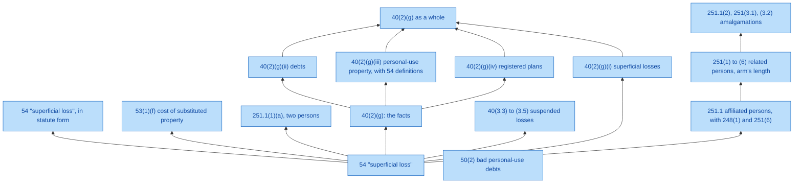

# Provision map

> Generated from the Lean sources by `scripts/blueprint.sh`. Do not edit by hand.

Every encoded provision, with an arrow from a provision to each one whose encoding builds on it, read from the compiled modules (arrows already implied by others are left out). For example, 40(3.3) to (3.5) builds on the superficial loss definition (its period and exceptions), and section 251 on section 251.1 (its world of persons and the 251(6) connections).

