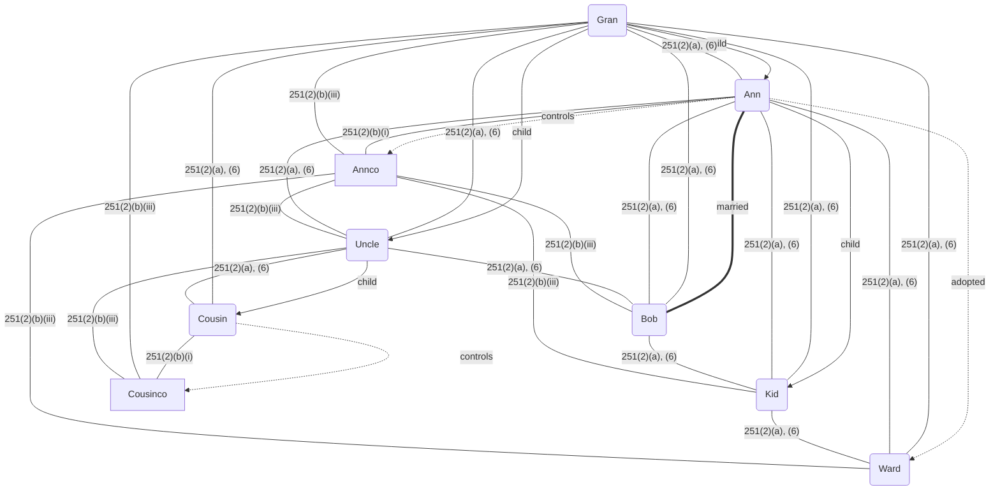

# Who is related to whom

> Generated from the Lean sources by `scripts/blueprint.sh`. Do not edit by hand.

A family under section 251: children by blood (solid arrows), an adoption in fact (dotted), a marriage (thick line) and control of two companies (dashed). Each thin line is a related pair, labelled with its paragraph. Cousins, and an uncle and his nephew, are not related: blood relationship covers only descendants and brothers and sisters (251(6)(a)). A step-parent is, through marriage (251(6)(b)). Cousinco is related to Uncle, through Cousin (251(2)(b)(iii)), but not to Annco.

## Three generations

