# A transaction series, step by step

> Generated from the Lean sources by `scripts/blueprint.sh`. Do not edit by hand.

The toy three-step plan from `Canteen/Examples/ToySeries.lean`, with Rule X checked after every step. Green states are ones where Rule X applies.

## If condition B is met (J-B = yes)

```mermaid
flowchart LR
  s0["<b>Start</b><br/>0 units, election not filed"]:::start
  s1["<b>After step 1</b><br/>60 units, election not filed<br/>Rule X: does not apply"]:::fact
  s0 -->|"Acquire 60 units"| s1
  s2["<b>After step 2</b><br/>110 units, election not filed<br/>Rule X: applies"]:::yes
  s1 -->|"Acquire 50 more units"| s2
  s3["<b>After step 3</b><br/>110 units, election filed<br/>Rule X: does not apply"]:::fact
  s2 -->|"File the election"| s3
  classDef fact fill:#eeeeee,stroke:#616161,color:#212121
  classDef judgment fill:#ffe0b2,stroke:#ef6c00,color:#e65100
  classDef rule fill:#bbdefb,stroke:#1565c0,color:#0d47a1
  classDef yes fill:#c8e6c9,stroke:#2e7d32,color:#1b5e20
  classDef no fill:#ffcdd2,stroke:#c62828,color:#b71c1c
  classDef start fill:#ffffff,stroke:#212121,color:#212121
```

## If condition B is not met (J-B = no)

```mermaid
flowchart LR
  s0["<b>Start</b><br/>0 units, election not filed"]:::start
  s1["<b>After step 1</b><br/>60 units, election not filed<br/>Rule X: does not apply"]:::fact
  s0 -->|"Acquire 60 units"| s1
  s2["<b>After step 2</b><br/>110 units, election not filed<br/>Rule X: does not apply"]:::fact
  s1 -->|"Acquire 50 more units"| s2
  s3["<b>After step 3</b><br/>110 units, election filed<br/>Rule X: does not apply"]:::fact
  s2 -->|"File the election"| s3
  classDef fact fill:#eeeeee,stroke:#616161,color:#212121
  classDef judgment fill:#ffe0b2,stroke:#ef6c00,color:#e65100
  classDef rule fill:#bbdefb,stroke:#1565c0,color:#0d47a1
  classDef yes fill:#c8e6c9,stroke:#2e7d32,color:#1b5e20
  classDef no fill:#ffcdd2,stroke:#c62828,color:#b71c1c
  classDef start fill:#ffffff,stroke:#212121,color:#212121
```

